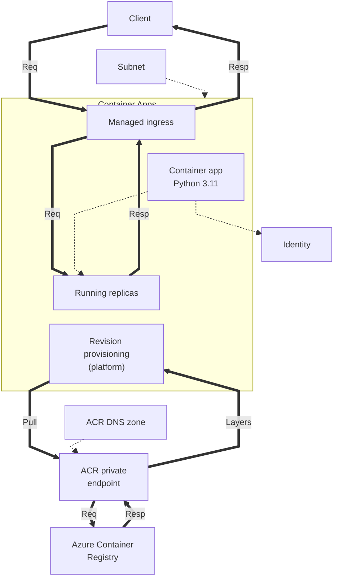
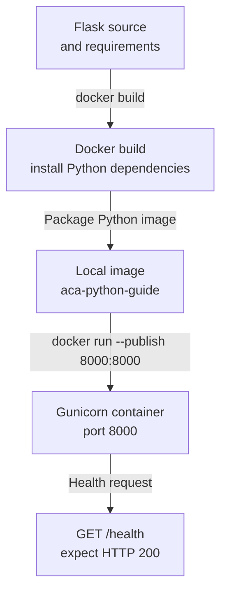

---
content_sources:
  diagrams:
    - id: this-tutorial-assumes-a-production-ready-container
      type: flowchart
      source: mslearn-adapted
      based_on:
        - https://learn.microsoft.com/en-us/azure/container-apps/networking
        - https://learn.microsoft.com/en-us/azure/container-apps/managed-identity-image-pull
        - https://learn.microsoft.com/en-us/azure/container-registry/container-registry-private-endpoints
    - id: local-development-workflow
      type: flowchart
      source: mslearn-adapted
      based_on:
        - https://learn.microsoft.com/en-us/azure/container-apps/quickstart-code-to-cloud
        - https://learn.microsoft.com/en-us/azure/container-apps/containers#configuration
validation:
  az_cli:
    last_tested:
    cli_version:
    result: not_tested
  bicep:
    last_tested:
    result: not_tested
---
# 01 - Run Locally with Docker

Before deploying to Azure Container Apps, validate your Python app in a container locally. This catches image, dependency, and port issues early.

!!! info "Infrastructure Context"
    **Service**: Container Apps (Consumption) | **Network**: VNet integrated | **VNet**: ✅

    This tutorial assumes a production-ready Container Apps deployment with a custom VNet, managed identity image pull, and a private endpoint for ACR.

    <!-- diagram-id: this-tutorial-assumes-a-production-ready-container -->


*Figure: The infrastructure subnet integrates with the environment, the identity is assigned to the container app, and platform revision provisioning exchanges image requests and layer responses with ACR through its private endpoint.*

## Local Development Workflow

<!-- diagram-id: local-development-workflow -->


*Figure: Build the Flask and Gunicorn application into a local image, run it with the Azure port contract, and verify `/health` before continuing.*

## Prerequisites

- Docker Engine or Docker Desktop
- Source code with a Dockerfile

!!! tip "Aim for local-cloud parity"
    Keep local container port mapping and environment variable names aligned with your Azure deployment settings. This reduces revision failures caused by mismatched runtime assumptions.

## Step-by-step

1. **Build the container image**

   ```bash
   cd app
   docker build --tag aca-python-guide .
   ```

   ???+ example "Expected output"
       ```text
       [1/6] FROM docker.io/library/python:3.11-slim
       [2/6] WORKDIR /app
       [3/6] COPY requirements.txt .
       [4/6] RUN pip install --no-cache-dir -r requirements.txt
       [5/6] COPY . .
       [6/6] CMD ["gunicorn", "--bind", "0.0.0.0:8000", "--workers", "4", "--chdir", "src", "app:app"]
       Successfully tagged aca-python-guide:latest
       ```

2. **Run the container locally**

   ```bash
   # Copy and customize the environment file
   cp .env.example .env

   docker run --publish 8000:8000 --env-file .env aca-python-guide
   ```

   ???+ example "Expected output"
       ```text
       [2026-04-04 11:30:54 +0000] [1] [INFO] Starting gunicorn 25.3.0
       [2026-04-04 11:30:54 +0000] [1] [INFO] Listening at: http://0.0.0.0:8000 (1)
       [2026-04-04 11:30:54 +0000] [8] [INFO] Booting worker with pid: 8
       ```

3. **Verify health endpoint**

   ```bash
   curl http://localhost:8000/health
   ```

   ???+ example "Expected output"
       ```json
       {"status":"healthy","timestamp":"2026-04-04T11:32:37.322216+00:00"}
       ```

   You can also verify runtime metadata:

   ```bash
   curl http://localhost:8000/info
   ```

   ???+ example "Expected output"
       ```json
       {"containerApp":"<your-app-name>","environment":"development","name":"azure-container-apps-practical-guide","python":"3.11.15","revision":"<your-app-name>--xxxxxxx","telemetryMode":"basic","version":"1.0.0"}
       ```

4. **Inspect application logs**

   ```bash
   docker logs <container-id>
   ```

   ???+ example "Expected output"
       ```text
       Starting application...
       PORT=8000
       [INFO] Starting gunicorn 25.3.0
       ```

   To find the container ID: `docker ps`

## Local parity checklist

- Application listens on port `8000` (or your configured container port)
- Required environment variables are present
- `/health` returns HTTP 200
- No startup exceptions in container logs

!!! warning "Do not commit local secret files"
    If you create a local `.env` file for testing, keep sensitive values out of source control and use placeholder values in shared examples.

## Advanced Topics

- Add local Redis or PostgreSQL via `docker network` and separate containers to mimic service dependencies.
- Use OpenTelemetry locally to validate logs and traces before cloud deployment.
- Add a Dapr sidecar for local service invocation testing.

## Review Matrix

| Review area | Page-specific check |
|---|---|
| Scope | Confirm the guidance applies to 01 - Run Locally with Docker. |
| Source basis | Validate the recommendation against the Microsoft Learn sources in this page. |
| Evidence | Capture command output, portal state, metrics, logs, or screenshots before treating the result as proven. |

## See Also
- [02 - First Deploy to Azure Container Apps](02-first-deploy.md)
- [03 - Configuration, Secrets, and Dapr](03-configuration.md)
- [Dapr Integration Recipe](../recipes/dapr-integration.md)

## Sources
- [Azure Container Apps networking](https://learn.microsoft.com/en-us/azure/container-apps/networking)
- [Managed identity image pull](https://learn.microsoft.com/en-us/azure/container-apps/managed-identity-image-pull)
- [Private endpoints for Azure Container Registry](https://learn.microsoft.com/en-us/azure/container-registry/container-registry-private-endpoints)
- [Quickstart: Code to Cloud (Microsoft Learn)](https://learn.microsoft.com/en-us/azure/container-apps/quickstart-code-to-cloud)
- [Dockerfile requirements for Azure Container Apps (Microsoft Learn)](https://learn.microsoft.com/en-us/azure/container-apps/containers#configuration)
