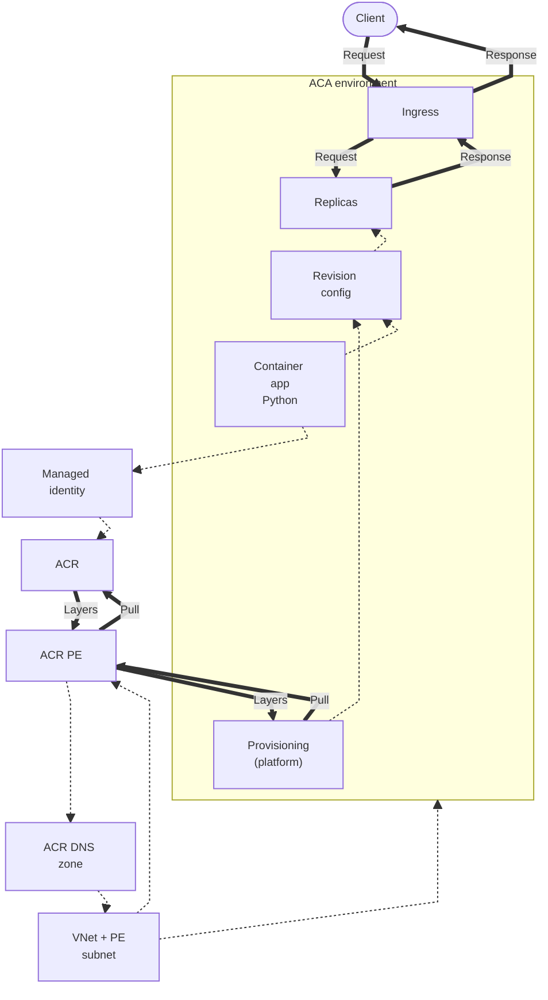
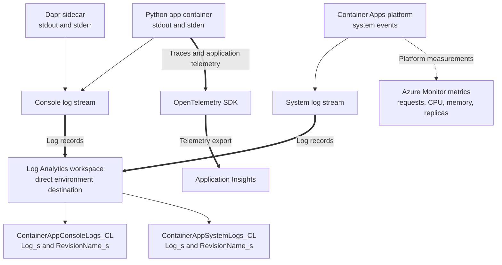
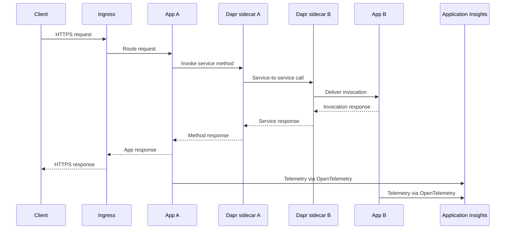

---
content_sources:
  diagrams:
    - id: this-tutorial-assumes-a-production-ready-container
      type: flowchart
      source: mslearn-adapted
      based_on:
        - https://learn.microsoft.com/en-us/azure/container-apps/networking
        - https://learn.microsoft.com/en-us/azure/container-apps/managed-identity-image-pull
        - https://learn.microsoft.com/en-us/azure/container-registry/container-registry-private-link
    - id: how-observability-works-in-container-apps
      type: flowchart
      source: mslearn-adapted
      based_on:
        - https://learn.microsoft.com/en-us/azure/container-apps/log-options
        - https://learn.microsoft.com/en-us/azure/container-apps/log-monitoring
        - https://learn.microsoft.com/en-us/azure/container-apps/observability
    - id: distributed-tracing-with-dapr
      type: sequence
      source: mslearn-adapted
      based_on:
        - https://learn.microsoft.com/en-us/azure/container-apps/dapr-overview
        - https://learn.microsoft.com/en-us/azure/container-apps/opentelemetry-agents
validation:
  az_cli:
    last_tested:
    cli_version:
    result: not_tested
  bicep:
    last_tested:
    result: not_tested
---
# 04 - Logging, Monitoring, and Observability

This tutorial step shows how to inspect console logs, query Log Analytics, and add OpenTelemetry-based observability for production operations.

!!! info "Infrastructure Context"
    **Service**: Container Apps (Consumption) | **Network**: VNet integrated | **VNet**: ✅

    This tutorial assumes a production-ready Container Apps deployment with a custom VNet and private ACR access using managed identity.

    <!-- diagram-id: this-tutorial-assumes-a-production-ready-container -->


*Figure: Client traffic crosses managed ingress to the replicas. The customer VNet and private-endpoint subnet host the ACR private endpoint and link its DNS zone. Managed identity is assigned to the app and authorizes registry pulls through a role assignment; platform provisioning remains the image-pull actor, and both pull requests and layer responses pass through the private endpoint.*

## How Observability Works in Container Apps

<!-- diagram-id: how-observability-works-in-container-apps -->


*Figure: This tutorial uses the direct Log Analytics custom-table destination, so KQL queries target the `*_CL` custom tables and `_s` columns. An environment configured with the Azure Monitor destination instead requires diagnostic settings; resource-specific native tables require `--export-to-resource-specific true`.*

## Distributed Tracing with Dapr

<!-- diagram-id: distributed-tracing-with-dapr -->


*Figure: Dapr service invocation carries the call and response between the two apps, while application telemetry is exported separately to Application Insights.*

## Prerequisites

- Completed [03 - Configuration, Secrets, and Dapr](03-configuration.md)
- Log Analytics connected to your Container Apps environment

## Step-by-step

1. **Set standard variables (reuse Bicep outputs from Step 02)**

    ```bash
    RG="rg-myapp"
    BASE_NAME="myapp"
    DEPLOYMENT_NAME="main"

   APP_NAME=$(az deployment group show \
     --name "$DEPLOYMENT_NAME" \
     --resource-group "$RG" \
     --query "properties.outputs.containerAppName.value" \
     --output tsv)

   ACA_ENV_NAME=$(az deployment group show \
     --name "$DEPLOYMENT_NAME" \
     --resource-group "$RG" \
     --query "properties.outputs.containerAppEnvName.value" \
     --output tsv)

    ACR_NAME=$(az deployment group show \
      --name "$DEPLOYMENT_NAME" \
      --resource-group "$RG" \
      --query "properties.outputs.containerRegistryName.value" \
      --output tsv)
    ```

    | Command | Purpose |
    |---|---|
    | `APP_NAME=$(az deployment group show --name "$DEPLOYMENT_NAME" --resource-group "$RG" --query "properties.outputs.containerAppName.value" --output tsv)` | Captures the deployed Python app name from the Bicep outputs so the logging commands query the correct app. |
    | `ACA_ENV_NAME=$(az deployment group show --name "$DEPLOYMENT_NAME" --resource-group "$RG" --query "properties.outputs.containerAppEnvName.value" --output tsv)` | Captures the environment name so workspace and system-log lookups stay tied to the same deployment. |
    | `ACR_NAME=$(az deployment group show --name "$DEPLOYMENT_NAME" --resource-group "$RG" --query "properties.outputs.containerRegistryName.value" --output tsv)` | Captures the registry name used by the deployed tutorial image, which is often useful context when debugging startup or logging issues. |

   ???+ example "Expected output"
       ```text
       APP_NAME=<your-app-name>
       ACA_ENV_NAME=<your-env-name>
       ACR_NAME=<acr-name>
       ```

2. **Stream console logs**

   ```bash
   az containerapp logs show \
     --name "$APP_NAME" \
     --resource-group "$RG" \
     --follow
   ```

   | Command | Why it is used |
   |---|---|
   | `az containerapp logs show ...` | Runs the Azure CLI operation required by the documented step. |

   ???+ example "Expected output"
       ```json
       {"TimeStamp":"2024-01-15T10:30:01","Log":"Connecting to the container 'app'..."}
       {"TimeStamp":"2024-01-15T10:30:01","Log":"Successfully Connected to container: 'app' [Revision: '<your-app-name>--xxxxxxx', Replica: '<your-app-name>--xxxxxxx-<replica-id>']"}
       {"TimeStamp":"2024-01-15T10:30:00+00:00","Log":"[2024-01-15 10:30:00 +0000] [1] [INFO] Starting gunicorn 21.2.0"}
       {"TimeStamp":"2024-01-15T10:30:00+00:00","Log":"[2024-01-15 10:30:00 +0000] [1] [INFO] Listening at: http://0.0.0.0:8000 (1)"}
       {"TimeStamp":"2024-01-15T10:30:00+00:00","Log":"[2024-01-15 10:30:00 +0000] [7] [INFO] Booting worker with pid: 7"}
       {"TimeStamp":"2024-01-15T10:30:00+00:00","Log":"[2024-01-15 10:30:00 +0000] [8] [INFO] Booting worker with pid: 8"}
       ```

   !!! note
       Use Ctrl+C to stop following logs.

3. **Check system logs for startup or image issues**

   ```bash
   az containerapp logs show \
     --name "$APP_NAME" \
     --resource-group "$RG" \
     --type system
   ```

   | Command | Why it is used |
   |---|---|
   | `az containerapp logs show ...` | Runs the Azure CLI operation required by the documented step. |

   ???+ example "Expected output"
       ```json
       {"TimeStamp":"2024-01-15T10:30:00Z","Type":"Normal","ContainerAppName":"<your-app-name>","RevisionName":"<your-app-name>--xxxxxxx","ReplicaName":null,"Msg":"Successfully connected to events server","Reason":"ConnectedToEventsServer","EventSource":"ContainerAppController","Count":1}
       ```

4. **Query Log Analytics via CLI**

   First, get the Log Analytics workspace ID:

   ```bash
   WORKSPACE_ID=$(az containerapp env show \
     --name "$ACA_ENV_NAME" \
     --resource-group "$RG" \
     --query "properties.appLogsConfiguration.logAnalyticsConfiguration.customerId" \
     --output tsv)
   ```

    | Command | Purpose |
    |---|---|
    | `WORKSPACE_ID=$(az containerapp env show --name "$ACA_ENV_NAME" --resource-group "$RG" --query "properties.appLogsConfiguration.logAnalyticsConfiguration.customerId" --output tsv)` | Extracts the Log Analytics workspace customer ID from the environment configuration so the next KQL queries run against the workspace actually receiving app logs. |

   Run a KQL query to fetch recent console logs:

   ```bash
   az monitor log-analytics query \
     --workspace "$WORKSPACE_ID" \
     --analytics-query "ContainerAppConsoleLogs_CL | where ContainerAppName_s == '$APP_NAME' | project TimeGenerated, ContainerAppName_s, Log_s | take 5" \
     --output table
   ```

   | Command | Why it is used |
   |---|---|
   | `az monitor log-analytics ...` | Creates or inspects Azure Monitor alerts, diagnostic settings, or metrics. |

   ???+ example "Expected output"
       ```text
       TableName      TimeGenerated                    ContainerAppName_s           Log_s
       -------------  -------------------------------  ---------------------------  ------------------------------------------------
       PrimaryResult  2026-04-04T17:15:00.000Z         <your-app-name>              [2026-04-04 17:15:00 +0000] [1] [INFO] Starting gunicorn
       PrimaryResult  2026-04-04T17:15:01.000Z         <your-app-name>              [2026-04-04 17:15:01 +0000] [1] [INFO] Listening at: http://0.0.0.0:8000
       ```

5. **Query for errors via CLI**

   ```bash
   az monitor log-analytics query \
     --workspace "$WORKSPACE_ID" \
     --analytics-query "ContainerAppConsoleLogs_CL | where ContainerAppName_s == '$APP_NAME' | where Log_s has_any ('error', 'exception', 'traceback') | project TimeGenerated, Log_s | take 10" \
     --output table
   ```

   | Command | Why it is used |
   |---|---|
   | `az monitor log-analytics ...` | Creates or inspects Azure Monitor alerts, diagnostic settings, or metrics. |

   ???+ example "Expected output"
       ```text
       TableName      TimeGenerated                    Log_s
       -------------  -------------------------------  ------------------------------------------------
       PrimaryResult  2026-04-04T11:35:12.000Z         [ERROR] Connection refused: redis://localhost:6379
       PrimaryResult  2026-04-04T11:34:58.000Z         Traceback (most recent call last): ...
       ```

       !!! tip
           If no errors exist, the query returns an empty result set — which is the healthy baseline.

   !!! note "KQL table names depend on the configured destination"
       This tutorial uses the environment's direct Log Analytics destination, which writes console and system records to `ContainerAppConsoleLogs_CL` and `ContainerAppSystemLogs_CL` with fields such as `Log_s` and `RevisionName_s`. If the environment instead uses the Azure Monitor destination, configure diagnostic settings; native resource-specific tables require `--export-to-resource-specific true`. Do not switch table names without first confirming the environment's logging destination and diagnostic-setting mode.

6. **Add OpenTelemetry for traces and metrics**

   ```bash
   pip install azure-monitor-opentelemetry
   ```

   ```python
   from azure.monitor.opentelemetry import configure_azure_monitor

   configure_azure_monitor(
       connection_string="InstrumentationKey=<instrumentation-key>;IngestionEndpoint=https://<region>.in.applicationinsights.azure.com/"
   )
   ```

7. **Correlate scaling behavior with telemetry**

   - Watch request bursts and KEDA scale-out events.
   - Verify reduced replica count during idle periods.
   - Compare latency before and after scale events.

### Verify log stream in Azure Portal


**[Observed]** `ca-sample-d38538`. `Container App`. `Log stream`. `Refresh`. `Send us your feedback`. `Historical`. `Real-time`. `Category`. `System`. `Application`. `Based on revision`. `ca-sample-d38538--v2`. `Not seeing your revision?`. `Click here to find and activate an existing revision.`. `Replica`. `ca-sample-d38538--v2-64dd6cf5b6-2wdpl`. `Container`. `ca-sample-d38538`. `Reconnect`. `Stop`. `Copy`. `Clear`. `Maximize`. `Connecting to stream...`. `2026-06-04T11:20:16.43591`. `Connecting to the container 'ca-sample-d38538'...`. `2026-06-04T11:20:16.46996`. `Successfully Connected to container: 'ca-sample-d38538' [Revision: 'ca-sample-d38538--v2', Replica: 'ca-sample-d38538--v2-64dd6cf5b6-2wdpl']`. `2026-06-03T14:40:20.9561158Z stderr F 2026/06/03 14:40:20 Listening on :80...`. `Application`. `Revisions and replicas`. `Containers`. `Scale`. `Volumes`. `Settings`. `Networking`. `Ingress`. `Custom domains`. `CORS`. `Security`. `Monitoring`. `Log stream`. `Logs`. `Console`. `Alerts`. `Metrics`.

**[Inferred]** The `Real-time` radio appears to map to the live tail behavior triggered by `az containerapp logs show --follow` in [Step-by-step](#step-by-step) Step 2. The `Category` toggle value `Application` appears consistent with the default console-log stream from [Step-by-step](#step-by-step) Step 2, and the `System` option appears consistent with the `--type system` selector exercised in [Step-by-step](#step-by-step) Step 3. The `Based on revision` selector value `ca-sample-d38538--v2` appears consistent with the `Revision:` identifier embedded inside the Step 2 expected log output line in [Step-by-step](#step-by-step) Step 2. The `Replica` selector value `ca-sample-d38538--v2-64dd6cf5b6-2wdpl` appears consistent with the `Replica:` identifier embedded inside the same Step 2 expected log output line.

**[Not Proven]** Additional log query output, trace export detail, and scaling telemetry detail are not visible on this view.

## Observability practices

- Emit structured JSON logs with correlation IDs.
- Capture dependency traces for outbound HTTP and database calls.
- Monitor revision-specific failures during rollout windows.

## Advanced Topics

- Deploy an OpenTelemetry Collector sidecar to route telemetry to multiple backends.
- Add custom business metrics (for example, `orders_total`, `queue_depth`).
- Use Dapr tracing to follow service-to-service calls across apps.

## See Also
- [03 - Configuration, Secrets, and Dapr](03-configuration.md)
- [06 - CI/CD with GitHub Actions](06-ci-cd.md)
- [Dapr Integration Recipe](../recipes/dapr-integration.md)

## Sources
- [Container Apps networking (Microsoft Learn)](https://learn.microsoft.com/en-us/azure/container-apps/networking)
- [Managed identity image pull (Microsoft Learn)](https://learn.microsoft.com/en-us/azure/container-apps/managed-identity-image-pull)
- [Azure Container Registry private link (Microsoft Learn)](https://learn.microsoft.com/en-us/azure/container-registry/container-registry-private-link)
- [Log storage and monitoring options (Microsoft Learn)](https://learn.microsoft.com/en-us/azure/container-apps/log-options)
- [Log monitoring (Microsoft Learn)](https://learn.microsoft.com/en-us/azure/container-apps/log-monitoring)
- [Observability in Azure Container Apps (Microsoft Learn)](https://learn.microsoft.com/en-us/azure/container-apps/observability)
- [Dapr integration in Azure Container Apps (Microsoft Learn)](https://learn.microsoft.com/en-us/azure/container-apps/dapr-overview)
- [OpenTelemetry agents in Azure Container Apps (Microsoft Learn)](https://learn.microsoft.com/en-us/azure/container-apps/opentelemetry-agents)
