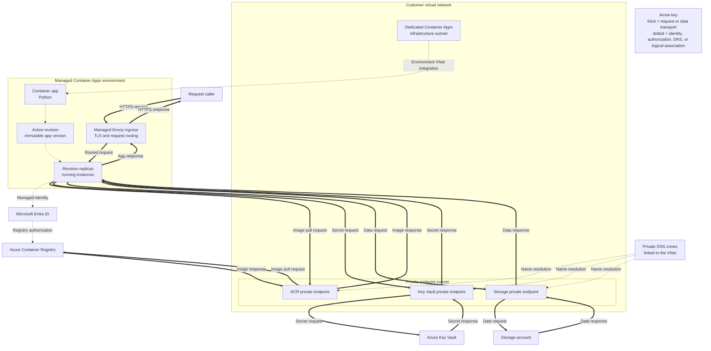
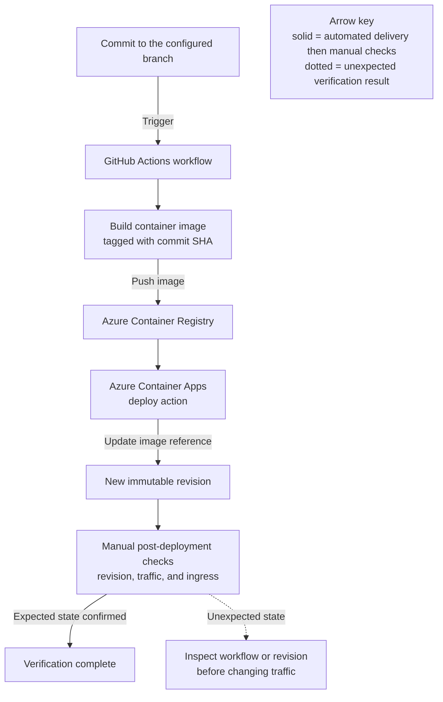

---
content_sources:
  diagrams:
    - id: this-tutorial-assumes-a-production-ready-container
      type: flowchart
      source: mslearn-adapted
      based_on:
        - https://learn.microsoft.com/en-us/azure/container-apps/networking
        - https://learn.microsoft.com/en-us/azure/container-apps/managed-identity-image-pull
        - https://learn.microsoft.com/en-us/azure/container-apps/private-endpoints-with-dns
    - id: ci-cd-pipeline-flow
      type: flowchart
      source: mslearn-adapted
      based_on:
        - https://learn.microsoft.com/en-us/azure/container-apps/github-actions
        - https://learn.microsoft.com/en-us/azure/developer/github/connect-from-azure
        - https://learn.microsoft.com/en-us/azure/container-apps/revisions
        - https://learn.microsoft.com/en-us/azure/container-apps/health-probes
validation:
  az_cli:
    last_tested:
    cli_version:
    result: not_tested
  bicep:
    last_tested:
    result: not_tested
---
# 06 - CI/CD with GitHub Actions

Automate build and deployment so every commit can produce a new Container App revision. This tutorial uses GitHub Actions, ACR, and Azure Container Apps deploy actions.

!!! info "Infrastructure Context"
    **Service**: Container Apps (Consumption) | **Network**: VNet integrated | **VNet**: ✅

    This tutorial assumes a production-ready Container Apps deployment with a custom VNet, ACR with managed identity pull, and private endpoints for backend services.

    <!-- diagram-id: this-tutorial-assumes-a-production-ready-container -->


*Figure: The tutorial's shared production context. The Container Apps environment is a managed logical boundary integrated with a dedicated subnet; ACR, Key Vault, Storage, private DNS zones, and Microsoft Entra ID remain separate Azure resources.*

## CI/CD Pipeline Flow

<!-- diagram-id: ci-cd-pipeline-flow -->


*Figure: The shown workflow automates image build, push, and deployment without a test gate. After deployment, an operator uses the CLI checks in Step 4 to confirm revision health, traffic, and ingress; add pre-deployment tests before treating the workflow as test-gated.*

## Prerequisites

- Completed [05 - Infrastructure as Code with Bicep](05-infrastructure-as-code.md)
- GitHub repository with Actions enabled
- Azure service principal stored as GitHub secret

!!! warning "Never expose credentials in workflow logs"
    Keep all credential material in GitHub Secrets and avoid printing secret-derived values in shell steps. Use masked placeholders in documentation and workflow examples.

## Step-by-step

1. **Configure repository variables and secrets**

   - Variables: `RESOURCE_GROUP`, `APP_NAME`, `ACR_NAME`
   - Secrets: `AZURE_CREDENTIALS`, `REGISTRY_USERNAME`, `REGISTRY_PASSWORD`

   Example `AZURE_CREDENTIALS` JSON (masked):

   ```json
   {
     "clientId": "xxxxxxxx-xxxx-xxxx-xxxx-xxxxxxxxxxxx",
     "clientSecret": "<client-secret>",
     "subscriptionId": "<subscription-id>",
     "tenantId": "<tenant-id>"
   }
   ```

2. **Create workflow file**

   ```yaml
   name: Deploy to Azure Container Apps

   on:
     push:
       branches: [ main ]

   jobs:
     build-and-deploy:
       runs-on: ubuntu-latest
       steps:
         - name: Checkout
           uses: actions/checkout@v4

         - name: Azure Login
           uses: azure/login@v2
           with:
             creds: ${{ secrets.AZURE_CREDENTIALS }}

         - name: ACR Login
           uses: azure/docker-login@v2
           with:
             login-server: ${{ vars.ACR_NAME }}.azurecr.io
             username: ${{ secrets.REGISTRY_USERNAME }}
             password: ${{ secrets.REGISTRY_PASSWORD }}

         - name: Build and push image
           run: |
             docker build --tag ${{ vars.ACR_NAME }}.azurecr.io/${{ vars.APP_NAME }}:${{ github.sha }} .
             docker push ${{ vars.ACR_NAME }}.azurecr.io/${{ vars.APP_NAME }}:${{ github.sha }}

         - name: Deploy Container App
           uses: azure/container-apps-deploy-action@v1
           with:
             imageToDeploy: ${{ vars.ACR_NAME }}.azurecr.io/${{ vars.APP_NAME }}:${{ github.sha }}
             resourceGroup: ${{ vars.RESOURCE_GROUP }}
             containerAppName: ${{ vars.APP_NAME }}
   ```

3. **Add infrastructure deployment (optional but recommended)**

   ```yaml
         - name: Deploy Infrastructure
           uses: azure/arm-deploy@v2
           with:
             resourceGroupName: ${{ vars.RESOURCE_GROUP }}
             template: ./infra/main.bicep
             parameters: appName=${{ vars.APP_NAME }} acrName=${{ vars.ACR_NAME }}
   ```

4. **Validate rollout behavior**

    - Trigger workflow from a commit to `main`.
    - Confirm a new revision was created.
    - Confirm traffic moved to healthy revision.

    ```bash
    RESOURCE_GROUP="<resource-group-name>"
    APP_NAME="<container-app-name>"
    az containerapp revision list \
      --name "$APP_NAME" \
      --resource-group "$RESOURCE_GROUP" \
      --query "[].{name:name,active:properties.active,trafficWeight:properties.trafficWeight,replicas:properties.replicas,healthState:properties.healthState,runningState:properties.runningState}"
    ```

    | Command/Parameter | Purpose |
    |---|---|
| `az containerapp revision list` | Lists Python revisions to verify the workflow produced a running rollout. |
| `--name` | Queries the app in the local `APP_NAME` shell variable; set it to the same value as the workflow repository variable. |
| `--resource-group` | Searches the group in the local `RESOURCE_GROUP` shell variable; set it to the same value as the workflow repository variable. |
| `--query` | Projects each revision's name, active state, traffic, replica count, health, and running state. |

    ???+ example "Expected output"
        ```json
        [
          {
            "name": "<your-app-name>--xxxxxxx",
            "active": true,
            "trafficWeight": 100,
            "replicas": 1,
            "healthState": "Healthy",
            "runningState": "Running"
          }
        ]
        ```

    ```bash
    az containerapp ingress show \
      --name "$APP_NAME" \
      --resource-group "$RESOURCE_GROUP"
    ```

    | Command/Parameter | Purpose |
    |---|---|
| `az containerapp ingress show` | Reads the Python app's ingress record before testing the deployed endpoint. |
| `--name` | Selects the workflow-managed app whose endpoint must be confirmed. |
| `--resource-group` | Locates that app using the same `RESOURCE_GROUP` value configured for the workflow. |

    ???+ example "Expected output"
        ```json
        {
          "allowInsecure": false,
          "external": true,
          "fqdn": "<your-app-name>.<hash>.<region>.azurecontainerapps.io",
          "targetPort": 8000,
          "transport": "Auto",
          "traffic": [
            { "latestRevision": true, "weight": 100 }
          ]
        }
        ```

### Verify in Azure Portal


**[Observed]** `ca-sample-d38538`. `Container App`. `Activity log`. `Activity`. `Edit columns`. `Refresh`. `Export Activity Logs`. `Download as CSV`. `Insights`. `Feedback`. `Pin current filters`. `Reset filters`. `Looking for Log Analytics?`. `Visit Log Analytics`. `Search`. `Quick Insights`. `Management Group`. `None`. `Subscription`. `Visual Studio Enterprise Subscription`. `All`. `Timespan`. `Last 6 hours`. `Resource group`. `rg-aca-basics-d38538`. `Resource`. `ca-sample-d38538`. `Add Filter`. `1 item.`. `Operation name`. `Status`. `Time`. `Time stamp`. `Subscription`. `Event initiated by`. `Auth Token for Container App Dev APIs`. `Succeeded`. `23 minutes ...`. `Thu Jun 04 ...`. `user@example.com`. `Overview`. `Activity log`. `Access control (IAM)`. `Tags`. `Diagnose and solve problems`. `Resource visualizer`. `Application`. `Revisions and replicas`. `Containers`. `Scale`. `Volumes`. `Settings`. `Networking`. `Ingress`. `Custom domains`. `CORS`. `Security`. `Monitoring`. `Log stream`. `Logs`. `Console`. `Alerts`. `Metrics`. `Dashboards with Grafana`. `Advisor recommendations`.

**[Inferred]** The resource-scoped filter chips `Resource group` and `Resource` appear to map to the same `${{ vars.RESOURCE_GROUP }}` and `${{ vars.APP_NAME }}` values passed to `resourceGroup` and `containerAppName` in [Step-by-step](#step-by-step) Step 2. The `Activity log` blade appears consistent with the same container app remaining the deployment target when [Step-by-step](#step-by-step) Step 3 runs `azure/arm-deploy@v2` with `resourceGroupName: ${{ vars.RESOURCE_GROUP }}` and `template: ./infra/main.bicep`. The single `Succeeded` status appears consistent with the healthy rollout checks in [Step-by-step](#step-by-step) Step 4, where `az containerapp revision list` is expected to show `healthState: "Healthy"` and `runningState: "Running"`. The recent `Time` and `Time stamp` columns appear to map to the post-commit verification window described in [Step-by-step](#step-by-step) Step 4, which tells you to trigger the workflow from a commit to `main`, confirm a new revision was created, and confirm traffic moved to the healthy revision.

**[Not Proven]** Additional GitHub Actions workflow detail, deployment template detail, and CLI command output are not visible on this view.

## Advanced Topics

- Add pre-deploy tests and security scanning gates.
- Implement staged deployment with manual approval.
- Use multiple active revisions for canary rollout in pipeline.

!!! tip "Use immutable image tags in pipelines"
    Prefer commit SHA or release-based tags for image versions. Immutable tags make revision-to-commit tracing straightforward during incident response.

## See Also
- [07 - Revisions and Traffic Splitting](07-revisions-traffic.md)
- [05 - Infrastructure as Code with Bicep](05-infrastructure-as-code.md)
- [Managed Identity Recipe](../../../platform/identity-and-secrets/managed-identity.md)

## Sources
- [Networking in an Azure Container Apps environment (Microsoft Learn)](https://learn.microsoft.com/en-us/azure/container-apps/networking)
- [Azure Container Apps image pull from ACR with managed identity (Microsoft Learn)](https://learn.microsoft.com/en-us/azure/container-apps/managed-identity-image-pull)
- [Private endpoints and DNS for Container Apps environments (Microsoft Learn)](https://learn.microsoft.com/en-us/azure/container-apps/private-endpoints-with-dns)
- [GitHub Actions (Microsoft Learn)](https://learn.microsoft.com/en-us/azure/container-apps/github-actions)
- [Connect GitHub Actions to Azure (Microsoft Learn)](https://learn.microsoft.com/en-us/azure/developer/github/connect-from-azure)
- [Revisions in Azure Container Apps (Microsoft Learn)](https://learn.microsoft.com/en-us/azure/container-apps/revisions)
- [Health probes in Azure Container Apps (Microsoft Learn)](https://learn.microsoft.com/en-us/azure/container-apps/health-probes)
