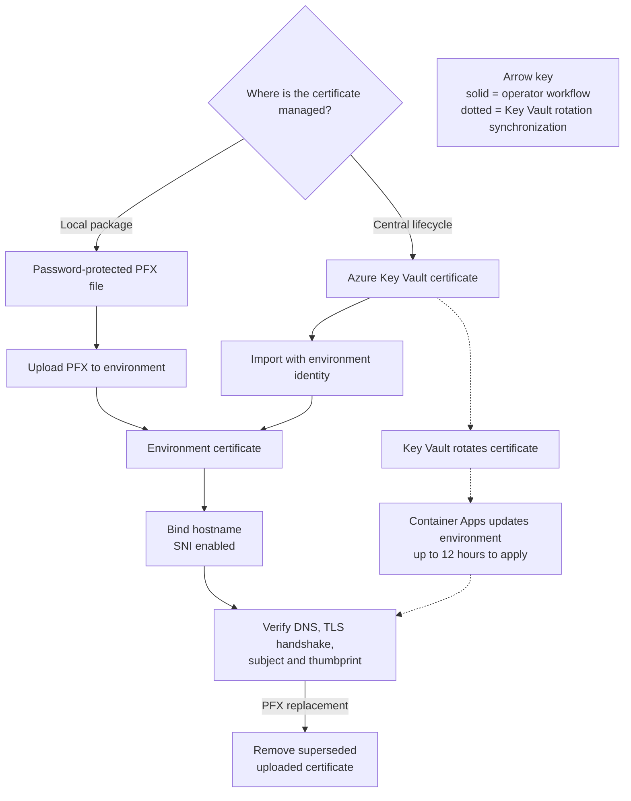

---
content_sources:
  diagrams:
    - id: byo-certificate-rotation-flow
      type: flowchart
      source: self-generated
      justification: Certificate-source and rotation decision flow synthesized from the documented PFX upload, Key Vault import, environment certificate, custom-domain binding, and Key Vault rotation behavior.
      based_on:
        - https://learn.microsoft.com/en-us/azure/container-apps/custom-domains-certificates
        - https://learn.microsoft.com/en-us/azure/container-apps/key-vault-certificates-manage
        - https://learn.microsoft.com/en-us/azure/container-apps/certificates-overview
content_validation:
  status: verified
  last_reviewed: 2026-11-07
  reviewer: agent
  core_claims:
    - claim: Azure Container Apps supports uploading an SNI .pfx certificate to the Container Apps environment and binding it to an individual app hostname.
      source: https://learn.microsoft.com/en-us/azure/container-apps/custom-domains-certificates
      verified: true
    - claim: Azure Container Apps can import a certificate from Key Vault by using an environment-level managed identity with access to the vault.
      source: https://learn.microsoft.com/en-us/azure/container-apps/key-vault-certificates-manage
      verified: true
    - claim: When a Key Vault certificate is rotated, Container Apps automatically updates the environment certificate, and applying the new certificate can take up to 12 hours.
      source: https://learn.microsoft.com/en-us/azure/container-apps/key-vault-certificates-manage
      verified: true
---
# Bring Your Own Certificates

Use your own certificate when managed certificates do not fit your hostname, CA, or organizational certificate process.

## Prerequisites

- An SNI certificate, supplied as a password-protected `.pfx` file or stored in Azure Key Vault
- For PFX upload, the certificate password stored securely
- For Key Vault import, an environment-level managed identity with the documented vault permission
- Permission to upload certificates to the managed environment

```bash
export RG="rg-aca-prod"
export APP_NAME="app-python-api-prod"
export ACA_ENV_NAME="aca-env-prod"
export HOSTNAME="api.contoso.com"
export CERTIFICATE_FILE="./certs/api-contoso-com.pfx"
export CERTIFICATE_NAME="api-contoso-com"
export VALIDATION_METHOD="CNAME"
read -r -s -p "Certificate password: " CERTIFICATE_PASSWORD
printf '\n'
```

## When to Use

- When you must use your own public or private CA
- When managed certificates do not support the hostname pattern
- When certificate lifecycle is owned by a separate security process

## Procedure

Upload the certificate to the environment:

```bash
az containerapp env certificate upload \
  --name "$ACA_ENV_NAME" \
  --resource-group "$RG" \
  --certificate-file "$CERTIFICATE_FILE" \
  --password "$CERTIFICATE_PASSWORD" \
  --certificate-name "$CERTIFICATE_NAME"
unset CERTIFICATE_PASSWORD
```

| Command | Why it is used |
|---|---|
| `az containerapp env certificate upload` | Uploads a PFX certificate to the Container Apps environment. |
| `--name` | Identifies the Container Apps environment. |
| `--resource-group` | Identifies the resource group that contains the environment. |
| `--certificate-file` | Supplies the local PFX file. |
| `--password` | Supplies the PFX password captured without echoing it to the terminal. |
| `--certificate-name` | Sets the lowercase certificate name used by the hostname binding. |

Bind the uploaded certificate to the hostname:

```bash
az containerapp hostname bind \
  --name "$APP_NAME" \
  --resource-group "$RG" \
  --hostname "$HOSTNAME" \
  --environment "$ACA_ENV_NAME" \
  --certificate "$CERTIFICATE_NAME" \
  --validation-method "$VALIDATION_METHOD"
```

| Command | Why it is used |
|---|---|
| `az containerapp hostname bind` | Binds the hostname and SNI certificate to the container app. |
| `--name` | Identifies the container app. |
| `--resource-group` | Identifies the resource group that contains the app. |
| `--hostname` | Selects the custom hostname to secure. |
| `--environment` | Identifies the Container Apps environment that holds the certificate. |
| `--certificate` | Selects the uploaded environment certificate by name. |
| `--validation-method` | Uses `CNAME` for a subdomain or `HTTP` for an apex domain. |

The example uses a subdomain, so `$VALIDATION_METHOD` is `CNAME`. Set it to `HTTP` when `$HOSTNAME` is an apex domain, after creating the documented A and TXT records.

For a Key Vault source, import the certificate from the environment's **Certificates** pane after granting the environment identity the documented Key Vault access. Container Apps keeps the imported environment certificate synchronized when that Key Vault certificate rotates; the updated certificate can take up to 12 hours to apply.

Rotation pattern:

1. Upload the replacement certificate.
2. Re-bind the hostname to the replacement certificate.
3. Verify HTTPS on the hostname.
4. Remove the old certificate after successful cutover.

<!-- diagram-id: byo-certificate-rotation-flow -->


*Figure: Both documented sources produce a certificate on the Container Apps environment before the certificate is bound to an individual app hostname. The dotted branch is lifecycle synchronization, not TLS request transport.*

## Verification

- Confirm the environment lists the uploaded certificate.
- Confirm the hostname binding points to the intended certificate.
- Confirm the served certificate matches the new subject or thumbprint.

## Rollback / Troubleshooting

- If upload fails, verify file format and password.
- If binding fails, confirm the certificate exists in the same environment.
- If the new certificate breaks traffic, re-bind the previous certificate first.

## See Also

- [Custom Domains and TLS](index.md)
- [Managed Certificates](managed-certificates.md)
- [Secret Rotation](../secret-rotation/index.md)

## Sources

- [Custom domains and certificates in Azure Container Apps](https://learn.microsoft.com/en-us/azure/container-apps/custom-domains-certificates)
- [Import certificates from Azure Key Vault to Azure Container Apps](https://learn.microsoft.com/en-us/azure/container-apps/key-vault-certificates-manage)
- [Certificates in Azure Container Apps](https://learn.microsoft.com/en-us/azure/container-apps/certificates-overview)
