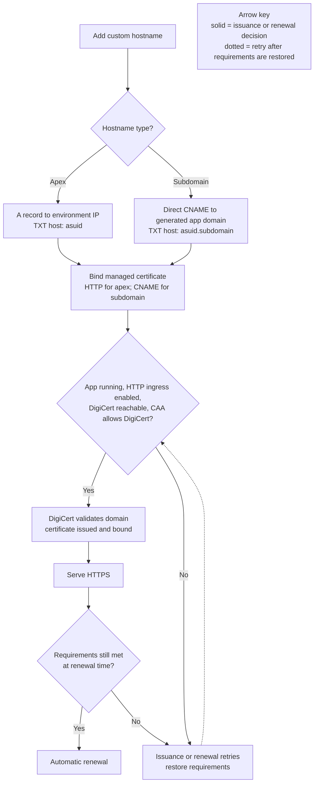

---
content_sources:
  diagrams:
    - id: managed-certificate-lifecycle
      type: flowchart
      source: self-generated
      justification: Managed-certificate issuance and renewal decision flow synthesized from the documented apex and subdomain DNS requirements, validation methods, DigiCert reachability, and app-running requirements.
      based_on:
        - https://learn.microsoft.com/en-us/azure/container-apps/custom-domains-managed-certificates
content_validation:
  status: verified
  last_reviewed: 2026-11-07
  reviewer: agent
  core_claims:
    - claim: Managed certificate issuance and renewal require HTTP ingress, public reachability from DigiCert validation IP addresses, and a running container app.
      source: https://learn.microsoft.com/en-us/azure/container-apps/custom-domains-managed-certificates
      verified: true
    - claim: An apex domain requires an A record to the environment IP and HTTP validation, while a subdomain requires a direct CNAME to the generated app domain and CNAME validation.
      source: https://learn.microsoft.com/en-us/azure/container-apps/custom-domains-managed-certificates
      verified: true
    - claim: Managed certificates renew automatically while the app continues to meet all managed-certificate requirements.
      source: https://learn.microsoft.com/en-us/azure/container-apps/custom-domains-managed-certificates
      verified: true
---
# Managed Certificates

Managed certificates reduce certificate-handling work when the target hostname fits the current Azure Container Apps managed-certificate support rules.

## Prerequisites

- External ingress enabled
- DNS access for validation records
- A hostname that matches the currently documented managed-certificate rules
- Public reachability from DigiCert domain-validation IP addresses and a running app during issuance and renewal

```bash
export RG="rg-aca-prod"
export APP_NAME="app-python-api-prod"
export HOSTNAME="api.contoso.com"
```

## When to Use

- When you want Azure to handle certificate issuance and renewal operations
- When the domain type is supported by the current managed-certificate feature set
- When you want a simpler public TLS runbook

## Procedure

Add the hostname:

```bash
az containerapp hostname add \
  --name "$APP_NAME" \
  --resource-group "$RG" \
  --hostname "$HOSTNAME"
```

| Command | Why it is used |
|---|---|
| `az containerapp hostname add` | Adds the custom hostname to the container app. |
| `--name` | Identifies the container app. |
| `--resource-group` | Identifies the resource group that contains the app. |
| `--hostname` | Supplies the apex domain or subdomain to add. |

Bind the managed certificate:

```bash
az containerapp hostname bind \
  --name "$APP_NAME" \
  --resource-group "$RG" \
  --hostname "$HOSTNAME" \
  --environment "$ACA_ENV_NAME" \
  --validation-method CNAME
```

| Command | Why it is used |
|---|---|
| `az containerapp hostname bind` | Requests a managed certificate and binds it to the hostname. |
| `--name` | Identifies the container app. |
| `--resource-group` | Identifies the resource group that contains the app. |
| `--hostname` | Selects the hostname to secure. |
| `--environment` | Identifies the Container Apps environment. |
| `--validation-method` | Uses `CNAME` for a subdomain; use `HTTP` for an apex domain. |

Validate the result:

```bash
curl --head "https://$HOSTNAME"
openssl s_client -connect "$HOSTNAME:443" -servername "$HOSTNAME"
```

For an apex domain, create an A record to the environment IP, create the `asuid` TXT ownership record, and replace `CNAME` above with `HTTP`. For a subdomain, create a CNAME that maps **directly** to the generated app domain, create the `asuid.<subdomain>` TXT record, and use `CNAME` validation. An intermediate CNAME, a stopped app, blocked DigiCert validation IPs, or a CAA policy that does not allow DigiCert can prevent issuance or renewal.

Microsoft Learn documents that Container Apps managed certificates are issued through DigiCert and automatically renew while the app continues to meet every managed-certificate requirement.

<!-- diagram-id: managed-certificate-lifecycle -->


*Figure: Apex and subdomain DNS records feed different validation methods, but both paths also require the TXT ownership record and the managed-certificate service requirements. The retry branch is a control workflow, not HTTPS transport.*

## Verification

- Confirm the hostname is listed on the app.
- Confirm HTTPS succeeds with the expected host header.
- Confirm the served certificate subject matches the hostname.

## Rollback / Troubleshooting

- If issuance stalls, re-check the validation record and DNS propagation.
- If issuance fails, verify the direct DNS mapping, TXT ownership record, DigiCert reachability, app running state, and any CAA record before resubmitting the binding.
- If TLS still fails after binding, remove and re-add the hostname after correcting DNS.

## See Also

- [Custom Domains and TLS](index.md)
- [Bring Your Own Certificates](byo-certificates.md)

## Sources

- [Custom domains and managed certificates in Azure Container Apps](https://learn.microsoft.com/en-us/azure/container-apps/custom-domains-managed-certificates)
