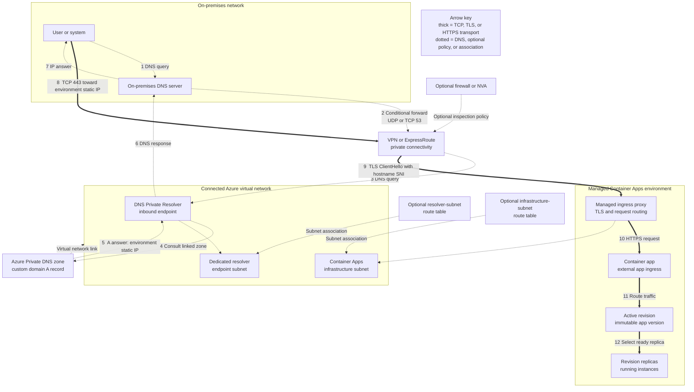
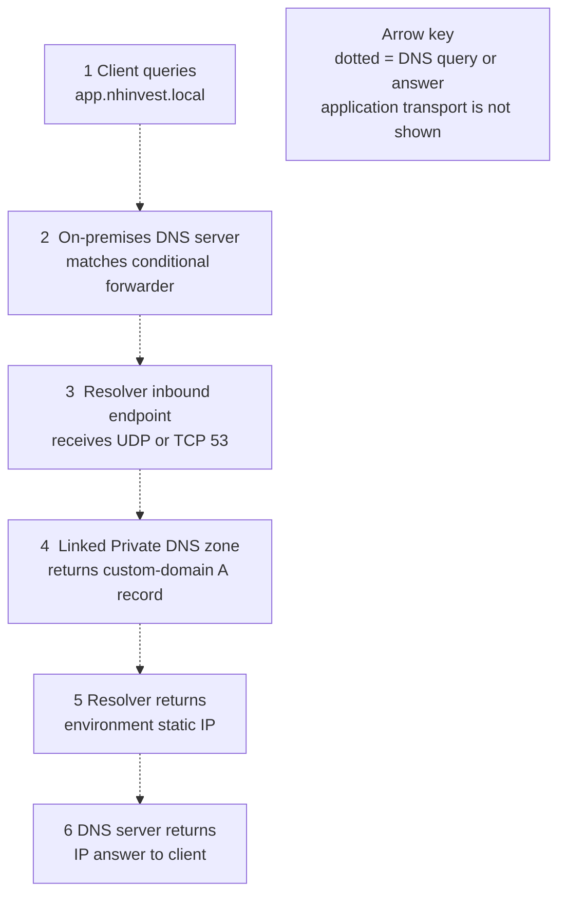

---
content_sources:
  references:
    - type: mslearn-adapted
      url: https://learn.microsoft.com/en-us/azure/container-apps/private-endpoints-with-dns
    - type: mslearn-adapted
      url: https://learn.microsoft.com/en-us/azure/dns/dns-private-resolver-overview
    - type: mslearn-adapted
      url: https://learn.microsoft.com/en-us/azure/container-apps/vnet-custom-internal
  diagrams:
    - id: dns-resolution-flow
      type: flowchart
      source: self-generated
      justification: Hybrid DNS query and answer flow synthesized from Microsoft Learn guidance for Private DNS Resolver inbound endpoints, conditional forwarding, linked Private DNS zones, and internal Container Apps environment DNS.
      based_on:
        - https://learn.microsoft.com/en-us/azure/dns/dns-private-resolver-overview
        - https://learn.microsoft.com/en-us/azure/container-apps/private-endpoints-with-dns
        - https://learn.microsoft.com/en-us/azure/container-apps/vnet-custom
    - id: network-topology
      type: flowchart
      source: self-generated
      justification: Hybrid DNS and HTTPS topology synthesized from Microsoft Learn; it separates the conditional-forwarding DNS path from TCP and TLS transport and treats firewall and route-table resources as optional associations rather than contained forwarding nodes.
      based_on:
        - https://learn.microsoft.com/en-us/azure/architecture/reference-architectures/hybrid-networking/hub-spoke
        - https://learn.microsoft.com/en-us/azure/dns/dns-private-resolver-overview
        - https://learn.microsoft.com/en-us/azure/container-apps/networking
        - https://learn.microsoft.com/en-us/azure/container-apps/private-endpoints-with-dns
content_validation:
  status: verified
  last_reviewed: 2026-11-07
  reviewer: agent
  lab_validation:
    status: reproduced
    tested_date: '2026-05-18'
    az_cli_version: 2.x
    region: koreacentral
    notes: Custom Domain (.local) + Private DNS Resolver in Spoke VNet + Firewall DNS flow verified with logs + UDR effective routes confirmed + VNet-internal HTTP 200. Ingress external:true required.
  core_claims:
    - claim: For an internal Container Apps environment with a custom domain, a private DNS zone can resolve the apex domain to the environment static IP.
      source: https://learn.microsoft.com/en-us/azure/container-apps/private-endpoints-with-dns
      verified: true
    - claim: An Azure DNS Private Resolver inbound endpoint is the conditional-forwarder destination that enables on-premises clients to resolve linked Azure Private DNS zones over VPN or ExpressRoute connectivity.
      source: https://learn.microsoft.com/en-us/azure/dns/dns-private-resolver-overview
      verified: true
    - claim: Private DNS Resolver inbound endpoint requires a dedicated subnet of /28 or larger.
      source: https://learn.microsoft.com/en-us/azure/dns/dns-private-resolver-overview
      verified: true
    - claim: In an internal environment, an app with external ingress is published through the environment internal load balancer for connected-VNet clients, while an app with internal ingress is directly reachable only from the same Container Apps environment.
      source: https://learn.microsoft.com/en-us/azure/container-apps/ingress-overview
      verified: true
---
# On-Premises DNS to Azure Container Apps Internal Environment via Custom Domain

Configure on-premises name resolution to reach Azure Container Apps running in an internal environment by using a custom internal domain. The environment has no public endpoint and exposes apps with external app ingress through its internal load balancer and static private IP.

## Prerequisites

- Hub-Spoke VNet topology with Site-to-Site VPN or ExpressRoute
- Container Apps Internal Environment deployed in Spoke VNet (apps accessible via environment static IP)
- Optional inspection path through Azure Firewall or another NVA, if your network architecture requires forced inspection
- On-premises DNS server with Conditional Forwarder capability
- A subdomain of a DNS name your organization owns, delegated for private use (recommended), or another internal suffix approved by your DNS team

Use the repository variable convention for the commands below, including `$RG`, `$APP_NAME`, `$ACA_ENV_NAME`, and `$LOCATION`, plus the VNet and subnet resource IDs for your deployment.

!!! note "Lab domain versus production DNS"
    The reproduced lab used the synthetic name `nhinvest.local`. For production, prefer a delegated subdomain of a DNS name your organization owns, such as `apps.internal.example.com`, so namespace ownership is explicit. Avoid `.local` for new designs because clients commonly reserve it for multicast DNS.

## When to Use

Use this procedure when **all** of the following are true:

1. Container Apps is deployed as an Internal Environment (apps accessible via environment static IP, not public internet)
2. On-premises users/systems must reach Container Apps apps via private IP (not public)
3. On-premises DNS policy **cannot** add Conditional Forwarders for external domains like `*.azurecontainerapps.io`
4. You can place a dedicated `/28` to `/24` resolver endpoint subnet in a VNet that has the required hybrid connectivity and access to the linked private zone

!!! note "If Hub has available address space"
    A resolver can live in the hub or another suitable connected VNet. Choose placement from DNS reachability and operational ownership; firewall and UDR requirements depend on the selected network path and are not inherent to Private DNS Resolver or Container Apps.

## Architecture

<!-- diagram-id: network-topology -->


*Figure: The DNS lookup and HTTPS connection are separate paths. The optional firewall and route tables sit outside the VNet and managed-environment boundaries because they are associated network controls; the diagram does not claim that every deployment requires forced inspection.*

## DNS Resolution Flow

<!-- diagram-id: dns-resolution-flow -->


*Figure: This ordered DNS flow ends when the server returns the environment static IP. TCP establishment, TLS negotiation, hostname authorization, and HTTP routing occur afterward and are deliberately excluded.*

## Procedure

!!! warning "Ingress Visibility: Must Be External"
    In an Internal Environment, set ingress to **`external: true`**. This does NOT expose the app to the internet — it means "accessible from within the VNet" (not just within the Container Apps environment). Without this, only other apps in the same environment can reach it.

    ```bash
    az containerapp ingress update \
        --resource-group $RG \
        --name $APP_NAME \
        --type external
    ```

    | Command/Parameter | Purpose |
    |---|---|
    | `az containerapp ingress update` | Updates ingress configuration for the container app |
    | `--resource-group` | Identifies the resource group that contains the app |
    | `--name` | Identifies the container app |
    | `--type external` | Makes the app accessible from within the VNet (not just within the Container Apps environment) |

    Microsoft Learn documents that a direct request through the internal load balancer to an app with internal ingress returns HTTP 404. An environment-level HTTP route can still target that app, so internal ingress is not an absolute isolation boundary.

### Step 1: Bind Custom Domain to Container Apps App

Configure a custom domain on the Container Apps app so it accepts traffic on the internal domain name.

```bash
az containerapp hostname add \
    --resource-group $RG \
    --name $APP_NAME \
    --hostname app.nhinvest.local
```

| Command/Parameter | Purpose |
|---|---|
| `az containerapp hostname add` | Associates a custom domain with the container app |
| `--resource-group` | Identifies the resource group that contains the app |
| `--name` | Identifies the container app |
| `--hostname app.nhinvest.local` | The internal domain clients will use to reach this app |

!!! warning "Certificate required for HTTPS"
    Bind an SNI certificate that clients trust for the internal hostname. Free managed certificates require the documented public DigiCert validation path, so private-only names generally use an uploaded certificate or a certificate imported from Key Vault. Do not treat `--insecure` as a production trust configuration.

!!! note "`.local` lab caveat"
    The historical lab used `.local`, which clients commonly reserve for multicast DNS and which can require resolver-specific workarounds. Preserve that name only when reproducing the lab. For a new production design, use a delegated subdomain of a DNS name your organization owns.

```bash
az containerapp hostname bind \
    --resource-group $RG \
    --name $APP_NAME \
    --hostname app.nhinvest.local \
    --certificate $CERT_ID \
    --environment $ACA_ENV_NAME
```

| Command/Parameter | Purpose |
|---|---|
| `az containerapp hostname bind` | Binds a TLS certificate to the custom domain |
| `--resource-group` | Identifies the resource group that contains the app |
| `--name` | Identifies the container app |
| `--hostname` | Selects the internal custom hostname |
| `--certificate $CERT_ID` | Resource ID of the uploaded certificate |
| `--environment` | Identifies the Container Apps environment that holds the certificate |

### Step 2: Create Private DNS Zone for Custom Domain

Create a Private DNS Zone for your internal domain and add an A record pointing to the Container Apps Internal Environment's static IP.

```bash
# Create the Private DNS Zone
az network private-dns zone create \
    --resource-group $RG \
    --name nhinvest.local

# Add A record pointing to ACA Internal Environment static IP
az network private-dns record-set a add-record \
    --resource-group $RG \
    --zone-name nhinvest.local \
    --record-set-name app \
    --ipv4-address "$ACA_STATIC_IP"
```

| Command/Parameter | Purpose |
|---|---|
| `az network private-dns zone create` | Creates a Private DNS Zone for the custom domain |
| `--resource-group` | Identifies the resource group for the private zone |
| `--name nhinvest.local` | The internal domain zone |
| `az network private-dns record-set a add-record` | Adds an A record to the zone |
| `--zone-name` | Selects the private DNS zone |
| `--record-set-name app` | Creates `app.nhinvest.local` |
| `--ipv4-address` | Supplies the Container Apps internal environment static IP from `$ACA_STATIC_IP`. |

### Step 3: Link Private DNS Zone to Spoke VNet

The zone must be linked to the Spoke VNet so the Private DNS Resolver can resolve records from it.

```bash
az network private-dns link vnet create \
    --resource-group $RG \
    --zone-name nhinvest.local \
    --name link-spoke-aisvc \
    --virtual-network $SPOKE_VNET_ID \
    --registration-enabled false
```

| Command/Parameter | Purpose |
|---|---|
| `az network private-dns link vnet create` | Links the DNS zone to a VNet for resolution |
| `--resource-group` | Identifies the resource group for the link |
| `--zone-name` | Selects the private DNS zone |
| `--name` | Names the virtual network link |
| `--virtual-network` | Identifies the virtual network to link |
| `--registration-enabled false` | Disables auto-registration (manual A records only) |

### Step 4: Deploy Private DNS Resolver in Spoke VNet

Deploy the resolver in the selected VNet. This example uses the spoke because its hub has no suitable dedicated endpoint subnet; Microsoft Learn permits endpoint subnets from `/28` through `/24`.

```bash
# Create dedicated subnet for resolver inbound endpoint (/28 minimum)
az network vnet subnet create \
    --resource-group $RG \
    --vnet-name $SPOKE_VNET \
    --name snet-dns-resolver-inbound \
    --address-prefixes "$DNS_RESOLVER_SUBNET_PREFIX" \
    --delegations Microsoft.Network/dnsResolvers

# Create the Private DNS Resolver
az dns-resolver create \
    --resource-group $RG \
    --name dnspr-spoke-aisvc \
    --location $LOCATION \
    --id $SPOKE_VNET_ID

# Create inbound endpoint
az dns-resolver inbound-endpoint create \
    --resource-group $RG \
    --dns-resolver-name dnspr-spoke-aisvc \
    --name inbound-endpoint \
    --location $LOCATION \
    --ip-configurations "[{\"private-ip-allocation-method\":\"Dynamic\",\"id\":\"$INBOUND_SUBNET_ID\"}]"
```

| Command/Parameter | Purpose |
|---|---|
| `az network vnet subnet create` | Creates a dedicated subnet for the resolver |
| `--resource-group` | Identifies the resource group for the VNet or resolver command |
| `--vnet-name` | Identifies the VNet that receives the endpoint subnet |
| `--name` | Names the subnet, resolver, or endpoint, depending on the command |
| `--address-prefixes` | Supplies the dedicated `/28` through `/24` endpoint subnet prefix from `$DNS_RESOLVER_SUBNET_PREFIX`. |
| `--delegations Microsoft.Network/dnsResolvers` | Required delegation for resolver subnet |
| `az dns-resolver create` | Creates the Private DNS Resolver resource |
| `--location` | Places the resolver or endpoint in `$LOCATION` |
| `--id` | Associates the resolver with the selected VNet resource ID |
| `az dns-resolver inbound-endpoint create` | Creates the endpoint that receives DNS queries from on-prem |
| `--dns-resolver-name` | Selects the parent resolver |
| `--ip-configurations` | Configures dynamic allocation from the dedicated endpoint subnet |

!!! tip "Note the Inbound Endpoint IP"
    After creation, retrieve the dynamically assigned IP:
    ```bash
    az dns-resolver inbound-endpoint show \
        --resource-group $RG \
        --dns-resolver-name dnspr-spoke-aisvc \
        --name inbound-endpoint \
        --query "ipConfigurations[0].privateIpAddress" \
        --output tsv
    ```

    | Command/Parameter | Purpose |
    |---|---|
    | `az dns-resolver inbound-endpoint show` | Retrieves details of the resolver inbound endpoint |
    | `--resource-group` | Identifies the resolver resource group |
    | `--dns-resolver-name` | Selects the parent resolver |
    | `--name` | Selects the inbound endpoint |
    | `--query "ipConfigurations[0].privateIpAddress"` | Extracts just the assigned private IP |
    | `--output tsv` | Returns plain text (no JSON formatting) |

    This IP is what the on-premises DNS server will forward to.

### Step 5: Configure Azure Firewall Rules When Inspection Is Required

If the approved path traverses Azure Firewall or another NVA, allow DNS traffic from the on-premises DNS server to the resolver and HTTPS traffic from approved clients to the internal environment static IP. Skip this step when your routing design does not force these flows through an inspection appliance.

!!! info "Evidence Level"
    [Observed] Firewall network rules were provisioned and verified with firewall diagnostic logs:

    - DNS: `UDP request from <on-prem-vm-ip> to <resolver-inbound-ip>:53. Action: Allow. Rule: allow-dns`
    - HTTPS: `TCP request from <on-prem-vm-ip> to <aca-static-ip>:443. Action: Allow. Rule: allow-https`

| Rule | Source | Destination | Protocol/Port |
|---|---|---|---|
| DNS to Resolver | On-prem DNS server IP | Resolver Inbound Endpoint IP | TCP/UDP 53 |
| HTTPS to Container Apps | On-prem user network (e.g., <on-prem-cidr>) | <aca-static-ip> | TCP 443 |

### Step 6: Configure a Forward UDR for the Lab Inspection Path

In the lab simulation, the on-premises VM sits in a Hub subnet. By default, Hub-to-Spoke traffic uses the VNet peering path directly, **bypassing Azure Firewall**. To force on-prem traffic through the firewall, create a UDR on the on-premises VM subnet.

!!! info "Evidence Level"
    [Observed] Effective routes on the on-prem VM NIC confirmed `User Active <spoke-cidr> → VirtualAppliance <firewall-ip>`, overriding the default VNetPeering route.

!!! note "Production with S2S VPN"
    In a real S2S VPN deployment, traffic from on-premises enters Azure through VPN Gateway. Whether that traffic then traverses Azure Firewall depends on the gateway routing, BGP propagation, peering and gateway-transit settings, UDRs, and effective routes. The Hub-side UDR below is specific to the **lab simulation** where a Hub VM acts as on-premises.

```bash
# Create route table for on-prem simulation subnet
az network route-table create \
    --resource-group $RG \
    --name rt-onprem-to-spoke \
    --location $LOCATION

# Route Spoke-bound traffic through Firewall
az network route-table route create \
    --resource-group $RG \
    --route-table-name rt-onprem-to-spoke \
    --name route-to-spoke \
    --address-prefix <spoke-cidr> \
    --next-hop-type VirtualAppliance \
    --next-hop-ip-address $HUB_FIREWALL_IP

# Associate with on-prem simulation subnet
az network vnet subnet update \
    --resource-group $RG \
    --vnet-name $HUB_VNET \
    --name snet-onprem \
    --route-table rt-onprem-to-spoke
```

| Command/Parameter | Purpose |
|---|---|
| `az network route-table create` | Creates a route table for the on-prem simulation subnet |
| `--resource-group` | Identifies the resource group for the route-table, route, or subnet command |
| `--name` | Names the route table, route, or subnet, depending on the command |
| `--location` | Places the route table in `$LOCATION` |
| `az network route-table route create` | Adds the spoke route to the route table |
| `--route-table-name` | Selects the route table to modify |
| `--address-prefix <spoke-cidr>` | Spoke VNet CIDR to redirect through firewall |
| `--next-hop-type VirtualAppliance` | Forces traffic through Azure Firewall |
| `--next-hop-ip-address $HUB_FIREWALL_IP` | Private IP of Azure Firewall |
| `az network vnet subnet update` | Associates route table with the on-prem subnet |
| `--vnet-name` | Selects the hub VNet |
| `--route-table` | Associates the route table with the subnet |

### Step 7: Configure a Return UDR for the Lab Inspection Path

When you intentionally force the forward path through a stateful firewall, preserve a symmetric return path. This requirement comes from the chosen forced-inspection topology, not from Container Apps or Private DNS Resolver alone.

!!! info "Evidence Level"
    [Observed] Both UDR directions were verified:

    - **On-prem → Spoke**: Effective routes on on-prem VM NIC confirmed `User Active <spoke-cidr> → VirtualAppliance <firewall-ip>`, overriding VNetPeering default.
    - **Spoke → on-prem**: Firewall diagnostic logs showed DNS return traffic from resolver was **denied** without this UDR (asymmetric routing). After applying the UDR to all Spoke subnets, both DNS and HTTPS traffic flowed successfully through the firewall.

!!! warning "Asymmetric Routing"
    In this reproduced lab topology, the return-path route table had to be associated with every spoke subnet participating in the inspected flows, including the Container Apps infrastructure and resolver endpoint subnets. Derive production associations from effective routes and the actual VPN, ExpressRoute, peering, and firewall design rather than copying the lab routes blindly.

```bash
# Create route table
az network route-table create \
    --resource-group $RG \
    --name rt-spoke-to-onprem \
    --location $LOCATION

# Add route for on-premises network
az network route-table route create \
    --resource-group $RG \
    --route-table-name rt-spoke-to-onprem \
    --name route-to-onprem \
    --address-prefix <on-prem-cidr> \
    --next-hop-type VirtualAppliance \
    --next-hop-ip-address $HUB_FIREWALL_IP

# Associate with all relevant Spoke subnets
az network vnet subnet update \
    --resource-group $RG \
    --vnet-name $SPOKE_VNET \
    --name snet-dns-resolver-inbound \
    --route-table rt-spoke-to-onprem

az network vnet subnet update \
    --resource-group $RG \
    --vnet-name $SPOKE_VNET \
    --name snet-aca-infra \
    --route-table rt-spoke-to-onprem
```

| Command/Parameter | Purpose |
|---|---|
| `az network route-table create` | Creates a route table resource |
| `--resource-group` | Identifies the resource group for each route or subnet operation |
| `--name` | Names the route table, route, or subnet, depending on the command |
| `--location` | Places the route table in `$LOCATION` |
| `az network route-table route create` | Adds a route entry to the route table |
| `--route-table-name` | Selects the route table to modify |
| `--next-hop-type VirtualAppliance` | Routes traffic through Azure Firewall |
| `--next-hop-ip-address $HUB_FIREWALL_IP` | Private IP of Azure Firewall in Hub |
| `--address-prefix <on-prem-cidr>` | On-premises network CIDR |
| `az network vnet subnet update` | Associates the route table with a subnet |
| `--vnet-name` | Selects the spoke VNet |
| `--route-table rt-spoke-to-onprem` | Attaches the UDR to the subnet |

### Step 8: Configure On-Premises DNS Conditional Forwarder

On the on-premises DNS server, add a Conditional Forwarder for the internal domain only:

| Setting | Value |
|---|---|
| Domain | `nhinvest.local` |
| Forward to | Resolver Inbound Endpoint IP (from Step 4) |
| Protocol | UDP/TCP 53 |

??? example "Example: bind9 Conditional Forwarder (Linux)"

    Add to your bind9 configuration (e.g., `/etc/bind/named.conf.local`):

    ```bash
    zone "nhinvest.local" {
        type forward;
        forward only;
        forwarders { <resolver-inbound-ip>; };
    };
    ```

    After editing, restart the service:

    ```bash
    sudo systemctl restart named
    ```

    | Command/Parameter | Purpose |
    |---|---|
    | `sudo systemctl restart named` | Restarts the bind9 DNS service to apply configuration changes |

    For Windows DNS Server, use DNS Manager → Conditional Forwarders → New Conditional Forwarder.

!!! success "Security Policy Compliant"
    This approach registers only an internal domain (`nhinvest.local`) as a Conditional Forwarder, satisfying policies that prohibit forwarding external domains like `azurecontainerapps.io`.

## Verification

### DNS Resolution Test (from on-premises)

```bash
nslookup app.nhinvest.local
# Expected: <aca-static-ip>

dig app.nhinvest.local +short
# Expected: <aca-static-ip>
```

| Command/Parameter | Purpose |
|---|---|
| `nslookup app.nhinvest.local` | Queries DNS for the custom domain A record |
| `dig app.nhinvest.local +short` | Queries DNS and returns only the IP address |

### Connectivity Test (from on-premises)

```bash
curl --insecure https://app.nhinvest.local
# Expected: HTTP response from ACA app

# Or test TCP connectivity with timeout
curl --insecure --silent --head --max-time 5 https://app.nhinvest.local
# Expected: HTTP/2 200 (or similar success status)
```

| Command/Parameter | Purpose |
|---|---|
| `curl --insecure` | Skips TLS certificate verification (expected for self-signed certs) |
| `--silent --head --max-time 5` | Suppresses progress, fetches headers only, times out after 5 seconds |

### From Azure (Spoke VNet VM)

```bash
# Verify Private DNS Zone resolution
nslookup app.nhinvest.local
# Expected: <aca-static-ip>

# Verify ACA default domain still works internally
nslookup app.<default-domain>.koreacentral.azurecontainerapps.io
# Expected: <aca-static-ip> (via environment's built-in DNS)
```

| Command/Parameter | Purpose |
|---|---|
| `nslookup app.nhinvest.local` | Verifies custom domain resolves via Private DNS Zone |
| `nslookup app.<default-domain>...` | Verifies Container Apps default domain still resolves internally |

## Rollback / Troubleshooting

| Symptom | Likely Cause | Fix |
|---|---|---|
| `NXDOMAIN` from on-prem | Conditional Forwarder not configured or wrong target IP | Verify forwarder points to Resolver Inbound Endpoint IP |
| DNS resolves but connection times out | TCP path, inspection policy, or return route is incomplete | Test TCP 443 separately; if forced inspection is configured, check firewall logs and effective routes |
| DNS resolves to public IP | Query not hitting Private DNS Zone | Verify VNet link exists on the Private DNS Zone |
| Resolver returns `SERVFAIL` | Private DNS Zone not linked to Spoke VNet | Create VNet link (Step 3) |
| Certificate error on HTTPS | Missing or mismatched TLS cert on custom domain | Bind correct certificate (Step 1) |
| HTTP 404 through the environment internal load balancer | App ingress is internal, or hostname/routing does not match the target app | For direct VNet access, set app ingress to external; also verify the host binding and any environment-level HTTP route |
| `.local` domain SERVFAIL on Linux clients | systemd-resolved treats `.local` as mDNS | For lab reproduction, query the intended resolver explicitly or configure the client resolver; for production, prefer a delegated subdomain of a DNS name your organization owns. |
| HTTPS times out but DNS works in the forced-inspection lab | Return traffic bypasses the stateful firewall | Use effective routes and firewall logs to restore symmetry for the participating subnets (Step 7) |
| bind9 returns SERVFAIL for `.local` zone | DNSSEC validation fails on `.local` forwarded queries | Set `dnssec-validation no;` in bind9 `named.conf.options` |

## Validated Results

!!! success "Lab Validation: 2026-05-18, az CLI, Korea Central"

    **Test Environment**: Hub-Spoke VNet Peering, Azure Firewall, On-prem DNS (bind9) simulation using a Hub VNet VM (not a real S2S VPN), Container Apps Internal Environment with Custom Domain + BYO self-signed certificate.

    Specific IP addresses have been replaced with placeholders. Results will differ in your deployment.

    | # | Test | Method | Result |
    |---|---|---|---|
    | 1 | Custom Domain binding (`.local`) | `az containerapp hostname add --hostname app.nhinvest.local` | ✅ Accepted |
    | 2 | BYO cert HTTPS binding | `az containerapp hostname bind` with self-signed PFX | ✅ `bindingType: SniEnabled` |
    | 3 | Private DNS Resolver in Spoke | `az dns-resolver create` + inbound endpoint | ✅ IP assigned dynamically |
    | 4 | DNS via Resolver | `dig app.nhinvest.local @<resolver-inbound-ip>` | ✅ Resolved to Container Apps static IP |
    | 5 | DNS via bind9 Conditional Forwarder | `dig app.nhinvest.local @127.0.0.1` (on-prem VM) | ✅ Resolved to Container Apps static IP |
    | 6 | E2E HTTP (on-prem → Container Apps) | `curl http://app.nhinvest.local` | ✅ HTTP 200 |
    | 7 | E2E HTTPS (on-prem → Container Apps) | `curl --silent --insecure https://app.nhinvest.local` | ✅ HTTPS 200 |
    | 8 | TLS Certificate CN | `openssl s_client -servername app.nhinvest.local` | ✅ `CN=app.nhinvest.local` |
    | 9 | Firewall DNS flow | Firewall diagnostic logs (AZFWNetworkRule) | ✅ `Action: Allow, Rule: allow-dns` |
    | 10 | Firewall HTTPS flow | Firewall diagnostic logs (AZFWNetworkRule) | ✅ `TCP to <aca-static-ip>:443. Action: Allow, Rule: allow-https` |
    | 11 | UDR effective routes | `az network nic show-effective-route-table` | ✅ `<spoke-cidr> → VirtualAppliance` |
    | 12 | Asymmetric routing detection | HTTPS timeout without Container Apps subnet UDR | ✅ Resolved by adding UDR to Container Apps subnet |

    **Key Findings:**

    - [Observed] In the reproduced direct-load-balancer path, app ingress had to be `external: true` for the VNet client; the internal setting returned 404. Microsoft Learn separately documents that an environment-level HTTP route can target an internal-ingress app.
    - [Observed] `.local` domains trigger Azure warning but work correctly for Private DNS Zone resolution. bind9 requires `dnssec-validation no` to forward `.local` queries.
    - [Observed] Both DNS (UDP 53) and HTTPS (TCP 443) traffic from on-prem VM traverse Azure Firewall. Confirmed by firewall diagnostic logs showing `Action: Allow` for both rules.
    - [Observed] Bidirectional UDR routing verified: on-prem→Spoke UDR confirmed by effective routes; Spoke→on-prem UDR verified by observing that DNS return traffic was **denied** by the firewall without it (asymmetric routing), and succeeded after applying it.
    - [Observed] For this forced-inspection lab topology, the return-path UDR had to be applied to the participating resolver and Container Apps infrastructure subnets. This is lab evidence, not a universal UDR requirement.
    - [Observed] Self-signed certificates work with `bindingType: SniEnabled`. Managed certificates require public DNS validation and cannot be used with `.local` domains.

    **Lab Limitations:**

    - [Inferred] On-premises was simulated with a Hub VNet VM and UDR-based firewall routing, not a real S2S VPN or ExpressRoute connection. A production path must be validated from its actual gateway, BGP, peering, UDR, firewall, and effective-route configuration.

## See Also

- [Private Endpoints](../../platform/networking/private-endpoints.md)
- [VNet Integration](../../platform/networking/vnet-integration.md)
- [Application Gateway Integration with an Internal Container Apps Environment](../../platform/networking/application-gateway-integration.md)
- [Custom Domains — Managed Certificates](../custom-domains/managed-certificates.md)
- [Custom Domains — BYO Certificates](../custom-domains/byo-certificates.md)
- [Networking Best Practices](../../best-practices/networking.md)
- [Internal DNS and Private Endpoint Failure (Troubleshooting)](../../troubleshooting/playbooks/ingress-and-networking/internal-dns-and-private-endpoint-failure.md)
- [AppGW to Internal Container Apps NSG Destination (Troubleshooting)](../../troubleshooting/playbooks/ingress-and-networking/appgw-to-internal-aca-nsg-destination.md)

## Sources

- [Configure private endpoints and DNS for virtual networks in Container Apps environments (Microsoft Learn)](https://learn.microsoft.com/en-us/azure/container-apps/private-endpoints-with-dns)
- [Ingress in Azure Container Apps (Microsoft Learn)](https://learn.microsoft.com/en-us/azure/container-apps/ingress-overview)
- [Networking in Azure Container Apps environment (Microsoft Learn)](https://learn.microsoft.com/en-us/azure/container-apps/networking)
- [What is Azure DNS Private Resolver? (Microsoft Learn)](https://learn.microsoft.com/en-us/azure/dns/dns-private-resolver-overview)
- [Internal ingress with VNet integration (Microsoft Learn)](https://learn.microsoft.com/en-us/azure/container-apps/vnet-custom-internal)
- [Hub-spoke network topology in Azure (Microsoft Learn)](https://learn.microsoft.com/en-us/azure/architecture/reference-architectures/hybrid-networking/hub-spoke)
- [Azure Private DNS zone scenarios (Microsoft Learn)](https://learn.microsoft.com/en-us/azure/dns/private-dns-scenarios)
