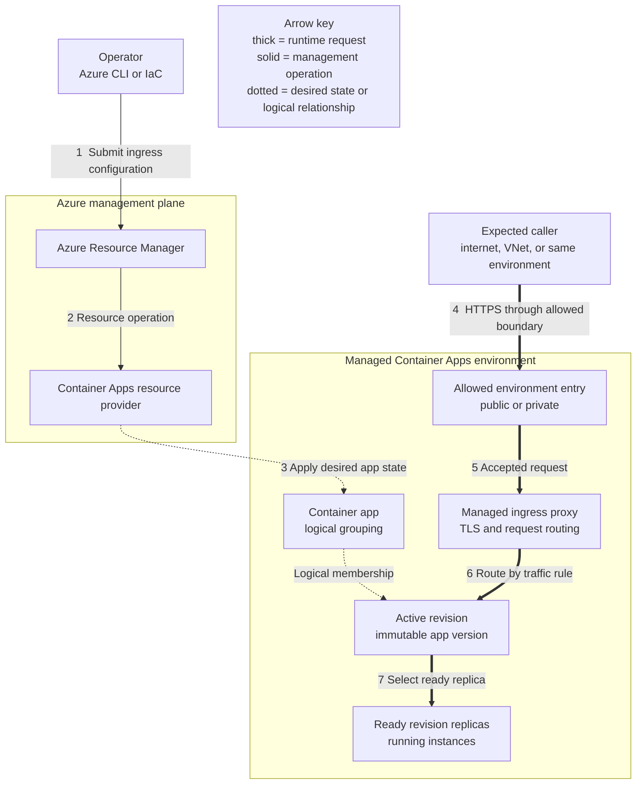
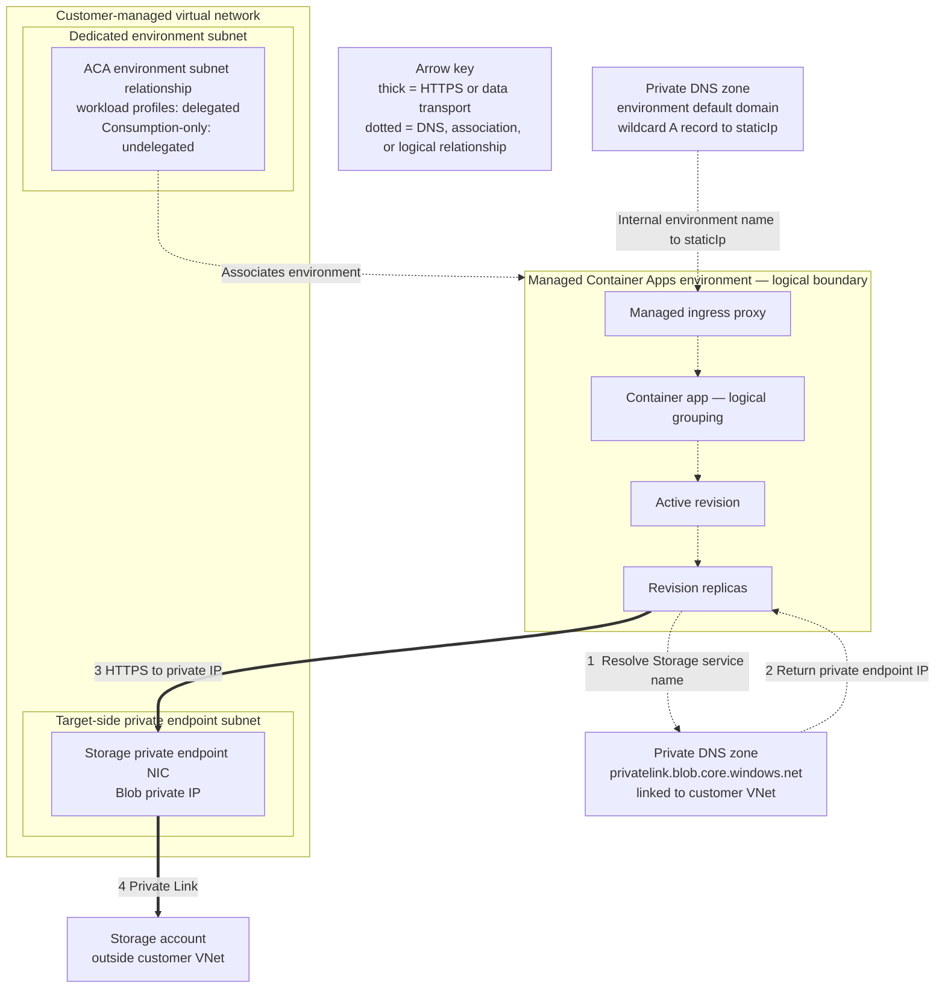
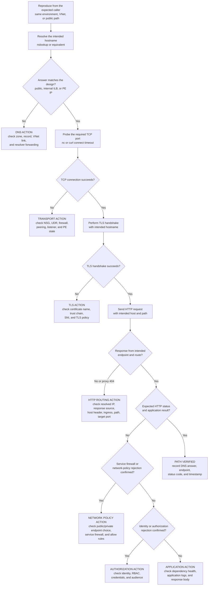

---
content_sources:
  diagrams:
    - id: ingress-flow
      type: flowchart
      source: self-generated
      justification: Operator deployment flow synthesized from Microsoft Learn; management configuration is separated from the accepted runtime request path through the managed ingress proxy, revision, and replica.
      based_on:
        - https://learn.microsoft.com/en-us/azure/container-apps/ingress-how-to
        - https://learn.microsoft.com/en-us/azure/container-apps/ingress-overview
        - https://learn.microsoft.com/en-us/azure/container-apps/networking
    - id: vnet-setup-flow
      type: flowchart
      source: self-generated
      justification: Deployment topology synthesized from Microsoft Learn and the shared cross-guide private-dependency contract; it separates the dedicated ACA environment subnet, target-side private endpoint subnet, DNS, and transport.
      based_on:
        - https://learn.microsoft.com/en-us/azure/container-apps/custom-virtual-networks
        - https://learn.microsoft.com/en-us/azure/container-apps/vnet-custom
        - https://learn.microsoft.com/en-us/azure/container-apps/how-to-use-private-endpoint
        - https://learn.microsoft.com/en-us/azure/private-link/private-endpoint-dns
    - id: diagnostic-flow
      type: flowchart
      source: self-generated
      justification: Operator decision flow synthesized from Microsoft Learn; DNS, TCP transport, TLS, HTTP routing and response source, network-policy rejection, and application authorization are tested independently from the caller network context.
      based_on:
        - https://learn.microsoft.com/en-us/azure/container-apps/networking
        - https://learn.microsoft.com/en-us/azure/container-apps/connect-apps
        - https://learn.microsoft.com/en-us/azure/private-link/private-endpoint-dns
content_validation:
  status: verified
  last_reviewed: 2026-11-07
  reviewer: agent
  core_claims:
    - claim: A workload profiles environment requires a dedicated subnet of /27 or larger delegated to Microsoft.App/environments.
      source: https://learn.microsoft.com/en-us/azure/container-apps/custom-virtual-networks
      verified: true
    - claim: A legacy Consumption-only environment requires a dedicated subnet of /23 or larger that is not delegated to Microsoft.App/environments.
      source: https://learn.microsoft.com/en-us/azure/container-apps/custom-virtual-networks
      verified: true
    - claim: An internal Container Apps environment has no public endpoint and uses an internal load balancer IP from the custom virtual network.
      source: https://learn.microsoft.com/en-us/azure/container-apps/networking
      verified: true
    - claim: App-level internal ingress is reachable only from other apps in the same Container Apps environment, while external app ingress on an internal environment is reachable from the virtual network without becoming internet-accessible.
      source: https://learn.microsoft.com/en-us/azure/container-apps/ingress-how-to
      verified: true
    - claim: Creating a private endpoint on a Container Apps environment requires a workload profiles environment and disabled public network access.
      source: https://learn.microsoft.com/en-us/azure/container-apps/how-to-use-private-endpoint
      verified: true
---
# Networking Operations

Use this runbook to deploy and verify Container Apps ingress, a custom virtual network, internal-environment DNS, and private dependency paths. Keep app ingress visibility, environment accessibility, DNS resolution, and packet transport as separate decisions.

## Prerequisites

- Azure CLI with the current Container Apps extension.
- Permission to read or change the Container App, its environment, and the customer-managed VNet.
- A dedicated environment subnet sized for the selected environment type.
- A caller in the same network context as the expected traffic path for data-plane verification.

```bash
export RG="rg-myapp"
export APP_NAME="ca-myapp"
export ACA_ENV_NAME="cae-myapp"
export VNET_NAME="vnet-aca-prod"
export ENV_SUBNET_NAME="snet-containerapps"
```

## When to Use

Use this procedure before a networking change, after an environment deployment, or when DNS resolves but an application request still fails. Record the current ingress and environment JSON before changing either resource.

## Procedure

### Configure app ingress

App-level **external** ingress publishes the app at the environment inbound boundary. It is internet-reachable only when the environment has a public inbound endpoint and public network access accepts the traffic. On an internal environment, external app ingress instead makes the app reachable through the environment's internal load balancer from the VNet.

```bash
az containerapp ingress enable \
  --name "$APP_NAME" \
  --resource-group "$RG" \
  --type external \
  --target-port 8000
```

| Command/Parameter | Purpose |
|---|---|
| `az containerapp ingress enable` | Enables ingress on the existing Container App. |
| `--name "$APP_NAME"` | Selects the app to update. |
| `--resource-group "$RG"` | Selects the resource group that contains the app. |
| `--type external` | Publishes the app at the environment inbound boundary; it does not independently create internet reachability. |
| `--target-port 8000` | Routes accepted ingress traffic to the container listener on port `8000`. |

Use app-level **internal** ingress only when callers are other apps in the same Container Apps environment:

```bash
az containerapp ingress enable \
  --name "$APP_NAME" \
  --resource-group "$RG" \
  --type internal \
  --target-port 8000
```

| Command/Parameter | Purpose |
|---|---|
| `az containerapp ingress enable` | Enables ingress on the existing Container App. |
| `--name "$APP_NAME"` | Selects the app to update. |
| `--resource-group "$RG"` | Selects the resource group that contains the app. |
| `--type internal` | Limits direct access to other apps in the same Container Apps environment. |
| `--target-port 8000` | Routes accepted ingress traffic to the container listener on port `8000`. |

Disable ingress for workers and jobs that should expose no inbound endpoint:

```bash
az containerapp ingress disable \
  --name "$APP_NAME" \
  --resource-group "$RG"
```

| Command/Parameter | Purpose |
|---|---|
| `az containerapp ingress disable` | Removes the app's inbound endpoint. |
| `--name "$APP_NAME"` | Selects the app to update. |
| `--resource-group "$RG"` | Selects the resource group that contains the app. |

#### Ingress deployment flow

**Takeaway:** The CLI changes desired configuration through Azure Resource Manager. Only an accepted runtime request follows the managed ingress → active revision → replica path.

<!-- diagram-id: ingress-flow -->


*Figure: Deployment and runtime flows share the reviewed ACA `ARM`, `RP`, `ENV`, `INGRESS`, `APP`, `REV_ACTIVE`, and `REPLICAS` vocabulary without presenting a management update as packet transport.*

### Deploy a custom VNet environment

Choose the environment type before creating the subnet. The network type and subnet size can't be changed after environment creation.

| Environment type | Minimum dedicated subnet | Delegation | Relevant network features |
|---|---:|---|---|
| Workload profiles (default) | `/27` or larger | Required: `Microsoft.App/environments` | UDR, NAT Gateway egress, and environment private endpoints are supported. |
| Consumption-only (legacy) | `/23` or larger | Must remain undelegated | UDR, NAT Gateway egress, and environment private endpoints are not supported. |

The following Bicep fragment deliberately targets a workload profiles environment. It accepts address ranges as parameters instead of embedding reusable CIDRs:

```bicep
@description('Virtual network address prefix')
param vnetAddressPrefix string

@description('Dedicated workload profiles environment subnet prefix (/27 or larger)')
param environmentSubnetPrefix string

resource vnet 'Microsoft.Network/virtualNetworks@2023-05-01' = {
  name: 'vnet-aca-prod'
  location: resourceGroup().location
  properties: {
    addressSpace: {
      addressPrefixes: [vnetAddressPrefix]
    }
    subnets: [
      {
        name: 'snet-containerapps'
        properties: {
          addressPrefix: environmentSubnetPrefix
          delegations: [
            {
              name: 'Microsoft.App.environments'
              properties: {
                serviceName: 'Microsoft.App/environments'
              }
            }
          ]
        }
      }
    ]
  }
}

resource environment 'Microsoft.App/managedEnvironments@2024-03-01' = {
  name: 'cae-myapp'
  location: resourceGroup().location
  properties: {
    workloadProfiles: [
      {
        name: 'Consumption'
        workloadProfileType: 'Consumption'
      }
    ]
    vnetConfiguration: {
      infrastructureSubnetId: vnet.properties.subnets[0].id
      internal: true
    }
  }
}
```

For a legacy Consumption-only environment, use a separate template path with a `/23` or larger dedicated subnet and omit the delegation. Do not make the delegation conditional inside a shared topology without making the environment type equally explicit.

#### VNet deployment topology

**Takeaway:** ACA uses a dedicated environment subnet relationship, not an App Service-style integration NIC. A downstream Storage private endpoint occupies a separate target-side subnet, while DNS remains outside the transport path.

<!-- diagram-id: vnet-setup-flow -->


*Figure: Internal-environment DNS and downstream dependency DNS are separate from transport. The Storage private endpoint NIC is not an inbound private endpoint to the Container Apps environment.*

If the design instead creates an **inbound private endpoint to the Container Apps environment**, use a workload profiles environment, disable public network access, and use the regional `privatelink.<region>.azurecontainerapps.io` private DNS zone. That inbound endpoint is separate from both the dedicated environment subnet and the downstream Storage endpoint shown above.

### Inspect the deployed environment and subnet

```bash
az containerapp env show \
  --name "$ACA_ENV_NAME" \
  --resource-group "$RG" \
  --query "{defaultDomain:properties.defaultDomain,staticIp:properties.staticIp,vnetConfiguration:properties.vnetConfiguration,publicNetworkAccess:properties.publicNetworkAccess}" \
  --output json
```

| Command/Parameter | Purpose |
|---|---|
| `az containerapp env show` | Reads the deployed environment configuration. |
| `--name "$ACA_ENV_NAME"` | Selects the environment. |
| `--resource-group "$RG"` | Selects its resource group. |
| `--query "{...}"` | Returns only the default domain, static IP, VNet configuration, and public-network setting needed for verification. |
| `--output json` | Preserves nested VNet configuration in structured output. |

For an internal environment, `staticIp` is the internal load balancer address from the custom VNet. Create or verify a Private DNS zone named after `defaultDomain`, link it to the caller VNet, and point a wildcard A record to that `staticIp`. For an external environment, `staticIp` represents the environment ingress virtual IP and is not evidence that the endpoint is private.

```bash
az network vnet subnet show \
  --resource-group "$RG" \
  --vnet-name "$VNET_NAME" \
  --name "$ENV_SUBNET_NAME" \
  --query "{addressPrefix:addressPrefix,delegations:delegations[].serviceName,privateEndpointNetworkPolicies:privateEndpointNetworkPolicies}" \
  --output json
```

| Command/Parameter | Purpose |
|---|---|
| `az network vnet subnet show` | Reads the dedicated environment subnet. |
| `--resource-group "$RG"` | Selects the VNet resource group. |
| `--vnet-name "$VNET_NAME"` | Selects the customer-managed VNet. |
| `--name "$ENV_SUBNET_NAME"` | Selects the dedicated environment subnet. |
| `--query "{...}"` | Returns the prefix, delegation, and private-endpoint policy fields needed for review. |
| `--output json` | Emits structured output so an empty delegation is distinguishable from a display omission. |

Expected delegation:

- Workload profiles: `Microsoft.App/environments`.
- Consumption-only: no service delegation.

## Verification

### Verify app ingress configuration

```bash
az containerapp ingress show \
  --name "$APP_NAME" \
  --resource-group "$RG" \
  --output json
```

| Command/Parameter | Purpose |
|---|---|
| `az containerapp ingress show` | Reads app-wide ingress configuration without changing a revision. |
| `--name "$APP_NAME"` | Selects the app. |
| `--resource-group "$RG"` | Selects the app resource group. |
| `--output json` | Shows exposure, transport, target port, FQDN, and traffic rules together. |

Check that `external`, `targetPort`, and `transport` match the intended caller. Do not infer internet reachability from `external: true` without also checking environment accessibility and public network access.

### Verify from the caller network context

For external app ingress on an internal environment, test from a VM, Application Gateway, VPN, or ExpressRoute-connected client in the VNet. For app-level internal ingress, test from another app in the **same Container Apps environment**, for example by opening a shell in the calling app:

```bash
az containerapp exec \
  --resource-group "$RG" \
  --name "$APP_NAME" \
  --command "/bin/sh"
```

| Command/Parameter | Purpose |
|---|---|
| `az containerapp exec` | Opens a shell in a running replica so probes use the workload's network context. |
| `--resource-group "$RG"` | Selects the app resource group. |
| `--name "$APP_NAME"` | Selects the calling app. |
| `--command "/bin/sh"` | Starts a shell when the image contains `/bin/sh`. |

Inside the caller, verify one layer at a time:

```bash
nslookup <dependency-hostname>
nc -zv <dependency-hostname> 443
curl --connect-timeout 5 --verbose https://<dependency-hostname>/health
```

DNS success proves only name resolution. A TCP success proves only that a connection reached a listener, and a successful TLS handshake proves only that the client reached an endpoint presenting an acceptable certificate. An HTTP `401` or `403` confirms an HTTP responder, but it does not identify which boundary rejected the request. In particular, a service firewall or network policy can return `403` when DNS selected a public endpoint. Correlate the resolved IP, response source and body, and service logs before choosing network-policy, routing, or authorization remediation.

### Diagnostic decision flow

**Takeaway:** Test DNS, TCP, TLS, HTTP routing and response source, then authorization and health in order. Don't use ICMP ping as a required private-endpoint gate because many Azure services do not answer ICMP.

<!-- diagram-id: diagnostic-flow -->


*Figure: A decision flow preserves failure-domain boundaries. A private DNS answer is not proof of TCP transport, a TLS handshake is not proof of correct HTTP routing, and an HTTP `403` requires response-source evidence before it is classified as network policy or authorization.*

## Rollback / Troubleshooting

Before changing DNS, NSGs, UDRs, ingress, or public network access, save the current resource JSON and the failing probe output. If verification fails, revert only the last change and repeat the same probe from the same caller context.

| Symptom | Most relevant evidence | First rollback or check |
|---|---|---|
| `NXDOMAIN` or unintended public answer | Resolver output and Private DNS VNet links | Restore the previous zone link or record; verify conditional forwarding. |
| Correct private IP, TCP timeout | NSG flow, effective route, firewall logs, private endpoint state | Restore the last NSG/UDR/firewall change; don't alter DNS that already resolves correctly. |
| TLS or host-routing error | Certificate name, SNI/Host header, app ingress mode, target port | Restore the previous ingress or gateway host configuration. |
| HTTP `401` or `403` | Resolved IP, response source/body, service firewall logs, app/gateway logs, identity and RBAC evidence | Determine which boundary generated the response. A service firewall or network policy can return `403`; change identity or RBAC only when authorization evidence confirms that failure class. |
| Internal app FQDN fails from a VM | Caller location and `.internal.` hostname | Test from another app in the same environment, or use external app ingress on an internal environment for VNet clients. |

!!! warning "Change one network layer at a time"
    Combining DNS, NSG, UDR, private endpoint, and ingress changes destroys the evidence needed to identify which layer fixed or broke the path.

## See Also

- [Ingress in Azure Container Apps](../../platform/networking/ingress.md)
- [VNet Integration](../../platform/networking/vnet-integration.md)
- [Private Endpoints](../../platform/networking/private-endpoints.md)
- [Application Gateway Integration](../../platform/networking/application-gateway-integration.md)
- [Service-to-Service Communication](../../platform/networking/service-to-service.md)

## Sources

- [Networking in an Azure Container Apps environment](https://learn.microsoft.com/en-us/azure/container-apps/networking)
- [Configure virtual networks in Azure Container Apps environments](https://learn.microsoft.com/en-us/azure/container-apps/custom-virtual-networks)
- [Integrate a virtual network with an Azure Container Apps environment](https://learn.microsoft.com/en-us/azure/container-apps/vnet-custom)
- [Configure ingress for your app in Azure Container Apps](https://learn.microsoft.com/en-us/azure/container-apps/ingress-how-to)
- [Communicate between container apps in Azure Container Apps](https://learn.microsoft.com/en-us/azure/container-apps/connect-apps)
- [Use a private endpoint with an Azure Container Apps environment](https://learn.microsoft.com/en-us/azure/container-apps/how-to-use-private-endpoint)
- [Azure Private Endpoint DNS configuration](https://learn.microsoft.com/en-us/azure/private-link/private-endpoint-dns)
