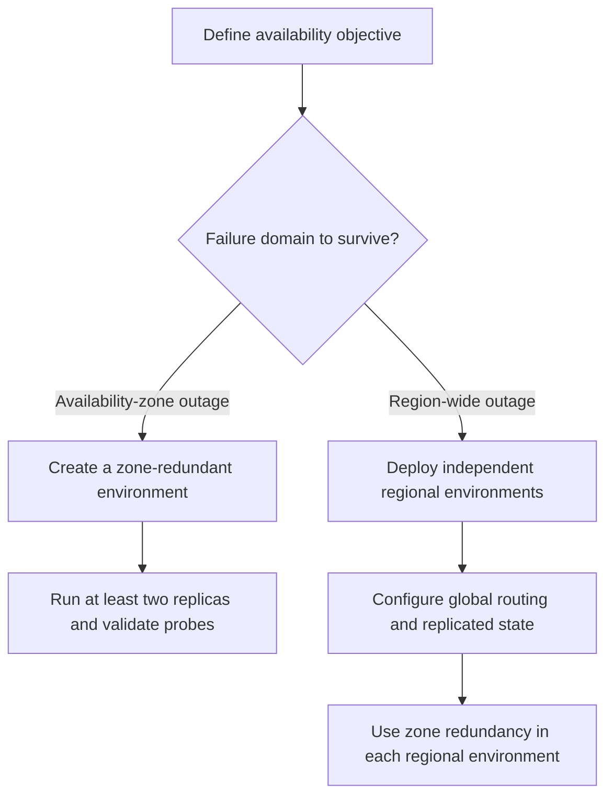
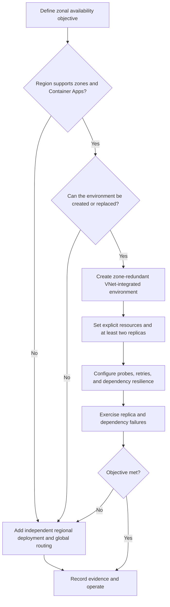

# Zone Redundancy

Zone redundancy improves resilience within a single region, but it is not a substitute for full multi-region disaster recovery. Container Apps manages zone placement and traffic redistribution; operators configure sufficient replicas, health probes, and application-level transient-fault handling.

!!! warning "Zone redundancy is regional, not cross-region recovery"
    Current Microsoft Learn guidance says Container Apps automatically schedules replicas across zones when zone redundancy is enabled. It also recommends a minimum replica count of at least two for distribution across multiple zones. This managed placement does not make the environment resilient to a full regional outage; use separate regional environments and global routing when the workload requires regional failover.

## Prerequisites

- A target region that supports the required Container Apps resilience features
- Infrastructure as Code for environment creation
- A decision on whether zonal failure tolerance is enough for the workload

```bash
export RG="rg-aca-prod"
export ACA_ENV_NAME="aca-env-prod"
export LOCATION="eastus"
```

## When to Use

- When you need protection from a single availability zone failure
- When you need a lower-complexity option than multi-region deployment
- When you need to explain why zonal resilience and regional resilience are different

## Procedure

1. Check the current reliability guidance for Azure Container Apps.
2. Confirm the target region and environment type support zone redundancy.
3. Decide whether the setting must be enabled at environment creation.
4. Compare the zonal design against your DR objectives.

Illustrative Bicep shape:

```bicep
resource managedEnvironment 'Microsoft.App/managedEnvironments@2024-03-01' = {
  name: envName
  location: location
  properties: {
    zoneRedundant: true
  }
}
```

Microsoft Learn now documents the current zone-redundancy rules: zone redundancy is available to **all Container Apps plans**, it must be enabled **during environment creation**, it **can't be changed afterward**, and it doesn't add charges beyond standard Container Apps pricing.

<!-- diagram-id: zone-redundancy-vs-multi-region -->


The decision separates an availability-zone failure from a region-wide outage so the resilience control matches the intended failure domain.

## What Zone Redundancy Does Not Guarantee

Zone redundancy is a platform-managed capability. Container Apps schedules replicas across zones transparently, while operators remain responsible for enough healthy capacity, explicit resource requirements, and resilient dependencies.

| Situation | What Microsoft Learn says | Operator implication |
|---|---|---|
| Underspecified resource requests | "Underspecified resource requirements can lead to uneven distribution..." | Set explicit CPU and memory requests to give the scheduler a stable basis for placement. |
| Image pull on cold zones | "Container images are pulled from your container register into each zone as needed when replicas are created." | First replica in a previously cold zone may experience extra start latency; do not interpret this as zone failure. |
| Maintenance, host failure, or autoscale churn | "The platform scheduler ensures optimal distribution across physical hosts while meeting your minimum replica count requirements." | Brief windows of skewed distribution are expected; correlate with platform events before treating as an outage. |
| Per-replica zone placement | Container Apps schedules replicas across zones transparently; operators don't specify placement for individual replicas. | Verify the environment's zone-redundancy setting and application behavior rather than inventing a per-replica placement control. |

<!-- diagram-id: zone-redundancy-best-effort-decision -->


The operator flow tests the regional design and escalates to multi-region deployment only when the measured objective requires a larger failure domain.

For the full decision tree, the four-layer mitigation matrix (in-Azure Container Apps inputs, app-layer resilience, topology escalation, observability), and a falsifiable lab that quantifies best-effort behavior under load, see the [Zone Redundancy Best-Effort playbook](../../troubleshooting/playbooks/platform-features/zone-redundancy-best-effort.md) and the [Zone Redundancy Best-Effort lab](../../troubleshooting/lab-guides/zone-redundancy-best-effort.md).

## Verification

- Confirm the environment reports the expected zone-redundancy state.
- Confirm the region and environment type support the configuration.
- Confirm your DR plan does not treat zone redundancy as a regional failover solution.
- Confirm the design uses at least two replicas when distribution across multiple zones is required, then test application behavior under replica and dependency failures.

## Rollback / Troubleshooting

- If the setting is immutable, recreate the environment instead of editing in place.
- If the region does not support the setting, move to a supported region or a multi-region pattern.
- If RTO or RPO targets exceed a single region, use multi-region instead.
- If you observe clustered replica churn (multiple replicas restarted within a short window) and suspect a correlated zone event, use the [zone redundancy mass-reschedule KQL pack](../../troubleshooting/kql/scaling-and-replicas/zone-redundancy-mass-reschedule.md) to triage before assuming a per-replica zone failure.

## Review Matrix

| Review area | Page-specific check |
|---|---|
| Scope | Confirm the guidance applies to Zone Redundancy. |
| Source basis | Validate the recommendation against the Microsoft Learn sources in this page. |
| Evidence | Capture command output, portal state, metrics, logs, or screenshots before treating the result as proven. |

## See Also

- [Disaster Recovery](index.md)
- [Multi-Region Deployment](multi-region-deployment.md)
- [Zone Redundancy Best-Effort playbook](../../troubleshooting/playbooks/platform-features/zone-redundancy-best-effort.md)
- [Zone Redundancy Best-Effort lab](../../troubleshooting/lab-guides/zone-redundancy-best-effort.md)
- [Zone redundancy mass-reschedule KQL pack](../../troubleshooting/kql/scaling-and-replicas/zone-redundancy-mass-reschedule.md)

## Sources

- [Reliability in Azure Container Apps](https://learn.microsoft.com/en-us/azure/reliability/reliability-container-apps)
- [How to use zone redundancy in Azure Container Apps](https://learn.microsoft.com/en-us/azure/container-apps/how-to-zone-redundancy)
