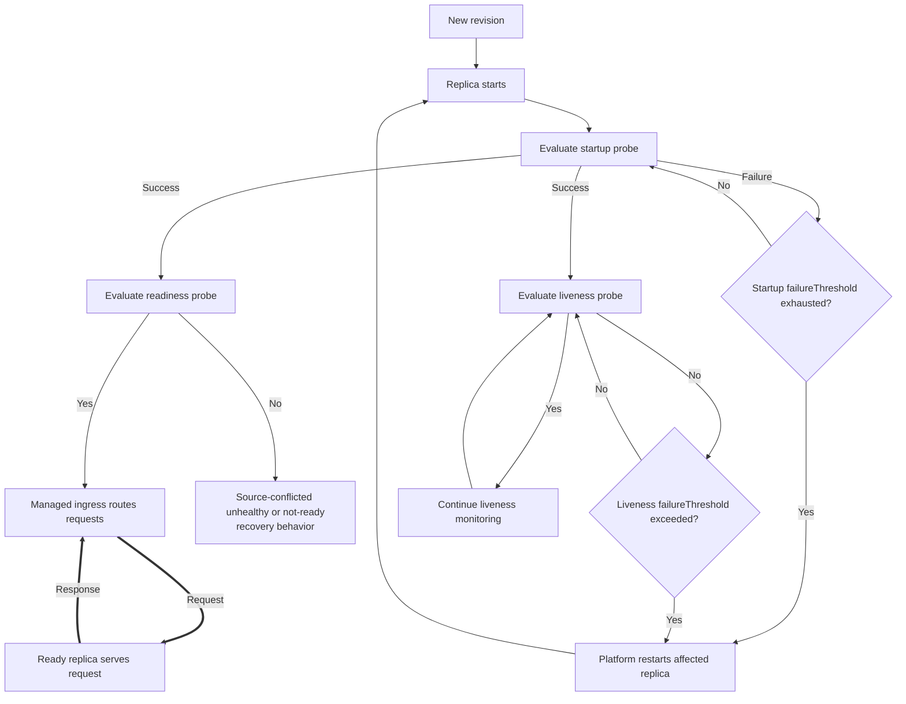

# Health Probes

Health probes determine whether a revision can become ready, continue serving traffic, or be restarted when the workload is unhealthy.

## Prerequisites

- An app with a clear health endpoint or TCP listener
- Access to revision configuration and system logs
- A rollback plan for any probe change

```bash
export RG="rg-aca-prod"
export APP_NAME="app-python-api-prod"
```

## When to Use

- When defining startup, readiness, and liveness behavior for production apps
- When new revisions fail to activate
- When restart loops or slow warm-up behavior require tuning

## Procedure

Azure Container Apps documents three probe types:

- **Startup** to protect slow initialization
- **Readiness** to control when the revision can receive traffic
- **Liveness** to detect unhealthy running containers

Documented probe configuration commonly includes:

- transport type
- path or port
- scheme
- `initialDelaySeconds`
- `periodSeconds`
- `timeoutSeconds`
- `successThreshold`
- `failureThreshold`

Use a YAML-based update when you need precise probe settings:

```bash
az containerapp update \
  --name "$APP_NAME" \
  --resource-group "$RG" \
  --yaml "./infra/containerapp-health.yaml"
```

| Command | Purpose |
|---|---|
| `az containerapp update` | Updates the selected container app. |
| `--name` | Selects the target resource by name. |
| `--resource-group` | Selects the resource group that contains the target resource. |
| `--yaml` | Applies configuration from the specified YAML file. |

Microsoft Learn documents the current probe behavior: Container Apps supports **startup**, **liveness**, and **readiness** probes; probes use **HTTP(S)** or **TCP** only; and `exec` probes aren't supported. When ingress is enabled and you don't define a probe type, the portal automatically adds default TCP probes to the main app container, except for dedicated or consumption GPU workload profiles. The portal doesn't add these defaults to sidecars. Startup succeeds before liveness and readiness checks begin. Readiness determines whether replicas receive routed requests, while liveness continues checking a running replica.

!!! note "Current readiness behavior"
    The health-probes reference says that one replica failing readiness makes the revision appear unhealthy and that Container Apps restarts that replica until it becomes healthy or the failure threshold is exceeded. The troubleshooting article describes the same symptom more narrowly as a container that might be marked not ready for traffic. This guide follows the explicit health-probes reference and does not substitute generic Kubernetes readiness behavior.

<!-- diagram-id: probe-lifecycle-during-revision-activation -->


The thick arrows are the runtime request and response path through managed ingress. Probe evaluation and restart recovery are platform actions, not user request traffic. The readiness-failure branch deliberately stops at a source-conflicted recovery node: the health-probes reference documents a restart loop until the replica is healthy or the failure threshold is exceeded, while the troubleshooting article only says the container might be marked not ready. The available sources do not establish a threshold-before-restart ordering.

## Verification

Check revision state:

```bash
az containerapp revision list \
  --name "$APP_NAME" \
  --resource-group "$RG" \
  --output table
```

| Command | Purpose |
|---|---|
| `az containerapp revision list` | Lists revisions for the selected container app. |
| `--name` | Selects the target resource by name. |
| `--resource-group` | Selects the resource group that contains the target resource. |
| `--output` | Selects the command output format. |

Review system logs for probe failures:

```bash
az containerapp logs show \
  --name "$APP_NAME" \
  --resource-group "$RG" \
  --type system \
  --follow false
```

| Command | Purpose |
|---|---|
| `az containerapp logs show` | Shows logs for the selected container app. |
| `--name` | Selects the target resource by name. |
| `--resource-group` | Selects the resource group that contains the target resource. |
| `--type` | Selects the requested log type. |
| `--follow` | Controls whether log output streams continuously. |

## Rollback / Troubleshooting

- If the app never becomes ready, inspect startup output and system logs together.
- If liveness is too aggressive, reduce false-positive restarts before changing scale rules.
- If you rely on platform defaults, document them explicitly after verifying them in your environment.

## See Also

- [Probe Tuning](probe-tuning.md)
- [Health and Recovery](../../platform/reliability/health-recovery.md)
- [Recovery and Incident Readiness](../recovery/index.md)

## Sources

- [Health probes in Azure Container Apps](https://learn.microsoft.com/en-us/azure/container-apps/health-probes)
- [Revisions in Azure Container Apps](https://learn.microsoft.com/en-us/azure/container-apps/revisions)
