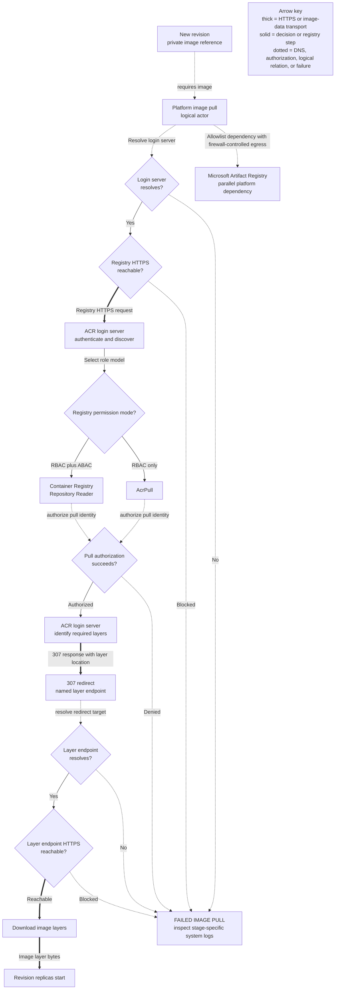

# Image Pull and Registry Operations

Image distribution reliability is foundational for stable deployments. This guide covers authentication, tagging, rotation, and troubleshooting for registry operations.

## ACR Authentication Methods

Container Apps can pull images from Azure Container Registry using several methods:

1. **Managed identity (recommended)**
   - Best for production security posture
   - No long-lived credentials in configuration
2. **Service principal**
   - Useful for cross-tenant or constrained scenarios
   - Requires credential lifecycle management
3. **Admin user (not recommended for production)**
   - Fast setup for testing only
   - Broad credentials increase risk

Assign the pull role that matches the registry's role assignment permissions mode: `Container Registry Repository Reader` for **RBAC Registry + ABAC Repository Permissions**, or `AcrPull` for **RBAC Registry Permissions**. The following example is for an RBAC-only registry:

```bash
az role assignment create \
  --assignee-object-id "<object-id>" \
  --assignee-principal-type "ServicePrincipal" \
  --role "AcrPull" \
  --scope "/subscriptions/<subscription-id>/resourceGroups/$RG/providers/Microsoft.ContainerRegistry/registries/$ACR_NAME"
```

| Command | Why it is used |
|---|---|
| `az role assignment create` | Grants the managed identity pull access on the registry. |
| `--assignee-object-id` | Selects the managed identity principal without a name lookup. |
| `--assignee-principal-type` | Declares the managed identity principal as a service principal. |
| `--role` | Uses `AcrPull` for this RBAC-only registry example. |
| `--scope` | Limits the assignment to the target registry. |

## Private ACR with VNet

For regulated workloads:

- Use Private Endpoint for ACR.
- Configure private DNS resolution in the same network boundary as Container Apps environment.
- Restrict public network access for the registry.

Validate connectivity from workload subnet before enforcing deny-public rules.

## Image Tagging Strategy

Use immutable version tags for deployment references:

- Good: `python-app:20260404.1`, `python-app:gitsha-1a2b3c4d`
- Avoid: relying only on `latest` in production

Maintain retention policy to prune stale tags while preserving rollback window.

## Registry Credential Rotation

If using service principal credentials:

- Rotate client secret on a fixed schedule.
- Update Container Apps secret references before expiry.
- Verify image pull after rotation and keep previous secret for rollback window.

Prefer managed identity to reduce operational rotation burden.

## ACR Tasks for Automated Builds

ACR Tasks can build images on commit or schedule without external runners.

```bash
az acr task create \
  --registry "$ACR_NAME" \
  --name "build-python-app" \
  --context "https://github.com/yeongseon/azure-container-apps-practical-guide.git" \
  --file "apps/python/Dockerfile" \
  --image "python-app:{{.Run.ID}}" \
  --commit-trigger-enabled true
```

| Command | Why it is used |
|---|---|
| `az acr task create` | Creates an ACR task that builds the sample image. |
| `--registry` | Selects the target registry. |
| `--name` | Names the task. |
| `--context` | Selects the source repository used as build context. |
| `--file` | Selects the Dockerfile within the context. |
| `--image` | Defines the output repository and run-specific tag. |
| `--commit-trigger-enabled` | Enables task runs when the source repository receives commits. |

## Troubleshooting Image Pull Failures

Common causes:

- Identity lacks the mode-appropriate pull role: `Container Registry Repository Reader` for ABAC-enabled ACR or `AcrPull` for RBAC-only ACR
- Image tag does not exist
- Registry firewall/private endpoint DNS misconfiguration
- Secret reference mismatch when using username/password auth

Collect system logs and verify effective image reference during rollout:

```bash
az containerapp logs show \
  --name "$APP_NAME" \
  --resource-group "$RG" \
  --type system
```

| Command | Purpose |
|---|---|
| `az containerapp logs show` | Pulls platform-generated system logs, which are where image-pull failures, registry auth errors, and revision provisioning errors are surfaced. |
| `--name "$APP_NAME"` / `--resource-group "$RG"` | Scopes the log collection to the app whose rollout failed so the investigation is tied to the correct revision history. |
| `--type system` | Chooses system logs instead of console logs because image download and registry authentication failures happen before the container process starts. |

## Image Pull Workflow

<!-- diagram-id: image-pull-workflow -->


*Figure: Registry HTTPS and authentication occur before the pull-authorization result. Authorization is not a transport hop. After authorization, the ACR login server identifies the required layers and returns the 307 redirect; the named endpoint's DNS and HTTPS path must then succeed before layer bytes arrive. MCR is shown as a separate platform dependency required on the allowlist when Azure Firewall controls environment egress, not as the application image source.*

## Registry Access Strategy Matrix

| Method | Security Posture | Operational Overhead | Recommendation |
|---|---|---|---|
| System-assigned managed identity | Strong | Low | Supported; tied to one app |
| User-assigned managed identity | Strong | Medium | Preferred when possible; reusable across apps |
| Service principal secret | Medium | High | Use only when MI is not possible |
| ACR admin user | Low | Medium | Avoid in production |

!!! tip "Validate image existence before deployment"
    Run a registry tag check in CI before calling `az containerapp update` to prevent preventable revision failures.

!!! warning "Network-restricted ACR requires DNS correctness"
    Private endpoint registry access fails if private DNS zone links are missing or stale, even when identity permissions are correct.

### Registry and Image Validation Commands

```bash
az acr repository show-tags \
  --name "$ACR_NAME" \
  --repository "$APP_NAME" \
  --output table

az containerapp show \
  --name "$APP_NAME" \
  --resource-group "$RG" \
  --query "properties.template.containers[].image" \
  --output table
```

| Command | Purpose |
|---|---|
| `az acr repository show-tags ...` | Lists the tags that actually exist in ACR for `$APP_NAME`, which lets the operator confirm the referenced image tag was published before blaming identity or networking. |
| `--name "$ACR_NAME"` | Selects the registry. |
| `--repository "$APP_NAME"` | Checks the repository that matches the deployed app image naming convention in this guide, which is the most direct way to catch tag drift or missing pushes. |
| `az containerapp show --query "properties.template.containers[].image"` | Reads the image reference stored in the current app template so you can compare what the app is trying to pull against the tags that ACR currently exposes. |
| `--name "$APP_NAME"` | Selects the Container App. |
| `--resource-group "$RG"` | Selects the resource group containing the app. |
| `--query` | Extracts image references from the app template. |
| `--output table` | Formats both checks for quick side-by-side operational review during triage. |

### Pull Failure Triage Table

| Log Pattern | Likely Cause | Immediate Action |
|---|---|---|
| `UNAUTHORIZED` | Wrong identity, ARM-audience setting, role propagation, or wrong role for the registry permission mode | Verify registry identity, authentication setting, mode-appropriate role, scope, and propagation |
| `MANIFEST_UNKNOWN` | Tag does not exist in repository | Confirm image tag pushed to ACR |
| `dial tcp` timeout | DNS or network path issue to registry | Validate private DNS and subnet routing |
| `denied` | Registry firewall policy blocks request | Allow trusted network path or private endpoint |

## See Also

- [Image Pull Failure Playbook](../../troubleshooting/playbooks/startup-and-provisioning/image-pull-failure.md)
- [Egress Control — Required Outbound Dependencies](../../platform/networking/egress-control.md#required-outbound-dependencies)
- [ACR Network Path Selection](../../platform/networking/acr-network-path-selection.md)
- [Troubleshooting Playbooks](../../troubleshooting/playbooks/index.md)
- [Deployment Workflows](../deployment/index.md)
- [Secret Rotation](../secret-rotation/index.md)

## Sources

- [Manage containers in Azure Container Apps](https://learn.microsoft.com/en-us/azure/container-apps/containers)
- [Authenticate with managed identity in Azure Container Apps](https://learn.microsoft.com/en-us/azure/container-apps/managed-identity-image-pull)
- [Azure Container Registry roles directory reference](https://learn.microsoft.com/en-us/azure/container-registry/container-registry-rbac-built-in-roles-directory-reference)
- [Dedicated data endpoints for Azure Container Registry](https://learn.microsoft.com/en-us/azure/container-registry/container-registry-dedicated-data-endpoints)
- [Use Azure Firewall with Azure Container Apps](https://learn.microsoft.com/en-us/azure/container-apps/use-azure-firewall)
