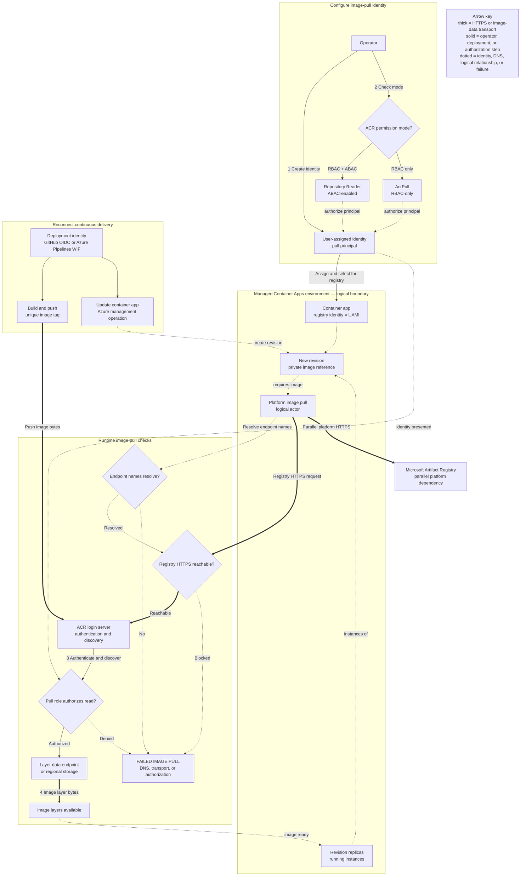

# Use a User-Assigned Managed Identity for ACR Image Pull

Configure an existing Container App to pull images from Azure Container Registry using a user-assigned managed identity (UAMI), then reconnect continuous delivery with a separate deployment identity. The pull identity answers **who the platform uses to fetch the image**; its ACR role answers **what that identity may read**; DNS and HTTPS connectivity determine **whether the registry and layer endpoints are reachable**. A GitHub Actions identity or Azure Pipelines service connection is a separate principal that builds, pushes, and updates the app.

**Takeaway:** Configure and authorize the pull identity before changing the image. Reconnecting continuous delivery does not replace the app's registry identity or its pull role.

<!-- diagram-id: uami-acr-pull-flow -->


*Figure: Runbook flow that consumes the shared `ENV` → `APP` → `REV_ACTIVE` → `REPLICAS` vocabulary. ACR remains an external dependency. Registry HTTPS and authentication discovery happen before the pull-authorization result; Microsoft Artifact Registry is a parallel platform dependency, not the source of the application image.*

## Prerequisites

- Current Azure CLI with the latest `containerapp` extension
- An existing Container App
- An Azure Container Registry with the target image
- Permissions to create managed identities and role assignments in the subscription
- ACR configured to allow ARM audience tokens for managed-identity image pull

## When to Use

- Migrating from admin credentials or service principal to managed identity
- Reconnecting Continuous Deployment after RBAC conflicts
- Separating image pull identity from application identity (system-assigned)
- Establishing a dedicated principal for ACR access auditing

## Procedure

### Step 0: Confirm ACR Accepts ARM Audience Tokens

Managed-identity image pull requires the registry to accept Azure Resource Manager audience tokens. Check the setting before changing the app:

```bash
az acr config authentication-as-arm show \
  --registry $ACR_NAME
```

| Command part | Purpose |
|---|---|
| `az acr config authentication-as-arm show` | Reads whether the registry accepts ARM audience tokens for authentication. |
| `--registry` | Selects the target registry. |

If the result reports `disabled`, enable it deliberately after reviewing the registry's authentication policy:

```bash
az acr config authentication-as-arm update \
  --registry $ACR_NAME \
  --status enabled
```

| Command part | Purpose |
|---|---|
| `az acr config authentication-as-arm update` | Changes the registry's ARM audience-token setting. |
| `--registry` | Selects the target registry. |
| `--status enabled` | Allows ARM audience tokens required by this managed-identity image-pull flow. |

### Step 1: Create a User-Assigned Managed Identity

```bash
az identity create \
  --resource-group $RG \
  --name "${APP_NAME}-uami" \
  --location $LOCATION
```

| Command part | Purpose |
|---|---|
| `az identity create` | Creates a user-assigned managed identity. |
| `--resource-group` | Places the identity in the same resource group used by the app resources. |
| `--name` | Names the identity so later commands can retrieve it consistently. |
| `--location` | Creates the identity in the target Azure region. |

Note the `id` (resource ID) and `principalId` from the output — both are needed in later steps.

### Step 2: Assign the UAMI to the Container App

```bash
UAMI_ID=$(az identity show \
  --resource-group $RG \
  --name "${APP_NAME}-uami" \
  --query id \
  --output tsv)

az containerapp identity assign \
  --resource-group $RG \
  --name $APP_NAME \
  --user-assigned "$UAMI_ID"
```

| Command part | Purpose |
|---|---|
| `az identity show` | Reads the managed identity metadata created in the previous step. |
| `--query id` | Returns only the identity resource ID for reuse. |
| `--output tsv` | Emits a shell-friendly value without JSON formatting. |
| `az containerapp identity assign` | Attaches the user-assigned identity to the Container App. |
| `--user-assigned` | Specifies which identity resource the app should use. |

### Step 3: Select and Grant the Pull Role

First inspect the registry's role assignment permissions mode. Use `Container Registry Repository Reader` when the result is `AbacRepositoryPermissions`; use `AcrPull` when the registry uses RBAC-only permissions. Legacy `AcrPull` assignments are not honored by ABAC-enabled registries.

```bash
UAMI_PRINCIPAL=$(az identity show \
  --resource-group $RG \
  --name "${APP_NAME}-uami" \
  --query principalId \
  --output tsv)

ACR_ID=$(az acr show \
  --name $ACR_NAME \
  --resource-group $RG \
  --query id \
  --output tsv)

ACR_ROLE_MODE=$(az acr show \
  --name $ACR_NAME \
  --resource-group $RG \
  --query roleAssignmentMode \
  --output tsv)

if [[ "$ACR_ROLE_MODE" == "AbacRepositoryPermissions" ]]; then
  ACR_PULL_ROLE="Container Registry Repository Reader"
else
  ACR_PULL_ROLE="AcrPull"
fi

az role assignment create \
  --assignee-object-id "$UAMI_PRINCIPAL" \
  --assignee-principal-type ServicePrincipal \
  --role "$ACR_PULL_ROLE" \
  --scope "$ACR_ID"
```

| Command part | Purpose |
|---|---|
| `az identity show --query principalId` | Gets the service principal object ID behind the managed identity. |
| `az acr show --query id` | Gets the registry scope for the role assignment. |
| `az acr show --query roleAssignmentMode` | Reads whether the registry uses ABAC-enabled or RBAC-only repository permissions. |
| `--name` | Selects the target identity or registry by name. |
| `--resource-group` | Selects the resource group containing the identity or registry. |
| `--query` | Extracts the required resource ID, principal ID, or role assignment mode. |
| `--output tsv` | Emits shell-friendly values without JSON formatting. |
| `az role assignment create` | Grants the identity permission to pull images from the registry. |
| `--assignee-object-id` | Uses the managed identity's principal ID without a Microsoft Graph name lookup. |
| `--assignee-principal-type ServicePrincipal` | Avoids ambiguous principal lookup during role assignment creation. |
| `--role` | Uses `Container Registry Repository Reader` for ABAC-enabled ACR or `AcrPull` for RBAC-only ACR. |
| `--scope` | Limits the permission to the target registry. |

!!! warning "Role Propagation Delay"
    Role assignments can take time to propagate. If the next step fails with an authorization error, wait and retry rather than changing DNS or registry transport settings without evidence.

### Step 4: Configure the Container App Registry to Use the UAMI

```bash
az containerapp registry set \
  --resource-group $RG \
  --name $APP_NAME \
  --server "${ACR_NAME}.azurecr.io" \
  --identity "$UAMI_ID"
```

| Command part | Purpose |
|---|---|
| `az containerapp registry set` | Updates the registry authentication configuration for the Container App. |
| `--server` | Identifies the ACR login server used by the image reference. |
| `--identity` | Selects the user-assigned identity for registry pulls. |

This tells Container Apps which identity to present when pulling from this registry. Merely attaching the identity to the app or granting it a role does not select it in the registry configuration.

### Step 5: Update the Container Image to Pull from ACR

```bash
az containerapp update \
  --resource-group $RG \
  --name $APP_NAME \
  --image "${ACR_NAME}.azurecr.io/${IMAGE_NAME}:${TAG}"
```

| Command part | Purpose |
|---|---|
| `az containerapp update` | Creates a new revision with the specified container image. |
| `--image` | Points the app to the private ACR image and tag. |

## Verification

Confirm the app is running with the ACR image:

```bash
az containerapp show \
  --resource-group $RG \
  --name $APP_NAME \
  --query "{image:properties.template.containers[0].image, registries:properties.configuration.registries, provisioningState:properties.provisioningState}" \
  --output json
```

| Command part | Purpose |
|---|---|
| `az containerapp show` | Reads the current Container App configuration. |
| `--query` | Extracts the image, registry identity, and provisioning state fields needed for verification. |
| `--output json` | Keeps nested registry details readable. |

Expected output shows:

- `image` pointing to your ACR
- `registries[0].identity` set to the UAMI resource ID
- `provisioningState` is `Succeeded`

## Reconnect Continuous Deployment (Optional)

Continuous delivery uses a deployment principal that is separate from the UAMI selected for image pull. The deployment principal needs permission to push the image and update the Container App; the Container App continues to use its configured UAMI when the platform pulls that image.

For GitHub Actions, prefer `azure/login` with OpenID Connect and a federated credential instead of a long-lived client secret. For Azure Pipelines, prefer an Azure Resource Manager service connection that uses workload identity federation. Then reconnect the workflow or service connection and confirm that it targets the existing app and registry:

1. Preserve the app's UAMI registry configuration; do not substitute the deployment principal as the pull identity.
2. Remove obsolete client secrets only after the federated connection succeeds.
3. In Deployment Center or your pipeline settings, reconnect GitHub Actions or the Azure Resource Manager service connection.
4. Grant the deployment principal only the roles needed to push to the registry and update the app. Role selection for an ABAC-enabled registry differs from legacy `AcrPush` in the same way that pull-role selection differs from `AcrPull`.
5. Trigger a deployment with a unique image tag, and verify that the pipeline updates the app and that the resulting revision becomes healthy.

!!! tip "CD Reconnect RBAC Conflicts"
    If the reconnect fails with a role assignment conflict, see the [CD RBAC Role Assignment Conflict](../../troubleshooting/playbooks/identity-and-configuration/cd-rbac-role-assignment-conflict.md) playbook.

## Rollback / Troubleshooting

| Symptom | Likely Cause | Action |
|---------|-------------|--------|
| `ImagePullBackOff` after update | DNS, HTTPS transport, role propagation, wrong role for the ACR mode, or wrong UAMI | Verify each stage separately; do not treat network reachability as proof of authorization. |
| `401 Unauthorized` | Registry not configured with UAMI | Re-run `az containerapp registry set` with `--identity` |
| App shows old image | Revision not updated | Confirm `az containerapp update` created a new revision |
| Pipeline can push but revision cannot start | Deployment principal works, but app pull identity or transport does not | Inspect the app registry identity and its mode-appropriate pull role. |

For detailed diagnosis, see the [Image Pull Failure](../../troubleshooting/playbooks/startup-and-provisioning/image-pull-failure.md) playbook and [Image Pull and Auth Errors KQL](../../troubleshooting/kql/system-and-revisions/image-pull-and-auth-errors.md) queries.

## Clean Up

To remove the demo resources:

```bash
az group delete --name $RG --yes --no-wait
```

| Command part | Purpose |
|---|---|
| `az group delete` | Removes the demo resource group and resources created for this procedure. |
| `--yes` | Confirms deletion without an interactive prompt. |
| `--no-wait` | Starts deletion and returns before Azure finishes removing the resources. |

## See Also

- [Image Pull and Registry Operations](index.md)
- [Managed Identity (Platform Concepts)](../../platform/identity-and-secrets/managed-identity.md)
- [CD RBAC Role Assignment Conflict Playbook](../../troubleshooting/playbooks/identity-and-configuration/cd-rbac-role-assignment-conflict.md)
- [CD Reconnect RBAC Conflict Lab](../../troubleshooting/lab-guides/cd-reconnect-rbac-conflict.md)

## Sources

- [Use managed identity for image pull — Microsoft Learn](https://learn.microsoft.com/en-us/azure/container-apps/managed-identity-image-pull)
- [Managed identities in Azure Container Apps — Microsoft Learn](https://learn.microsoft.com/en-us/azure/container-apps/managed-identity)
- [ACR built-in roles directory — Microsoft Learn](https://learn.microsoft.com/en-us/azure/container-registry/container-registry-rbac-built-in-roles-directory-reference)
- [ACR ABAC repository permissions — Microsoft Learn](https://learn.microsoft.com/en-us/azure/container-registry/container-registry-rbac-abac-repository-permissions)
- [Publish revisions with GitHub Actions — Microsoft Learn](https://learn.microsoft.com/en-us/azure/container-apps/github-actions)
- [Authenticate GitHub Actions to Azure with OIDC — Microsoft Learn](https://learn.microsoft.com/en-us/azure/developer/github/connect-from-azure-openid-connect)
- [Publish revisions with Azure Pipelines — Microsoft Learn](https://learn.microsoft.com/en-us/azure/container-apps/azure-pipelines)
- [Azure Resource Manager service connections — Microsoft Learn](https://learn.microsoft.com/en-us/azure/devops/pipelines/library/connect-to-azure)
