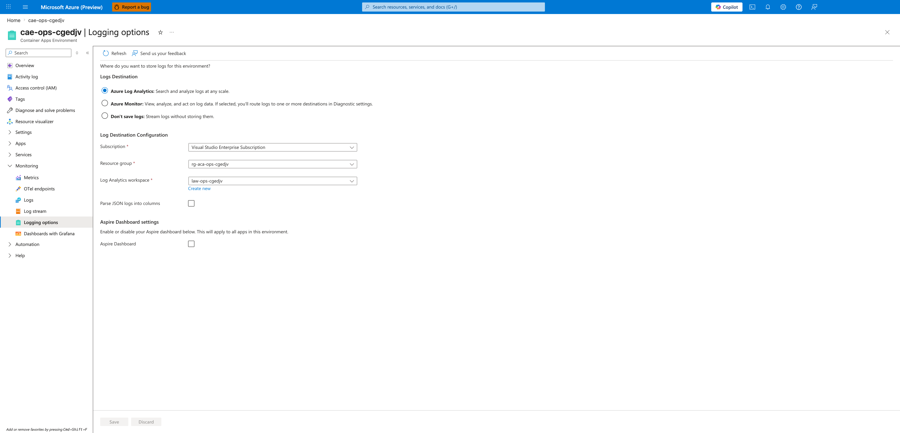
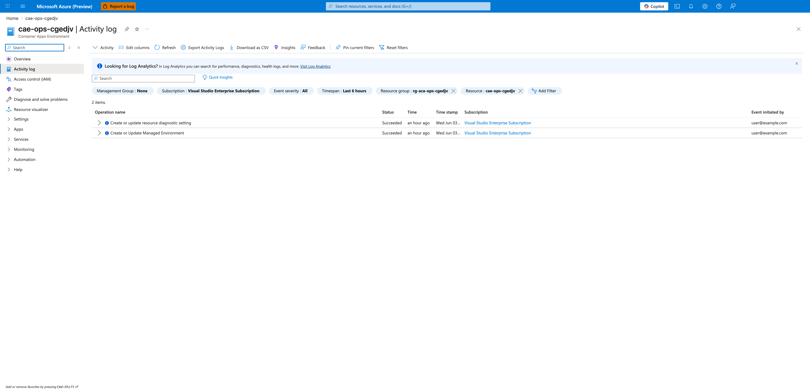
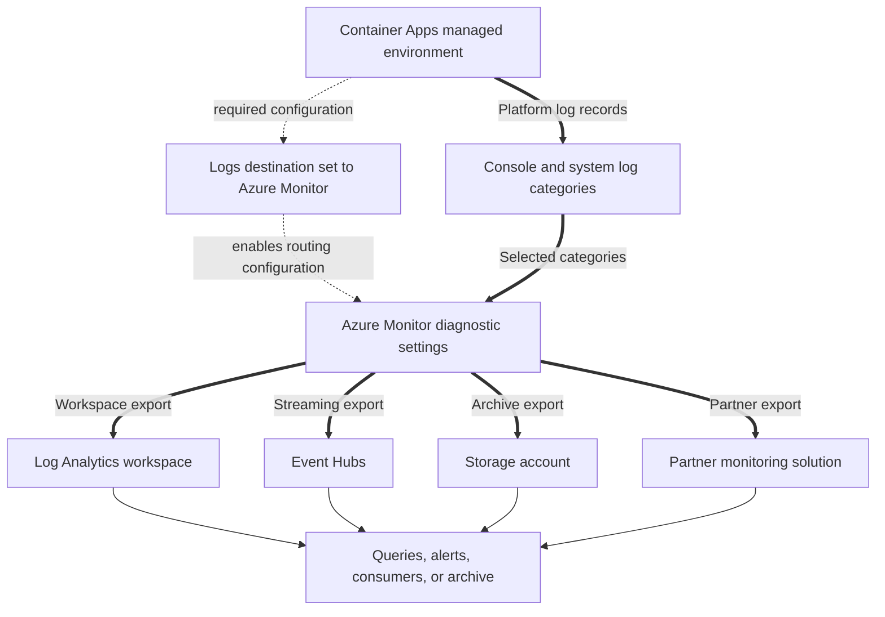

# Diagnostic Settings

Use diagnostic settings when the default workspace path is not enough and you need extra export, retention, or downstream processing for Container Apps environment logs.

## Prerequisites

- An existing Container Apps environment
- Permission to create diagnostic settings and target destinations
- Azure CLI access for both Container Apps and Azure Monitor resources

```bash
export RG="rg-aca-prod"
export ACA_ENV_NAME="aca-env-prod"
export ENVIRONMENT_ID="/subscriptions/<subscription-id>/resourceGroups/$RG/providers/Microsoft.App/managedEnvironments/$ACA_ENV_NAME"
```

## When to Use

- To send environment logs to additional Azure Monitor destinations
- To integrate with SIEM, archive, or Event Hub consumers
- To keep export scope tighter than a general workspace strategy

## Procedure

1. Identify the managed environment resource ID.
2. Set the environment logs destination to Azure Monitor.
3. Decide whether you need all available log categories or a limited set.
4. Create an environment-level diagnostic setting for the selected log categories.
5. Validate that records arrive at the destination.

Select Azure Monitor before configuring diagnostic log export:

```bash
az containerapp env update \
  --name "$ACA_ENV_NAME" \
  --resource-group "$RG" \
  --logs-destination azure-monitor
```

| Command | Why it is used |
|---|---|
| `az containerapp env update` | Changes the environment logging path before diagnostic export is configured. |
| `--name` | Targets the Container Apps environment stored in `$ACA_ENV_NAME`. |
| `--resource-group` | Scopes the logging update to the environment's resource group. |
| `--logs-destination` | Selects Azure Monitor so environment log categories can be routed by diagnostic settings. |

Example to route logs to Log Analytics:

```bash
az monitor diagnostic-settings create \
  --name "aca-env-diagnostics" \
  --resource "$ENVIRONMENT_ID" \
  --workspace "/subscriptions/<subscription-id>/resourceGroups/$RG/providers/Microsoft.OperationalInsights/workspaces/law-aca-prod" \
  --logs '[{"categoryGroup":"allLogs","enabled":true}]'
```

| Command | Why it is used |
|---|---|
| `az monitor diagnostic-settings create` | Creates the environment-level rule that exports Container Apps logs. |
| `--name` | Assigns `aca-env-diagnostics` as the diagnostic setting name. |
| `--resource` | Attaches the diagnostic setting to the managed environment identified by `$ENVIRONMENT_ID`. |
| `--workspace` | Routes exported environment logs to the specified Log Analytics workspace. |
| `--logs` | Enables every environment log category through the `allLogs` category group. |

### Portal view: confirm log destination on the environment

Open the Container Apps environment → **Monitoring** → **Logging options**.



[Observed] The Logging options blade shows three radio choices under **Logs Destination**: `Azure Log Analytics`, `Azure Monitor`, and `Don't save logs`. `Azure Log Analytics` is the selected option. Under **Log Destination Configuration**, `Subscription`, `Resource group` (`rg-aca-ops-cgedjv`), and `Log Analytics workspace` (`law-ops-cgedjv`) are populated, the `Parse JSON logs into columns` checkbox is unchecked, and the toolbar `Save` and `Discard` buttons are disabled.

[Inferred] The `Azure Log Analytics` selection plus the populated workspace value means this environment is using the direct workspace path shown in the capture. This is not the required state for the diagnostic-export procedure above. Before creating a diagnostic setting for environment log categories, select `Azure Monitor`, save the logging option, and then configure the diagnostic setting and its destinations.

[Not Proven] This blade alone does not list the `az monitor diagnostic-settings` rules that exist on the environment, does not show the categories or category groups those rules export, and does not confirm whether records are currently arriving at the destination — those need a separate confirmation (see the Activity log view below and the Verification section).

### Portal view: confirm the diagnostic setting was created

Open the Container Apps environment → **Activity log** and filter by recent operations.



[Observed] The Activity log blade shows two rows: `Create or update resource diagnostic setting` and `Create or Update Managed Environment`, both with `Status = Succeeded`. The filter chips above the grid show `Resource group: rg-aca-ops-cgedjv` and `Resource: cae-ops-cgedjv`, the timespan is `Last 6 hours`, and the row count reads `2 items`.

[Inferred] The `Create or update resource diagnostic setting` row that targets `cae-ops-cgedjv` is the Activity-log record produced by the `az monitor diagnostic-settings create --resource $ENVIRONMENT_ID ...` call from the Procedure. A `Succeeded` status here is the operation-level result for the control-plane write, so it confirms the rule was accepted by Azure Resource Manager against the managed environment.

[Not Proven] This Activity-log row does not show which categories (`allLogs` vs. a category subset) the rule exports, does not show the destination type (Log Analytics vs. Event Hub vs. Storage), and does not confirm that log records are flowing to that destination — only that the write succeeded. Use `az monitor diagnostic-settings list --resource "$ENVIRONMENT_ID"` to read the actual rule, and the Verification section below to confirm ingestion.

Minimal Bicep pattern:

```bicep
resource diagnosticSetting 'Microsoft.Insights/diagnosticSettings@2021-05-01-preview' = {
  name: 'aca-env-diagnostics'
  scope: managedEnvironment
  properties: {
    logs: [
      {
        categoryGroup: 'allLogs'
        enabled: true
      }
    ]
    workspaceId: logAnalyticsWorkspace.id
  }
}
```

!!! note "Container Apps diagnostic-setting categories"
    Environment-level diagnostic settings support the category group `allLogs` and the log categories `ContainerAppConsoleLogs` and `ContainerAppSystemLogs`, plus `AllMetrics`. Container-app-level diagnostic settings support `AllMetrics` only; they do not support the `--logs` parameter.

<!-- diagram-id: diagnostic-settings-routing-flow -->


After the environment logs destination is set to Azure Monitor, diagnostic settings route selected environment log categories to one or more destinations. App-level diagnostic settings are a separate metrics-only path.

## Verification

- Confirm the diagnostic setting exists on the managed environment.
- Confirm the selected categories or category group match your intended scope.
- Confirm records arrive in the chosen destination.

## Rollback / Troubleshooting

- If ingestion cost rises, reduce categories or retention.
- If no logs arrive, verify permissions on the destination resource.
- If you see duplicate ingestion, review overlap with existing workspace collection.

## See Also

- [Logging Operations](index.md)
- [Monitoring](../monitoring/index.md)
- [Alerts](../alerts/index.md)

## Sources

- [Diagnostic settings in Azure Monitor](https://learn.microsoft.com/en-us/azure/azure-monitor/essentials/diagnostic-settings)
- [Log monitoring in Azure Container Apps](https://learn.microsoft.com/en-us/azure/container-apps/log-monitoring)
- [Log storage and monitoring options](https://learn.microsoft.com/en-us/azure/container-apps/log-options)
