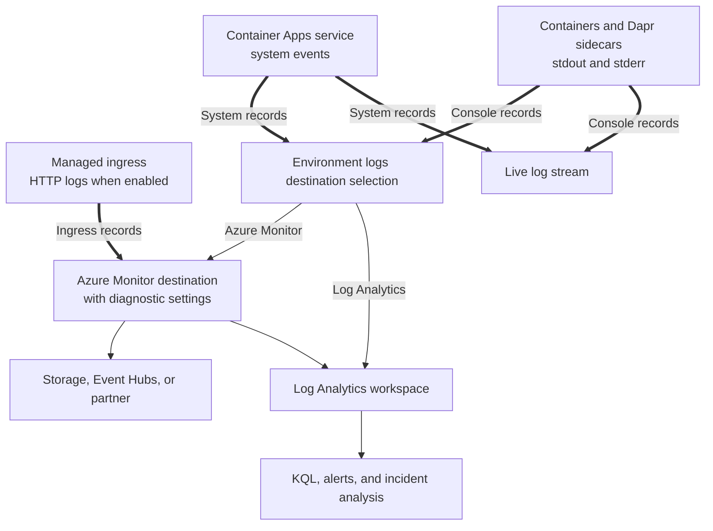

# Logging Operations

Azure Container Apps logging operations start with separating application console output from platform system events, then deciding where those streams should be retained, queried, and exported.

## Prerequisites

- A Container Apps environment and at least one running app
- Azure CLI with the Container Apps extension installed
- Access to the workspace or monitoring destination used by the environment

```bash
export RG="rg-aca-prod"
export APP_NAME="app-python-api-prod"
export ACA_ENV_NAME="aca-env-prod"

az extension add --name containerapp --upgrade
```

| Command | Why it is used |
|---|---|
| `az extension add` | Installs the Container Apps extension required for the logging checks on this page. |
| `--name` | Identifies `containerapp` as the extension needed to inspect environment logging. |
| `--upgrade` | Updates an existing installation so current logging commands and flags are available. |

## When to Use

- When you need to explain how Container Apps logs are produced and stored
- When you are standardizing workspace, export, or retention decisions
- When you need to separate app stdout or stderr from platform lifecycle events

## Procedure

1. Confirm the environment log destination.
2. Treat console logs and system logs as separate operational streams.
3. Query the active workspace tables before automating alerts.
4. To use diagnostic settings for log export, select Azure Monitor as the environment logs destination, then configure the environment-level categories and destinations.

Container Apps operationally produces three useful log types:

- **Console logs** for application stdout and stderr
- **System logs** for revision lifecycle, probe, scale, replica, and platform events
- **HTTP logs** for ingress request and response details when enabled through diagnostic settings

For workspace queries, use the table names that exist in your environment. Microsoft Learn currently documents both naming patterns:

- Native Azure Monitor table reference pages: `ContainerAppConsoleLogs`, `ContainerAppSystemLogs`
- Container Apps log-monitoring article and CLI examples: `ContainerAppConsoleLogs_CL`, `ContainerAppSystemLogs_CL`

Check your workspace schema before standardizing KQL. Microsoft Learn's Container Apps article still shows `_CL` tables and suffixed columns, while Azure Monitor's table reference pages document native tables and unsuffixed columns.

<!-- diagram-id: logging-architecture-overview -->


The logging architecture separates the live stream from persisted destinations. The Azure Monitor branch requires environment-level diagnostic settings for log categories; app-level diagnostic settings support metrics only.

Log retention is primarily a workspace and downstream destination decision. Keep Container Apps runbooks aligned with:

- Log Analytics retention policy
- Diagnostic settings export scope
- Cost controls for noisy console logs

## Verification

Check the environment logging configuration:

```bash
az containerapp env show \
  --name "$ACA_ENV_NAME" \
  --resource-group "$RG" \
  --query "properties.appLogsConfiguration" \
  --output json
```

| Command | Why it is used |
|---|---|
| `az containerapp env show` | Reads the environment configuration to verify its active log destination. |
| `--name` | Targets the Container Apps environment stored in `$ACA_ENV_NAME`. |
| `--resource-group` | Scopes the lookup to the environment's resource group. |
| `--query` | Projects only `appLogsConfiguration`, where the destination and workspace settings are stored. |
| `--output` | Returns the logging configuration as structured JSON evidence. |

Validate that the expected tables exist by running a short query against your workspace and testing both native and legacy names if needed.

## Rollback / Troubleshooting

- If logs are missing, verify the environment log destination before changing app code.
- If KQL returns no rows, test both native and legacy table names.
- If costs spike, reduce noisy application logging before broadening export scope.

## See Also

- [Log Streaming](log-streaming.md)
- [Log Analytics Queries](log-analytics-queries.md)
- [Diagnostic Settings](diagnostic-settings.md)
- [Monitoring](../monitoring/index.md)
- [Alerts](../alerts/index.md)

## Sources

- [Log monitoring in Azure Container Apps](https://learn.microsoft.com/en-us/azure/container-apps/log-monitoring)
- [Log storage and monitoring options](https://learn.microsoft.com/en-us/azure/container-apps/log-options)
- [ContainerAppConsoleLogs table reference](https://learn.microsoft.com/en-us/azure/azure-monitor/reference/tables/containerappconsolelogs)
- [ContainerAppSystemLogs table reference](https://learn.microsoft.com/en-us/azure/azure-monitor/reference/tables/containerappsystemlogs)
