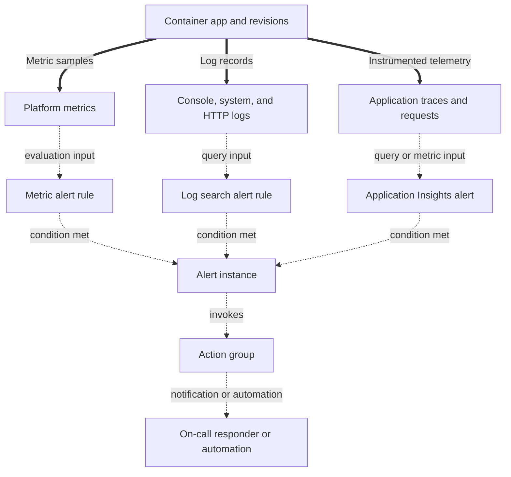
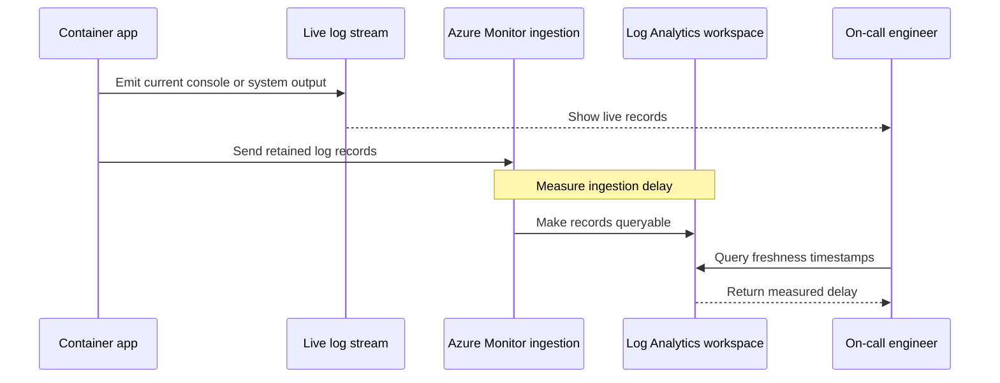

# Observability Operations

This guide covers production observability operations for Container Apps using metrics, Log Analytics, Application Insights, and distributed tracing. Logging-specific runbooks now live in the dedicated [Logging](../logging/index.md) section.

## Signals and Alerting Architecture

<!-- diagram-id: signals-and-alerting-architecture -->


Signals remain distinct through evaluation, then converge on an alert instance and its associated action group.

!!! info "This page is operational; metric definitions live in Reference"
    This page covers *how* to wire signals, queries, and alerts in production. For *what* each metric measures — exact metric IDs, aggregations, dimensions, percentage denominators, and KEDA scaler attribution — see the [Container Apps metrics reference](../../reference/metrics/index.md). Use that page when building an alert rule, dashboard, or autoscale rule and you need the precise metric contract.

## Prerequisites

- Log Analytics workspace connected to the Container Apps environment
- Application Insights configured for application telemetry

```bash
export RG="rg-myapp"
export APP_NAME="ca-myapp"
export ACA_ENV_NAME="cae-myapp"
```

## Log Analytics Operations

Identify workspace connected to the environment:

```bash
az containerapp env show \
  --name "$ACA_ENV_NAME" \
  --resource-group "$RG" \
  --query "properties.appLogsConfiguration" \
  --output json
```

| Command | Why it is used |
|---|---|
| `az containerapp env show` | Reads the environment configuration to identify its monitoring destination. |
| `--name` | Targets the Container Apps environment stored in `$ACA_ENV_NAME`. |
| `--resource-group` | Scopes the destination lookup to the environment's resource group. |
| `--query` | Projects `appLogsConfiguration`, including the active destination and workspace details. |
| `--output` | Returns the environment logging path as structured JSON evidence. |

Example output (PII scrubbed):

```json
{
  "destination": "log-analytics",
  "logAnalyticsConfiguration": {
    "customerId": "xxxxxxxx-xxxx-xxxx-xxxx-xxxxxxxxxxxx"
  }
}
```

Run a KQL query for recent errors:

```bash
az monitor log-analytics query \
  --workspace "<log-analytics-workspace-id>" \
  --analytics-query "ContainerAppConsoleLogs | where ContainerAppName == '$APP_NAME' | where Log contains 'ERROR' | limit 50" \
  --output table
```

| Command | Why it is used |
|---|---|
| `az monitor log-analytics query` | Queries retained console logs for recent application errors. |
| `--workspace` | Targets the Log Analytics workspace connected to the Container Apps environment. |
| `--analytics-query` | Filters `$APP_NAME` console records for `ERROR` and limits the incident sample to 50 rows. |
| `--output` | Formats the recent-error result as a table for operator review. |

Microsoft Learn currently documents both schema patterns for Container Apps logs: the Container Apps log-monitoring article queries `ContainerAppConsoleLogs_CL`, while Azure Monitor table references document the native `ContainerAppConsoleLogs` table. Check your workspace schema first, then match the table and column names to that shape.

Example output:

```text
No results found.
```

## Application Insights Operations

List availability and request telemetry for the app:

```bash
az monitor app-insights query \
  --app "<app-insights-name>" \
  --resource-group "$RG" \
  --analytics-query "requests | where cloud_RoleName == '$APP_NAME' | summarize count() by resultCode, bin(timestamp, 5m)" \
  --output table
```

| Command | Why it is used |
|---|---|
| `az monitor app-insights query` | Queries request telemetry to summarize response codes for the app. |
| `--app` | Targets the Application Insights component receiving this app's request telemetry. |
| `--resource-group` | Scopes the telemetry query to the component's resource group. |
| `--analytics-query` | Counts `$APP_NAME` requests by result code in five-minute bins. |
| `--output` | Formats the request aggregation as a table for incident analysis. |

Use container logs directly during active incidents:

```bash
az containerapp logs show \
  --name "$APP_NAME" \
  --resource-group "$RG" \
  --type console \
  --follow false
```

| Command | Why it is used |
|---|---|
| `az containerapp logs show` | Retrieves a bounded snapshot of current application output during an incident. |
| `--name` | Targets the Container App stored in `$APP_NAME`. |
| `--resource-group` | Scopes the log snapshot to the app's resource group. |
| `--type` | Chooses console logs because the check is for application output. |
| `--follow` | Disables continuous streaming so the command returns the available incident sample. |

Example output from the running revision:

```json
{"status":"healthy","timestamp":"2026-04-04T11:32:37.322216+00:00"}
```

Track replica and revision health as platform signals:

```bash
az containerapp revision list \
  --name "$APP_NAME" \
  --resource-group "$RG" \
  --output json

az containerapp replica list \
  --name "$APP_NAME" \
  --resource-group "$RG" \
  --revision "ca-myapp--0000001" \
  --output json
```

| Command | Why it is used |
|---|---|
| `az containerapp revision list` | Lists rollout state, traffic, and health across the app's revisions. |
| `az containerapp replica list` | Lists container readiness and restart state for the revision being investigated. |
| `--name` | Targets the Container App stored in `$APP_NAME` for both health checks. |
| `--resource-group` | Scopes both checks to the app's resource group. |
| `--revision` | Narrows replica inspection to `ca-myapp--0000001`. |
| `--output` | Preserves revision and replica health details as structured JSON evidence. |

Example output (PII scrubbed):

```json
[
  {
    "name": "ca-myapp--0000001",
    "active": true,
    "trafficWeight": 100,
    "replicas": 1,
    "healthState": "Healthy",
    "runningState": "Running"
  }
]
```

```json
[
  {
    "name": "ca-myapp--0000001-646779b4c5-bhc2v",
    "properties": {
      "containers": [
        {
          "name": "ca-myapp",
          "ready": true,
          "restartCount": 0,
          "runningState": "Running"
        }
      ],
      "runningState": "Running"
    }
  }
]
```

## Distributed Tracing Operations

Confirm trace context propagation across services by querying end-to-end operation IDs in Application Insights.

```bash
az monitor app-insights query \
  --app "<app-insights-name>" \
  --resource-group "$RG" \
  --analytics-query "dependencies | where cloud_RoleName == '$APP_NAME' | project timestamp, operation_Id, target, resultCode | limit 20" \
  --output table
```

| Command | Why it is used |
|---|---|
| `az monitor app-insights query` | Queries dependency telemetry for end-to-end operation correlation. |
| `--app` | Targets the Application Insights component receiving this app's dependency telemetry. |
| `--resource-group` | Scopes the dependency query to the component's resource group. |
| `--analytics-query` | Projects recent `$APP_NAME` operation IDs, targets, and result codes for trace correlation. |
| `--output` | Formats the dependency sample as a table for cross-service diagnosis. |

## Verification Steps

Check that logs and traces are flowing within expected delay windows.

```bash
az monitor app-insights component show \
  --app "<app-insights-name>" \
  --resource-group "$RG" \
  --output json
```

| Command | Purpose |
|---|---|
| `az monitor app-insights component show` | Verifies that the Application Insights component itself exists and is provisioned successfully before you interpret missing traces as an app-side telemetry problem. |
| `--app "<app-insights-name>"` | Targets the exact App Insights component backing this Container App's observability pipeline, which is important when a resource group contains multiple telemetry components. |
| `--resource-group "$RG"` | Keeps the verification scoped to the same operational environment as the app you are monitoring. |
| `--output json` | Returns the component metadata in a form that is easy to inspect for IDs and provisioning state during verification. |

Example output (PII masked):

```json
{
  "id": "/subscriptions/<subscription-id>/resourceGroups/rg-myapp/providers/microsoft.insights/components/<app-insights-name>",
  "name": "<app-insights-name>",
  "provisioningState": "Succeeded"
}
```

## Observability Decision Matrix

| Signal Type | Best For | Query Surface | Typical Alert Latency |
|---|---|---|---|
| Platform metrics | Fast saturation and availability detection | Azure Monitor metrics | Verify against the alert rule evaluation frequency |
| Console/system logs | Detailed failure context and root cause hints | Log Analytics (KQL) | Expect several minutes; measure in your workspace |
| Distributed traces | Cross-service request path analysis | Application Insights | Measure end-to-end freshness for your instrumentation path |

!!! tip "Pair every alert with an investigation query"
    For each alert rule, store a companion KQL query that responders can run immediately. This shortens MTTR by removing first-response guesswork.

!!! warning "Avoid unbounded log volume"
    Excessive debug logging can increase ingestion cost and hide actionable events. Use structured JSON logs and severity controls in production.

### Telemetry Freshness Workflow

<!-- diagram-id: telemetry-freshness-workflow -->


The sequence distinguishes immediate live-stream inspection from the asynchronous path that makes retained logs queryable.

## Troubleshooting

### No logs in workspace

- Confirm environment log configuration points to the expected workspace.
- Check regional alignment between app, environment, and workspace.
- Validate IAM permissions for querying telemetry resources.

### Missing distributed traces

- Verify OpenTelemetry exporter endpoint and connection string settings.
- Ensure incoming requests include trace context headers.

## Advanced Topics

- Define SLO-based alerts (latency, error rate, saturation).
- Build dashboards combining infra metrics and app traces.
- Use sampling strategies to balance fidelity and telemetry cost.

## See Also
- [Container Apps metrics reference](../../reference/metrics/index.md) — metric IDs, aggregations, dimensions, denominators, KEDA scaler observability
- [Logging](../logging/index.md)
- [Log Streaming](../logging/log-streaming.md)
- [Log Analytics Queries](../logging/log-analytics-queries.md)
- [Health and Recovery](../../platform/reliability/health-recovery.md)
- [Cost Optimization](../../platform/reliability/cost-optimization.md)

## Sources
- [Azure Monitor for Container Apps](https://learn.microsoft.com/en-us/azure/container-apps/log-monitoring)
- [ContainerAppConsoleLogs table reference](https://learn.microsoft.com/en-us/azure/azure-monitor/reference/tables/containerappconsolelogs)
- [ContainerAppSystemLogs table reference](https://learn.microsoft.com/en-us/azure/azure-monitor/reference/tables/containerappsystemlogs)
- [OpenTelemetry in Azure Container Apps (Microsoft Learn)](https://learn.microsoft.com/en-us/azure/container-apps/opentelemetry-agents)
- [Log storage and monitoring options](https://learn.microsoft.com/en-us/azure/container-apps/log-options)
- [Log data ingestion time in Azure Monitor](https://learn.microsoft.com/en-us/azure/azure-monitor/logs/data-ingestion-time)
- [Overview of Azure Monitor alerts](https://learn.microsoft.com/en-us/azure/azure-monitor/alerts/alerts-overview)
