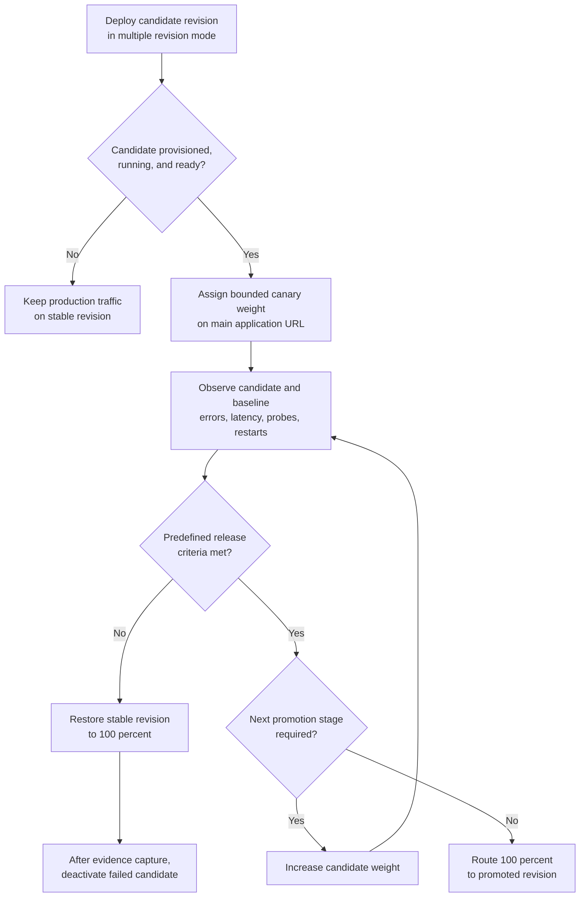

# Revision Operations

This guide focuses on operating revisions in production: activating/deactivating revisions, splitting traffic safely, and performing fast rollbacks.

## Prerequisites

- App deployed in a Container Apps environment
- A known stable revision available for rollback

```bash
export RG="rg-aca-prod"
export APP_NAME="app-python-api-prod"
export ACA_ENV_NAME="aca-env-prod"
```

## Revision Mode Management

Use multiple revision mode for canary or A/B releases.

```bash
az containerapp revision set-mode \
  --name "$APP_NAME" \
  --resource-group "$RG" \
  --mode multiple
```


| Command | Purpose |
|---|---|
| `az containerapp revision set-mode` | Sets stable single or multiple active revision mode. |
| `--name` | Selects the target container app or extension. |
| `--resource-group` | Selects the resource group that contains the app. |
| `--mode` | Specifies the active revision mode. |


Review revisions and health state:

```bash
az containerapp revision list \
  --name "$APP_NAME" \
  --resource-group "$RG" \
  --output table
```


| Command | Purpose |
|---|---|
| `az containerapp revision list` | Lists revisions and their current operational fields. |
| `--name` | Selects the target container app or extension. |
| `--resource-group` | Selects the resource group that contains the app. |
| `--output` | Selects the command output format. |


Use Activity Log for deployment event timeline:

```bash
az monitor activity-log list \
  --resource-group "$RG" \
  --max-events 20 \
  --status Succeeded \
  --output table
```


| Command | Purpose |
|---|---|
| `az monitor activity-log list` | Lists matching Azure Activity Log events. |
| `--resource-group` | Selects the resource group that contains the app. |
| `--max-events` | Limits the number of Activity Log events returned. |
| `--status` | Filters Activity Log entries by operation status. |
| `--output` | Selects the command output format. |


## Traffic Splitting

Shift a small percentage to the candidate revision first.

```bash
az containerapp ingress traffic set \
  --name "$APP_NAME" \
  --resource-group "$RG" \
  --revision-weight "${APP_NAME}--stable=90" "${APP_NAME}--candidate=10"
```


| Command | Purpose |
|---|---|
| `az containerapp ingress traffic set` | Updates ingress traffic routing rules. |
| `--name` | Selects the target container app or extension. |
| `--resource-group` | Selects the resource group that contains the app. |
| `--revision-weight` | Assigns main-URL traffic percentages to named revisions. |


Gradually increase traffic only when SLOs remain healthy.

## Rollback Procedure

Return 100% traffic to last known good revision:

```bash
az containerapp ingress traffic set \
  --name "$APP_NAME" \
  --resource-group "$RG" \
  --revision-weight "${APP_NAME}--stable=100"
```


| Command | Purpose |
|---|---|
| `az containerapp ingress traffic set` | Updates ingress traffic routing rules. |
| `--name` | Selects the target container app or extension. |
| `--resource-group` | Selects the resource group that contains the app. |
| `--revision-weight` | Assigns main-URL traffic percentages to named revisions. |


Deactivate failed revision:

```bash
az containerapp revision deactivate \
  --name "$APP_NAME" \
  --resource-group "$RG" \
  --revision "${APP_NAME}--candidate"
```


| Command | Purpose |
|---|---|
| `az containerapp revision deactivate` | Deactivates the selected revision and stops its replicas. |
| `--name` | Selects the target container app or extension. |
| `--resource-group` | Selects the resource group that contains the app. |
| `--revision` | Selects the exact revision to manage. |


## Verification Steps

```bash
az containerapp ingress traffic show \
  --name "$APP_NAME" \
  --resource-group "$RG" \
  --output json
```


| Command | Purpose |
|---|---|
| `az containerapp ingress traffic show` | Shows the current ingress traffic routing rules. |
| `--name` | Selects the target container app or extension. |
| `--resource-group` | Selects the resource group that contains the app. |
| `--output` | Selects the command output format. |


Example output (PII masked):

```json
[
  {
    "revisionName": "app-python-api-prod--stable",
    "weight": 100
  }
]
```

## Troubleshooting

### New revision is healthy but receives no traffic

- Confirm app is in multiple revision mode.
- Check exact revision name from `revision list` command.
- Ensure ingress is enabled before setting traffic weights.

```bash
az containerapp show \
  --name "$APP_NAME" \
  --resource-group "$RG" \
  --query "properties.configuration.ingress" \
  --output json
```


| Command | Purpose |
|---|---|
| `az containerapp show` | Shows the selected container app configuration. |
| `--name` | Selects the target container app or extension. |
| `--resource-group` | Selects the resource group that contains the app. |
| `--query` | Projects the response to the fields needed for this check. |
| `--output` | Selects the command output format. |


## Revision Promotion Workflow

<!-- diagram-id: revision-promotion-workflow -->


*Figure: Promotion begins only after the candidate is ready. A failed gate changes traffic first; deactivation follows after the operator preserves the evidence needed for diagnosis.*

| Scenario | Recommended Action | Why |
|---|---|---|
| New feature with unknown risk | Multiple revision mode + staged traffic | Limits blast radius |
| Security hotfix | Fast deploy + focused health checks | Reduces exposure window |
| Runtime regression detected | Immediate traffic rollback | Restores service quickly |
| Stable period after rollout | Deactivate stale revisions | Reduces operational noise |

!!! tip "Name revisions with meaningful image tags"
    Immutable image tags mapped to commit SHA or release IDs make revision rollback decisions deterministic during incidents.

Microsoft Learn explicitly ties traffic promotion to readiness: in multiple revision mode, "wait until your readiness probes indicate success before you shift traffic to that revision." A revision can exist before it is ready for safe promotion, so validate health, restart count, and error rate before increasing traffic.

### Revision Health Validation Commands

```bash
az containerapp revision list \
  --name "$APP_NAME" \
  --resource-group "$RG" \
  --query "[].{name:name,active:properties.active,replicas:properties.replicas,healthState:properties.healthState,runningState:properties.runningState}" \
  --output table

az containerapp ingress traffic show \
  --name "$APP_NAME" \
  --resource-group "$RG" \
  --output table
```


| Command | Purpose |
|---|---|
| `az containerapp revision list` | Lists revisions and their current operational fields. |
| `--name` | Selects the target container app or extension. |
| `--resource-group` | Selects the resource group that contains the app. |
| `--query` | Projects the response to the fields needed for this check. |
| `--output` | Selects the command output format. |
| `az containerapp ingress traffic show` | Shows the current ingress traffic routing rules. |


## Advanced Topics

- Use labels for stable/candidate routing patterns.
- Implement progressive delivery with automated rollback on alert.
- Keep at least one warm standby revision for instant failback.

## See Also
- [Health and Recovery](../../platform/reliability/health-recovery.md)
- [Observability](../monitoring/index.md)

## Sources
- [Azure Container Apps revisions](https://learn.microsoft.com/en-us/azure/container-apps/revisions)
- [Traffic splitting in Azure Container Apps (Microsoft Learn)](https://learn.microsoft.com/en-us/azure/container-apps/traffic-splitting)
