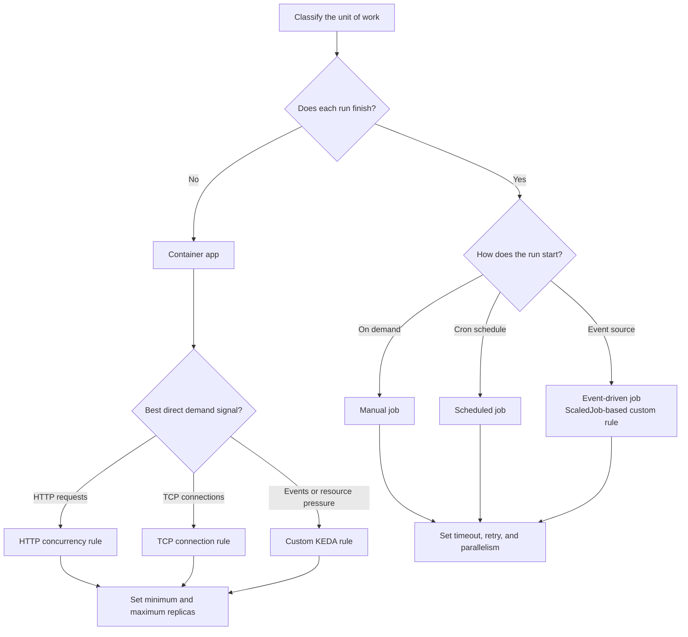

# Scaling Operations

This guide explains how to operate scaling in production, including replica floor and ceiling adjustments, KEDA-based autoscaling, and scale-to-zero behavior.

## Prerequisites

- Existing Container App in a managed environment
- Baseline performance targets (latency, throughput, queue delay)

```bash
export RG="rg-aca-prod"
export APP_NAME="app-python-api-prod"
export ACA_ENV_NAME="aca-env-prod"
```

## Adjust Replica Floors and Ceilings for Controlled Events

Adjust the autoscaling floor and ceiling for maintenance windows or expected short-term load. Different minimum and maximum values still allow autoscaling within those bounds; they do not set a fixed replica count.

```bash
az containerapp update \
  --name "$APP_NAME" \
  --resource-group "$RG" \
  --min-replicas 3 \
  --max-replicas 10
```

| Command or parameter | Purpose |
|---|---|
| `az containerapp update` | Update the Container App configuration and create a revision when the changed property is revision-scoped. |
| `--max-replicas` | Set the revision's upper replica bound. |
| `--min-replicas` | Set the revision's lower replica bound. |
| `--name` | Select the named extension or Container App. |
| `--resource-group` | Select the resource group that contains the app. |


Check current replica settings:

```bash
az containerapp show \
  --name "$APP_NAME" \
  --resource-group "$RG" \
  --query "properties.template.scale" \
  --output json
```

| Command or parameter | Purpose |
|---|---|
| `az containerapp show` | Read the current Container App configuration. |
| `--name` | Select the named extension or Container App. |
| `--output` | Choose the command output format. |
| `--query` | Project only the requested fields from the response. |
| `--resource-group` | Select the resource group that contains the app. |


## KEDA Rule Operations

Scale based on HTTP concurrency:

```bash
az containerapp update \
  --name "$APP_NAME" \
  --resource-group "$RG" \
  --scale-rule-name "http-concurrency" \
  --scale-rule-type "http" \
  --scale-rule-metadata "concurrentRequests=100" \
  --min-replicas 1 \
  --max-replicas 20
```

| Command or parameter | Purpose |
|---|---|
| `az containerapp update` | Update the Container App configuration and create a revision when the changed property is revision-scoped. |
| `--max-replicas` | Set the revision's upper replica bound. |
| `--min-replicas` | Set the revision's lower replica bound. |
| `--name` | Select the named extension or Container App. |
| `--resource-group` | Select the resource group that contains the app. |
| `--scale-rule-metadata` | Supply the scaler-specific threshold and source metadata. |
| `--scale-rule-name` | Assign a stable name to the scale rule. |
| `--scale-rule-type` | Select the HTTP, resource, or KEDA scaler type. |


Example queue scaler operation (Azure Service Bus):

```bash
az containerapp update \
  --name "$APP_NAME" \
  --resource-group "$RG" \
  --scale-rule-name "sb-queue" \
  --scale-rule-type "azure-servicebus" \
  --scale-rule-metadata "queueName=orders" "messageCount=50" "namespace=<servicebus-namespace>"
```

| Command or parameter | Purpose |
|---|---|
| `az containerapp update` | Update the Container App configuration and create a revision when the changed property is revision-scoped. |
| `--name` | Select the named extension or Container App. |
| `--resource-group` | Select the resource group that contains the app. |
| `--scale-rule-metadata` | Supply the scaler-specific threshold and source metadata. |
| `--scale-rule-name` | Assign a stable name to the scale rule. |
| `--scale-rule-type` | Select the HTTP, resource, or KEDA scaler type. |


Use Azure Monitor metrics to tune thresholds:

```bash
az monitor metrics list \
  --resource "/subscriptions/<subscription-id>/resourceGroups/$RG/providers/Microsoft.App/containerApps/$APP_NAME" \
  --metrics "Requests" \
  --interval "PT1M" \
  --output table
```

| Command or parameter | Purpose |
|---|---|
| `az monitor metrics list` | Query Azure Monitor metrics for the selected resource. |
| `--interval` | Set the metric aggregation interval. |
| `--metrics` | Select the Azure Monitor metric to retrieve. |
| `--output` | Choose the command output format. |
| `--resource` | Select the Azure resource whose metrics are queried. |


## Scale-to-Zero Operations

Enable scale-to-zero for event-driven or intermittent workloads:

```bash
az containerapp update \
  --name "$APP_NAME" \
  --resource-group "$RG" \
  --min-replicas 0 \
  --max-replicas 10
```

| Command or parameter | Purpose |
|---|---|
| `az containerapp update` | Update the Container App configuration and create a revision when the changed property is revision-scoped. |
| `--max-replicas` | Set the revision's upper replica bound. |
| `--min-replicas` | Set the revision's lower replica bound. |
| `--name` | Select the named extension or Container App. |
| `--resource-group` | Select the resource group that contains the app. |


Use this mode only when cold start impact is acceptable.

## Verification Steps

```bash
az containerapp replica list \
  --name "$APP_NAME" \
  --resource-group "$RG" \
  --output table
```

| Command or parameter | Purpose |
|---|---|
| `az containerapp replica list` | List replicas for the selected Container App. |
| `--name` | Select the named extension or Container App. |
| `--output` | Choose the command output format. |
| `--resource-group` | Select the resource group that contains the app. |


```bash
az containerapp show \
  --name "$APP_NAME" \
  --resource-group "$RG" \
  --query "{minReplicas:properties.template.scale.minReplicas,maxReplicas:properties.template.scale.maxReplicas,rules:properties.template.scale.rules}" \
  --output json
```

| Command or parameter | Purpose |
|---|---|
| `az containerapp show` | Read the current Container App configuration. |
| `--name` | Select the named extension or Container App. |
| `--output` | Choose the command output format. |
| `--query` | Project only the requested fields from the response. |
| `--resource-group` | Select the resource group that contains the app. |


Example output (PII masked):

```json
{
  "minReplicas": 0,
  "maxReplicas": 20,
  "rules": [
    {
      "name": "http-concurrency",
      "custom": {
        "type": "http",
        "metadata": {
          "concurrentRequests": "100"
        }
      }
    }
  ]
}
```

## Scaling Decision Framework

<!-- diagram-id: scaling-decision-framework -->


*Figure: Choose a continuously running container app or a finite job first, then select the demand signal or job trigger and configure the corresponding limits.*

| Symptom | Primary Knob | First Adjustment | Validation Signal |
|---|---|---|---|
| p95 latency rises while CPU moderate | HTTP concurrency threshold | Lower `concurrentRequests` target | Latency drops without excessive replicas |
| Queue delay grows steadily | Queue message threshold | Decrease `messageCount` trigger | Queue depth recovers within SLO |
| Cost spike overnight | Min replicas and max guardrail | Reduce `min-replicas` and cap `max-replicas` | Cost trend normalizes with acceptable latency |
| Frequent cold starts | Minimum replicas | Raise `min-replicas` from 0 to 1-2 | Startup-related errors decrease |

!!! tip "Tune one variable at a time"
    Change only one scaler parameter per evaluation cycle so you can attribute impact correctly.

!!! warning "Scaling cannot fix application bottlenecks alone"
    If database limits or downstream API quotas are saturated, adding replicas may increase failure rate. Validate dependency capacity before aggressive scale-out.

## Troubleshooting

### Autoscaling does not trigger

- Confirm scaler metadata values and key names.
- Check if incoming load actually reaches configured thresholds.
- Validate identity/secret references for external event sources.

```bash
az containerapp logs show \
  --name "$APP_NAME" \
  --resource-group "$RG" \
  --type system \
  --follow false
```

| Command or parameter | Purpose |
|---|---|
| `az containerapp logs show` | Stream or retrieve logs for the selected Container App. |
| `--follow` | Choose whether to keep following new log entries. |
| `--name` | Select the named extension or Container App. |
| `--resource-group` | Select the resource group that contains the app. |
| `--type` | Select the system or console log stream. |


## Advanced Topics

- Combine multiple KEDA rules and set max replica guardrails.
- Separate interactive and batch workloads into different apps.
- Define pre-warming strategies for predictable peak windows.

## See Also
- [Cost Optimization](../../platform/reliability/cost-optimization.md)
- [Observability](../monitoring/index.md)
- [Scaling with KEDA (Concepts)](../../platform/scaling/index.md)

## Sources
- [Azure Container Apps scaling](https://learn.microsoft.com/en-us/azure/container-apps/scale-app)
- [Jobs in Azure Container Apps](https://learn.microsoft.com/en-us/azure/container-apps/jobs)
