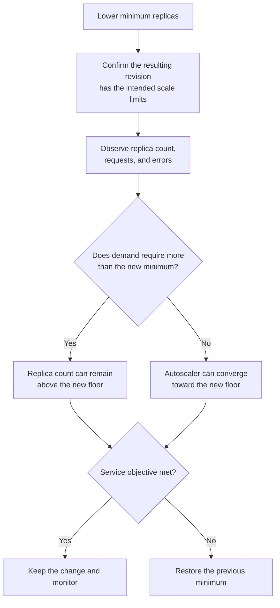

# Min Replica Change Impact

Reducing `minReplicas` (e.g., 100 → 50) is a common Day-2 operation for cost optimization. This page separates documented platform behavior from observations recorded during one live Azure deployment on 2026-05-18 in Korea Central.

## Prerequisites

- Existing Container App with active traffic
- Azure CLI with `containerapp` extension

## When to Use

- Reducing guaranteed replica count for cost savings
- Adjusting scaling floor after peak traffic period ends
- Right-sizing after initial over-provisioning

## Key Question

> **Does reducing `minReplicas` cause downtime?**

The recorded lab run observed no downtime and no immediate termination of the five existing replicas. Treat that as experiment evidence, not as a universal timing guarantee. Microsoft Learn documents that a custom rule's cooldown period applies only to the final transition from one replica to zero; it does **not** explain the observed five-to-two convergence time.

## Procedure

### Change Min Replicas

```bash
az containerapp update \
    --resource-group $RG \
    --name $APP_NAME \
    --min-replicas 2
```

| Command or parameter | Purpose |
|---|---|
| `az containerapp update` | Update the Container App configuration and create a revision when the changed property is revision-scoped. |
| `--min-replicas` | Set the revision's lower replica bound. |
| `--name` | Select the named extension or Container App. |
| `--resource-group` | Select the resource group that contains the app. |


### Monitor Replica Count

```bash
az containerapp replica list \
    --resource-group $RG \
    --name $APP_NAME \
    --output table
```

| Command or parameter | Purpose |
|---|---|
| `az containerapp replica list` | List replicas for the selected Container App. |
| `--name` | Select the named extension or Container App. |
| `--output` | Choose the command output format. |
| `--resource-group` | Select the resource group that contains the app. |


## Behavior Summary

<!-- diagram-id: min-replica-change-flow -->


*Figure: Lowering the floor is an observe-and-rollback operation; demand may keep replicas above the new minimum, so verify both replica convergence and service health.*

The following timings are observations from the 2026-05-18 Korea Central lab run described below, not platform guarantees:

| Observed phase | Duration in this run | Observation |
|---|---|---|
| Configuration update | ~20 seconds | The CLI returned after the configuration update. |
| Initial observation | ~5 minutes | Five replicas remained visible; the documented 300-second cooldown applies only to a final 1→0 transition and does not prove this delay. |
| Convergence | ~3 additional minutes | The sampled counts changed from 5 to 4 and then to 2. The sampling does not establish a one-at-a-time termination contract or connection-draining behavior. |
| End of observation | ~8 minutes total | Two replicas were visible, matching the new minimum in this run. |

## Validated Results

!!! success "Lab Validation: 2026-05-18, az CLI 2.73.0, Korea Central"

    **Test Environment**: External ingress Container App, `mcr.microsoft.com/k8se/quickstart:latest`, single-revision mode.

    | # | Test | Result |
    |---|---|---|
    | 1 | Initial replica count (min=5) | ✅ 5 replicas running |
    | 2 | Continuous HTTP requests during change (120 requests) | ✅ All returned HTTP 200 |
    | 3 | Non-200 responses during/after change | ✅ Zero errors |
    | 4 | Replica count immediately after change | 5 (unchanged) |
    | 5 | Replica count after ~5min cooldown | 4 (gradual reduction started) |
    | 6 | Replica count after ~8min | 2 (reached new minimum) |
    | 7 | App responsiveness at min=2 | ✅ HTTP 200 |

    **Key Findings:**

    - [Observed] **Zero downtime** — all 120 requests during the min replica change returned HTTP 200.
    - [Observed] Existing replicas were not immediately terminated. Scale-down began after approximately five minutes in this run.
    - [Not Proven] The custom-rule cooldown caused that delay. Microsoft Learn limits the cooldown behavior to the final transition from one replica to zero.
    - [Observed] The sampled replica counts changed from 5→4→2 rather than directly from 5→2.
    - [Not Proven] The platform always removes replicas one at a time or performs connection draining during this operation; the samples only establish the counts visible at collection time.
    - [Observed] Total time from change to reaching new minimum: approximately 8 minutes (with no traffic).
    - [Observed] If traffic is still active during the change, the autoscaler keeps replicas at the level needed to handle load, regardless of the new lower minimum.

## Production Assessment Template (100 → 50)

The lab outcome is useful evidence for planning, but it does not guarantee the same result for another app, revision, region, traffic pattern, or observation interval.

| Concern | What the lab observed | Production decision |
|---|---|---|
| Immediate downtime | None during the sampled requests | Monitor availability and latency during the change; do not treat this run as a no-downtime guarantee. |
| Request failures during change | Zero non-200 responses among 120 requests | Define an acceptable error budget and observe enough traffic to evaluate it. |
| Reduced warm capacity | The run ended at its new floor | Model whether the lower floor can absorb expected demand while additional replicas start. |
| Scaling speed back up | Measure for this workload | If load increases, the autoscaler can add replicas from the nonzero floor; Microsoft Learn does not promise a fixed per-replica startup time. |

!!! warning "Peak Traffic Consideration"
    If your service consistently needs 80+ replicas under normal load, reducing min to 50 means the autoscaler must add capacity during traffic spikes. Measure scale-out and application startup latency for your own workload instead of assuming a fixed per-replica time.

!!! tip "Recommended Approach"
    1. Change min replicas during low-traffic window
    2. Monitor p95 latency for the next 24h
    3. If latency spikes appear during traffic ramp-up, increase min back

## Rollback

If issues are observed after reducing min replicas:

```bash
az containerapp update \
    --resource-group $RG \
    --name $APP_NAME \
    --min-replicas 5
```

| Command or parameter | Purpose |
|---|---|
| `az containerapp update` | Update the Container App configuration and create a revision when the changed property is revision-scoped. |
| `--min-replicas` | Set the revision's lower replica bound. |
| `--name` | Select the named extension or Container App. |
| `--resource-group` | Select the resource group that contains the app. |


After rollback, observe the replica count and service metrics until the previous floor is restored. Startup time depends on the workload and is not documented as a fixed platform duration.

## Verification

Confirm the target app, revision, job, logs, or metric state matches the expected result before closing the task.

## Rollback / Troubleshooting

If verification fails, revert only the last configuration change, capture the failing output, and use the linked troubleshooting guide before retrying.

## See Also

- [Scaling Operations](index.md)
- [Scaling Concepts](../../platform/scaling/index.md)

## Sources

- [Set scaling rules in Azure Container Apps (Microsoft Learn)](https://learn.microsoft.com/en-us/azure/container-apps/scale-app)
- [Revisions in Azure Container Apps (Microsoft Learn)](https://learn.microsoft.com/en-us/azure/container-apps/revisions)
- [KEDA scaling behavior — cooldownPeriod](https://keda.sh/docs/latest/concepts/scaling-deployments/#cooldownperiod)
