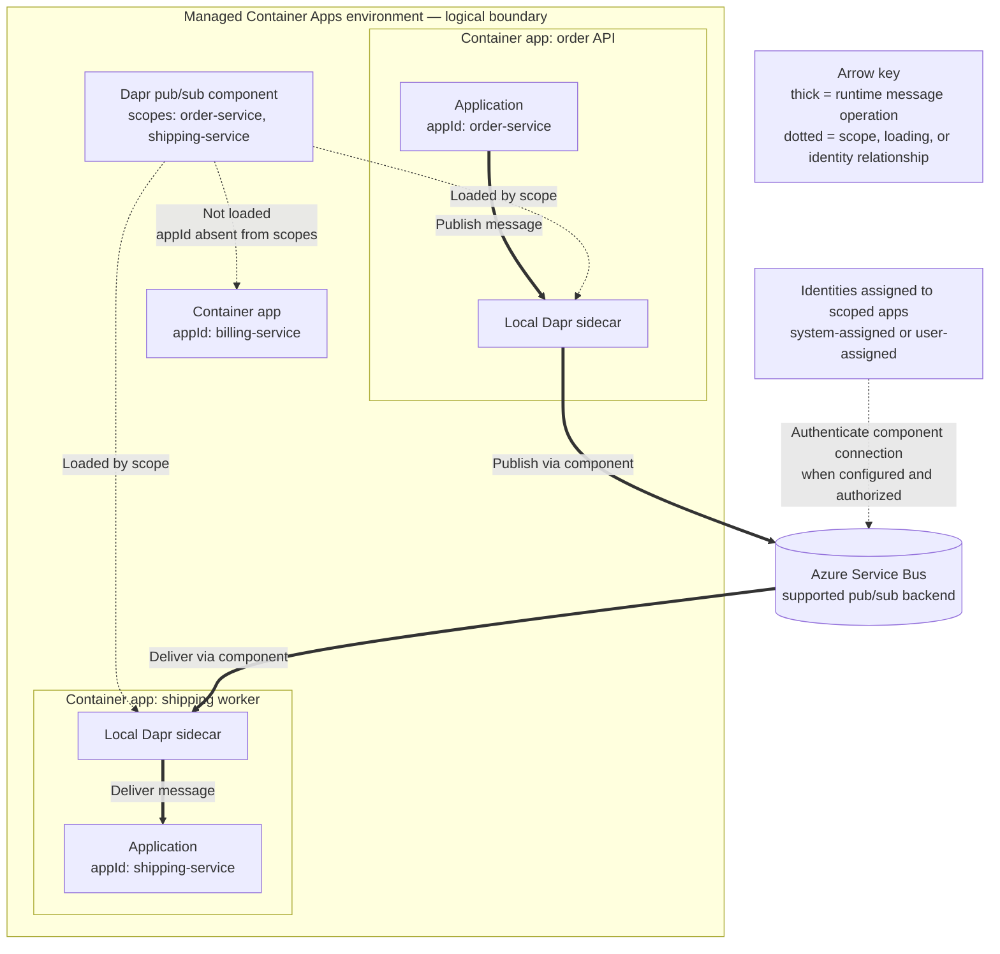

---
content_sources:
  diagrams:
    - id: dapr-component-scoping
      type: flowchart
      source: mslearn-adapted
      based_on:
        - https://learn.microsoft.com/en-us/azure/container-apps/dapr-overview
        - https://learn.microsoft.com/en-us/azure/container-apps/dapr-components
        - https://learn.microsoft.com/en-us/azure/container-apps/dapr-component-connect-services
content_validation:
  status: verified
  last_reviewed: 2026-11-07
  reviewer: agent
  core_claims:
    - claim: Dapr components in Azure Container Apps are environment-level resources that can be shared across container apps or scoped to specific container apps.
      source: https://learn.microsoft.com/en-us/azure/container-apps/dapr-components
      verified: true
    - claim: By default a Dapr component is loaded by every Dapr-enabled app in the environment, and the scopes property restricts a component to only the apps whose Dapr application IDs are listed.
      source: https://learn.microsoft.com/en-us/azure/container-apps/dapr-components
      verified: true
    - claim: For the most secure connection, Dapr components should use managed identity of the scoped container apps when supported, and use an Azure Key Vault secret store only when managed identity authentication isn't supported.
      source: https://learn.microsoft.com/en-us/azure/container-apps/dapr-component-connect-services
      verified: true
    - claim: Azure Container Apps supports Dapr state store, pub/sub, bindings, and secret store component types backed by Azure services such as Azure Cosmos DB, Azure Service Bus, Azure Event Hubs, and Azure Key Vault.
      source: https://learn.microsoft.com/en-us/azure/container-apps/dapr-overview
      verified: true
---
# Dapr Components, State, and Pub/Sub

Dapr building blocks such as state management and pub/sub are backed by **components** — declarative resources that bind a Dapr API to concrete infrastructure like Azure Cosmos DB or Azure Service Bus. This page covers how components are scoped in Azure Container Apps, how they reference secrets, and how to choose backing stores for state and pub/sub.

## Components Are Environment-Level Resources

Unlike the Dapr *sidecar* setting (which is application-scoped), a Dapr **component** is defined at the **Container Apps environment level**. This lets multiple apps in the same environment share one broker or state store definition.

By default, every Dapr-enabled app in the environment loads every deployed component. The `scopes` property narrows a component to specific apps by listing their **Dapr application IDs** (`appId`) — not the container app resource names.

<!-- diagram-id: dapr-component-scoping -->


*Figure: One environment-level pub/sub component is loaded only by the two Dapr application IDs in its `scopes` array. Azure Service Bus remains a separate backend resource. A system-assigned identity belongs to its container app, while a user-assigned identity is an independently provisioned resource that can be assigned to scoped apps.*

!!! tip "Scope every production component"
    Leaving `scopes` empty causes **all** Dapr-enabled apps in the environment to load the component. For least privilege, list the exact `appId`s that need each state store, broker, or secret store.

## Component Schema

Azure Container Apps uses a simplified Dapr component schema:

| Field | Purpose |
|---|---|
| `componentType` | Supported Dapr component type, for example `state.azure.cosmosdb` or `pubsub.azure.servicebus.queues` |
| `version` | Component API version, typically `v1` |
| `initTimeout` | How long Dapr waits for the component to initialize |
| `ignoreErrors` | Whether the sidecar continues if the component fails to load |
| `metadata` | Key/value configuration for the backing service |
| `scopes` | Dapr `appId`s allowed to load the component |
| `secretStoreComponent` / `secrets` | Reference to a Dapr secret store, or component-local secret parameters |

## Authenticating Components Safely

Never place connection strings or keys directly in component `metadata`. Azure Container Apps offers two authentication paths, in order of preference:

1. **Managed identity (recommended).** For Azure-hosted backends that support it, Dapr authenticates using the [managed identity of the scoped container apps](../identity-and-secrets/managed-identity.md). No secret material is stored in the component manifest. For a user-assigned identity, set the `azureClientId` metadata field.
2. **Azure Key Vault secret store.** Use this **only when managed identity authentication isn't supported**. Create a `secretstores.azure.keyvault` component, then reference it from other components via `secretStoreComponent` and resolve sensitive fields with `secretRef`.

```yaml
# Example: Service Bus queue pub/sub component that authenticates
# through a Key Vault secret store component
componentType: pubsub.azure.servicebus.queues
version: v1
secretStoreComponent: keyvault-secretstore
metadata:
  - name: namespaceName
    value: "mynamespace.servicebus.windows.net"
  - name: azureClientId
    value: "[your_client_id]"
  - name: azureClientSecret
    secretRef: sb-client-secret
scopes:
  - order-service
  - shipping-service
```

## Choosing a State Store Backend

State management provides key/value persistence and concurrency operations through supported components. The current supported-component list distinguishes Tier 1 components from Tier 2 components:

| Backend | When to use |
|---|---|
| Azure Cosmos DB | Tier 1 Azure state component |
| Azure Blob Storage v1 | Tier 1 Azure state component |
| Azure Table Storage | Tier 1 Azure state component |
| Microsoft SQL Server | Tier 1 relational state component |
| PostgreSQL / MySQL / Redis | Tier 2 state components; evaluate best-effort support before production use |

State keys are namespaced by the app's `appId`, so two apps sharing a store do not overwrite each other's keys.

## Choosing a Pub/Sub Broker

Pub/sub decouples publishers from subscribers using the competing-consumer pattern. Consumer grouping is keyed by `appId`, so all replicas of an app share the same subscription.

| Broker | When to use |
|---|---|
| Azure Service Bus queues or topics | Tier 1 Azure messaging components |
| Azure Event Hubs | Tier 1 Azure event-streaming component |
| Apache Kafka or Redis Streams | Tier 2 components; evaluate best-effort support before production use |

### Durability Trade-offs

- **Delivery behavior**: verify the selected broker component's delivery contract and make subscriber processing safe for redelivery where applicable.
- **Ordering**: verify ordering at the chosen broker and partitioning or session boundary rather than assuming global ordering.
- **Scale-to-zero**: test how the selected event source, subscription, and scale rule reactivate a subscriber before relying on zero minimum replicas.

## Component Resiliency (Preview)

Dapr supports resiliency policies (timeouts, retries, and circuit breakers) applied to component interactions, letting you tune how the sidecar handles transient backend failures without changing application code. On Azure Container Apps, Dapr component resiliency is a **preview** feature — confirm current availability before relying on it in production.

## Limitations

- Components are shared at the environment level; isolate sensitive backends by using separate environments or strict `scopes`.
- Only the Dapr APIs and components listed as GA, Tier 1, or Tier 2 are supported; Tier 2 support is best effort.
- Secret values must be referenced, not embedded, to pass security review.

## See Also

- [Dapr Integration in Azure Container Apps](index.md)
- [Managed Identity](../identity-and-secrets/managed-identity.md)
- [Key Vault Integration](../identity-and-secrets/key-vault.md)
- [Secrets](../security/secrets.md)
- [Event-Driven Jobs](../jobs/event-driven-jobs.md)

## Sources

- [Dapr integration with Azure Container Apps](https://learn.microsoft.com/en-us/azure/container-apps/dapr-overview)
- [Dapr components in Azure Container Apps](https://learn.microsoft.com/en-us/azure/container-apps/dapr-components)
- [Connect to other Azure or partner services via Dapr components](https://learn.microsoft.com/en-us/azure/container-apps/dapr-component-connect-services)
- [Dapr component resiliency (preview)](https://learn.microsoft.com/en-us/azure/container-apps/dapr-component-resiliency)
- [Manage secrets in Azure Container Apps](https://learn.microsoft.com/en-us/azure/container-apps/manage-secrets)
