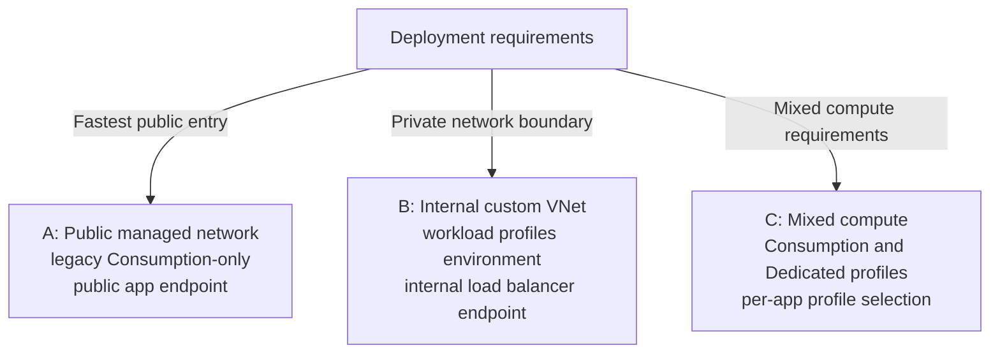
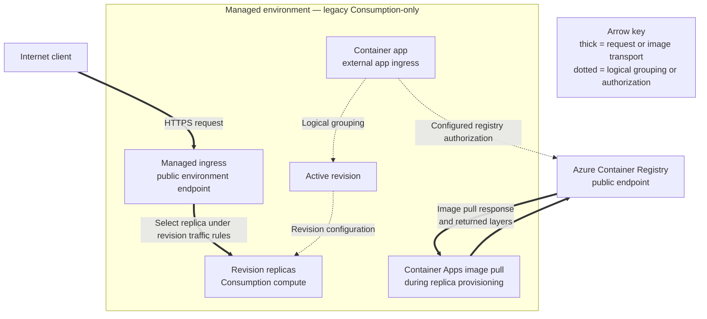
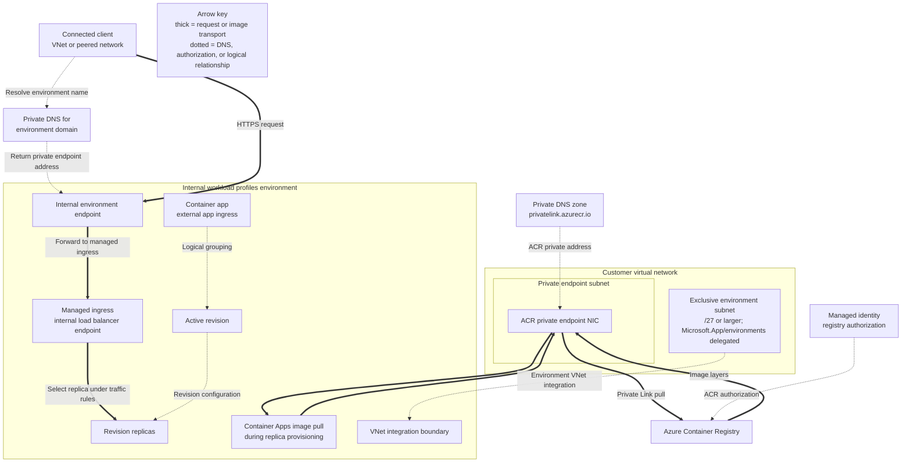
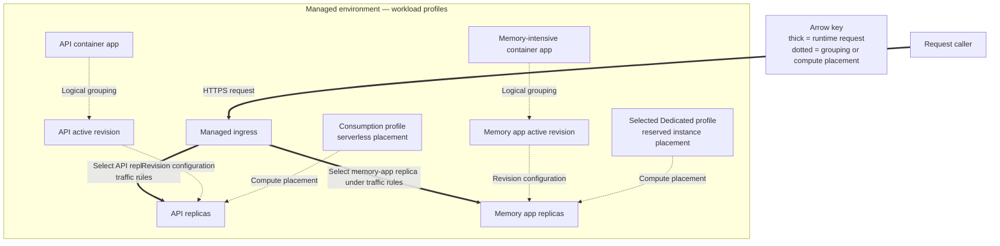

# Deployment Scenarios

This page compares the reference deployment patterns used in this guide across different Azure Container Apps environment configurations.

!!! info "Guide defaults, not platform limits"
    The tables below reflect the deployment patterns implemented in this repository's Bicep templates and tutorials. Azure supports additional configurations beyond what is shown here.

## Scenario Overview

<!-- diagram-id: scenario-overview -->


*Figure: Requirement-oriented comparison of the three guide scenarios. The arrows are design branches, not an upgrade sequence or packet path. Workload profiles environments are the current default; Scenario A retains the legacy Consumption-only model only as a simple reference pattern.*

## Matrix A — Networking and Security

| Feature | Scenario A: Public Consumption | Scenario B: Internal VNet | Scenario C: Workload Profiles |
|---|---|---|---|
| **Environment Type** | Legacy Consumption-only | Workload profiles | Workload profiles |
| **Environment accessibility** | External | Internal | Internal or external |
| **VNet Integration** | :material-close: No (Managed) | :material-check: Yes (Custom) | :material-check: Yes (Custom) |
| **App ingress in this example** | External app ingress on a public environment | External app ingress published at the environment's internal load balancer endpoint | Per app; independent of profile selection |
| **Registry identity in this example** | None; admin credentials | User-assigned managed identity | Not configured by the Scenario C command |
| **Registry Auth** | Admin credentials | Managed identity | Not configured by the example command |
| **Default domain reachability** | Public DNS and endpoint | Internal load balancer endpoint; connected clients need working DNS | Determined by environment accessibility and app ingress, not profile type |

## Matrix B — Deployment and Container Registry Mechanics

| Feature | Scenario A: Public Consumption | Scenario B: Internal VNet | Scenario C: Workload Profiles |
|---|---|---|---|
| **Compute Billing** | Consumption usage | Consumption profile usage | Dedicated instance allocation + Consumption profile usage |
| **Scaling behavior** | Consumption scaling rules | Consumption scaling rules | Profile-specific scaling and capacity limits |
| **Deployment Source** | ACR / Docker Hub | Private ACR | Private ACR / Artifact Registry |
| **Registry network path in this example** | Public ACR endpoint | Private ACR endpoint and private DNS | Chosen independently; not configured by the Scenario C command |
| **CLI Command** | `az containerapp up` | `az containerapp create` | `az containerapp create` |
| **Key Gotcha** | Admin keys must be enabled on ACR | Requires VNet DNS for image pull | Profile must be added to Environment first |

## Scenario A — Public Consumption (Simplest)

This guide keeps the legacy Consumption-only environment as its simplest public reference. New environments default to workload profiles, but the managed-network request path remains useful when you do not need custom VNet controls.

<!-- diagram-id: scenario-a-public-consumption -->


*Figure: Public request path and separate image-pull dependency. Azure Container Registry is an associated Azure resource outside the managed environment. Registry authorization permits the pull; it is not itself a transport hop.*

**When to use**: Web apps, APIs, and microservices that require public internet access and don't need complex networking.

### CLI Implementation

```bash
# Create a container app with public ingress using admin credentials
az containerapp up \
    --resource-group $RG \
    --name $APP_NAME \
    --environment $ACA_ENV_NAME \
    --image $ACR_NAME.azurecr.io/$IMAGE_NAME:$TAG \
    --ingress external \
    --target-port 8080 \
    --registry-server $ACR_NAME.azurecr.io \
    --registry-username $ACR_USERNAME \
    --registry-password $ACR_PASSWORD
```

| Command/Parameter | Purpose |
|---|---|
| `az containerapp up` | Creates or updates the container app from the supplied image. |
| `--resource-group` | Selects the resource group. |
| `--name` | Selects the container app name. |
| `--environment` | Selects the Container Apps environment. |
| `--image` | Selects the image and tag to deploy. |
| `--ingress` | Enables external app ingress. |
| `--target-port` | Sets the port on which the container listens. |
| `--registry-server` | Identifies the registry endpoint. |
| `--registry-username` | Supplies the registry username for this guide example. |
| `--registry-password` | Supplies the matching registry password. |

## Scenario B — Internal VNet (Private Environment)

For workloads that need an internal environment endpoint, create an internal, VNet-integrated workload profiles environment. The environment's virtual IP maps to an Azure internal load balancer endpoint; this is distinct from an Azure Private Endpoint resource. In this example the app uses **external app ingress relative to the environment**, so connected VNet clients can reach it through the environment's internal load balancer. Setting the app itself to internal ingress would instead limit its direct FQDN to the Container Apps environment and would not make it directly reachable from arbitrary VNet clients.

<!-- diagram-id: scenario-b-internal-vnet -->


*Figure: Internal environment topology extending the [architecture base](architecture/index.md#managed-environment-ingress-revisions-and-scaling). The managed environment is logically associated with the delegated subnet; the ACR private endpoint NIC is a separate resource in its own subnet, while ACR, managed identity, and private DNS remain associated Azure resources.*

**When to use**: Internal microservices, backend APIs, or applications that require private inbound reachability from a VNet or connected network. If outbound traffic must also avoid public paths, add controlled egress and private endpoints for the required dependencies.

### CLI Implementation

```bash
# Create a container app in an internal environment using Managed Identity for registry pull
az containerapp create \
    --resource-group $RG \
    --name $APP_NAME \
    --environment $ACA_ENV_NAME \
    --image $ACR_NAME.azurecr.io/$IMAGE_NAME:$TAG \
    --ingress external \
    --target-port 80 \
    --user-assigned $UAMI_ID \
    --registry-server $ACR_NAME.azurecr.io \
    --registry-identity $UAMI_ID
```

| Command/Parameter | Purpose |
|---|---|
| `az containerapp create` | Creates the app in an existing internal environment. |
| `--resource-group` | Selects the resource group. |
| `--name` | Selects the container app name. |
| `--environment` | Selects the already-created internal Container Apps environment. |
| `--image` | Selects the image and tag to deploy. |
| `--ingress` | Enables app ingress at the environment endpoint; the environment remains private. |
| `--target-port` | Sets the port on which the container listens. |
| `--user-assigned` | Associates a user-assigned managed identity with the app. |
| `--registry-server` | Identifies the registry endpoint. |
| `--registry-identity` | Uses the managed identity for registry authorization instead of a password. |

## Scenario C — Workload Profiles (Dedicated Compute)

A workload profiles environment always includes the Consumption profile and can also contain Dedicated profiles. Flexible profiles are a third profile type, currently in preview, but are outside this two-profile scenario. Each app selects one profile; multiple apps can share one Dedicated profile instance, so use separate profiles or environments when workloads must not share compute.

<!-- diagram-id: scenario-c-workload-profiles -->


*Figure: Workload-profile placement extending the [architecture base](architecture/index.md#managed-environment-ingress-revisions-and-scaling). Consumption and Dedicated are profile choices inside one managed environment; they are not separate ingress paths or customer-managed node pools.*

**When to use**: High-performance applications, memory-intensive jobs, or workloads that need reserved capacity, larger resource sizes, or profile-specific hardware. Use separate profiles or environments when strict workload separation is required.

### CLI Implementation

```bash
# Create a container app using a specific workload profile
az containerapp create \
    --resource-group $RG \
    --name $APP_NAME \
    --environment $ACA_ENV_NAME \
    --workload-profile-name "D4" \
    --cpu 2.0 \
    --memory 4Gi \
    --image $IMAGE_NAME
```

| Command/Parameter | Purpose |
|---|---|
| `az containerapp create` | Creates the app in an existing workload profiles environment. |
| `--resource-group` | Selects the resource group. |
| `--name` | Selects the container app name. |
| `--environment` | Selects the Container Apps environment. |
| `--workload-profile-name` | Selects a profile that already exists in the environment. |
| `--cpu` | Sets the requested CPU within the selected profile's supported resources. |
| `--memory` | Sets the requested memory within the selected profile's supported resources. |
| `--image` | Selects the image to deploy. |

## Pre-Deployment Checklist

Before deploying any scenario, verify:

- [ ] **Resource group** exists in a region supporting Container Apps
- [ ] **Environment Name** is unique within the resource group
- [ ] **Subnet model** matches the environment type: workload profiles use an exclusive delegated `/27` or larger subnet; legacy Consumption-only uses an exclusive undelegated `/23` or larger subnet
- [ ] **Managed identity** has `AcrPull` on a registry using the RBAC Registry Permissions mode, or `Container Registry Repository Reader` on an ABAC-enabled registry
- [ ] **Port mapping** matches the container's listening port
- [ ] **Scale rules** (min/max replicas) are defined to prevent unexpected costs
- [ ] **Private DNS** resolves the internal environment domain and every required ACR private-endpoint record (Scenario B)

## Verify deployment-scenario surfaces in Azure Portal

![ca-sample-d38538 | Ingress | Container App | Refresh | Send us your feedback | Ingress | Ingress traffic | Limited to Container Apps Environment | Accepting traffic from anywhere | Ingress type | HTTP | TCP | Client certificate mode | Ignore | Accept | Require | Transport | Auto | Insecure connections | Target port | 80 | Endpoint(s) | https://<app-name>.<unique-id>.<region>.azurecontainerapps.io | Session affinity | Additional TCP ports | IP Restrictions | IP Security Restrictions Mode | Allow all traffic (default) | Save | Discard](../assets/platform/deployment-scenarios-ingress-blade.png)

**[Observed]** `ca-sample-d38538 | Ingress` `Container App` `Refresh` `Send us your feedback` `Ingress` `Ingress traffic` `Limited to Container Apps Environment` `Accepting traffic from anywhere` `Ingress type` `HTTP` `TCP` `Client certificate mode` `Ignore` `Accept` `Require` `Transport` `Auto` `Insecure connections` `Target port` `80` `Endpoint(s)` `https://<app-name>.<unique-id>.<region>.azurecontainerapps.io` `Session affinity` `Additional TCP ports` `IP Restrictions` `IP Security Restrictions Mode` `Allow all traffic (default)` `Save` `Discard`.

**[Inferred]** The `Limited to Container Apps Environment` radio option represents internal **app ingress**, which is narrower than the private **environment endpoint** used in [Scenario B — Internal VNet (Private Environment)](#scenario-b-internal-vnet-private-environment). The `Accepting traffic from anywhere` radio paired with the external `Endpoint(s)` value appears to map to the external app-ingress setting used in both Scenario A and Scenario B; whether that endpoint is public or private depends on environment accessibility. The `IP Restrictions` section with the `IP Security Restrictions Mode` `Allow all traffic (default)` value is consistent with the networking-and-security comparison surface listed in [Matrix A — Networking and Security](#matrix-a-networking-and-security).

**[Not Proven]** Additional environment configuration detail, networking binding detail, registry authentication detail, and workload profile detail are not visible on this view.

## See Also

- [Environments](environments/index.md) — differences between Consumption and Workload Profiles
- [Networking](networking/index.md) — internal vs external ingress and VNet integration
- [Managed Identity](identity-and-secrets/managed-identity.md) — securing access to registries and other Azure resources
- [Scaling](scaling/index.md) — configuring KEDA-based scaling rules

## Sources

- [Azure Container Apps environments (Microsoft Learn)](https://learn.microsoft.com/en-us/azure/container-apps/environment)
- [Workload profiles in Azure Container Apps (Microsoft Learn)](https://learn.microsoft.com/en-us/azure/container-apps/workload-profiles-overview)
- [Networking in Azure Container Apps environment (Microsoft Learn)](https://learn.microsoft.com/en-us/azure/container-apps/networking)
- [Provide a virtual network to an Azure Container Apps environment (Microsoft Learn)](https://learn.microsoft.com/en-us/azure/container-apps/vnet-custom)
- [Managed identity image pulls in Azure Container Apps (Microsoft Learn)](https://learn.microsoft.com/en-us/azure/container-apps/managed-identity-image-pull)
- [Azure Container Registry roles and ABAC repository permissions (Microsoft Learn)](https://learn.microsoft.com/en-us/azure/container-registry/container-registry-rbac-abac-repository-permissions)
- [Private endpoints with DNS in Azure Container Apps (Microsoft Learn)](https://learn.microsoft.com/en-us/azure/container-apps/private-endpoints-with-dns)
- [Private endpoints for Azure Container Registry (Microsoft Learn)](https://learn.microsoft.com/en-us/azure/container-registry/container-registry-private-endpoints)
- [Containers in Azure Container Apps (Microsoft Learn)](https://learn.microsoft.com/en-us/azure/container-apps/containers)
