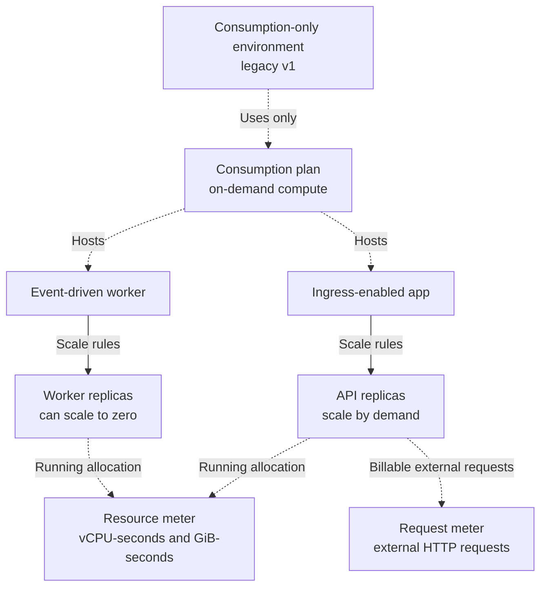

---
content_sources:
  diagrams:
    - id: consumption-only-execution-model
      type: flowchart
      source: mslearn-adapted
      based_on:
        - https://learn.microsoft.com/en-us/azure/container-apps/environment-type-consumption-only
        - https://learn.microsoft.com/en-us/azure/container-apps/containers
        - https://learn.microsoft.com/en-us/azure/container-apps/billing
        - https://learn.microsoft.com/en-us/azure/container-apps/networking
content_validation:
  status: verified
  last_reviewed: 2026-11-08
  reviewer: agent
  core_claims:
    - claim: The Consumption-only environment type is a legacy option and Workload profiles (v2) is the default and recommended choice for new environments.
      source: https://learn.microsoft.com/en-us/azure/container-apps/environment-type-consumption-only
      verified: true
    - claim: Microsoft Learn currently conflicts on the Consumption-only app ceiling; the environment-type page says 4 vCPUs and 8 GB, while the container allocation page gives a more specific maximum of 2 cores and 4 GiB for an app on the Consumption plan in a Consumption-only environment.
      source: https://learn.microsoft.com/en-us/azure/container-apps/containers
      verified: true
    - claim: Consumption plan billing is based on resource consumption billed in vCPU-seconds and GiB-seconds plus HTTP requests.
      source: https://learn.microsoft.com/en-us/azure/container-apps/billing
      verified: true
    - claim: Consumption-only environments don't support UDR or NAT Gateway egress and require a minimum subnet size of /23.
      source: https://learn.microsoft.com/en-us/azure/container-apps/networking
      verified: true
---
# Consumption Plan

The Consumption-only environment is the legacy Azure Container Apps model for pure usage-based compute. It is still available, but Microsoft Learn recommends the Workload profiles (v2) environment with its built-in Consumption profile for new environments.

## Main Content

### What the Consumption-only environment is

The Consumption-only environment runs apps only on the Consumption plan:

- Compute is allocated on demand.
- Billing follows replica usage instead of node allocation.
- Scale-to-zero remains the main fit for low-idle or bursty workloads.

<!-- diagram-id: consumption-only-execution-model -->

The dotted links describe placement and metering relationships; they are not request or data paths.

### Billing model

Microsoft Learn describes Consumption plan charges in three buckets:

| Meter | What it tracks | Notes |
|---|---|---|
| vCPU-seconds | CPU allocated per running replica | Billed per second |
| GiB-seconds | Memory allocated per running replica | Billed per second |
| HTTP requests | Requests received by the app | External requests are billable |

!!! note "GPU-seconds are a Consumption-plan meter, but not for Consumption-only v1"
    The billing page documents GPU-seconds for serverless GPU scenarios.
    The Consumption-only environment page separately states that Consumption-only environments have no GPU access.

### Characteristics and limitations

!!! warning "Microsoft Learn currently conflicts on the per-app ceiling"
    The [Consumption-only environment page](https://learn.microsoft.com/en-us/azure/container-apps/environment-type-consumption-only) says apps have access to **4 vCPUs and 8 GB** of memory.
    The more specific [container allocation page](https://learn.microsoft.com/en-us/azure/container-apps/containers#vcpu-and-memory-allocation-requirements) says an app using the Consumption plan in a Consumption-only environment is limited to **2 cores and 4 GiB**.
    Until Microsoft reconciles these pages, do not treat 4 vCPUs / 8 GB as an unqualified per-app ceiling; validate the accepted allocation in the target environment.

| Area | Consumption-only (v1) behavior |
|---|---|
| Status | Legacy environment type |
| Per-app compute ceiling | Conflicting Learn guidance: environment overview says 4 vCPUs / 8 GB; container allocation page says 2 cores / 4 GiB |
| Dedicated SKUs | Not available |
| GPUs | Not available |
| UDR | Not supported |
| NAT Gateway egress | Not supported |
| Minimum subnet size | `/23` |

### Good use cases

Consumption-only still fits when you need:

- Prototyping environments with minimal baseline cost.
- Low-traffic apps that spend meaningful time idle.
- Event-driven workers where scale-to-zero matters more than advanced networking.
- Legacy environments you are maintaining while planning a v2 landing zone.

### Migration considerations

Microsoft Learn now recommends using the built-in Consumption profile in a Workload profiles (v2) environment for new deployments.

!!! warning "Treat Consumption-only to v2 as an environment migration project"
    The Microsoft Learn pages reviewed for this guide recommend the v2 environment type, but they do not document a simple in-place conversion path from Consumption-only to Workload profiles.
    Plan a parallel environment, redeploy apps with IaC, validate networking, and then cut over.

### Verify Consumption-plan surfaces in Azure Portal

![cae-basics-d38538 | Container Apps Environment | Refresh | Delete | Essentials | View Cost | JSON View | Resource group (move) | rg-aca-basics-d38538 | Status | Succeeded | Location (move) | Korea Central | Subscription (move) | Visual Studio Enterprise Subscription | Subscription ID | 00000000-0000-0000-0000-000000000000 | Aspire Dashboard | Not yet active (set up) | Tags (edit) | Add tags | Environment type | Workload profiles | Static IP | 4.230.156.3 | Applications | 1 | KEDA version | 2.18.1 | Dapr version | 1.16.4-msft.7 | Applications | Get started | Monitoring | Tutorials | Name | App Type | Resource Group | ca-sample-d38538 | Container App | rg-aca-basics-d38538](../../assets/platform/environments/consumption-plan-environment-overview.png)

**[Observed]** `cae-basics-d38538` `Container Apps Environment` `Refresh` `Delete` `Essentials` `View Cost` `JSON View` `Resource group (move)` `rg-aca-basics-d38538` `Status` `Succeeded` `Location (move)` `Korea Central` `Subscription (move)` `Visual Studio Enterprise Subscription` `Subscription ID` `00000000-0000-0000-0000-000000000000` `Aspire Dashboard` `Not yet active (set up)` `Tags (edit)` `Add tags` `Environment type` `Workload profiles` `Static IP` `4.230.156.3` `Applications` `1` `KEDA version` `2.18.1` `Dapr version` `1.16.4-msft.7` `Applications` `Get started` `Monitoring` `Tutorials` `Name` `App Type` `Resource Group` `ca-sample-d38538` `Container App` `rg-aca-basics-d38538`.

**[Inferred]** The `Environment type` `Workload profiles` value is consistent with the v2-recommended environment surface discussed in [Migration considerations](#migration-considerations).

**[Not Proven]** Additional environment provisioning detail, billing detail, workload profile detail, and network binding detail are not visible on this view.

## See Also

- [Plans and Workload Profiles](plans-and-workload-profiles.md)
- [Workload Profiles](workload-profiles.md)
- [Networking and CIDR](networking-and-cidr.md)
- [Migration](migration.md)
- [Limits and Quotas](limits-and-quotas.md)
- [Replica Node-Spread Lab](../../troubleshooting/lab-guides/replica-node-spread.md) — empirical measurement showing the Consumption profile distributes replicas across multiple kernel contexts at high N (27× more clusters than single-node Dedicated D8)

## Sources

- [Consumption-only environment type in Azure Container Apps (legacy) (Microsoft Learn)](https://learn.microsoft.com/en-us/azure/container-apps/environment-type-consumption-only)
- [Containers in Azure Container Apps (Microsoft Learn)](https://learn.microsoft.com/en-us/azure/container-apps/containers)
- [Billing in Azure Container Apps (Microsoft Learn)](https://learn.microsoft.com/en-us/azure/container-apps/billing)
- [Networking in Azure Container Apps environment (Microsoft Learn)](https://learn.microsoft.com/en-us/azure/container-apps/networking)
