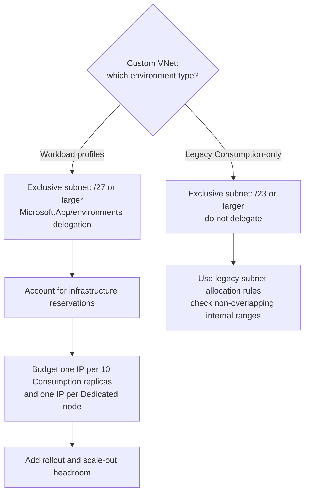

---
content_sources:
  diagrams:
    - id: delegated-subnet-capacity-model
      type: flowchart
      source: mslearn-adapted
      based_on:
        - https://learn.microsoft.com/en-us/azure/container-apps/networking
        - https://learn.microsoft.com/en-us/azure/container-apps/custom-virtual-networks
        - https://learn.microsoft.com/en-us/azure/container-apps/workload-profiles-manage-cli
        - https://learn.microsoft.com/en-us/azure/templates/microsoft.app/managedenvironments
content_validation:
  status: verified
  last_reviewed: '2026-11-07'
  reviewer: agent
  core_claims:
    - claim: Workload profiles environments require a minimum subnet size of /27 and Consumption-only environments require a minimum subnet size of /23.
      source: https://learn.microsoft.com/en-us/azure/container-apps/networking
      verified: true
    - claim: When using the Workload profiles environment, the subnet must be delegated to Microsoft.App/environments, and Consumption-only must not delegate the subnet.
      source: https://learn.microsoft.com/en-us/azure/container-apps/custom-virtual-networks
      verified: true
    - claim: The infrastructure subnet resource ID is the subnet for infrastructure components and user application containers.
      source: https://learn.microsoft.com/en-us/azure/container-apps/custom-virtual-networks
      verified: true
    - claim: For workload-profile environments, the current networking capacity table reports 18 available addresses in a /27, one IP per Dedicated node, and planning at one IP per 10 Consumption replicas.
      source: https://learn.microsoft.com/en-us/azure/container-apps/custom-virtual-networks
      verified: true
---
# Networking and CIDR

Subnet planning for Azure Container Apps is an environment design task, not a last-minute deployment detail. The minimum CIDR, delegation model, and IP allocation rules all depend on which environment type you create.

## Main Content

### Minimum subnet sizes

| Environment type | Minimum subnet size | Notes |
|---|---|---|
| Workload profiles (v2) | `/27` | Supports newer networking features |
| Consumption-only (v1) | `/23` | Legacy model with different internal addressing needs |

!!! warning "Do not reuse the environment subnet"
    Microsoft Learn requires a subnet that is dedicated exclusively to the Container Apps environment.
    Treat it as environment-owned capacity, not shared subnet space.

### Delegation and subnet roles

For custom VNets:

- **Workload profiles (v2)**: delegate the subnet to `Microsoft.App/environments`.
- **Consumption-only (v1)**: do **not** delegate the subnet.

Microsoft Learn also describes the `infrastructureSubnetId` as the subnet for **infrastructure components and user application containers**. In other words, the standard deployment model uses one customer-managed infrastructure subnet rather than separate customer-managed runtime and platform subnets.

For the legacy Consumption-only environment, Learn also documents optional internal ranges such as `platformReservedCidr` and `dockerBridgeCidr` for platform networking. These are not extra customer-managed subnets.

Choose the environment type before calculating usable subnet capacity:

<!-- diagram-id: delegated-subnet-capacity-model -->

*Figure: Subnet-capacity planning flow. Thin arrows are design steps and branch choices, not packet transport or containment. A workload-profile environment can contain Consumption and Dedicated profiles; it is not the same as a legacy Consumption-only environment. No customer-managed nodes or hidden platform subnets are inferred.*

### IP allocation model

Use the capacity table in the current **Configure Virtual Networks in Azure Container Apps Environments** article as the canonical planning source:

- A `/27` subnet has **32 IPs total**.
- The table subtracts **14 addresses** for Container Apps infrastructure, including the five addresses Azure reserves in every subnet.
- That leaves **18 available IP addresses**.

The article differentiates how those available addresses are consumed in a workload-profile environment:

| Placement model | IP pressure driver | Practical meaning |
|---|---|---|
| Consumption | One IP per 10 replicas for planning | Replica growth still consumes subnet capacity, but replicas share addresses |
| Dedicated | Per VM node | Many replicas can share fewer node IPs |

!!! note "Zero-downtime rollouts can increase temporary IP demand"
    The canonical networking article accounts for the temporary doubling required by single-revision zero-downtime deployments. Size above the minimum for rollout and scale-out headroom.

!!! warning "Microsoft Learn currently contains a conflicting CLI example"
    The `workload-profiles-manage-cli` article still describes 11 reserved addresses, 21 available addresses, and one IP per Consumption replica for a workload-profile `/27`. That conflicts with the newer canonical networking capacity table, which reports 18 available addresses and plans one IP per 10 Consumption replicas. This guide follows the networking article for capacity planning and retains the CLI article only as a command workflow reference.

### Sizing guidance

Start larger than the documented minimum when:

- You expect many Consumption replicas.
- You want headroom for revision overlap during rollout.
- You plan to add more dedicated node pools later.
- You expect the environment to become a shared landing zone for multiple teams.

### Portal view: non-VNet-integrated baseline

The Networking blade on an environment created without a custom VNet is the contrast baseline for this page's CIDR rules — the subnet sizing table only applies when a VNet integration is configured.

[Observed] The General tab shows `Public Network Access : Enable - Allows incoming traffic from the public internet` (radio button selected). The Virtual network section reads `This environment isn't integrated`. The tab strip lists `General`, `Ingress settings`, `Request Routing`, `Encryption`, `Custom DNS Suffix`. No subnet resource ID, CIDR range, or delegation field is visible on the blade.

[Inferred] The `This environment isn't integrated` text is consistent with this page's [Minimum subnet sizes](#minimum-subnet-sizes) table only applying once a custom VNet is in scope. The absence of a subnet resource ID or CIDR field on this blade appears to map to topics covered later in this page's [Delegation and subnet roles](#delegation-and-subnet-roles) and [IP allocation model](#ip-allocation-model) sections.

[Not Proven] This image does not visualize the `infrastructureSubnetId` property described in this page's [Delegation and subnet roles](#delegation-and-subnet-roles) section, the `Microsoft.App/environments` delegation requirement, or the `platformReservedCidr` / `dockerBridgeCidr` legacy ranges. It does not visualize the `/27` vs `/23` minimum subnet sizes or the workload-profile capacity table described on this page.

## See Also

- [VNet Integration](../networking/vnet-integration.md)
- [Private Endpoints](../networking/private-endpoints.md)
- [Plans and Workload Profiles](plans-and-workload-profiles.md)
- [Workload Profiles](workload-profiles.md)
- [Environment Design](../../best-practices/environment-design.md)

## Sources

- [Networking in Azure Container Apps environment (Microsoft Learn)](https://learn.microsoft.com/en-us/azure/container-apps/networking)
- [Configure virtual networks in Azure Container Apps environments (Microsoft Learn)](https://learn.microsoft.com/en-us/azure/container-apps/custom-virtual-networks)
- [Create a Container Apps environment with the Azure CLI (Microsoft Learn)](https://learn.microsoft.com/en-us/azure/container-apps/workload-profiles-manage-cli)
- [Microsoft.App/managedEnvironments template reference (Microsoft Learn)](https://learn.microsoft.com/en-us/azure/templates/microsoft.app/managedenvironments)
