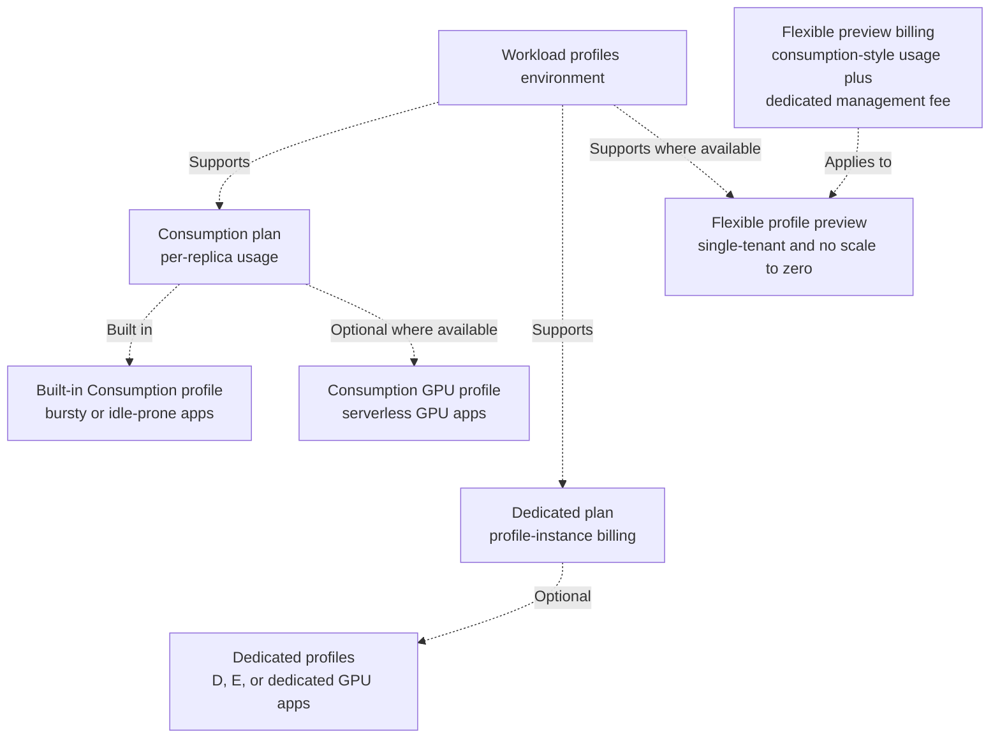

---
content_sources:
  diagrams:
    - id: one-environment-many-workload-profiles
      type: flowchart
      source: mslearn-adapted
      based_on:
        - https://learn.microsoft.com/en-us/azure/container-apps/structure
        - https://learn.microsoft.com/en-us/azure/container-apps/workload-profiles-overview
        - https://learn.microsoft.com/en-us/azure/container-apps/billing
        - https://learn.microsoft.com/en-us/azure/container-apps/networking
content_validation:
  status: verified
  last_reviewed: 2026-11-08
  reviewer: agent
  core_claims:
    - claim: 'Azure Container Apps features two different environment types: Workload profiles and Consumption-only.'
      source: https://learn.microsoft.com/en-us/azure/container-apps/structure
      verified: true
    - claim: Workload profiles (v2) is the default environment type and Consumption-only (v1) is legacy.
      source: https://learn.microsoft.com/en-us/azure/container-apps/structure
      verified: true
    - claim: Workload profiles environments support UDR, NAT Gateway egress, and private endpoints on the environment, while Consumption-only environments do not.
      source: https://learn.microsoft.com/en-us/azure/container-apps/networking
      verified: true
    - claim: Each Container Apps environment includes a default Consumption profile, and Dedicated or Consumption GPU profiles can be added.
      source: https://learn.microsoft.com/en-us/azure/container-apps/workload-profiles-overview
      verified: true
---
# Plans and Workload Profiles

Azure Container Apps separates environment type, plan type, and workload profile. This page connects those terms so you can pick the right environment model before you design app placement, networking, and scaling.

## Main Content

### Current Microsoft Learn taxonomy

Current Microsoft Learn pages use these environment names:

| Current term | Status | Notes |
|---|---|---|
| **Workload profiles (v2)** | Default | Recommended for new environments |
| **Consumption-only (v1)** | Legacy | Still available, but no longer the default |

!!! note "Use current Learn terminology"
    The current Microsoft Learn pages reviewed for this guide use **Workload profiles (v2)** and **Consumption-only (v1)**.
    Older Premium or Standard wording is not the active environment taxonomy in the current Learn pages cited below.

### How the layers fit together

- **Environment type** decides the broad capability set.
- **Plan type** decides how billing is calculated.
- **Workload profile** decides the compute shape where an app runs.

In practice:

- A **Consumption-only (v1)** environment runs only on the **Consumption plan**.
- A **Workload profiles (v2)** environment includes a built-in **Consumption** workload profile and can add **Dedicated**, Consumption GPU, and, where available, **Flexible** profiles.

!!! caution "Learn uses plan and profile terminology differently"
    The current [plan-types page](https://learn.microsoft.com/en-us/azure/container-apps/plans) and [billing page](https://learn.microsoft.com/en-us/azure/container-apps/billing) organize charges under Consumption and Dedicated plan labels.
    The [workload-profile overview](https://learn.microsoft.com/en-us/azure/container-apps/workload-profiles-overview) separately lists Consumption, Dedicated, and Flexible (preview) profile types, and says Flexible combines consumption-style billing with a dedicated management fee. Because the public pages overlap these terms, this guide states the documented billing treatment for each profile instead of treating Flexible as either a third plan or a conventional Dedicated profile.

<!-- diagram-id: one-environment-many-workload-profiles -->

The diagram distinguishes profile placement from the two billing plans; Flexible is a preview workload profile type, not a third plan.

### Capability comparison

| Capability | Workload profiles (v2) | Consumption-only (v1) |
|---|---|---|
| Environment status | Default | Legacy |
| Supported plan types | Consumption, Dedicated | Consumption |
| Built-in consumption option | Yes | Yes |
| Dedicated SKUs | Yes | No |
| Multiple profile mix in one environment | Yes | No |
| UDR support | Yes | No |
| NAT Gateway egress | Yes | No |
| Private endpoints on the environment | Yes | No |
| Minimum subnet size for custom VNet | `/27` | `/23` |
| GPU support | Yes, via Consumption GPU or Dedicated GPU profiles | No |
| Flexible profile | Preview where available; requires its own networking and no-scale-to-zero planning | No |
| Scale-to-zero | Yes on Consumption profile apps | Yes |
| Replica ceiling per revision | Up to 1,000 configurable replicas, subject to quota and subnet realities | Up to 1,000 configurable replicas, subject to quota and subnet realities |

### When to choose which

Choose **Workload profiles (v2)** when you need:

- Long-term flexibility between usage-based and dedicated compute.
- UDR, NAT Gateway, or private endpoints on the environment.
- Different app classes in one environment, such as bursty APIs and steady backends.
- GPU or larger dedicated shapes.

Choose **Consumption-only (v1)** only when:

- You already run legacy environments and need to understand or maintain them.
- Your workloads fit within the Consumption-only limits and you don't need the newer networking features.

!!! warning "Consumption pricing no longer requires a Consumption-only environment"
    Microsoft Learn recommends using a **Workload profiles (v2)** environment with the built-in Consumption profile when you want consumption-style billing.
    That keeps the option to add dedicated resources later without redesigning the environment type first.

### Portal view: built-in Consumption profile on a v2 environment

The Workload profiles blade on an existing v2 environment shows the built-in Consumption profile and lets you add Dedicated profiles. The capture below is the same environment used elsewhere in this guide.

[Observed] The blade renders one row under a `Consumption` group header: profile `Consumption`, capacity `Up to 4 vCPUs / 8 Gi`, `# of Apps : 1`. No `Dedicated` group header or Dedicated profile row is rendered on the blade. The `Add` button is enabled in the command bar. The columns `Current cores usage`, `Current instances`, and `Min & Max number of instances` are dashed.

[Inferred] The single visible `Consumption` row without any `Dedicated` row is consistent with this page's [Capability comparison](#capability-comparison) entry that Workload profiles (v2) environments expose a built-in Consumption option while Dedicated SKUs are listed as a separate `Yes` capability rather than an automatic one. The `Add` button being enabled in the command bar is consistent with this page's [How the layers fit together](#how-the-layers-fit-together) framing of Dedicated workload profiles as additions a v2 environment can take on top of the built-in Consumption profile.

[Not Proven] This image does not visualize any D-series, E-series, or GPU profile rows shown in this page's [one-environment-many-workload-profiles diagram](#how-the-layers-fit-together). It does not visualize any pricing or billing surface corresponding to the Consumption vs Dedicated plan-type distinction in the [Capability comparison](#capability-comparison) table. It does not visualize per-app `workloadProfileName` placement for the one app counted in the `# of Apps` column.

## See Also

- [Environments in Azure Container Apps](index.md)
- [Consumption Plan](consumption-plan.md)
- [Workload Profiles](workload-profiles.md)
- [Networking and CIDR](networking-and-cidr.md)
- [Limits and Quotas](limits-and-quotas.md)
- [Replica Node-Spread Lab](../../troubleshooting/lab-guides/replica-node-spread.md) — reproducible lab measuring Consumption vs Dedicated D8 placement spread using kernel-signal proxies

## Sources

- [Compute and billing structures in Azure Container Apps (Microsoft Learn)](https://learn.microsoft.com/en-us/azure/container-apps/structure)
- [Consumption-only environment type in Azure Container Apps (legacy) (Microsoft Learn)](https://learn.microsoft.com/en-us/azure/container-apps/environment-type-consumption-only)
- [Workload profiles in Azure Container Apps (Microsoft Learn)](https://learn.microsoft.com/en-us/azure/container-apps/workload-profiles-overview)
- [Billing in Azure Container Apps (Microsoft Learn)](https://learn.microsoft.com/en-us/azure/container-apps/billing)
- [Networking in Azure Container Apps environment (Microsoft Learn)](https://learn.microsoft.com/en-us/azure/container-apps/networking)
- [Scaling in Azure Container Apps (Microsoft Learn)](https://learn.microsoft.com/en-us/azure/container-apps/scale-app)
- [Azure Container Apps plan types (Microsoft Learn)](https://learn.microsoft.com/en-us/azure/container-apps/plans)
