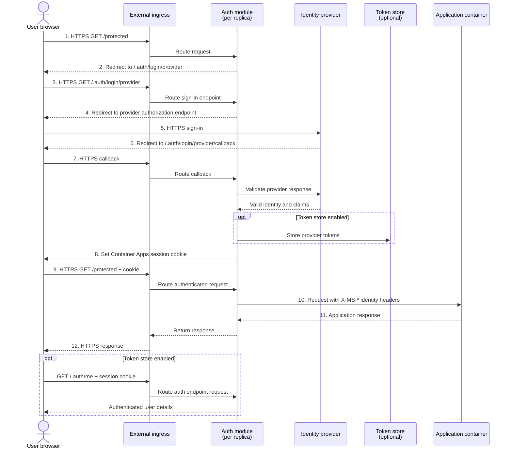
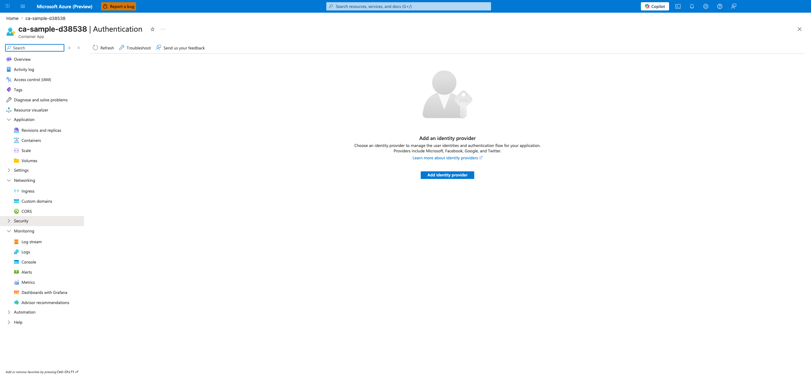

---
content_sources:
  diagrams:
    - id: when-you-enable-authentication-the-platform-s
      type: sequence
      source: mslearn-adapted
      based_on:
        - https://learn.microsoft.com/en-us/azure/container-apps/authentication
        - https://learn.microsoft.com/en-us/azure/app-service/configure-authentication-user-identities
content_validation:
  status: verified
  last_reviewed: 2026-11-07
  reviewer: agent
  core_claims:
    - claim: Azure Container Apps provides built-in authentication and authorization features to secure external ingress-enabled container apps with minimal or no code.
      source: https://learn.microsoft.com/en-us/azure/container-apps/authentication
      verified: true
    - claim: The authentication and authorization module runs as a separate sidecar container on each application replica and processes incoming HTTP requests before the application.
      source: https://learn.microsoft.com/en-us/azure/container-apps/authentication
      verified: true
    - claim: The platform middleware injects identity information into HTTP request headers.
      source: https://learn.microsoft.com/en-us/azure/container-apps/authentication
      verified: true
    - claim: With the token store enabled, authenticated callers can use the /.auth/me endpoint and the app can receive provider-token headers.
      source: https://learn.microsoft.com/en-us/azure/app-service/configure-authentication-user-identities
      verified: true
---
# Built-in Authentication (Easy Auth)

Azure Container Apps provides built-in authentication and authorization, often referred to as "Easy Auth," for **external ingress-enabled** container apps. The platform module can authenticate callers and enforce a coarse unauthenticated-request policy before a request reaches your application; your code remains responsible for business authorization.

## How it Works

When you enable authentication, each application replica includes a separate platform authentication module. For the server-directed browser flow, that module redirects an unauthenticated browser to the configured identity provider, establishes a Container Apps session after the callback, and then injects identity headers into requests sent to the application container.

<!-- diagram-id: when-you-enable-authentication-the-platform-s -->


*Figure: Server-directed sign-in for an external ingress-enabled app. Arrows are HTTP request, redirect, callback, or response messages; identity-provider validation establishes **who** the caller is, while application authorization still decides **what** that caller may do.*

!!! warning "Easy Auth does not replace app authorization"
    Easy Auth authenticates users, but your application still must enforce role/tenant/resource-level authorization rules.

## Enabling Authentication

To enable authentication with Microsoft Entra ID (formerly Azure AD):

```bash
export RG="rg-myapp"
export APP_NAME="ca-myapp"
export CLIENT_ID="<client-id>"
export CLIENT_SECRET="<client-secret>"
export TENANT_ID="<tenant-id>"
```

```bash
az containerapp auth microsoft update \
  --name "$APP_NAME" \
  --resource-group "$RG" \
  --client-id "$CLIENT_ID" \
  --client-secret "$CLIENT_SECRET" \
  --tenant-id "$TENANT_ID" \
  --yes
```

| Command | Why it is used |
|---|---|
| `az containerapp auth microsoft update` | Configures the Microsoft identity provider for the container app. |
| `--name "$APP_NAME"` | Selects the container app. |
| `--resource-group "$RG"` | Selects the resource group that contains the app. |
| `--client-id "$CLIENT_ID"` | Sets the application registration client ID used for sign-in. |
| `--client-secret "$CLIENT_SECRET"` | Supplies the application registration credential; prefer a secure automation input. |
| `--tenant-id "$TENANT_ID"` | Selects the Microsoft Entra tenant. |
| `--yes` | Accepts the command confirmation non-interactively. |

!!! note "Use secret references for client secrets"
    Avoid storing raw client secrets directly in scripts. Use secure secret handling workflows and rotate credentials regularly.

### Portal view: Authentication blade (no providers configured)



**[Observed]** The Authentication blade for the `ca-sample-d38538` Container App is open. The command bar exposes **Refresh**, **Troubleshoot**, and **Send us your feedback** controls. The main content area shows an empty-state illustration above the heading **Add an identity provider**, followed by descriptive text reading "Choose an identity provider to manage the user identities and authentication flow for your application. Providers include Microsoft, Facebook, Google, and Twitter.", a **Learn more about identity providers** link, and a primary **Add identity provider** button.

**[Inferred]** The presence of an "Add an identity provider" empty state is consistent with this Container App having no identity provider configured yet. The provider list mentioned in the description (Microsoft, Facebook, Google, Twitter) appears to map to the built-in providers documented for Easy Auth on this page. The single primary **Add identity provider** button appears to be the starting point for provider configuration in the portal.

**[Not Proven]** Additional provider configuration detail and runtime behavior detail are not visible on this view.

## Accessing User Information

Once a user is authenticated, the platform module adds headers to the request that your Python application can use. External requests cannot set these protected headers; Container Apps removes or replaces them before the request reaches the app.

- `X-MS-CLIENT-PRINCIPAL-NAME`: The user's username or email.
- `X-MS-CLIENT-PRINCIPAL-ID`: The user's unique identifier.
- `X-MS-CLIENT-PRINCIPAL`: A base64-encoded JSON object containing the user's claims.

### Python Example

```python
import base64
import json
from flask import Flask, request
from markupsafe import escape

app = Flask(__name__)

@app.route('/')
def home():
    principal_header = request.headers.get('X-MS-CLIENT-PRINCIPAL')
    if principal_header:
        # Decode the principal header
        principal = json.loads(base64.b64decode(principal_header).decode('utf-8'))
        claims = {item['typ']: item['val'] for item in principal.get('claims', [])}
        user_name = claims.get(principal.get('name_typ'), 'Unknown User')
        return f"Hello, {escape(user_name)}!"
    return "Hello, anonymous user!"
```

## Why use Easy Auth?

- **Simplicity:** No need to implement OAuth/OpenID Connect flows in your Python code.
- **Platform integration:** The authentication module, session handling, and protected identity-header injection are managed by Container Apps.
- **Flexibility:** Supports multiple identity providers, including Google, Facebook, and GitHub.

## Easy Auth Capability Matrix

| Capability | Easy Auth Coverage | App Responsibility |
|---|---|---|
| Authentication handshake | Built-in | Configure provider correctly |
| Identity-header injection | Built-in (`X-MS-*`) | Validate claim assumptions |
| Provider-token headers and `/.auth/me` | Built-in when the token store is enabled | Enable the store only when the app needs provider tokens |
| Business authorization | Partial | Enforce route/resource policies |
| Session/user experience | Partial | Handle app-specific redirects and UX |

## See Also
- [Managed Identity](managed-identity.md)
- [Operations: Security](security-operations.md)
- [Python Guide Configuration](../../language-guides/python/tutorial/03-configuration.md)

## Sources
- [Container Apps authentication and authorization](https://learn.microsoft.com/en-us/azure/container-apps/authentication)
- [Work with user identities in built-in authentication](https://learn.microsoft.com/en-us/azure/app-service/configure-authentication-user-identities)
