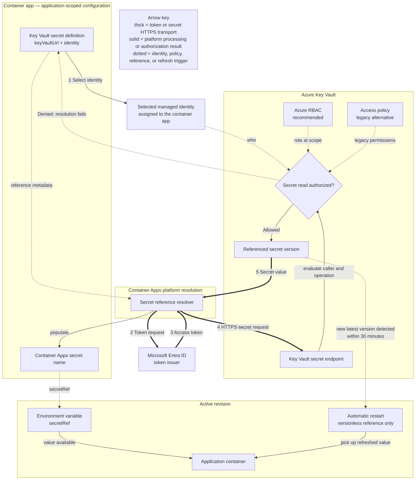
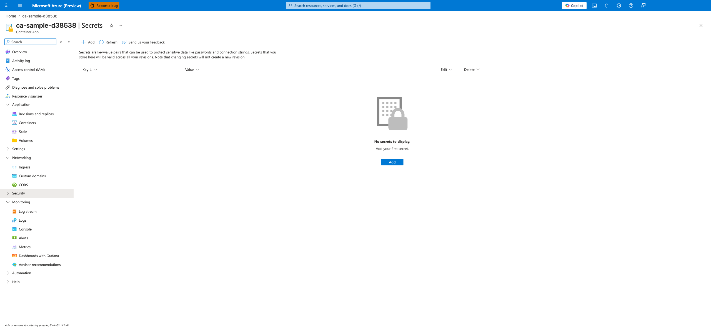

---
content_sources:
  diagrams:
    - id: architecture
      type: flowchart
      source: mslearn-adapted
      based_on:
        - https://learn.microsoft.com/en-us/azure/container-apps/manage-secrets
        - https://learn.microsoft.com/en-us/azure/container-apps/managed-identity
        - https://learn.microsoft.com/en-us/azure/key-vault/general/rbac-access-policy
content_validation:
  status: verified
  last_reviewed: 2026-11-07
  reviewer: agent
  core_claims:
    - claim: A Container Apps Key Vault secret reference requires a system-assigned or user-assigned managed identity with permission to read the referenced secret.
      source: https://learn.microsoft.com/en-us/azure/container-apps/manage-secrets
      verified: true
    - claim: A versionless Key Vault secret reference is refreshed within 30 minutes after a newer version becomes available, and active revisions using it in environment variables are restarted.
      source: https://learn.microsoft.com/en-us/azure/container-apps/manage-secrets
      verified: true
    - claim: Updating an inline Container Apps secret does not automatically update existing revisions; an operator must deploy a new revision or restart an existing revision to use the updated value.
      source: https://learn.microsoft.com/en-us/azure/container-apps/manage-secrets
      verified: true
    - claim: Before deleting a Container Apps secret, an operator must deploy a revision that no longer references it and deactivate every revision that still references it.
      source: https://learn.microsoft.com/en-us/azure/container-apps/manage-secrets
      verified: true
    - claim: Azure RBAC is the recommended Key Vault data-plane authorization model, while Key Vault access policies remain a legacy alternative.
      source: https://learn.microsoft.com/en-us/azure/key-vault/general/rbac-access-policy
      verified: true
---
# Key Vault Secrets Management (Managed Identity)

Use a Container Apps Key Vault secret reference when the platform should retrieve a secret through managed identity and expose it under an application-scoped Container Apps secret name. This is different from application code calling Key Vault directly through an SDK; both patterns require identity authorization and a working network path, but only the reference pattern receives the documented automatic refresh behavior.

## Architecture

<!-- diagram-id: architecture -->


*Figure: Platform-managed Key Vault reference resolution. Identity answers **who** requests the secret; Azure RBAC or a legacy access policy answers **whether** that identity may read it; HTTPS carries token and secret traffic. The automatic restart branch applies only to a versionless Key Vault URI used through an environment-variable reference.*

## Prerequisites

- Existing Container App: `$APP_NAME` in `$RG`
- Existing Key Vault with RBAC authorization enabled
- Azure CLI with Container Apps extension

## Step 1: Enable managed identity on the Container App

```bash
az containerapp identity assign \
  --name "$APP_NAME" \
  --resource-group "$RG" \
  --system-assigned

export PRINCIPAL_ID=$(az containerapp show \
  --name "$APP_NAME" \
  --resource-group "$RG" \
  --query "identity.principalId" \
  --output tsv)
```

| Command | Why it is used |
|---|---|
| `az containerapp identity assign` | Enables the system-assigned identity used by the Key Vault reference. |
| `--name "$APP_NAME"` | Selects the container app. |
| `--resource-group "$RG"` | Selects the resource group that contains the app. |
| `--system-assigned` | Creates or enables the app-owned identity. |
| `az containerapp show` | Reads the identity principal ID after assignment. |
| `--query "identity.principalId"` | Selects only the system-assigned identity object ID. |
| `--output tsv` | Returns the ID as an unquoted shell value. |

## Step 2: Grant Key Vault secret permissions via RBAC

```bash
export KEY_VAULT_ID=$(az keyvault show \
  --name "$KEY_VAULT_NAME" \
  --resource-group "$RG" \
  --query "id" \
  --output tsv)

az role assignment create \
  --assignee-object-id "$PRINCIPAL_ID" \
  --assignee-principal-type ServicePrincipal \
  --role "Key Vault Secrets User" \
  --scope "$KEY_VAULT_ID"
```

| Command | Why it is used |
|---|---|
| `az keyvault show` | Reads the Key Vault resource ID used as the role-assignment scope. |
| `--name "$KEY_VAULT_NAME"` | Selects the vault. |
| `--resource-group "$RG"` | Selects the resource group that contains the vault. |
| `--query "id"` | Selects the vault resource ID. |
| `--output tsv` | Returns the resource ID as an unquoted shell value. |
| `az role assignment create` | Creates the Key Vault data-plane role assignment. |
| `--assignee-object-id "$PRINCIPAL_ID"` | Selects the managed identity security principal. |
| `--assignee-principal-type ServicePrincipal` | Identifies the managed identity's principal type. |
| `--role "Key Vault Secrets User"` | Grants secret-value read access without vault-management permissions. |
| `--scope "$KEY_VAULT_ID"` | Limits the assignment to this vault. |

## Step 3: Add secret and app configuration

Set a sample secret in Key Vault:

```bash
az keyvault secret set \
  --vault-name "$KEY_VAULT_NAME" \
  --name "api-base-url" \
  --value "https://example.internal"
```

| Command | Why it is used |
|---|---|
| `az keyvault secret set` | Creates a new Key Vault secret version. |
| `--vault-name "$KEY_VAULT_NAME"` | Selects the vault. |
| `--name "api-base-url"` | Names the secret. |
| `--value "https://example.internal"` | Supplies the example secret value. |

Declare an application-scoped Key Vault reference and expose it to the revision through `secretRef`:

```bash
az containerapp secret set \
  --name "$APP_NAME" \
  --resource-group "$RG" \
  --secrets "api-base-url=keyvaultref:https://$KEY_VAULT_NAME.vault.azure.net/secrets/api-base-url,identityref:system"

az containerapp update \
  --name "$APP_NAME" \
  --resource-group "$RG" \
  --set-env-vars "API_BASE_URL=secretref:api-base-url"
```

| Command | Why it is used |
|---|---|
| `az containerapp secret set` | Creates or updates the application-scoped Container Apps secret definition. |
| `--name "$APP_NAME"` | Selects the container app for each command. |
| `--resource-group "$RG"` | Selects the resource group for each command. |
| `--secrets "api-base-url=keyvaultref:...,identityref:system"` | Defines a versionless Key Vault reference resolved with the system-assigned identity. |
| `az containerapp update` | Creates a revision-template update that consumes the secret. |
| `--set-env-vars "API_BASE_URL=secretref:api-base-url"` | Maps the application secret to an environment variable without exposing its value. |

!!! warning "Key Vault references still require correct RBAC and network path"
    Secret resolution fails when identity permissions, private DNS linkage, or endpoint connectivity are incomplete.

### Portal view: Secrets blade (empty state)



**[Observed]** The Secrets blade for the `ca-sample-d38538` Container App is open. The command bar exposes **Add**, **Refresh**, and **Send us your feedback** controls. A descriptive paragraph reads "Secrets are key/value pairs that can be used to protect sensitive data like passwords and connection strings. Secrets that you store here will be valid across all your revisions. Note that changing secrets will not create a new revision." Below it is a table header with **Key**, **Value**, **Edit**, and **Delete** columns. The central area shows an empty-state lock illustration with the text "No secrets to display." and "Add your first secret." above a primary **Add** button.

**[Inferred]** The two-column **Key** / **Value** layout is consistent with the documented Container App secret store model where each secret is a named key/value pair. The header sentence "changing secrets will not create a new revision" describes revision creation only; current Microsoft Learn states that existing revisions still require a restart or replacement revision to use an updated inline value. The presence of a single primary **Add** button on an otherwise empty list appears to indicate the starting point for declaring either an inline secret value or a Key Vault reference in the portal.

**[Not Proven]** Additional secret entry detail, reference configuration detail, identity detail, and RBAC detail are not visible on this view.

## Alternative: direct SDK access

Use this alternative when application code must choose secret names or versions dynamically. It is not a Container Apps Key Vault reference and therefore does not inherit the reference refresh/restart behavior shown above.
The example expects `KEY_VAULT_URL` to contain the vault URI, such as `https://<key-vault-name>.vault.azure.net/`.

Install dependencies:

```bash
pip install azure-identity azure-keyvault-secrets
```

Read secrets using `DefaultAzureCredential`:

```python
import os
from azure.identity import DefaultAzureCredential
from azure.keyvault.secrets import SecretClient

vault_url = os.environ["KEY_VAULT_URL"]
credential = DefaultAzureCredential()
client = SecretClient(vault_url=vault_url, credential=credential)

secret = client.get_secret("api-base-url")
print(secret.value)
```

## Container Apps specifics

- Use inline Container App secrets only when direct app-level storage is appropriate; production guidance favors Key Vault references.
- Use versionless Key Vault references when the documented refresh-within-30-minutes and active-revision restart behavior is desired.
- For private access, combine with VNet integration and Key Vault private endpoint.

When deleting a secret, first deploy a revision that no longer references it, then deactivate every older revision that still references it. Delete the secret only after no active revision depends on that name; restarting a revision cannot repair a reference to a deleted secret.

## Secret Access Pattern Comparison

| Pattern | Security Posture | Operational Overhead | Recommended Usage |
|---|---|---|---|
| Inline Container Apps secret | Value stored in app configuration | Manual revision deployment or restart | Bootstrap or constrained app-local use |
| Key Vault reference + managed identity | Value remains governed in Key Vault | Automatic for versionless references used by environment variables | Production default for centrally governed secrets |
| Direct Key Vault SDK call | App requests the value at runtime | Application-defined caching and refresh | Dynamic secret selection or application-controlled retrieval |

!!! tip "Separate secret naming from business naming"
    Use stable secret names (for example `database-password`) and rotate values behind the same key
    to reduce application change frequency.

## Verification steps

1. Validate role assignment:

```bash
az role assignment list \
  --assignee "$PRINCIPAL_ID" \
  --scope "$KEY_VAULT_ID" \
  --output table
```

| Command | Why it is used |
|---|---|
| `az role assignment list` | Lists Azure RBAC assignments for the identity and vault scope. |
| `--assignee "$PRINCIPAL_ID"` | Filters assignments to the managed identity. |
| `--scope "$KEY_VAULT_ID"` | Filters assignments to the vault. |
| `--output table` | Formats the verification output for an operator. |

2. Verify secret read in app logs:

```bash
az containerapp logs show \
  --name "$APP_NAME" \
  --resource-group "$RG" \
  --follow false
```

| Command | Why it is used |
|---|---|
| `az containerapp logs show` | Reads console logs from the app to verify startup after secret resolution. |
| `--name "$APP_NAME"` | Selects the container app. |
| `--resource-group "$RG"` | Selects the resource group. |
| `--follow false` | Returns current logs without opening a streaming session. |

3. Validate secret metadata (without exposing secret values):

```bash
az keyvault secret show \
  --vault-name "$KEY_VAULT_NAME" \
  --name "api-base-url" \
  --query "{name:name,enabled:attributes.enabled,updated:attributes.updated}"
```

| Command | Why it is used |
|---|---|
| `az keyvault secret show` | Reads secret metadata without printing the secret value. |
| `--vault-name "$KEY_VAULT_NAME"` | Selects the vault. |
| `--name "api-base-url"` | Selects the secret. |
| `--query "{name:name,enabled:attributes.enabled,updated:attributes.updated}"` | Limits output to non-secret metadata. |

## See Also
- [Managed Identity](managed-identity.md)
- [Private Endpoints](../networking/private-endpoints.md)
- [Operations Security](security-operations.md)
- [Secrets in Azure Container Apps](../security/secrets.md)

## Sources
- [Key Vault secrets in Azure Container Apps (Microsoft Learn)](https://learn.microsoft.com/en-us/azure/container-apps/manage-secrets)
- [Managed identities in Azure Container Apps](https://learn.microsoft.com/en-us/azure/container-apps/managed-identity)
- [Azure RBAC versus Key Vault access policies](https://learn.microsoft.com/en-us/azure/key-vault/general/rbac-access-policy)
