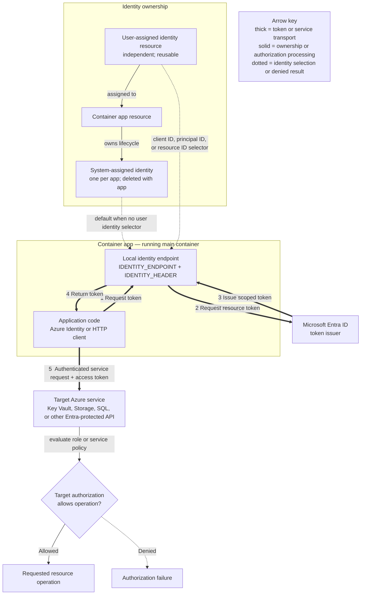
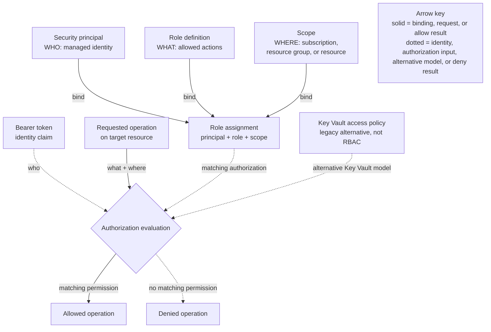
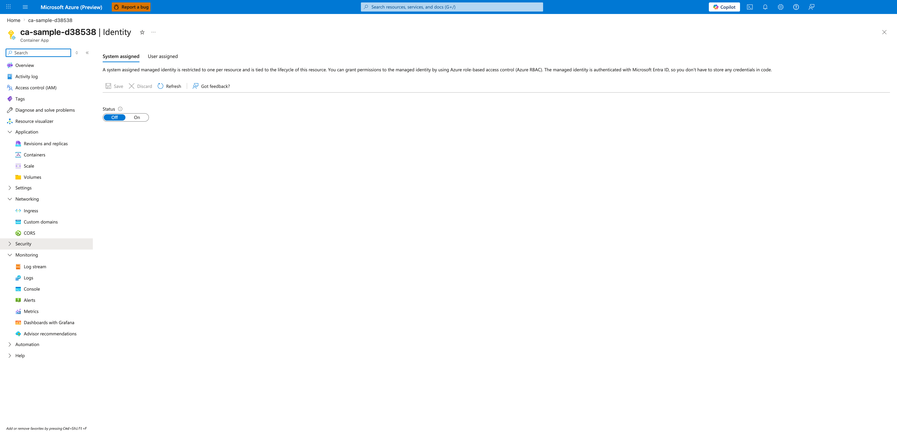

---
content_sources:
  diagrams:
    - id: architecture
      type: flowchart
      source: mslearn-adapted
      based_on:
        - https://learn.microsoft.com/en-us/azure/container-apps/managed-identity
        - https://learn.microsoft.com/en-us/entra/identity/managed-identities-azure-resources/overview
    - id: rbac-structure
      type: flowchart
      source: self-generated
      justification: Synthesized from the Microsoft Learn sources cited by this page.
      based_on:
        - https://learn.microsoft.com/en-us/azure/container-apps/managed-identity
        - https://learn.microsoft.com/en-us/entra/identity/managed-identities-azure-resources/overview
        - https://learn.microsoft.com/en-us/azure/key-vault/general/rbac-access-policy
content_validation:
  status: verified
  last_reviewed: 2026-11-07
  reviewer: agent
  core_claims:
    - claim: A system-assigned identity is tied to the container app and is deleted when the container app is deleted.
      source: https://learn.microsoft.com/en-us/azure/container-apps/managed-identity
      verified: true
    - claim: A user-assigned identity is a standalone Azure resource that can be assigned to a container app and other resources.
      source: https://learn.microsoft.com/en-us/azure/container-apps/managed-identity
      verified: true
    - claim: Managed identities let a container app connect to Microsoft Entra protected resources without managing credentials in the app.
      source: https://learn.microsoft.com/en-us/azure/container-apps/managed-identity
      verified: true
    - claim: When a managed identity is added, deleted, or modified on a running container app, the app does not automatically restart and a new revision is not created.
      source: https://learn.microsoft.com/en-us/azure/container-apps/managed-identity
      verified: true
    - claim: Container Apps exposes an internally accessible identity endpoint through IDENTITY_ENDPOINT and requires the rotating IDENTITY_HEADER value when requesting a token.
      source: https://learn.microsoft.com/en-us/azure/container-apps/managed-identity
      verified: true
---
# Passwordless Access with Managed Identity

Azure Container Apps supports managed identities, allowing your Python application to access supported Microsoft Entra-protected services without storing service credentials in the app.

## Architecture

<!-- diagram-id: architecture -->


*Figure: Managed identity separates identity ownership, token acquisition, service transport, and target authorization. A valid Microsoft Entra token proves **who** the app is; the target's Azure RBAC role or service-specific policy determines **what** that identity may do.*

## How RBAC Connects Identity to Resources

A managed identity alone does not grant access. Azure RBAC binds three elements into a **role assignment**:

<!-- diagram-id: rbac-structure -->


| Element | Question it answers | Example |
|---|---|---|
| **Principal** | Who needs access? | Container App's managed identity |
| **Role Definition** | What permission? | `AcrPush`, `Key Vault Secrets User` |
| **Scope** | On which resource? | A specific ACR, Key Vault, or resource group |
| **Role Assignment** | The binding itself | Unique GUID — one per (principal + role + scope) combination |

For Key Vault, Azure RBAC is the recommended data-plane authorization model. The legacy access policy model grants secret, key, and certificate permissions directly to a security principal at vault scope; it is an alternative authorization model, not an additional role assignment.

## Types of Managed Identity

- **System-assigned:** Tied to the lifecycle of the Container App.
- **User-assigned:** Created as a separate resource and can be shared among multiple apps.

| Identity Type | Lifecycle | Best Use Case |
|---|---|---|
| System-assigned | Deleted with the app | Single app, simplest setup |
| User-assigned | Independent resource | Shared identity across multiple apps/jobs |

!!! warning "Role assignment propagation is eventually consistent"
    Newly assigned RBAC roles can take time to become effective.
    Retry the operation that exercises the new role assignment. Token back-end caching can also delay effective permission changes for a resource URI.

## Enabling Managed Identity

To enable a system-assigned managed identity for your app:

```bash
az containerapp identity assign \
  --name "$APP_NAME" \
  --resource-group "$RG" \
  --system-assigned
```

| Command | Why it is used |
|---|---|
| `az containerapp identity assign` | Enables a managed identity on the container app. |
| `--name "$APP_NAME"` | Selects the container app. |
| `--resource-group "$RG"` | Selects the resource group. |
| `--system-assigned` | Creates or enables the app-owned identity. |

### Portal view: Identity blade



**[Observed]** The Identity blade for the `ca-sample-d38538` Container App is open. The content area shows two tabs labeled **System assigned** (selected) and **User assigned**. Below the description text, a command bar exposes **Save**, **Discard**, **Refresh**, and **Got feedback?** controls. A single form field labeled **Status** is rendered as an **Off / On** toggle, currently set to **Off**.

**[Inferred]** The two-tab layout appears to map to the two identity types described in this page: **System assigned** for an identity whose lifecycle is tied to the Container App, and **User assigned** for a standalone Azure resource that can be attached to one or more apps. The presence of a single **Status** toggle on the System assigned tab is consistent with the documented constraint that a Container App can have at most one system-assigned identity. The **Save / Discard** command-bar pattern is consistent with the typical Portal edit-then-commit workflow for identity configuration.

**[Not Proven]** Additional identity attribute detail, RBAC detail, user-assigned tab detail, and runtime behavior detail are not visible on this view.

## Assigning Roles

Assign roles to the managed identity to grant access to other resources (e.g., Azure SQL, Blob Storage, Key Vault).

```bash
# Get the principal ID of the system-assigned identity
PRINCIPAL_ID=$(az containerapp show \
  --name "$APP_NAME" \
  --resource-group "$RG" \
  --query identity.principalId \
  --output tsv)

# Assign the 'Storage Blob Data Reader' role
az role assignment create \
  --assignee-object-id "$PRINCIPAL_ID" \
  --assignee-principal-type ServicePrincipal \
  --role "Storage Blob Data Reader" \
  --scope "/subscriptions/<subscription-id>/resourceGroups/$RG/providers/Microsoft.Storage/storageAccounts/mystorageaccount"
```

| Command | Why it is used |
|---|---|
| `az containerapp show` | Reads the app's system-assigned identity principal ID. |
| `--name "$APP_NAME"` | Selects the container app. |
| `--resource-group "$RG"` | Selects the resource group for both commands. |
| `--query identity.principalId` | Selects the managed identity object ID. |
| `--output tsv` | Returns the ID as an unquoted shell value. |
| `az role assignment create` | Binds the identity, role definition, and storage-account scope. |
| `--assignee-object-id "$PRINCIPAL_ID"` | Selects the managed identity security principal. |
| `--assignee-principal-type ServicePrincipal` | Identifies the managed identity's principal type. |
| `--role "Storage Blob Data Reader"` | Grants blob data read operations. |
| `--scope "/subscriptions/.../storageAccounts/mystorageaccount"` | Limits the role to the target storage account. |

## Python Implementation

Use the `azure-identity` library in your Python code to authenticate using the managed identity.

```python
from azure.identity import DefaultAzureCredential
from azure.storage.blob import BlobServiceClient

# DefaultAzureCredential will automatically pick up the managed identity
credential = DefaultAzureCredential()

# Connect to the storage account using the credential
blob_service_client = BlobServiceClient(
    account_url="https://mystorageaccount.blob.core.windows.net",
    credential=credential
)
```

!!! tip "Use service-specific SDK clients with DefaultAzureCredential"
    Keep authorization centralized in managed identity and avoid embedding keys or SAS tokens in app configuration.

## Why use Managed Identity?

- **Fewer service credentials:** Supported Microsoft Entra-authenticated dependencies no longer require stored passwords, access keys, or client secrets.
- **Scoped authorization:** The target service authorizes the application identity through Azure RBAC or its documented service-specific policy.
- **Configuration still required:** Endpoint, database, and other non-secret connection settings remain part of application configuration, and unrelated application secrets still need their own lifecycle controls.

## See Also
- [Cosmos DB](../../language-guides/python/recipes/cosmosdb.md)
- [Azure SQL](../../language-guides/python/recipes/azure-sql.md)
- [Key Vault](key-vault.md)
- [Blob Storage and File Mounts](../../language-guides/python/recipes/storage.md)

## Sources
- [Managed identity in Azure Container Apps (Microsoft Learn)](https://learn.microsoft.com/en-us/azure/container-apps/managed-identity)
- [What are managed identities for Azure resources? (Microsoft Learn)](https://learn.microsoft.com/en-us/entra/identity/managed-identities-azure-resources/overview)
- [Azure RBAC versus Key Vault access policies](https://learn.microsoft.com/en-us/azure/key-vault/general/rbac-access-policy)
