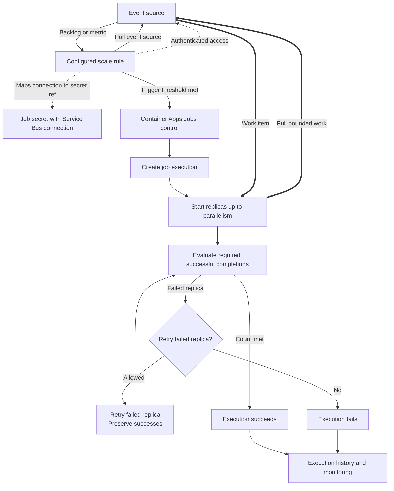

---
content_sources:
  diagrams:
    - id: event-driven-job-flow
      type: flowchart
      source: self-generated
      justification: Synthesized from the documented event-trigger and scaling lifecycle without asserting support for an unverified scaler matrix.
      based_on:
        - https://learn.microsoft.com/en-us/azure/container-apps/jobs
        - https://learn.microsoft.com/en-us/azure/container-apps/scale-app#jobs
content_validation:
  status: verified
  last_reviewed: '2026-07-18'
  reviewer: ai-agent
  core_claims:
    - claim: Azure Container Apps Jobs support event-driven triggering.
      source: https://learn.microsoft.com/en-us/azure/container-apps/jobs
      verified: true
    - claim: Jobs can use scale-rule metadata and authentication patterns similar to other Container Apps scale integrations.
      source: https://learn.microsoft.com/en-us/azure/container-apps/scale-app#jobs
      verified: true
---
# Event-Driven Jobs

Event-Driven Jobs create discrete executions when an external event source indicates work is available. This model fits queue backlogs, asynchronous integration pipelines, and bursty background workloads.

## Main Content

### How event triggering works

Event-driven Jobs combine a job definition with KEDA-style scale metadata. Instead of keeping a worker process alive, the platform creates an execution when the event rule indicates work should be pulled.

```bash
export RG="rg-aca-prod"
export ACA_ENV_NAME="aca-env-prod"
export JOB_NAME="job-orders-queue"
export IMAGE_NAME="acrsharedprod.azurecr.io/jobs/orders-consumer:v1.0.0"

az containerapp job create \
  --name "$JOB_NAME" \
  --resource-group "$RG" \
  --environment "$ACA_ENV_NAME" \
  --trigger-type "Event" \
  --scale-rule-name "orders-queue" \
  --scale-rule-type "azure-servicebus" \
  --scale-rule-metadata "queueName=orders" "messageCount=10" "namespace=<servicebus-namespace>.servicebus.windows.net" \
  --secrets "servicebus-connection=<SERVICE_BUS_CONNECTION_STRING>" \
  --scale-rule-auth "connection=servicebus-connection" \
  --replica-timeout 900 \
  --replica-retry-limit 2 \
  --image "$IMAGE_NAME"
```

| Command | Purpose |
|---|---|
| `az containerapp job create` | Creates a Container Apps job definition. |
| `--name` | Selects the target resource by name. |
| `--resource-group` | Selects the resource group that contains the target resource. |
| `--environment` | Selects the Container Apps environment for the job. |
| `--trigger-type` | Selects the job trigger type. |
| `--scale-rule-name` | Names the event-driven scale rule. |
| `--scale-rule-type` | Selects the event scaler type. |
| `--scale-rule-metadata` | Supplies scaler-specific trigger metadata. |
| `--secrets` | Stores the Service Bus connection string as a job secret. |
| `--scale-rule-auth` | Maps the scaler's `connection` authentication parameter to the job secret. |
| `--replica-timeout` | Sets the maximum time allowed for a replica to complete. |
| `--replica-retry-limit` | Sets how many times a failed replica can be retried. |
| `--image` | Selects the container image for the job template. |

### Event sources and scaler support

Event-driven jobs can create custom scaling rules from KEDA scalers that support the `ScaledJob` specification. Azure Service Bus is the concrete example on this page, but the same model can apply to other compatible event sources.

| Topic | Guidance |
|---|---|
| Scaler model | Use a KEDA scaler that supports `ScaledJob`. |
| Example in this guide | Azure Service Bus with scaler metadata and secret-backed authentication. |
| Operational rule | Verify the selected scaler's metadata and authentication requirements before deployment. |

!!! warning "Verify each scaler contract"
    `ScaledJob` compatibility does not make metadata and authentication interchangeable across scalers. Check the selected KEDA scaler specification and configure every required metadata and authentication value.

### Polling interval and scale rules

Event-driven Jobs depend on the scaler configuration to decide when new executions are created. Container Apps polls the event source every 30 seconds by default; configure `pollingInterval` (CLI: `--polling-interval`) when the workload needs a different interval. The other important operator inputs are:

- Threshold metadata such as queue length or lag
- Authentication details that let the scaler inspect the source

!!! warning "Validate latency assumptions"
    The job-level polling default is 30 seconds, but source behavior and scaler metadata still affect when a threshold is observed. Validate the complete scaler configuration before using polling behavior in queue-latency SLOs or cost projections.

### Authentication choices

Prefer this order:

1. Managed identity when the scaler and event source support it.
2. Secret-backed connection metadata when identity is not available.
3. Separate identities or secrets per job when blast radius must stay narrow.

### Jobs vs event-driven apps

Use an event-driven Job when:

- Each run should pull a bounded unit of work and exit.
- Cold start per execution is acceptable.
- You want explicit execution history and replay behavior.

Use an event-driven Container App when:

- A long-running worker should keep consuming continuously.
- Warm process state or connection reuse materially improves throughput.
- The consumer should scale existing replicas up and down rather than launch one-shot executions.

### Event-driven execution model

<!-- diagram-id: event-driven-job-flow -->


The thick arrows are work transport between the event source and running replicas. Scaler authentication is a dotted authorization dependency, while threshold evaluation and execution creation are control actions rather than runtime request traffic.

### Portal view of an event-driven job


**[Observed]** `cj-event-d38538`. `Container App Job`. `Overview`. `Run now`. `Suspend`. `Refresh`. `Delete`. `Essentials`. `Resource group`. `Location`. `Korea Central`. `Subscription`. `Visual Studio Enterprise Subscription`. `Subscription ID`. `Container Apps Environme...`. `Log Analytics`. `Workload profile`. `Consumption`. `Tags`. `Add tags`. `View Cost`. `JSON View`. `Properties`. `Job`. `Provisioning status`. `Succeeded`. `Trigger Type`. `Event`. `Execution history`. `View`. `Configuration`. `Replica timeout`. `300`. `Replica retry limit`. `1`. `Advanced`. `Parallelism`. `1`. `Completion count`. `1`.

**[Inferred]** The `Trigger Type` field value of `Event` appears to map to the same configuration lever set by `--trigger-type "Event"` in [How event triggering works](#how-event-triggering-works). The `Replica timeout` field appears to map to the same lever set by `--replica-timeout` in that same section. The `Replica retry limit` field appears to map to the same lever set by `--replica-retry-limit` in that same section. The `Parallelism` and `Completion count` fields appear consistent with the bounded-unit-of-work model described in [Jobs vs event-driven apps](#jobs-vs-event-driven-apps).

**[Not Proven]** No scale-rule configuration detail, authentication detail, polling detail, execution history detail, or event-source backlog detail is shown on this blade.

## See Also

- [Container Apps Jobs Overview](index.md)
- [Execution Lifecycle](execution-lifecycle.md)
- [Jobs vs Apps](jobs-vs-apps.md)
- [Job Design](../../best-practices/job-design.md)

## Sources

- [Jobs in Azure Container Apps (Microsoft Learn)](https://learn.microsoft.com/en-us/azure/container-apps/jobs)
- [Scale jobs in Azure Container Apps (Microsoft Learn)](https://learn.microsoft.com/en-us/azure/container-apps/scale-app#jobs)
