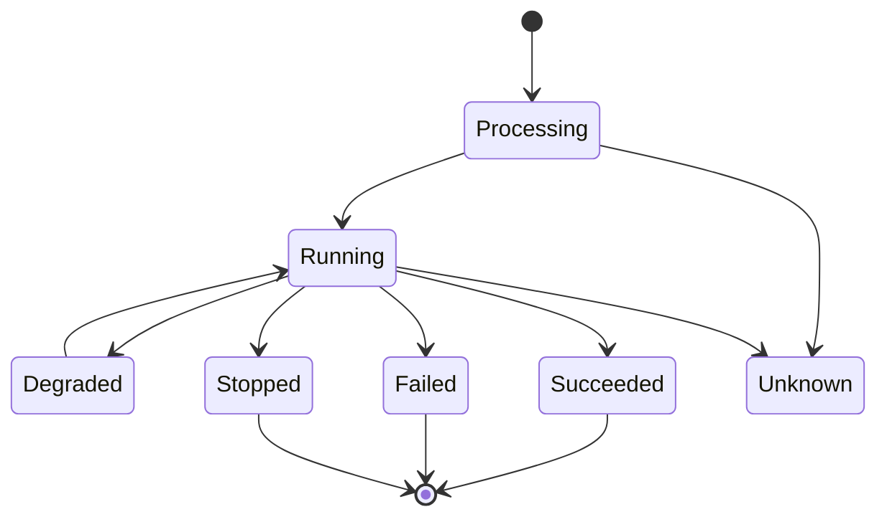
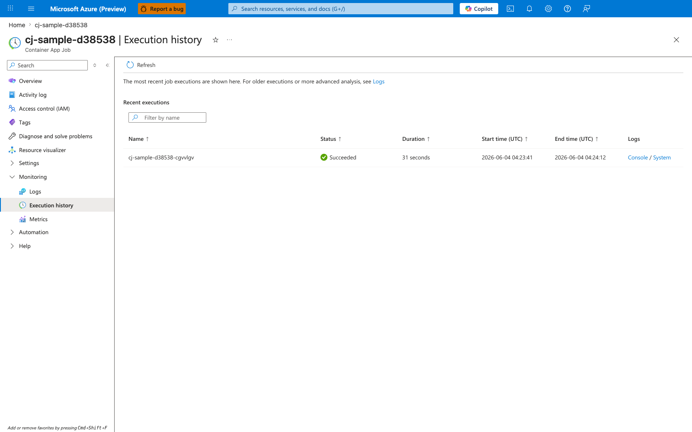

---
content_sources:
  diagrams:
    - id: job-execution-state-model
      type: state
      source: self-generated
      justification: Conceptual state model synthesized from existing repository job troubleshooting evidence and Microsoft Learn Jobs guidance pending final quote verification.
      based_on:
        - https://learn.microsoft.com/en-us/azure/container-apps/jobs
        - https://learn.microsoft.com/en-us/azure/container-apps/scale-app#jobs
        - https://learn.microsoft.com/en-us/rest/api/resource-manager/containerapps/job-execution/job-execution
content_validation:
  status: verified
  last_reviewed: '2026-07-18'
  reviewer: ai-agent
  core_claims:
    - claim: A Container Apps Job execution can run one or more replicas.
      source: https://learn.microsoft.com/en-us/azure/container-apps/jobs
      verified: true
    - claim: Scheduled and event-based jobs keep only a limited recent execution history.
      source: https://learn.microsoft.com/en-us/azure/container-apps/jobs
      verified: true
---
# Execution Lifecycle

Understanding the execution lifecycle is the key to sizing parallelism, handling retries safely, and building useful monitoring for Jobs.

## Main Content

### Execution states

At a high level, a Job execution moves through trigger, runtime, and terminal phases.

| Phase | Operator meaning |
|---|---|
| Processing | The execution is being processed before or between active runtime work |
| Running | One or more replicas are executing |
| Succeeded | Completion criteria were met |
| Failed | Retries were exhausted or the execution could not complete |
| Stopped | An operator or platform action ended the run before successful completion |
| Degraded | The execution reports a degraded running state |
| Unknown | The service can't report a more specific current state |

The labels above match the current `JobExecutionRunningState` management API enumeration. The arrows below are an operator-oriented lifecycle interpretation; the API enumeration defines status values, not a complete transition contract.

### Replica fan-out: `parallelism` and `replicaCompletionCount`

An execution can fan out to multiple replicas.

- `parallelism` limits how many replicas can run at once.
- `replicaCompletionCount` defines how many successful replicas are required before the execution is treated as complete.

This gives you two useful models:

- **All replicas required**: every partition must succeed.
- **n-of-m completion**: a subset of replicas can satisfy the execution.

Choose n-of-m only when downstream correctness explicitly allows partial success.

### Retry and timeout controls

Use `replicaRetryLimit` and `replicaTimeout` together:

| Setting | Primary purpose | Failure mode if mis-tuned |
|---|---|---|
| `replicaRetryLimit` | Recover from transient failure | Retry storms or repeated side effects |
| `replicaTimeout` | Stop stuck or unexpectedly long replicas | Silent hangs or premature termination |

Design guidance:

1. Measure normal and p95 duration.
2. Set timeout above p95 with headroom.
3. Retry only failures that are truly transient.
4. Make all external writes idempotent before increasing retry counts.

### History retention

The current repository already documents that scheduled and event-based Jobs retain only the most recent 100 successful and failed executions.

Operational implications:

- Export important execution evidence to dashboards or tickets quickly.
- Keep longer-term success-rate reporting in Log Analytics or Application Insights.
- Do not rely on the platform execution list alone for long-term audit history.

!!! warning "Manual-job retention behavior should be confirmed before using it as an audit log"
    The 100-execution retention statement is already cited for scheduled and event-driven Jobs in this repository.
    Re-verify manual execution retention separately if long-running audit history matters for your workload.

### Lifecycle state model

<!-- diagram-id: job-execution-state-model -->

`replicaRetryLimit` retries a failed replica within the execution; it does not add a `Retrying` execution status. `replicaCompletionCount` determines how many replicas must complete successfully for the execution to succeed, and `replicaTimeout` can end the opportunity to finish retries. `Unknown` is not treated as terminal: keep polling the execution API until it reports a more specific state. Only `Succeeded`, `Failed`, and `Stopped` terminate the lifecycle presented here.

### Portal view of execution history

**[Observed]** `Container App Job`. `Execution history`. `Logs`. `Execution history`. `Metrics`. `Refresh`. `The most recent job executions are shown here. For older executions or more advanced analysis, see Logs`. `Recent executions`. `Filter by name`. `Name`. `Status`. `Duration`. `Start time (UTC)`. `End time (UTC)`. `Logs`. `Succeeded`. `31 seconds`. `2026-06-04 04:23:41`. `2026-06-04 04:24:12`. `Console`. `System`.

**[Inferred]** The `Status` column of `Succeeded` appears consistent with the `Succeeded` terminal state in the [Execution states](#execution-states) table. The `Duration`, `Start time (UTC)`, and `End time (UTC)` columns appear to surface the runtime window referenced by `replicaTimeout` in [Retry and timeout controls](#retry-and-timeout-controls). The presence of a single row alongside the `For older executions or more advanced analysis, see Logs` text is consistent with the bounded-retention point made in [History retention](#history-retention).

**[Not Proven]** Additional execution history detail, replica detail, retry detail, and trigger detail are not shown on this blade.

## See Also

- [Container Apps Jobs Overview](index.md)
- [Manual Jobs](manual-jobs.md)
- [Scheduled Jobs](scheduled-jobs.md)
- [Event-Driven Jobs](event-driven-jobs.md)
- [Jobs Operations](../../operations/jobs/index.md)

## Sources

- [Jobs in Azure Container Apps (Microsoft Learn)](https://learn.microsoft.com/en-us/azure/container-apps/jobs)
- [Scale jobs in Azure Container Apps (Microsoft Learn)](https://learn.microsoft.com/en-us/azure/container-apps/scale-app#jobs)
- [Job Execution resource and status enumeration](https://learn.microsoft.com/en-us/rest/api/resource-manager/containerapps/job-execution/job-execution)
