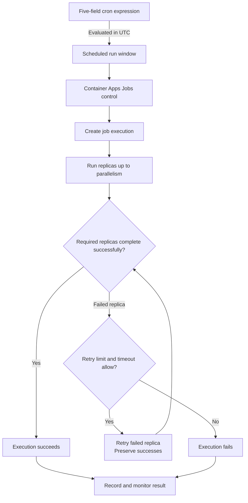
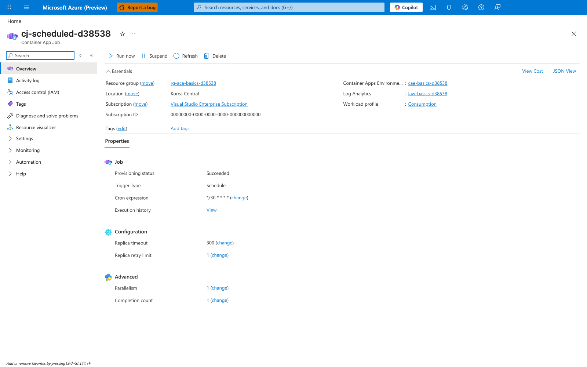

---
content_sources:
  diagrams:
    - id: scheduled-job-run-window
      type: flowchart
      source: self-generated
      justification: Synthesized from the documented five-field UTC cron schedule and advanced job settings.
      based_on:
        - https://learn.microsoft.com/en-us/azure/container-apps/jobs
        - https://learn.microsoft.com/en-us/azure/container-apps/scale-app#jobs
content_validation:
  status: verified
  last_reviewed: '2026-07-18'
  reviewer: ai-agent
  core_claims:
    - claim: Azure Container Apps Jobs can run on a schedule.
      source: https://learn.microsoft.com/en-us/azure/container-apps/jobs
      verified: true
    - claim: Container Apps jobs support advanced configuration options such as retries, timeouts, and parallelism.
      source: https://learn.microsoft.com/en-us/azure/container-apps/jobs
      verified: true
---
# Scheduled Jobs

Scheduled Jobs run at recurring times and are a good fit for nightly cleanup, hourly materialization, and business-window batch work.

## Main Content

### Creating a scheduled job

```bash
export RG="rg-aca-prod"
export ACA_ENV_NAME="aca-env-prod"
export JOB_NAME="job-nightly-reconcile"
export IMAGE_NAME="acrsharedprod.azurecr.io/jobs/nightly-reconcile:v1.0.0"

az containerapp job create \
  --name "$JOB_NAME" \
  --resource-group "$RG" \
  --environment "$ACA_ENV_NAME" \
  --trigger-type "Schedule" \
  --cron-expression "0 2 * * *" \
  --replica-timeout 3600 \
  --replica-retry-limit 1 \
  --image "$IMAGE_NAME"
```

| Command | Purpose |
|---|---|
| `az containerapp job create` | Creates a Container Apps job definition. |
| `--name` | Selects the target resource by name. |
| `--resource-group` | Selects the resource group that contains the target resource. |
| `--environment` | Selects the Container Apps environment for the job. |
| `--trigger-type` | Selects the job trigger type. |
| `--cron-expression` | Sets the five-field UTC cron schedule. |
| `--replica-timeout` | Sets the maximum time allowed for a replica to complete. |
| `--replica-retry-limit` | Sets how many times a failed replica can be retried. |
| `--image` | Selects the container image for the job template. |

### Cron expression examples

Use readable schedules and document them in the runbook:

| Intent | Example | Meaning |
|---|---|---|
| Hourly | `0 * * * *` | At minute 0 every hour |
| Nightly | `0 2 * * *` | 02:00 every day |
| Weekly | `0 6 * * 1` | 06:00 every Monday |
| Business-hours-only | `0 8-18 * * 1-5` | Top of the hour, weekdays, 08:00-18:00 |

Container Apps scheduled jobs use the standard five-field cron format: minute, hour, day of month, month, and day of week. The Jobs reference does not document seconds fields or provider-specific macros.

### Time zone handling

Cron expressions for scheduled jobs are evaluated in UTC.

Recommended practice:

- Author cron in UTC.
- Document the equivalent local-business time.
- Re-check schedules before daylight-saving transitions and regional policy changes.

### Overlap and missed runs

The platform schedule decides when a new execution is created, but your workload must still tolerate slow previous runs, manual replays, and retries.

Protect scheduled jobs with:

- Idempotent writes
- External locking when overlap would corrupt state
- Measured timeout values
- Alerting on missed windows and long-running executions

!!! warning "Overlap and skip behavior still needs a direct product quote"
    This page does not claim a guaranteed platform behavior for overlapping or skipped executions because the Microsoft Learn quote collection for that detail did not complete.
    Assume overlap is a design risk unless you have validated the current platform behavior in your environment.

### Scheduling checklist

Before production rollout, answer:

1. What is the allowed execution window?
2. Can a new run start while the previous run is still active?
3. What is the operational response if a window is missed?

### Scheduled execution flow

<!-- diagram-id: scheduled-job-run-window -->


## Portal View: Schedule Trigger Type and Cron Expression Field



**[Observed]** `cj-scheduled-d38538`. `Container App Job`. `Run now`. `Suspend`. `Refresh`. `Delete`. `Resource group`. `rg-aca-basics-d38538`. `Location`. `Korea Central`. `Subscription`. `Visual Studio Enterprise Subscription`. `Subscription ID`. `00000000-0000-0000-0000-000000000000`. `Container Apps Environme...`. `cae-basics-d38538`. `Log Analytics`. `law-basics-d38538`. `Workload profile`. `Consumption`. `Properties`. `Job`. `Provisioning status`. `Succeeded`. `Trigger Type`. `Schedule`. `Cron expression`. `*/30 * * * *`. `Execution history`. `View`. `Configuration`. `Replica timeout`. `300`. `Replica retry limit`. `1`. `Advanced`. `Parallelism`. `1`. `Completion count`. `1`.

**[Inferred]** The `Trigger Type` field appears to map to the same configuration lever set by `--trigger-type` in [Creating a scheduled job](#creating-a-scheduled-job). The `Cron expression` field appears to map to the same lever set by `--cron-expression` in that same section. The five space-separated tokens shown in the `Cron expression` value are consistent with the five-field format used by every row of the [Cron expression examples](#cron-expression-examples) table.

**[Not Proven]** Additional time-zone detail, scheduling-control detail, next-execution detail, and execution history detail are not visible on this view.

## See Also

- [Container Apps Jobs Overview](index.md)
- [Execution Lifecycle](execution-lifecycle.md)
- [Job Design](../../best-practices/job-design.md)
- [Jobs Operations](../../operations/jobs/index.md)

## Sources

- [Jobs in Azure Container Apps (Microsoft Learn)](https://learn.microsoft.com/en-us/azure/container-apps/jobs)
- [Scale jobs in Azure Container Apps (Microsoft Learn)](https://learn.microsoft.com/en-us/azure/container-apps/scale-app#jobs)
