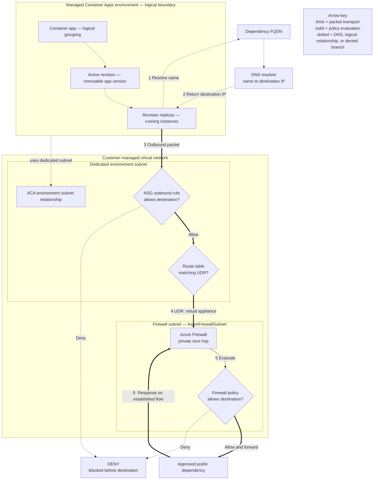
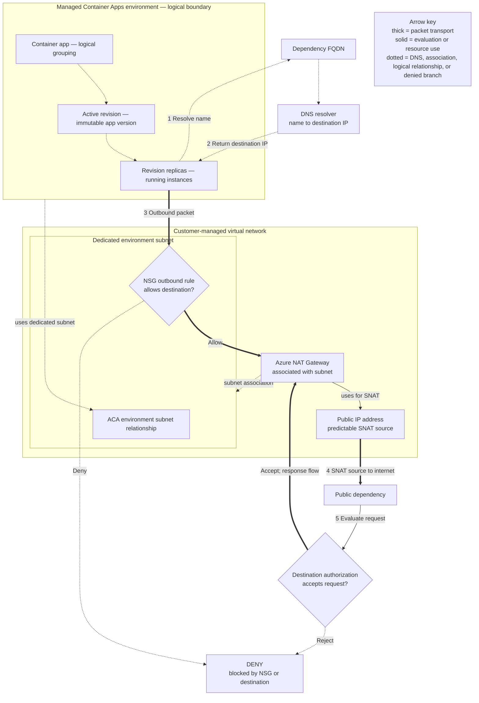
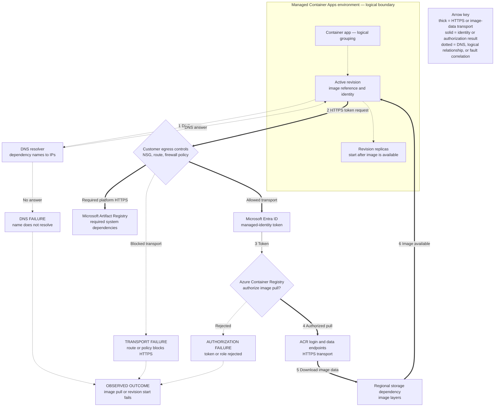

# Egress Control

Control outbound traffic from Container Apps.

## Default Behavior

By default, Container Apps can access:
- Public internet
- Azure services via public endpoints
- Resources in the same VNet (if VNet integrated)

!!! warning "Uncontrolled egress increases data exfiltration risk"
    Production workloads should define explicit outbound paths and approved destinations,
    especially when handling regulated or sensitive data.

## Egress Strategy Comparison

| Strategy | Primary Goal | Trade-off | Typical Fit |
|---|---|---|---|
| Default outbound | Fast setup | Minimal governance | Dev/test environments |
| UDR + Azure Firewall | Domain/IP filtering and inspection | Higher complexity and cost | Regulated production workloads |
| NAT Gateway | Static outbound IP for allow-lists | No L7 filtering by itself | SaaS allow-list integrations |

## Portal view: non-integrated starting point for UDR and NAT Gateway recipes

This screenshot is used here as a visual starting point for the Bicep examples in [User-Defined Routes (UDR)](#user-defined-routes-udr) and [NAT Gateway for Static Outbound IP](#nat-gateway-for-static-outbound-ip).


[Observed] The `Public Network Access` section has `Enable: Allows incoming traffic from the public internet.` selected. The `Virtual network` section reads `This environment isn't integrated`. The tab strip lists `General`, `Ingress settings`, `Request Routing`, `Encryption`, `Custom DNS Suffix`. No route table, NAT gateway, or firewall reference is visible in the shown content.

[Inferred] The visible `This environment isn't integrated` text is consistent with this page using the screenshot as a contrast point for the Bicep examples in [User-Defined Routes (UDR)](#user-defined-routes-udr) and [NAT Gateway for Static Outbound IP](#nat-gateway-for-static-outbound-ip). The screenshot appears to map to a configuration context separate from the `routeTable` and `natGateway` subnet properties shown in those examples.

[Not Proven] This image does not show the `Microsoft.Network/routeTables` resource from [User-Defined Routes (UDR)](#user-defined-routes-udr). It does not show the `Microsoft.Network/natGateways` resource from [NAT Gateway for Static Outbound IP](#nat-gateway-for-static-outbound-ip). It does not show the `Microsoft.Network/firewallPolicies` resource from [Azure Firewall Rules](#azure-firewall-rules). It does not show the service tags listed in [Required Outbound Dependencies](#required-outbound-dependencies). It does not show the managed identity ACR egress dependencies discussed later in [Required Outbound Dependencies](#required-outbound-dependencies).

## User-Defined Routes (UDR)

Route outbound traffic through Azure Firewall or NVA:

### Route selection, inspection, and transport

**Takeaway:** A workload-profiles environment can use a dedicated environment subnet whose route table sends matching outbound packets to Azure Firewall; DNS resolution, NSG evaluation, route selection, firewall policy, and the destination response remain separate decisions.

<!-- diagram-id: route-outbound-traffic-through-azure-firewall -->


*Figure: Azure Firewall egress extension of the shared `ENV` → `APP` → `REV_ACTIVE` → `REPLICAS` vocabulary. The customer VNet owns the dedicated environment subnet controls and firewall resources; the managed runtime stays a logical Azure-managed boundary.*

```bicep
resource routeTable 'Microsoft.Network/routeTables@2023-05-01' = {
  name: 'rt-containerapp'
  location: location
  properties: {
    routes: [
      {
        name: 'default-route'
        properties: {
          addressPrefix: '0.0.0.0/0'
          nextHopType: 'VirtualAppliance'
          nextHopIpAddress: firewallPrivateIp
        }
      }
    ]
  }
}
```

## Azure Firewall Rules

Allow required outbound traffic:

### NAT Gateway Architecture

**Takeaway:** Associating NAT Gateway with the dedicated environment subnet gives supported workload-profiles environments a predictable public source address for internet egress, but it does not perform DNS resolution, application-layer filtering, or destination authorization.

<!-- diagram-id: nat-gateway-architecture -->


*Figure: NAT Gateway extension of the same logical ACA runtime vocabulary. The NAT resource is associated with the customer-managed subnet; it is not drawn as an App Service-style integration NIC or as an Azure-managed component inside the environment.*

```bicep
resource firewallPolicy 'Microsoft.Network/firewallPolicies@2023-05-01' = {
  name: 'fw-policy'
  properties: {
    sku: { tier: 'Standard' }
  }
}
```

## Azure Firewall Rules

Allow required outbound traffic:

```bicep
resource firewallPolicy 'Microsoft.Network/firewallPolicies@2023-05-01' = {
  name: 'fw-policy'
  properties: {
    sku: { tier: 'Standard' }
  }
}

resource appRuleCollection 'Microsoft.Network/firewallPolicies/ruleCollectionGroups@2023-05-01' = {
  parent: firewallPolicy
  name: 'container-apps-rules'
  properties: {
    priority: 100
    ruleCollections: [
      {
        ruleCollectionType: 'FirewallPolicyFilterRuleCollection'
        name: 'allow-external-apis'
        priority: 100
        action: { type: 'Allow' }
        rules: [
          {
            ruleType: 'ApplicationRule'
            name: 'allow-jsonplaceholder'
            protocols: [{ protocolType: 'Https', port: 443 }]
            targetFqdns: ['jsonplaceholder.typicode.com']
            sourceAddresses: ['10.0.0.0/23']
          }
        ]
      }
    ]
  }
}
```

## NAT Gateway for Static Outbound IP

Assign static IP for outbound traffic:

```bicep
resource natGateway 'Microsoft.Network/natGateways@2023-05-01' = {
  name: 'nat-containerapp'
  location: location
  sku: { name: 'Standard' }
  properties: {
    publicIpAddresses: [{ id: publicIp.id }]
  }
}

resource subnet 'Microsoft.Network/virtualNetworks/subnets@2023-05-01' = {
  name: 'snet-containerapp'
  properties: {
    addressPrefix: '10.0.0.0/23'
    natGateway: { id: natGateway.id }
  }
}
```

!!! tip "Combine NAT and firewall when needed"
    Use NAT Gateway for predictable source IP and Azure Firewall for destination governance
    when both compliance and partner allow-list requirements exist.

## Verify Outbound IP

```python
import requests

@app.route('/api/my-ip')
def my_ip():
    # Use standard service to verify public outbound IP
    response = requests.get('https://api.ipify.org?format=json')
    return response.json()  # Returns NAT Gateway's public IP
```

## Required Outbound Dependencies

If you restrict egress and pull application images from Azure Container Registry (ACR) by using managed identity, allow the dependency categories that support both token acquisition and image download.

| Service Tag / Dependency | Port | When Required |
|---|---|---|
| `AzureActiveDirectory` | 443 | Required when the container app uses managed identity to obtain an access token for ACR. |
| `ACR login server` | 443 | Required for the registry endpoint (for example, `<registry-name>.azurecr.io`) unless you use a private endpoint for the registry. |
| `Storage.<Region>` | 443 | Required for ACR-backed image layer downloads from regional storage. |
| `MicrosoftContainerRegistry` | 443 | Required for Microsoft-managed system container dependencies in the environment. |
| `AzureContainerRegistry` | 443 | Required when pulling images from ACR without a private endpoint. When using a private endpoint for ACR, this tag is not required. |
| `AzureFrontDoor.FirstParty` | 443 | Required as a dependency of Microsoft Container Registry. |

When using Azure Firewall application rules instead of (or in addition to) NSG service tags, allow these FQDNs for managed identity token acquisition:

| FQDN | When Required |
|---|---|
| `login.microsoftonline.com` | Token issuance for managed identity |
| `*.login.microsoftonline.com` | Regional token endpoints |
| `login.microsoft.com` | Primary Microsoft login endpoint |
| `*.login.microsoft.com` | Alternative login endpoints |
| `*.identity.azure.net` | Managed identity metadata |

Use service tags where Azure provides them, and use private endpoints or FQDN-aware firewall rules for registry-specific destinations.

### Identity, authorization, DNS, and image transport

**Takeaway:** A successful managed-identity image pull needs separate successes for DNS, token acquisition, ACR authorization, and registry/image-layer transport; a failure in one stage does not prove a failure in the others.

<!-- diagram-id: managed-identity-acr-egress-dependencies -->


*Figure: ACR dependency extension of the shared `ENV` → `APP` → `REV_ACTIVE` → `REPLICAS` vocabulary. This is a dependency model, not an ACR Path A–E topology and not proof of any observed packet route.*

!!! warning "Private ACR does not remove all outbound requirements"
    Even when ACR uses a private endpoint, managed identity image pulls still require outbound access to `AzureActiveDirectory` on port `443` so the platform can acquire a token.

Also keep DNS to `168.63.129.16:53` available; blocking platform DNS breaks name resolution for these dependencies.

For the failure symptoms and validation steps, see [Image Pull Failure](../../troubleshooting/playbooks/startup-and-provisioning/image-pull-failure.md).

The same egress dependency applies to control-plane operations that authenticate with the app's managed identity — for example, `az containerapp secret set --identity ... --key-vault-url ...` performs OIDC discovery against `login.microsoftonline.com/<tenant>/.well-known/openid-configuration` before token acquisition. When a UDR routes the workload subnet through Azure Firewall and the firewall policy lacks an Application Rule for `login.microsoftonline.com` and `login.microsoft.com`, the discovery request fails with a transport-level `EOF` and the secret update returns `Unable to get value using Managed identity`. For the reproducible falsification proof, see [ACA Secret Key Vault Reference — Managed Identity Network Path Lab](../../troubleshooting/lab-guides/aca-secret-kv-ref-mi-network-path.md) and [Secret and Key Vault Reference Failure — H4](../../troubleshooting/playbooks/identity-and-configuration/secret-and-key-vault-reference-failure.md#h4-managed-identity-oidc-discovery-blocked-by-egress-control-udr-azure-firewall).

## See Also
- [VNet Integration](vnet-integration.md)
- [Private Endpoints](private-endpoints.md)
- [ACR Network Path Selection](acr-network-path-selection.md)
- [Service-to-Service Communication](service-to-service.md)

## Sources
- [Outbound FQDN requirements in Azure Container Apps (Microsoft Learn)](https://learn.microsoft.com/en-us/azure/container-apps/networking#outbound-fqdn-requirements)
- [User-defined routes in Azure Container Apps (Microsoft Learn)](https://learn.microsoft.com/en-us/azure/container-apps/user-defined-routes)
- [Firewall integration in Azure Container Apps (Microsoft Learn)](https://learn.microsoft.com/en-us/azure/container-apps/firewall-integration)
- [Use Azure Firewall with Azure Container Apps — outbound FQDNs (Microsoft Learn)](https://learn.microsoft.com/en-us/azure/container-apps/use-azure-firewall)
