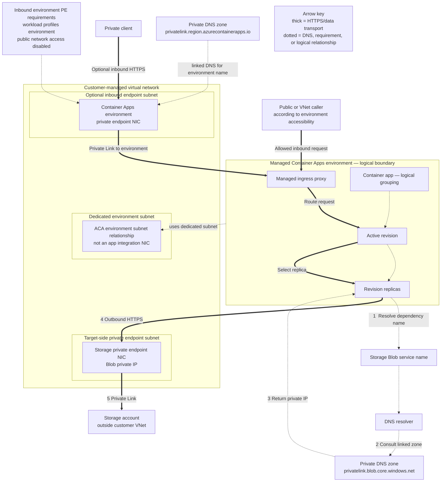

---
content_sources:
  diagrams:
    - id: architecture
      type: flowchart
      source: self-generated
      justification: ACA custom-VNet topology synthesized from Microsoft Learn and the shared cross-guide private-dependency contract; it distinguishes the dedicated environment subnet relationship, downstream Storage private endpoint, optional inbound environment private endpoint, external Private DNS zones, and transport paths.
      based_on:
        - https://learn.microsoft.com/en-us/azure/container-apps/vnet-custom
        - https://learn.microsoft.com/en-us/azure/container-apps/networking
        - https://learn.microsoft.com/en-us/azure/container-apps/how-to-use-private-endpoint
        - https://learn.microsoft.com/en-us/azure/private-link/private-endpoint-dns
content_validation:
  status: verified
  last_reviewed: 2026-09-11
  reviewer: agent
  core_claims:
    - claim: A Container Apps environment can use either the default Azure network or an existing virtual network, and the network type cannot be changed after creation.
      source: https://learn.microsoft.com/en-us/azure/container-apps/networking
      verified: true
    - claim: A subnet provided for an existing virtual network deployment must be dedicated exclusively to the Container Apps environment.
      source: https://learn.microsoft.com/en-us/azure/container-apps/networking
      verified: true
    - claim: Using an existing virtual network enables Network Security Groups, Azure Firewall integration, outbound traffic control, and access to resources behind private endpoints.
      source: https://learn.microsoft.com/en-us/azure/container-apps/networking
      verified: true
    - claim: An internal Container Apps environment does not use a public static IP and uses internal IP addresses from the custom virtual network.
      source: https://learn.microsoft.com/en-us/azure/container-apps/vnet-custom
      verified: true
    - claim: Container apps deployed to the same environment are deployed in the same virtual network and write logs to the same Log Analytics workspace.
      source: https://learn.microsoft.com/en-us/azure/container-apps/vnet-custom
      verified: true
---
# VNet Integration

Deploy Container Apps in a custom virtual network for network isolation.

## Overview

Container Apps can be deployed into a custom VNet to:
- Isolate traffic from the public internet
- Connect to private resources (databases, storage)
- Control ingress/egress with NSG rules

!!! warning "Subnet sizing depends on the environment type"
    Workload profiles environments and legacy Consumption-only environments have different minimum subnet sizes. Use the current Microsoft Learn sizing table and plan additional capacity for revisions and replicas; do not apply one prefix universally.

## Architecture

**Takeaway:** ACA attaches the managed environment to a dedicated environment subnet—not through an App Service-style integration NIC—while downstream and inbound private endpoints use separate endpoint NICs for different directions and targets.

<!-- diagram-id: architecture -->


*Figure: The downstream Storage private endpoint and optional inbound environment private endpoint are not interchangeable. Neither endpoint represents app-level internal ingress, and the managed environment is not drawn as a customer-owned subnet workload.*

## Portal view: non-integrated baseline for the Bicep example

This screenshot is used here as a visual contrast baseline for the Bicep example in [Deploy Container Apps Environment with VNet](#deploy-container-apps-environment-with-vnet).


[Observed] The `Public Network Access` section has `Enable: Allows incoming traffic from the public internet.` selected. The `Virtual network` section reads `This environment isn't integrated`. The tab strip lists `General`, `Ingress settings`, `Request Routing`, `Encryption`, `Custom DNS Suffix`. No subnet resource ID or CIDR value is visible in the shown content.

[Inferred] The visible `This environment isn't integrated` text is consistent with the Bicep example in [Deploy Container Apps Environment with VNet](#deploy-container-apps-environment-with-vnet) introducing networking properties that are not shown on this blade. The absence of any visible subnet resource ID value appears to map to the `infrastructureSubnetId` property in that same example.

[Not Proven] This image does not show the `infrastructureSubnetId` property from [Deploy Container Apps Environment with VNet](#deploy-container-apps-environment-with-vnet). It does not show the `internal: true` vs `internal: false` choice from [Internal vs External Ingress](#internal-vs-external-ingress). It does not show the `/23` minimum subnet sizing from [Overview](#overview). It does not show the NSG rules from [Network Security Groups](#network-security-groups). It does not show the private endpoint connectivity discussed in [Access Private Resources](#access-private-resources).

## Prerequisites

- Azure subscription with VNet creation permissions
- Existing VNet or create new one

## Create VNet with Subnets

Container Apps requires a dedicated environment subnet. Choose its prefix from the current Microsoft Learn requirements for the environment type and expected scale.

### Using Azure CLI:
```bash
# Create VNet
az network vnet create \
  --name vnet-containerapp \
  --resource-group $RESOURCE_GROUP \
  --location $LOCATION \
  --address-prefix 10.0.0.0/16

# Create subnet for Container Apps (minimum /23)
az network vnet subnet create \
  --name snet-containerapp \
  --vnet-name vnet-containerapp \
  --resource-group $RESOURCE_GROUP \
  --address-prefix 10.0.0.0/23
```

| Command | Why it is used |
|---|---|
| `az network vnet create ...` | Creates or inspects networking resources such as VNets, DNS zones, routes, or private endpoints. |

### Using Bicep:
```bicep
resource vnet 'Microsoft.Network/virtualNetworks@2023-05-01' = {
  name: 'vnet-containerapp'
  location: location
  properties: {
    addressSpace: {
      addressPrefixes: ['10.0.0.0/16']
    }
    subnets: [
      {
        name: 'snet-containerapp'
        properties: {
          addressPrefix: '10.0.0.0/23'
        }
      }
    ]
  }
}
```

## Deploy Container Apps Environment with VNet

```bicep
resource containerAppEnv 'Microsoft.App/managedEnvironments@2023-05-01' = {
  name: 'cae-${baseName}'
  location: location
  properties: {
    vnetConfiguration: {
      infrastructureSubnetId: vnet.properties.subnets[0].id
      internal: false  // true for internal-only access
    }
    appLogsConfiguration: {
      destination: 'log-analytics'
      logAnalyticsConfiguration: {
        customerId: logAnalytics.properties.customerId
        sharedKey: logAnalytics.listKeys().primarySharedKey
      }
    }
  }
}
```

## Internal vs External Ingress

For the full ingress model, including the app-level `external` property, transport selection, TCP rules, headers, and request handling behavior, see [Ingress in Azure Container Apps](ingress.md). This section focuses on the environment-level VNet posture.

| Mode | Description | Use Case |
|------|-------------|----------|
| `internal: false` | Public IP + VNet | Public APIs with VNet backend access |
| `internal: true` | Private IP only | Internal microservices, no public access |

## Access Private Resources

Once in a VNet, Container Apps can access:
- Private Endpoints (Azure SQL, Storage, Key Vault)
- VNet-peered resources
- On-premises via VPN/ExpressRoute

!!! tip "Treat DNS as part of networking design"
    Private endpoint connectivity depends on DNS zone linkage and name resolution.
    Validate DNS records before investigating application code.

### Example: Connect to Private Azure SQL
```python
import os
import pyodbc

# Connection string uses private endpoint DNS
conn_str = os.environ['SQL_CONNECTION_STRING']
# Server=myserver.database.windows.net -> resolves to private IP
```

## Network Security Groups

Apply NSG rules to the Container Apps subnet:

```bicep
resource nsg 'Microsoft.Network/networkSecurityGroups@2023-05-01' = {
  name: 'nsg-containerapp'
  location: location
  properties: {
    securityRules: [
      {
        name: 'AllowHTTPS'
        properties: {
          priority: 100
          direction: 'Inbound'
          access: 'Allow'
          protocol: 'Tcp'
          sourceAddressPrefix: '*'
          sourcePortRange: '*'
          destinationAddressPrefix: '*'
          destinationPortRange: '443'
        }
      }
    ]
  }
}
```

## Troubleshooting

### Container can't reach private endpoint
1. Check DNS resolution inside container
2. Verify private endpoint is in same/peered VNet
3. Check NSG rules allow outbound traffic

### Public access not working
1. Verify `internal: false` in environment config
2. Check ingress is enabled on container app
3. Verify FQDN is correctly configured

## See Also
- [Ingress in Azure Container Apps](ingress.md)
- [Private Endpoints](private-endpoints.md)
- [Application Gateway Integration](application-gateway-integration.md)
- [Egress Control](egress-control.md)
- [Service-to-Service Communication](service-to-service.md)
- [Environment Networking and CIDR](../environments/networking-and-cidr.md)
- [Azure SQL](../../language-guides/python/recipes/azure-sql.md)

## Sources
- [Custom virtual networks in Azure Container Apps (Microsoft Learn)](https://learn.microsoft.com/en-us/azure/container-apps/vnet-custom)
- [Networking architecture in Azure Container Apps (Microsoft Learn)](https://learn.microsoft.com/en-us/azure/container-apps/networking)
- [Use a private endpoint with a Container Apps environment (Microsoft Learn)](https://learn.microsoft.com/en-us/azure/container-apps/how-to-use-private-endpoint)
- [Azure Private Endpoint DNS zone values (Microsoft Learn)](https://learn.microsoft.com/en-us/azure/private-link/private-endpoint-dns)
