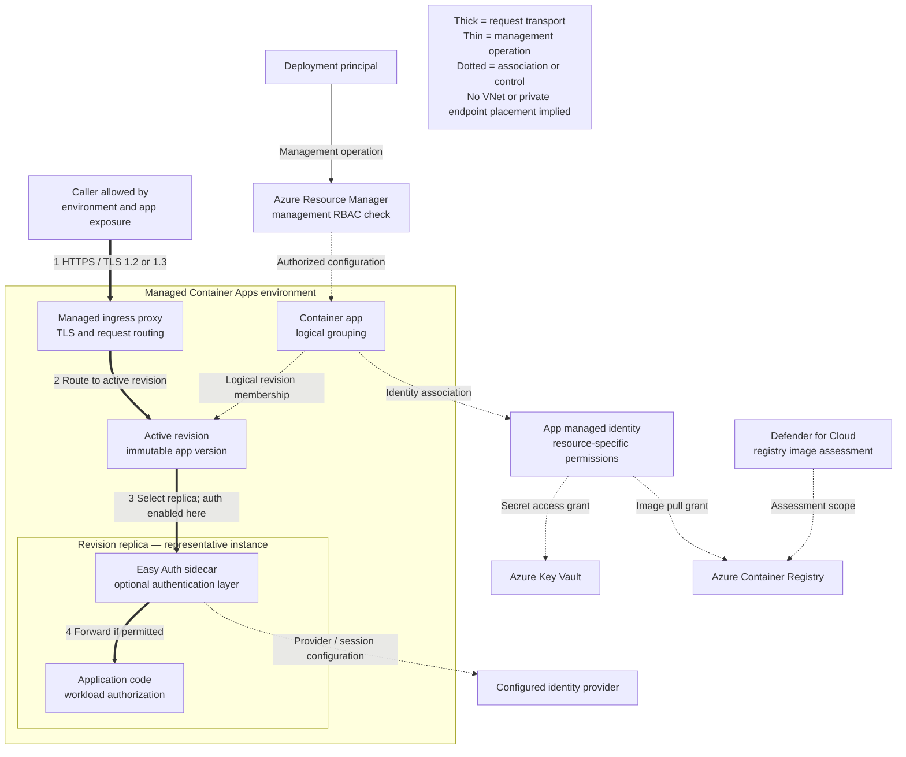
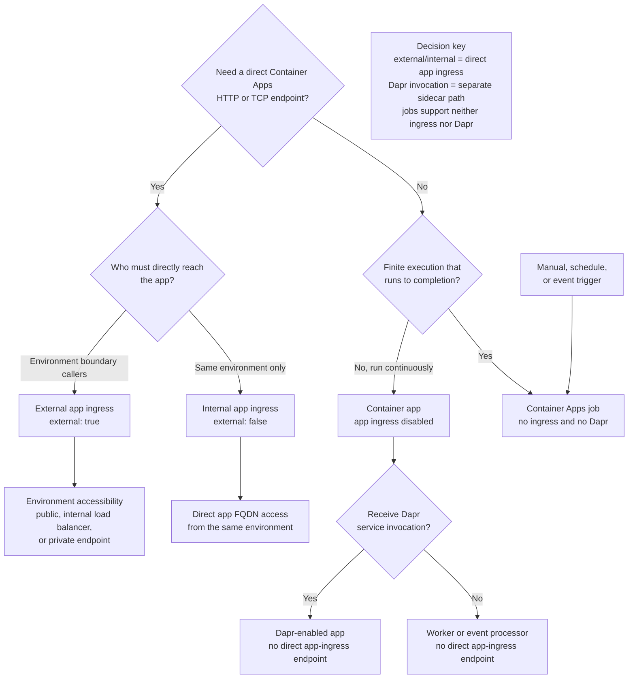
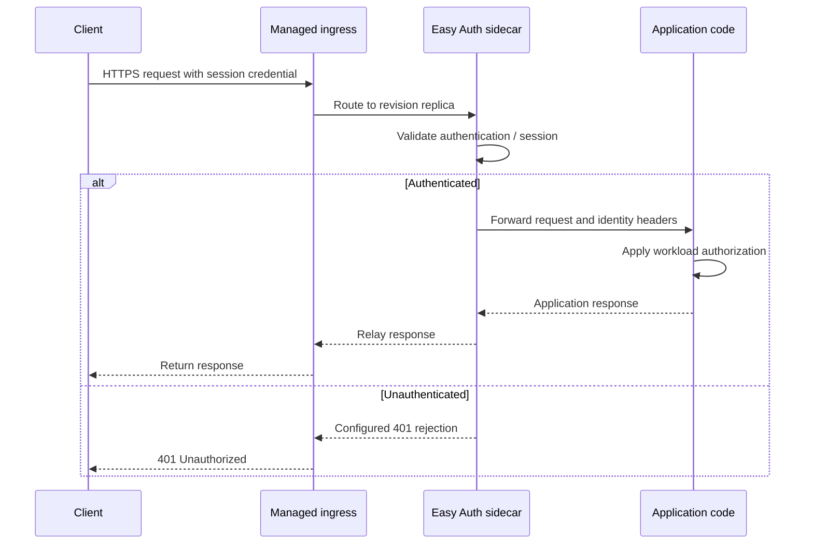
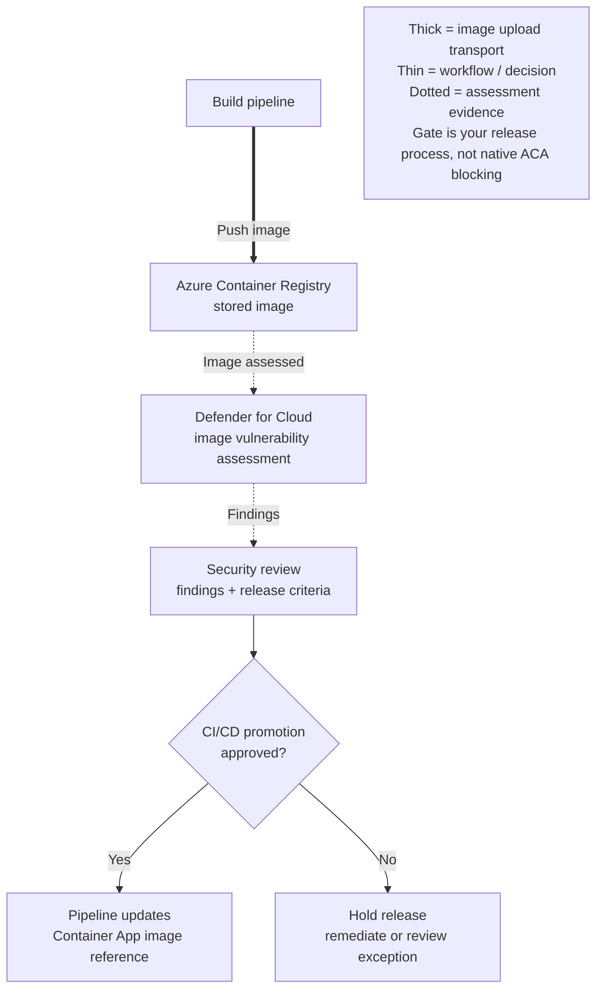
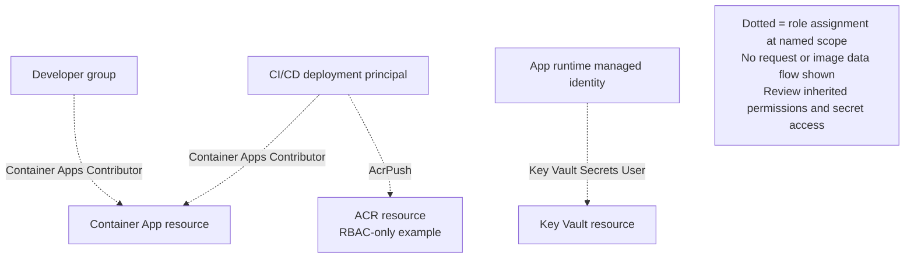
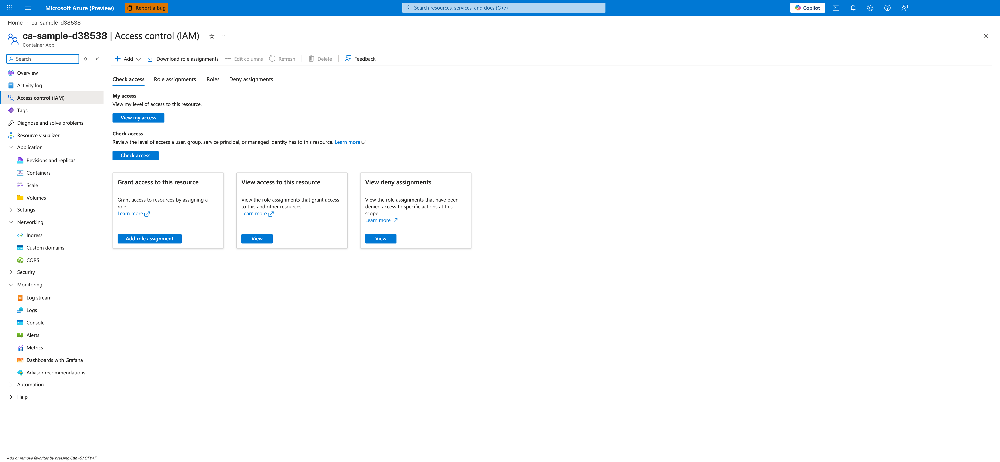

# Security in Azure Container Apps

Azure Container Apps provides multiple layers of security — from network isolation and identity-based access to image integrity and data protection. This page consolidates the security architecture into a single reference, connecting the topics covered in networking, identity, and operations sections.

## Security Architecture Overview

<!-- diagram-id: security-architecture-overview -->

*Figure: A security extension of the [architecture base](../architecture/index.md#architecture-at-a-glance), using its environment, ingress, app, revision, and replica vocabulary. The enabled-auth path is illustrative; Easy Auth is not part of the shared ingress proxy. Dotted resource grants neither transport requests nor prove network reachability.*

| Area | Layer | Control |
|---|---|---|
| Ingress | Transport | HTTPS terminates at managed ingress |
| Replica | Authentication | Optional Easy Auth; application authorization still applies |
| Service calls | Service-to-service | Dapr mTLS is a separate sidecar path, shown below |
| Identity grants | Resource access | Least-privilege permissions, separate from networking |
| Registry | Image pull | Managed identity authentication to ACR |
| Assessment | Supply chain | Findings inform release governance, not automatic blocking |
| Network | Egress | UDR selects a path; a firewall filters it (not shown) |
| Management | Control plane | Azure RBAC for resource operations |

## Security Deep Dives

Read each path as a separate security question:

- **Reachability:** can the caller reach the selected ingress or dependency endpoint?
- **Authentication:** which identity or certificate does the receiver establish?
- **Authorization:** does the receiving service or application permit that identity's action?
- **Supply chain:** has the release process reviewed the exact image reference?

Use these focused pages when you need implementation details for a specific security domain:

- [Image Security](image-security.md) — registry authentication, revision-time pulls, and vulnerability scanning scope.
- [Secrets](secrets.md) — inline secrets, Key Vault references, `secretRef`, and refresh behavior.
- [Network Isolation](network-isolation.md) — internal environments, private endpoints, NSG/UDR, ingress posture, and egress control.
- [Customer-Managed Keys](customer-managed-keys.md) — current documented CMK status and Key Vault-related alternatives.

## Network Isolation

Network isolation combines distinct environment-accessibility, app-ingress, VNet, private-connectivity, DNS, subnet-control, and egress decisions. No single setting supplies every boundary.

### Ingress Boundary

First decide whether the workload needs a **direct Container Apps HTTP or TCP ingress endpoint**. If it does, keep the app-level ingress setting separate from the environment's accessibility:

- **External app ingress** publishes the app at the environment inbound boundary. That boundary can be public, an internal load balancer, or a private endpoint, so `external: true` does not by itself mean internet reachable.
- **Internal app ingress** makes the app's own FQDN directly reachable only from the same Container Apps environment by default. It is not the setting for VNet-wide access; an environment-level HTTP route can also explicitly target it.
- **Disabled app ingress** creates no direct FQDN or app-name ingress endpoint. A Dapr-enabled app can still receive Dapr service invocation from other Dapr-enabled apps in the environment.
- **Container Apps jobs** are separate finite-execution resources. They support neither ingress nor Dapr, but a running job can make outbound app-to-app calls. Jobs run manually, on a schedule, or in response to events.

**Takeaway:** No ingress and internal ingress are not synonyms. Internal ingress provides an environment-local direct endpoint; disabled app ingress provides no direct app-ingress endpoint, while Dapr invocation remains a separate optional path.

<!-- diagram-id: no-ingress-not-http-addressable-event-driven -->

*Figure: This decision view intentionally does not consume the architecture topology base: its purpose is to choose a workload and ingress posture, not to trace the managed ingress-to-replica request path.*

An event-driven app with ingress disabled can scale on a custom KEDA-backed rule. If it has neither such a rule nor `minReplicas` of at least `1`, it can scale to zero without a signal that starts it again. A Dapr-enabled no-ingress app remains invocable through Dapr's separate service-invocation path. An event-driven job instead uses a custom scaler to determine how many finite job executions to start; jobs do not support Dapr or ingress.

!!! warning "Internal-only environments for sensitive workloads"
    Create the environment as internal to remove its public endpoint. A VNet client reaches an app through that internal environment boundary only when the app uses external app ingress; internal app ingress remains directly reachable only from the same environment unless an environment-level HTTP route targets it. Put a controlled gateway in front only when the design requires an entry path.

### VNet Integration

With a custom VNet, the environment uses a dedicated subnet relationship. Keep the Azure-managed logical environment separate from the customer-managed VNet in architecture diagrams. The relationship enables:

- Private endpoint access to Azure services (Key Vault, Storage, SQL, ACR).
- DNS resolution through Azure Private DNS Zones.
- Subnet-level Network Security Groups (NSGs) for additional filtering.

### Egress Filtering

In workload profiles environments, control outbound traffic using user-defined routes (UDRs) and Azure Firewall:

- Route all outbound traffic through a central firewall.
- Allow-list required FQDNs and service tags for platform dependencies.
- Audit outbound connections for compliance.

!!! note "Platform dependency FQDNs"
    Overly restrictive egress rules break image pulls, telemetry upload, and control-plane communication. Always validate with a canary app before enforcing strict egress policies.

For detailed networking configuration, see [Networking Overview](../networking/index.md).

## Authentication and Authorization

### Easy Auth (Built-in Authentication)

For an external HTTP ingress-enabled app, Easy Auth runs as a sidecar on each replica. This sequence illustrates **Require authentication**, configured to reject unauthenticated requests with `401`, after sign-in has already established a session:

<!-- diagram-id: container-apps-provides-a-built-in-authentication -->

*Figure: Solid sequence arrows are requests or local processing; dashed arrows are responses. Sign-in/provider exchanges are omitted, not assumed to occur on every request. This typed sequence does not consume the topology base.*

Easy Auth supports Microsoft Entra ID, Facebook, GitHub, Google, X, and custom OpenID Connect providers. The platform authentication middleware runs as a sidecar on each replica when enabled; the sequence above is a logical request flow rather than a physical claim that authentication is part of the ingress proxy.

Unauthenticated handling can instead redirect to sign-in or return `403`. **Allow unauthenticated access** passes anonymous traffic to application code, so enabling Easy Auth alone is not equivalent to requiring authentication. Keep `allowInsecure` disabled and implement any finer role/claims authorization your workload needs.

!!! tip "When to use Easy Auth vs custom auth"
    Use Easy Auth for standard identity provider flows with minimal code. Use custom JWT validation when you need fine-grained claims inspection, multi-tenant logic, or non-standard token formats.

### API Key and Header-Based Access

For service-to-service calls that do not use identity tokens, validate API keys or custom headers at the application level. Store keys in Key Vault and reference them as managed secrets.

### Mutual TLS (mTLS)

Dapr service invocation provides automatic mTLS between Dapr sidecars for Dapr-enabled apps. This is separate from the optional environment-level peer-to-peer encryption feature, which can encrypt network traffic within the environment for direct app communication:

```mermaid
flowchart TD
    accTitle: Dapr service invocation encrypts the sidecar-to-sidecar hop
    accDescr: Inside one managed environment, representative replicas of two Dapr-enabled apps contain application code and a Dapr sidecar. The caller uses the local Dapr API, sidecars communicate with automatic mTLS, and the callee sidecar calls its application on the configured app port. This is not the direct app-ingress path.
    subgraph ENV["Managed Container Apps environment"]
        subgraph A["App A — representative replica"]
            A_APP["Application code A"]
            A_DAPR["Dapr sidecar A"]
        end
        subgraph B["App B — representative replica"]
            B_DAPR["Dapr sidecar B"]
            B_APP["Application code B"]
        end
    end
    A_APP ==>|"Local Dapr API<br/>HTTP or gRPC"| A_DAPR
    A_DAPR ==>|"Service invocation<br/>automatic mTLS"| B_DAPR
    B_DAPR ==>|"Local app call<br/>configured appPort / protocol"| B_APP
    LEGEND["Thick = invocation transport<br/>Logical hop view; proxy routing omitted<br/>mTLS is between sidecars, not local app hops"]
```

<!-- diagram-id: dapr-sidecar-enables-automatic-mtls-for -->

*Figure: A minimal environment-boundary extension of the architecture base; the app/replica vocabulary is reused without inventing ingress or revision hops for Dapr. The sidecar channel is distinct from client certificates at HTTP ingress and from environment peer-to-peer encryption.*

Key properties of Dapr mTLS in Container Apps:

- Dapr service invocation supplies automatic mTLS authentication and encryption between sidecars.
- Encryption is transparent to application code — apps communicate over localhost to their sidecar.
- mTLS applies to all Dapr-enabled service invocations within the environment.

!!! warning "mTLS requires Dapr enablement"
    Dapr service-invocation mTLS requires Dapr on both caller and callee. For direct app-to-app traffic, use the separate environment peer-to-peer encryption setting when that path needs platform-managed TLS; Microsoft Learn documents that peer-to-peer encryption is disabled by default.

## Image Security

### Container Registry Authentication

Use managed identity for image pulls instead of admin credentials:

| Method | Security Posture | Recommendation |
|---|---|---|
| Admin credentials | Shared registry credential; weak caller attribution | Avoid in production |
| Service principal | Requires secret rotation | Acceptable with rotation policy |
| Managed identity | Passwordless, auditable, auto-rotated | Recommended |

### Vulnerability Scanning

Microsoft Defender for Cloud vulnerability assessment can assess images stored in Azure Container Registry. Treat assessment findings as evidence for a promotion decision; the cited documentation does not establish that Defender directly blocks a Container Apps deployment:

<!-- diagram-id: microsoft-defender-for-containers-provides-continuous -->

*Figure: An assessment-and-promotion workflow, not a topology extension or an automatic Defender enforcement path. The subsequent authenticated image pull and startup checks are covered in [Image Security](image-security.md).*

Interpret the controls separately:

- **Registry assessment**: Defender for Cloud provides vulnerability assessment for images stored in ACR.
- **Posture evidence**: security recommendations and findings help teams prioritize remediation.
- **Promotion control**: CI/CD or release governance can use those findings as an input; do not assume assessment alone blocks a Container Apps deployment.

### Trusted Image Practices

- Use specific image tags or digests — never `latest` in production.
- Verify signed images with a current registry and deployment-policy mechanism appropriate to your supply chain; do not assume legacy Docker Content Trust is enforced by Container Apps.
- Restrict ACR network access with private endpoints and firewall rules.
- Maintain a base image update cadence to patch OS-level vulnerabilities.

## Role-Based Access Control (RBAC)

Azure RBAC controls who can manage Container Apps resources at the control plane level.

### Built-in Roles for Container Apps

| Role | Scope | Permissions |
|---|---|---|
| Contributor | Resource Group | Full management of Container Apps resources |
| Container Apps Contributor | Resource / RG | Manage Container Apps resources; review the current role definition before assignment |
| Reader | Resource Group | View Container Apps configuration and status |
| Monitoring Reader | Resource Group | View metrics and logs |

### Least-Privilege Assignment Pattern

<!-- diagram-id: least-privilege-assignment-pattern -->

*Figure: A role-assignment association view, not an extension of the runtime topology. The app, ACR, and Key Vault are distinct scopes; a deployment role on the app does not grant registry push or Key Vault secret-read access. For ABAC-enabled ACR, use the corresponding repository roles instead of `AcrPush`.*

Principles:

- Assign roles at the narrowest scope possible (resource level over resource group).
- Use custom roles when built-in roles are too broad.
- Review role assignments quarterly — remove unused assignments.
- Separate deployment permissions (CI/CD) from runtime permissions (managed identity).
- `Container Apps Contributor` includes wildcard actions that allow `listSecrets`. Treat the diagram as a scoped example, not a claim that a broad built-in role is always least privilege; use a custom role when its permissions exceed the task.

### Portal view: Access control (IAM) blade

[Observed] The blade is `<your-app-name> | Access control (IAM)` with the subtitle `Container App`. Four tabs are rendered along the top: `Check access`, `Role assignments`, `Roles`, and `Deny assignments`. The `Check access` tab is selected. The tab body shows three cards titled `Grant access to this resource` (with an `Add role assignment` button), `View access to this resource` (with a `View` button), and `View deny assignments` (with a `View` button). Above the cards, a `My access` section exposes a `View my access` button and a `Check access` section exposes a `Check access` button. The command bar includes `+ Add`, `Download role assignments`, `Edit columns`, `Refresh`, `Delete`, and `Feedback`. The left navigation lists `Application`, `Settings`, `Networking`, `Security`, `Monitoring`, `Automation`, and `Help` groups.

[Inferred] The `Grant access to this resource` card with its `Add role assignment` button is consistent with the per-resource scoping that the [Least-Privilege Assignment Pattern](#least-privilege-assignment-pattern) diagram describes — RBAC bindings created at the Container App resource rather than at the resource group. The `Roles` tab label is consistent with the catalog framing in the [Built-in Roles for Container Apps](#built-in-roles-for-container-apps) table, which lists `Contributor`, `Container Apps Contributor`, `Reader`, and `Monitoring Reader` as the principal role choices an operator would pick from. The presence of a `Deny assignments` tab alongside `Role assignments` is consistent with this page's broader RBAC framing as both an allow surface and an exception surface.

[Not Proven] This image does not show the contents of the `Role assignments`, `Roles`, or `Deny assignments` tabs, so the actual list of principals, the actual catalog of built-in and custom roles, and any existing deny rules are not visible here. No secondary pane, dialog, or result panel is rendered in this capture, so any controls beyond the buttons and labels shown here are outside the scope of this image.

## Data Protection

### Encryption at Rest

- Azure encryption-at-rest guidance uses platform-managed keys by default; do not infer an ACA environment CMK setting from Key Vault integration. See [Customer-Managed Keys](customer-managed-keys.md) for the documented support boundary.
- Secrets stored in Container Apps configuration are encrypted at rest, but broad management roles can include secret-reading actions; review role definitions before assignment.
- Key Vault references keep the source secret in Key Vault and let the app resolve it by managed identity. They are not the same as configuring customer-managed encryption keys for Container Apps service-managed storage.

### Encryption in Transit

| Path | Encryption | Managed By |
|---|---|---|
| Client → Ingress | TLS 1.2 or 1.3 at HTTP ingress | Platform |
| Ingress → App | Internal traffic; optionally encrypted by environment peer-to-peer encryption | Platform |
| App → App (Dapr) | mTLS | Dapr sidecar |
| App → Azure Services (PE) | Service protocol over a Private Link path; application-layer TLS depends on the service | Application + Private Endpoint |
| App → External APIs | TLS as required by the destination | Application code |

### Secret Management

Container Apps supports two secret storage patterns:

1. **Platform secrets**: stored in Container Apps configuration, referenced as environment variables or mounted as files. A Secret volume mounts all app secrets when no selection is specified; explicit `secretRef` entries select individual secrets.
2. **Key Vault references**: secrets resolved from Key Vault by using managed identity and exposed to the app through Container Apps secret configuration.

!!! tip "Prefer Key Vault references for production"
    Key Vault references centralize the source secret and its access control. Verify the documented refresh behavior and application restart requirements for your secret-consumption pattern instead of assuming rotation is immediate.

For secret management details, see [Key Vault Integration](../identity-and-secrets/key-vault.md).

## Compliance and Governance

### Azure Policy for Container Apps

Choose Azure Policy definitions and effects that match the standard; not every policy is an enforcement gate. The current built-in catalog includes:

- Require VNet integration for all environments.
- Require managed identity enablement. This alone does **not** prove ACR uses that identity or that admin credentials are disabled.
- Require HTTPS-only ingress.
- Block external ingress for sensitive workloads.
- Audit authentication enablement (`AuditIfNotExists`, not a deny gate).

### Audit and Monitoring

Security-relevant events are captured in:

- **Azure Activity Log**: control-plane operations (create, update, delete).
- **Container Apps system logs**: runtime events, restarts, probe failures.
- **Application Insights**: request traces, dependency calls, exceptions.
- **Identity-provider and application logs**: use the configured provider's sign-in evidence plus application or authentication diagnostics; do not assume every Easy Auth event appears in one log without configuring and verifying that source.

!!! warning "Verify the configured logging destination"
    Environments can send logs directly to Log Analytics, route them through Azure Monitor diagnostic settings, or disable saved logs. Configure diagnostic settings when using the Azure Monitor destination and verify retention at the destination; do not infer retention from the live log stream.

## Advanced Topics

- Zero-trust architecture patterns with internal environments and private endpoints end-to-end.
- Workload identity federation for cross-cloud and GitHub Actions OIDC deployments.
- Defender for Cloud posture capabilities for Container Apps; do not infer AKS runtime-sensor coverage from ACR image assessment.
- Network micro-segmentation using multiple environments with separate VNets.
- Automated compliance scanning with Azure Policy initiatives.

## See Also

- [Networking Overview](../networking/index.md)
- [VNet Integration](../networking/vnet-integration.md)
- [Private Endpoints](../networking/private-endpoints.md)
- [Egress Control](../networking/egress-control.md)
- [Managed Identity](../identity-and-secrets/managed-identity.md)
- [Key Vault Integration](../identity-and-secrets/key-vault.md)
- [Easy Auth](../identity-and-secrets/easy-auth.md)
- [Security Operations](../identity-and-secrets/security-operations.md)
- [Image Security](image-security.md)
- [Secrets](secrets.md)
- [Network Isolation](network-isolation.md)
- [Customer-Managed Keys](customer-managed-keys.md)
- [Security Best Practices](../../best-practices/security.md)
- [Image Security Best Practices](../../best-practices/image-security.md)
- [Compliance Baseline](../../best-practices/compliance-baseline.md)

## Sources

- [Security in Azure Container Apps (Microsoft Learn)](https://learn.microsoft.com/en-us/azure/container-apps/security)
- [Networking in Azure Container Apps (Microsoft Learn)](https://learn.microsoft.com/en-us/azure/container-apps/networking)
- [Managed Identity in Azure Container Apps (Microsoft Learn)](https://learn.microsoft.com/en-us/azure/container-apps/managed-identity)
- [Authentication and Authorization in Azure Container Apps (Microsoft Learn)](https://learn.microsoft.com/en-us/azure/container-apps/authentication)
- [Microsoft Defender for Containers (Microsoft Learn)](https://learn.microsoft.com/en-us/azure/defender-for-cloud/defender-for-containers-introduction)
- [Azure RBAC Overview (Microsoft Learn)](https://learn.microsoft.com/en-us/azure/role-based-access-control/overview)
- [Azure Policy for Container Apps (Microsoft Learn)](https://learn.microsoft.com/en-us/azure/container-apps/policy-reference)
- [Ingress in Azure Container Apps (Microsoft Learn)](https://learn.microsoft.com/en-us/azure/container-apps/ingress-overview)
- [Jobs in Azure Container Apps (Microsoft Learn)](https://learn.microsoft.com/en-us/azure/container-apps/jobs)
- [Scaling in Azure Container Apps (Microsoft Learn)](https://learn.microsoft.com/en-us/azure/container-apps/scale-app)
- [Configure environment ingress and peer-to-peer encryption (Microsoft Learn)](https://learn.microsoft.com/en-us/azure/container-apps/ingress-environment-configuration)
- [Dapr in Container Apps (Microsoft Learn)](https://learn.microsoft.com/en-us/azure/container-apps/dapr-overview)
- [Communicate between apps (Microsoft Learn)](https://learn.microsoft.com/en-us/azure/container-apps/connect-apps)
- [Manage secrets and review role permissions (Microsoft Learn)](https://learn.microsoft.com/en-us/azure/container-apps/manage-secrets)
- [ACR repository permissions and ABAC (Microsoft Learn)](https://learn.microsoft.com/en-us/azure/container-registry/container-registry-rbac-abac-repository-permissions)
- [Log storage options (Microsoft Learn)](https://learn.microsoft.com/en-us/azure/container-apps/log-options)
- [Defender for Containers deployment and registry assessment (Microsoft Learn)](https://learn.microsoft.com/en-us/azure/defender-for-cloud/defender-for-containers-deployment-overview)
