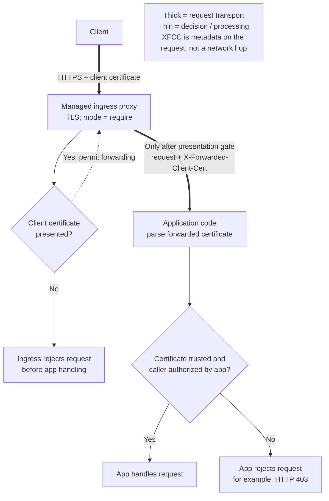

---
content_sources:
  diagrams:
    - id: aca-client-cert-ingress-flow
      type: flowchart
      source: mslearn-adapted
      based_on:
        - https://learn.microsoft.com/en-us/azure/container-apps/client-certificate-authorization
        - https://learn.microsoft.com/en-us/azure/container-apps/ingress-overview
        - https://learn.microsoft.com/en-us/azure/templates/microsoft.app/2025-01-01/containerapps
content_validation:
  status: verified
  last_reviewed: 2026-11-07
  reviewer: agent
  core_claims:
    - claim: Ingress passes the client certificate to the container app if clientCertificateMode is set to require or accept.
      source: https://learn.microsoft.com/en-us/azure/container-apps/client-certificate-authorization
      verified: true
    - claim: Azure Container Apps uses the X-Forwarded-Client-Cert header to forward client certificate information to the application.
      source: https://learn.microsoft.com/en-us/azure/container-apps/ingress-overview
      verified: true
    - claim: The ARM template schema for container app ingress includes clientCertificateMode values accept, ignore, and require.
      source: https://learn.microsoft.com/en-us/azure/templates/microsoft.app/2025-01-01/containerapps
      verified: true
---
# Ingress Client Certificates

Use ingress client certificate mode when Azure Container Apps should require or accept a caller certificate at the edge and forward certificate details to your application. Requiring certificate presentation is not proof that the caller is trusted: application code must validate the certificate and authorize the request.

## Prerequisites

- A container app with HTTP ingress enabled.
- A client certificate and private key for testing.
- Azure CLI installed and authenticated.
- Optional: a custom domain if you want the certificate exchange on your own hostname.

Set reusable variables:

```bash
export RG="rg-aca-security"
export APP_NAME="ca-api-mtls"
export ACA_ENV_NAME="cae-security"
export LOCATION="koreacentral"
```

## When to Use

- Partner or B2B APIs that require certificate-based caller authentication.
- APIs fronted by enterprise proxies or gateways that already manage client certificates.
- Workloads that need the app to inspect and validate a certificate subject, issuer, thumbprint, or trust chain after ingress forwards it.

<!-- diagram-id: aca-client-cert-ingress-flow -->


*Figure: A gate/processing view for `require`, not a topology-base extension. `accept` permits a missing certificate; `ignore` does not forward it. Neither certificate presence nor a parsed header substitutes for application trust validation.*

## Procedure

### 1. Enable external ingress

For callers outside the environment, publish the app at the environment boundary using external app ingress. This does not by itself create public internet access: an internal environment still has no public endpoint. Keep HTTP ingress on the intended application port.

```bash
az containerapp ingress enable \
  --name "$APP_NAME" \
  --resource-group "$RG" \
  --type external \
  --target-port 8000
```

| Command | Why it is used |
|---|---|
| `az containerapp ingress enable` | Enables app ingress. |
| `--name` | Selects the container app. |
| `--resource-group` | Selects its resource group. |
| `--type` | Publishes the app at the environment boundary with `external`. |
| `--target-port` | Routes to the application listener on port 8000. |

### 2. Require client certificates

Microsoft Learn documents the setting on the app's **Networking → Ingress** blade as well as in templates and an ARM PATCH. Use `require` to enforce certificate presentation on all requests; still validate trust in app code.

```bash
export APP_ID=$(az containerapp show \
  --name "$APP_NAME" \
  --resource-group "$RG" \
  --query id \
  --output tsv)

az rest \
  --method patch \
  --uri "https://management.azure.com${APP_ID}?api-version=2025-01-01" \
  --body '{
    "properties": {
      "configuration": {
        "ingress": {
          "clientCertificateMode": "require"
        }
      }
    }
  }'
```

| Command | Why it is used |
|---|---|
| `az containerapp show` | Reads the app resource ID. |
| `--name` | Selects the container app. |
| `--resource-group` | Selects its resource group. |
| `--query` | Extracts `id`. |
| `--output` | Returns the ID as TSV for `APP_ID`. |
| `az rest` | Patches the app through ARM. |
| `--method` | Uses the PATCH method. |
| `--uri` | Targets the app using the stable 2025-01-01 API. |
| `--body` | Sets `configuration.ingress.clientCertificateMode`. |

### 3. Use ARM or Bicep for repeatable configuration

```bicep
// Fragment: supply appName, location, environmentId, and imageName as parameters.
resource app 'Microsoft.App/containerApps@2025-01-01' = {
  name: appName
  location: location
  properties: {
    environmentId: environmentId
    configuration: {
      ingress: {
        external: true
        targetPort: 8000
        transport: 'auto'
        clientCertificateMode: 'require'
      }
    }
    template: {
      containers: [
        {
          name: 'api'
          image: imageName
        }
      ]
    }
  }
}
```

### 4. Understand what the app receives

Azure Container Apps uses the `X-Forwarded-Client-Cert` header when `clientCertificateMode` is `require` or `accept`.

Documented format:

```text
Hash=<hash>;Cert="-----BEGIN CERTIFICATE-----...";Chain="-----BEGIN CERTIFICATE-----..."
```

Your application should:

1. Extract the `Cert=` segment.
2. Decode the PEM certificate.
3. Validate thumbprint, subject, issuer, or trust chain according to your policy.
4. Return `403` when the caller presents a certificate that does not match your allowlist or policy.

### 5. Treat path exclusions conservatively

!!! warning "No documented per-path mTLS exclusion in Azure Container Apps ingress"
    The Microsoft Learn sources cited on this page document `clientCertificateMode` and `corsPolicy`, but they do not document a per-path exclusion feature for client certificate enforcement. If you need mixed behavior by path, use a separate container app, a separate hostname, or application-level logic after choosing `accept` mode.

### 6. Keep CORS separate from mTLS

`corsPolicy` controls browser cross-origin behavior. It does not replace or bypass client certificate enforcement.

```bash
az containerapp ingress cors enable \
  --name "$APP_NAME" \
  --resource-group "$RG" \
  --allowed-origins "https://portal.contoso.com" \
  --allowed-methods "GET" "POST" \
  --allowed-headers "content-type" "x-request-id" \
  --allow-credentials true
```

| Command | Why it is used |
|---|---|
| `az containerapp ingress cors enable` | Configures browser cross-origin behavior, separately from certificate mode. |
| `--name` | Selects the container app. |
| `--resource-group` | Selects its resource group. |
| `--allowed-origins` | Allows the specified browser origin. |
| `--allowed-methods` | Allows GET and POST requests. |
| `--allowed-headers` | Allows the listed request headers. |
| `--allow-credentials` | Enables credentialed CORS responses. |

#### Portal view: environment Networking blade (scope boundary)


[Observed] The blade subtitle reads `Container Apps Environment`. The tab strip lists `General`, `Ingress settings`, `Request Routing`, `Encryption`, and `Custom DNS Suffix`, with `General` selected. No tab is labeled `Client certificates`, and no field labeled `clientCertificateMode` is visible on the selected `General` tab.

[Inferred] The presence of an `Ingress settings` tab on a blade whose subtitle is `Container Apps Environment` is consistent with this page's framing of ingress configuration as having an environment-scoped surface in addition to the app-scoped `clientCertificateMode` setting described under [Require client certificates](#2-require-client-certificates). The absence of a tab named `Client certificates` on this environment blade is consistent with this page's description of `clientCertificateMode` as a per-app `configuration.ingress` field set on the container app rather than on the environment.

[Not Proven] This image does not show the contents of the `Ingress settings` tab, so whatever environment-level ingress fields exist behind that tab are outside the scope of this capture. It does not show any app-level ingress blade, so the `clientCertificateMode` radio or dropdown surface is not represented here. It does not show the `X-Forwarded-Client-Cert` header described under [Understand what the app receives](#4-understand-what-the-app-receives), and it does not show any per-path exclusion control referenced in the warning above.

## Verification

### Check ingress configuration

```bash
az containerapp show \
  --name "$APP_NAME" \
  --resource-group "$RG" \
  --query "properties.configuration.ingress.clientCertificateMode" \
  --output tsv
```

| Command | Why it is used |
|---|---|
| `az containerapp show` | Reads the app's certificate mode. |
| `--name` | Selects the container app. |
| `--resource-group` | Selects its resource group. |
| `--query` | Extracts `clientCertificateMode`. |
| `--output` | Returns an unquoted TSV value. |

Expected output:

```text
require
```

### Test with curl

```bash
export FQDN=$(az containerapp show \
  --name "$APP_NAME" \
  --resource-group "$RG" \
  --query "properties.configuration.ingress.fqdn" \
  --output tsv)

curl --include \
  --cert "./client.pem" \
  --key "./client.key" \
  "https://${FQDN}/cert-info"
```

| Command | Purpose |
|---|---|
| `az containerapp show` | Reads the app's ingress hostname; it is not necessarily public. |
| `--name` | Selects the container app. |
| `--resource-group` | Selects its resource group. |
| `--query` | Extracts the app ingress FQDN. |
| `--output` | Returns TSV for the `FQDN` variable. |
| `curl` | Calls a test route that your application must implement. |
| `--include` | Prints response headers. |
| `--cert` | Supplies the test client certificate. |
| `--key` | Supplies its local private key; never publish this file. |

These are test expectations for your implementation, not live results collected for this page. Run from a client that can reach the environment, and also test with no certificate and an untrusted certificate:

- `200 OK` when the client certificate is accepted and the app authorizes it.
- `403` from the app when the certificate reaches the app but fails your policy.
- Rejection before app handling when `require` is set and no certificate is supplied. Record the actual TLS/HTTP outcome rather than assuming a universal status code.
- An untrusted but presented certificate must not receive protected content; the application trust policy must reject it.

### Inspect the forwarded header in app logs

Confirm that the app records certificate presence and its authorization outcome without logging raw certificate/header material or private keys. Parse the leaf certificate and validate it rather than trusting the raw header string. Ingress overwrites a client-supplied `X-Forwarded-Client-Cert` header on this path.

## Rollback / Troubleshooting

Set the mode back to `ignore` or `accept` if you need to relax enforcement:

```bash
az rest \
  --method patch \
  --uri "https://management.azure.com${APP_ID}?api-version=2025-01-01" \
  --body '{
    "properties": {
      "configuration": {
        "ingress": {
          "clientCertificateMode": "ignore"
        }
      }
    }
  }'
```

| Command | Why it is used |
|---|---|
| `az rest` | Relaxes certificate presentation through ARM. |
| `--method` | Uses PATCH. |
| `--uri` | Targets the app resource at the specified API version. |
| `--body` | Sets certificate mode to `ignore`; reassess the security impact first. |

Troubleshooting checklist:

- No `X-Forwarded-Client-Cert` header: verify the app is in `require` or `accept` mode.
- Browser preflight issues: review `corsPolicy` separately from mTLS policy.
- Direct client rejected at edge: confirm the client is actually sending the certificate and key pair.
- App rejects valid clients: inspect the parsed leaf certificate, not only the raw header.

## See Also

- [mTLS Architecture in Azure Container Apps](mtls.md)
- [Security in Azure Container Apps](index.md)
- [Azure Container Apps Networking Best Practices](../../best-practices/networking.md)
- [mTLS Failures](../../troubleshooting/playbooks/mtls-failures.md)

## Sources

- [Configure client certificate authentication in Azure Container Apps (Microsoft Learn)](https://learn.microsoft.com/en-us/azure/container-apps/client-certificate-authorization)
- [Ingress overview in Azure Container Apps (Microsoft Learn)](https://learn.microsoft.com/en-us/azure/container-apps/ingress-overview)
- [Ingress for your app in Azure Container Apps (Microsoft Learn)](https://learn.microsoft.com/en-us/azure/container-apps/ingress-how-to)
- [Microsoft.App/containerApps@2025-01-01 template reference (Microsoft Learn)](https://learn.microsoft.com/en-us/azure/templates/microsoft.app/2025-01-01/containerapps)
- [Configure CORS in Azure Container Apps (Microsoft Learn)](https://learn.microsoft.com/en-us/azure/container-apps/cors)
- [Use mTLS and the Portal ingress setting (Microsoft Learn)](https://learn.microsoft.com/en-us/azure/container-apps/mtls)
- [Azure CLI CORS command reference (Microsoft Learn)](https://learn.microsoft.com/en-us/cli/azure/containerapp/ingress/cors)
