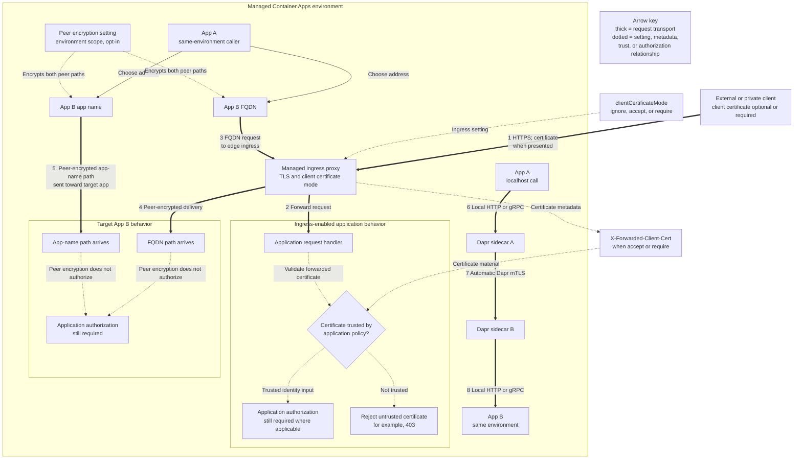

---
content_sources:
  diagrams:
    - id: aca-mtls-three-planes
      type: flowchart
      source: mslearn-adapted
      based_on:
        - https://learn.microsoft.com/en-us/azure/container-apps/ingress-environment-configuration
        - https://learn.microsoft.com/en-us/azure/container-apps/client-certificate-authorization
        - https://learn.microsoft.com/en-us/azure/container-apps/connect-apps
        - https://learn.microsoft.com/en-us/azure/container-apps/dapr-overview
content_validation:
  status: verified
  last_reviewed: 2026-11-07
  reviewer: agent
  core_claims:
    - claim: Azure Container Apps supports peer-to-peer TLS encryption within the environment, and the feature is disabled by default.
      source: https://learn.microsoft.com/en-us/azure/container-apps/ingress-environment-configuration
      verified: true
    - claim: Container Apps ingress supports clientCertificateMode values require, accept, and ignore.
      source: https://learn.microsoft.com/en-us/azure/container-apps/client-certificate-authorization
      verified: true
    - claim: Dapr service invocation in Azure Container Apps includes built-in mutual TLS.
      source: https://learn.microsoft.com/en-us/azure/container-apps/connect-apps
      verified: true
    - claim: Workload profiles environments support both Consumption and Dedicated plans, while Consumption-only environments support only the Consumption plan.
      source: https://learn.microsoft.com/en-us/azure/container-apps/environment
      verified: true
---
# mTLS Architecture in Azure Container Apps

Azure Container Apps has three distinct mTLS-related planes: environment-internal peer encryption, ingress client certificate presentation, and Dapr service-to-service calls. Treat them as complementary transport and identity-input controls rather than one feature flag or an application-authorization system.

## mTLS Planes in Container Apps

<!-- diagram-id: aca-mtls-three-planes -->


*Figure: The three planes share one managed environment but solve different problems. Client certificate mode controls certificate presentation and forwarding; application validation, rejection, and authorization stay inside the application behavior boundary. For peer encryption, a same-environment FQDN call first reaches edge ingress, while an app-name call is sent toward the target app without traversing edge ingress; both paths remain platform-managed and encrypted when the environment setting is enabled. Dapr provides authenticated and encrypted sidecar-to-sidecar invocation.*

| Plane | Primary purpose | Scope |
|---|---|---|
| Environment-internal peer encryption | Encrypt traffic inside the managed environment | App-to-app traffic inside the environment boundary |
| Ingress client certificate presentation | Require, accept, or ignore a certificate and forward presented certificate material | Internet or private clients calling ingress; application validates trust before authorization |
| Dapr service-to-service mTLS | Secure Dapr sidecar-to-sidecar invocation | Dapr-enabled apps in the same environment |

### Plane 1: Environment-internal peer encryption

Azure Container Apps supports peer-to-peer TLS encryption within the environment. Microsoft Learn currently documents the managed environment property as `peerTrafficConfiguration.encryption.enabled`, and older examples also referenced `peerAuthentication.mtls.enabled` during schema evolution.

```bicep
resource managedEnvironment 'Microsoft.App/managedEnvironments@2025-01-01' = {
  name: environmentName
  location: location
  properties: {
    peerTrafficConfiguration: {
      encryption: {
        enabled: true
      }
    }
  }
}
```

What this plane does:

- Encrypts network traffic within the Azure Container Apps environment with platform-managed private certificates.
- Applies at the environment boundary, not as application code middleware.
- Helps protect east-west traffic on both documented same-environment paths: FQDN calls first reach edge ingress, while app-name calls are sent toward the target app. Container Apps manages service discovery and routing for both paths; peer encryption protects transport but does not add application authorization.

What it does not do:

- It does not authenticate external clients at ingress.
- It does not provide authorization for access control between applications. Enforce application authorization separately.
- It does not make your application parse client certificates automatically.

Performance and scope notes:

- The feature is disabled by default.
- Microsoft Learn notes that enabling peer-to-peer encryption can increase response latency and reduce maximum throughput under high load.
- Document the environment type before rollout. Workload profiles environments support both Consumption and Dedicated plans, while Consumption-only environments are legacy and support only the Consumption plan.

!!! warning "Use the current property name in new IaC"
    Use `peerTrafficConfiguration.encryption.enabled` in current ARM or Bicep examples. Microsoft documentation previously showed `peerAuthentication.mtls.enabled` in earlier schema examples, so older blog posts or snippets may not match current API versions.

#### Portal view: environment Networking blade (Encryption tab label)


[Observed] The blade title ends with `| Networking` and the subtitle is `Container Apps Environment`. The tab strip lists `General`, `Ingress settings`, `Request Routing`, `Encryption`, and `Custom DNS Suffix`, with `General` selected. The `General` tab shows a `Public Network Access` field with two radios — `Enable: Allows incoming traffic from the public internet.` (selected) and `Disable: Block all incoming traffic from the public internet.` — and a `Virtual network` section that reads `This environment isn't integrated`.

[Inferred] The presence of a dedicated `Encryption` tab in the tab strip is consistent with [Plane 1: Environment-internal peer encryption](#plane-1-environment-internal-peer-encryption) being framed on this page as an environment-scoped setting rather than an app-scoped one. The grouping of `Encryption` as a peer tab alongside `Ingress settings` and `Request Routing` is consistent with the three-plane model on this page locating the environment plane and the ingress-side surfaces on the same environment blade, while [Plane 3: Dapr service-to-service mTLS](#plane-3-dapr-service-to-service-mtls) is described as configured separately on Dapr-enabled apps. The `Virtual network` row reading "This environment isn't integrated" appears to be orthogonal to the `Encryption` tab being present, which is consistent with this page's description of peer encryption as protecting east-west traffic within the managed environment rather than depending on VNet integration state.

[Not Proven] This image does not show the contents of the `Encryption` tab, so the actual toggle, the field label corresponding to `peerTrafficConfiguration.encryption.enabled`, and any latency or throughput warnings inside the tab body are not visible here. It does not show the `Ingress settings` tab contents, so the `clientCertificateMode` field referenced in [Plane 2: Ingress client certificate presentation and application validation](#plane-2-ingress-client-certificate-presentation-and-application-validation) is outside the scope of this capture. It does not show any Dapr-related surface, so [Plane 3: Dapr service-to-service mTLS](#plane-3-dapr-service-to-service-mtls) is not represented in this image.

### Plane 2: Ingress client certificate presentation and application validation

The client TLS exchange terminates at the Container Apps managed ingress layer. You configure certificate presentation with `ingress.clientCertificateMode` on the container app. This mode does not establish that a presented certificate is trusted by your application's policy: `accept` permits requests without a certificate, and Container Apps accepts CA-issued or self-signed client certificates.

| Value | Behavior |
|---|---|
| `require` | Reject requests that do not present a client certificate |
| `accept` | Accept requests with or without a certificate, and forward the certificate when present |
| `ignore` | Ignore client certificates |

When `require` or `accept` is enabled, ingress passes a presented client certificate to the app through `X-Forwarded-Client-Cert`. Before authorization, the application must extract and decode the leaf certificate, then validate the thumbprint, subject, issuer, or trust chain against its own policy. Reject an untrusted presented certificate, for example with `403`; certificate presentation alone is not a successful trust decision.

This plane is best for:

- Partner APIs whose application policy validates an approved certificate thumbprint, subject, issuer, or trust chain.
- Edge APIs that accept certificate material from enterprise devices or gateways and evaluate it before authorization.
- Scenarios where ingress should require or optionally forward a certificate while the application owns trust validation and authorization.

### Plane 3: Dapr service-to-service mTLS

For Dapr-enabled apps in the same Container Apps environment, Dapr service invocation includes automatic mTLS authentication and encryption. The application talks to its local sidecar over `localhost`, and Dapr handles the secured sidecar-to-sidecar call.

```text
http://localhost:3500/v1.0/invoke/<dapr-app-id>/method/<path>
```

Key points:

- Dapr App ID is the service identity other apps use to invoke the target service.
- If you do not set an explicit App ID, Dapr defaults to the container app name.
- App IDs must be unique within the environment.
- Dapr on Azure Container Apps enables mTLS by default for service invocation.

!!! note "Document certificate rotation conservatively"
    Microsoft Learn is clear that Container Apps Dapr service invocation uses built-in mTLS, but it does not publish a rotation cadence specific to Container Apps on the Container Apps pages cited here. Treat the implementation as Sentry-issued, automatically managed Dapr certificates and refer to the Dapr security documentation for current certificate TTL and rotation behavior.

## Comparison of the Three Planes

| Plane | Who terminates or validates | What is encrypted | Default or opt-in | Certificate source and rotation |
|---|---|---|---|---|
| Environment-internal peer encryption | Platform-managed environment networking | Traffic within the managed environment | Opt-in | Platform-managed private certificates inside the environment |
| Ingress client certificate presentation | Managed ingress controls presentation; application validates trust | Client-to-ingress TLS, plus certificate forwarding metadata to the app | Opt-in per app | Client presents its own certificate; ingress forwards XFCC metadata; application validates the leaf certificate |
| Dapr service-to-service mTLS | Dapr sidecars | Sidecar-to-sidecar service invocation | Automatic when Dapr service invocation is used | Dapr-managed certificates; see Dapr security docs for current rotation details |

## Design Guidance

- Use environment peer encryption when you want both documented app-to-app paths inside the environment protected without re-implementing TLS in each service. Keep the distinction visible during diagnosis: FQDN calls first reach edge ingress; app-name calls are sent toward the target app without traversing edge ingress.
- Use ingress client certificates when ingress should require or accept certificate presentation, and implement the trust decision in application policy before authorization.
- Use Dapr service invocation when both apps are in the same environment and you want mTLS, retries, and service discovery together.
- Do not assume one plane automatically enables the others.

## See Also

- [Security in Azure Container Apps](index.md)
- [Ingress Client Certificates](ingress-client-certificates.md)
- [Service-to-Service Communication](../networking/service-to-service.md)
- [Passwordless Access with Managed Identity](../identity-and-secrets/managed-identity.md)

## Sources

- [Ingress environment configuration in Azure Container Apps (Microsoft Learn)](https://learn.microsoft.com/en-us/azure/container-apps/ingress-environment-configuration)
- [Configure client certificate authentication in Azure Container Apps (Microsoft Learn)](https://learn.microsoft.com/en-us/azure/container-apps/client-certificate-authorization)
- [Communicate between container apps in Azure Container Apps (Microsoft Learn)](https://learn.microsoft.com/en-us/azure/container-apps/connect-apps)
- [Dapr overview in Azure Container Apps (Microsoft Learn)](https://learn.microsoft.com/en-us/azure/container-apps/dapr-overview)
- [Azure Container Apps environments (Microsoft Learn)](https://learn.microsoft.com/en-us/azure/container-apps/environment)
- [Securing Dapr deployments (Dapr Docs)](https://docs.dapr.io/operations/security/_print/)
