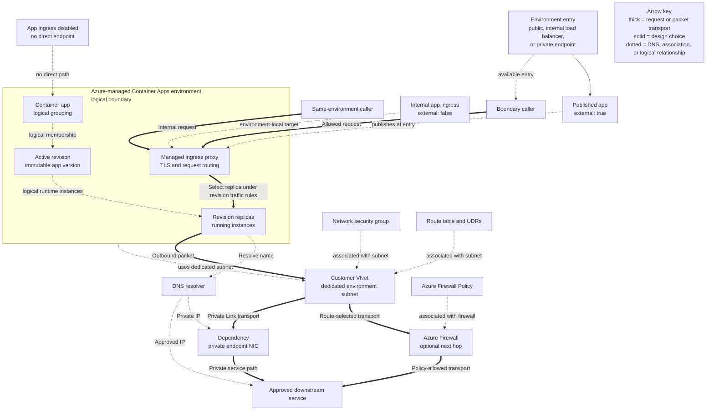

---
content_sources:
  diagrams:
    - id: layered-network-isolation-stack
      type: flowchart
      source: self-generated
      justification: Layered decision and association view synthesized from Microsoft Learn; it separates Azure-managed Container Apps runtime boundaries from customer-managed VNet resources and keeps DNS resolution, policy associations, and transport distinct.
      based_on:
        - https://learn.microsoft.com/en-us/azure/container-apps/networking
        - https://learn.microsoft.com/en-us/azure/container-apps/custom-virtual-networks
        - https://learn.microsoft.com/en-us/azure/container-apps/private-endpoints-with-dns
        - https://learn.microsoft.com/en-us/azure/container-apps/firewall-integration
        - https://learn.microsoft.com/en-us/azure/container-apps/user-defined-routes
        - https://learn.microsoft.com/en-us/azure/container-apps/ingress-environment-configuration
        - https://learn.microsoft.com/en-us/azure/private-link/disable-private-endpoint-network-policy
content_validation:
  status: verified
  last_reviewed: 2026-11-07
  reviewer: agent
  core_claims:
    - claim: You can deploy a Container Apps environment into your own virtual network by using a dedicated subnet.
      source: https://learn.microsoft.com/en-us/azure/container-apps/custom-virtual-networks
      verified: true
    - claim: Container Apps environment private endpoints require a workload profiles environment and disabled public network access.
      source: https://learn.microsoft.com/en-us/azure/container-apps/private-endpoints-with-dns
      verified: true
    - claim: User-defined routes, Azure Firewall integration, and advanced egress control are supported for workload profiles environments.
      source: https://learn.microsoft.com/en-us/azure/container-apps/firewall-integration
      verified: true
    - claim: NSG and UDR enforcement for private endpoints requires the corresponding private endpoint network policies to be enabled on the endpoint subnet.
      source: https://learn.microsoft.com/en-us/azure/private-link/disable-private-endpoint-network-policy
      verified: true
    - claim: External app ingress publishes an app at the environment inbound boundary, while internal app ingress is directly reachable only from the same environment by default.
      source: https://learn.microsoft.com/en-us/azure/container-apps/ingress-overview
      verified: true
---
# Network Isolation in Azure Container Apps

Network isolation in Azure Container Apps is a layered design problem, not a single setting. This page consolidates the environment, ingress, private connectivity, and egress controls from a security perspective so you can choose the right boundary for the threat you are trying to reduce.

## Defense-in-depth layers

Microsoft Learn documents several network controls that work together rather than replacing one another:

- **Environment accessibility and public network access** to determine whether an environment has a public entry path or accepts traffic only through private paths.
- **App ingress configuration** to publish an app at the environment boundary, keep direct access inside the environment, or disable its inbound endpoint.
- **Custom VNet integration** to give the environment a relationship with a dedicated customer-managed subnet.
- **Private endpoints and DNS** for private inbound access to the environment and private outbound access to dependencies.
- **NSG and route-table associations** to constrain traffic that traverses the customer VNet.
- **Egress processing** through Azure Firewall, NAT Gateway, or another supported next hop in workload profiles environments.

**Takeaway:** Treat this as a layered decision view, not a packet trace. Some controls select exposure, some are associated customer resources, DNS resolves names, and only the thick arrows represent transport.

<!-- diagram-id: layered-network-isolation-stack -->

*Figure: The layered view reuses the architecture base's `ENV`, `INGRESS`, `APP`, `REV_ACTIVE`, and `REPLICAS` vocabulary, but it does not place the managed environment inside the customer VNet. Customer-managed NSGs, route tables, and Firewall Policy are shown as associations rather than contained subnet resources.*

The diagram presents two possible outbound path families, not one mandatory sequence: after the packet reaches the dedicated environment subnet, a route-selected path can use Azure Firewall, while a dependency Private Endpoint provides a private transport path. DNS returns the destination address; it does not point back to the source subnet, and a successful answer does not prove routing, policy, transport, or dependency authorization succeeds.

## Layer 1: Environment exposure boundary

The first security decision is whether the environment has a public endpoint and whether public network access accepts traffic through it. This environment-level choice is separate from each app's ingress visibility.

### Internal environment

Use an **internal** environment when the workload should stay on private address space and be reached only from within the virtual network, peered networks, or connected on-premises paths.

Security value:

- Removes the public environment endpoint.
- Creates a cleaner boundary for private APIs and back-end services.
- Pairs naturally with Application Gateway, API Management, or other controlled entry points.

### External environment

Use an **external** environment when the design needs an internet-accessible environment endpoint or a public endpoint whose access can be disabled in favor of private endpoints. An external environment does not make every app public; only apps published at the environment boundary can use that entry.

Security implication:

- You still need per-app ingress decisions.
- Public reachability should be limited to true edge applications, not all services in the environment.

#### Portal view: environment Networking blade (unhardened baseline)

[Observed] On the selected `General` tab, `Public Network Access` shows two radio options with `Enable` selected and `Disable` unselected, and the `Virtual network` section reads `This environment isn't integrated`.

[Inferred] The simultaneous state of `Public Network Access: Enable` and a `Virtual network` section reading `This environment isn't integrated` is consistent with this page's framing of an environment that has neither the [Layer 1: Environment exposure boundary](#layer-1-environment-exposure-boundary) control nor the [Layer 2: Custom VNet integration](#layer-2-custom-vnet-integration) control applied. The grouping of these two rows on the same `General` tab is consistent with this page's description of environment exposure and VNet integration as distinct but related layer-1 and layer-2 decisions in the defense-in-depth stack.

[Not Proven] This image does not show any subnet ID, NSG, UDR, route table, or private endpoint surface, so [Layer 3: Private endpoints](#layer-3-private-endpoints) and [Layer 4: NSG and UDR controls](#layer-4-nsg-and-udr-controls) are not represented here. It does not show any per-app ingress mode field, so [Layer 5: App ingress decisions](#layer-5-app-ingress-decisions) is outside the scope of this capture. It does not show Azure Firewall, NAT Gateway, or egress policy controls, so [Layer 6: Egress control](#layer-6-egress-control) is not represented in this image.

## Layer 2: Custom VNet integration

Microsoft Learn documents that you can deploy a Container Apps environment into a user-provided virtual network by using a dedicated subnet. The subnet is customer-managed, while the Container Apps environment remains an Azure-managed logical boundary that uses that subnet; do not model the environment, revisions, or replicas as customer-owned network resources.

Security value:

- Lets you apply VNet-level governance.
- Enables private endpoint consumption for downstream Azure services.
- Supports route control and inspection patterns in supported environment types.

!!! note "VNet integration is the foundation, not the finish line"
    Moving the environment into a VNet does not automatically make the workload private. You still need to choose internal or external exposure, configure ingress carefully, and validate outbound paths.

## Layer 3: Private endpoints

Private endpoints matter in two different security scenarios, and neither endpoint contains the target Azure service:

1. **Private inbound access to the Container Apps environment**.
2. **Private outbound access from apps to Azure services such as Key Vault, Storage, or Azure Container Registry**, by using a private endpoint NIC in a customer subnet for each dependency.

Microsoft Learn documents environment private endpoints for both Consumption and Dedicated plans **within workload profiles environments**. Legacy Consumption-only environments do not support this feature. Public network access must be disabled before the environment private endpoint can be used.

Security value:

- Keeps traffic on private IP space.
- Reduces dependency on public DNS and public service endpoints.
- Helps satisfy regulated workload requirements for private-only entry.

!!! warning "Private endpoint design is DNS-dependent"
    Private access fails when name resolution, zone links, forwarding, or endpoint records are incomplete. DNS resolves a name to an address; it does not prove routing, transport, or authorization. Treat DNS as part of the isolation boundary, not as an afterthought.

## Layer 4: NSG and UDR controls

Once the environment lives in your VNet, subnet-level controls become part of the security posture.

### NSGs

Associate NSGs with the environment subnet and related private endpoint subnets to narrow allowed traffic patterns. The NSG is a separate Azure resource, not a child object contained in a subnet. For private endpoints, NSG or UDR enforcement applies only after the subnet's private endpoint network policies are explicitly enabled for the required policy type; those policies are disabled by default.

For external workload profiles environments, public inbound traffic uses the managed public endpoint instead of traversing the customer subnet. An inbound NSG on that subnet therefore does not lock down public ingress; use environment accessibility, public network access, and app ingress controls for that boundary.

Typical security objectives:

- Reduce accidental lateral reachability.
- Enforce approved inbound and outbound subnet flows.
- Align the environment with broader enterprise segmentation rules.

### UDRs

Associate a route table with the environment subnet when outbound traffic must follow a controlled path, such as Azure Firewall or another network virtual appliance. The route table, Azure Firewall, and Firewall Policy are separate resources; the policy is associated with the firewall rather than contained inside the VNet or subnet.

Typical security objectives:

- Force inspection of internet-bound traffic.
- Route traffic through centralized security tooling.
- Keep egress decisions out of individual application deployments.

!!! note "Advanced egress control depends on environment type"
    Microsoft Learn documents Azure Firewall and UDR-based egress control for workload profiles environments. If your design depends on strict route governance, confirm that your environment type supports the required network features.

## Layer 5: App ingress decisions

Even in a hardened environment, each app still needs an explicit ingress posture.

| Ingress mode | Security meaning | Typical use |
|---|---|---|
| External app ingress | Published at the environment inbound boundary; internet reachability depends on environment accessibility and public network access | Public API, or a VNet-facing app on an internal environment |
| Internal app ingress | Directly reachable only from the same environment by default; an environment HTTP route can explicitly target it | Environment-local service API |
| Disabled ingress | No inbound HTTP or TCP endpoint | Worker, consumer, or event-driven app |

Security guidance:

- Use **external app ingress** only when callers need the app published at the environment boundary.
- Use **internal app ingress** for same-environment back-end services, and verify that no environment HTTP route publishes the app.
- Use **no ingress** when a workload does not need direct HTTP entry.

App-level IP restrictions are an additional ingress control for allowed or denied IPv4 CIDR ranges; they do not replace the environment-accessibility or app-ingress decision. Client-certificate mTLS is another orthogonal control for two-way client authentication at ingress.

Environment peer-to-peer encryption is separate again: it encrypts traffic within the environment with platform-managed certificates, but Microsoft Learn states that the built-in feature does not provide application authorization between apps.

## Layer 6: Egress control

Inbound isolation is only half the model. Egress control reduces data exfiltration risk and helps enforce approved dependency paths.

Microsoft Learn documents egress governance options such as Azure Firewall integration and NAT Gateway for workload profiles environments. NAT Gateway supplies predictable source network address translation; it is not an application-layer filtering control.

Security value:

- Centralizes outbound allow-listing.
- Makes dependency review auditable.
- Supports stable outbound IP requirements for partner allow-lists.

Common uses:

- Route all internet-bound traffic through Azure Firewall for FQDN-aware policy.
- Use NAT Gateway when a static outbound IP is required.
- Combine private endpoints with strict egress policy for Azure PaaS dependencies.

## Security decision matrix

Use this matrix to choose the right layer for the threat you are addressing.

| Threat model / requirement | Primary control | Supporting controls |
|---|---|---|
| Prevent public exposure of the whole environment | Internal environment, or disabled public network access with private endpoints | Controlled private edge service |
| Keep a specific service off the environment boundary | Internal app ingress with no environment route, or disabled ingress | Internal environment, service-to-service routing |
| Keep access to Azure dependencies on private IP paths | Private endpoints for dependencies | VNet integration, private DNS, NSG |
| Inspect or restrict outbound traffic | UDR + Azure Firewall | NAT Gateway, dependency allow-list validation |
| Enforce subnet-level segmentation | VNet integration + NSG | Internal environment, private endpoints |
| Provide private-only inbound access from enterprise networks | Internal environment entry or environment private endpoint | Public network access disabled when using a private endpoint, private DNS |
| Limit blast radius of public apps | Separate edge app with external ingress | Internal-only downstream apps, firewall, identity controls |

## Practical guidance for secure topologies

### Private API topology

Recommended combination:

- Internal environment.
- Custom VNet integration.
- External app ingress for APIs that VNet clients must reach through the internal environment entry; internal app ingress only for same-environment callers.
- Private endpoints to Key Vault, Storage, and ACR where required.
- UDR and firewall controls for outbound governance.

### Internet-facing edge with private backends

Recommended combination:

- One edge app with external app ingress on an environment that permits the intended public entry.
- Internal app ingress for same-environment downstream apps, with no environment HTTP route that exposes them.
- VNet integration for the environment.
- Private endpoints for stateful dependencies.
- Egress control for downstream calls.

This keeps the public boundary small while avoiding duplication of networking guidance already covered elsewhere in the repo.

## See Also

- [Security Overview](index.md)
- [Networking Overview](../networking/index.md)
- [VNet Integration](../networking/vnet-integration.md)
- [Private Endpoints](../networking/private-endpoints.md)
- [Egress Control](../networking/egress-control.md)
- [Networking Best Practices](../../best-practices/networking.md)

## Sources

- [Networking in Azure Container Apps (Microsoft Learn)](https://learn.microsoft.com/en-us/azure/container-apps/networking)
- [Custom virtual networks in Azure Container Apps (Microsoft Learn)](https://learn.microsoft.com/en-us/azure/container-apps/custom-virtual-networks)
- [Use a private endpoint with Azure Container Apps (Microsoft Learn)](https://learn.microsoft.com/en-us/azure/container-apps/how-to-use-private-endpoint)
- [Configure private endpoints and DNS for Container Apps environments (Microsoft Learn)](https://learn.microsoft.com/en-us/azure/container-apps/private-endpoints-with-dns)
- [Use Azure Firewall with Azure Container Apps (Microsoft Learn)](https://learn.microsoft.com/en-us/azure/container-apps/firewall-integration)
- [Control outbound traffic with user-defined routes (Microsoft Learn)](https://learn.microsoft.com/en-us/azure/container-apps/user-defined-routes)
- [Ingress in Azure Container Apps (Microsoft Learn)](https://learn.microsoft.com/en-us/azure/container-apps/ingress-overview)
- [Ingress environment configuration in Azure Container Apps (Microsoft Learn)](https://learn.microsoft.com/en-us/azure/container-apps/ingress-environment-configuration)
- [Manage network policies for private endpoints (Microsoft Learn)](https://learn.microsoft.com/en-us/azure/private-link/disable-private-endpoint-network-policy)
- [IP ingress restrictions in Azure Container Apps (Microsoft Learn)](https://learn.microsoft.com/en-us/azure/container-apps/ip-restrictions)
- [Client certificate authentication in Azure Container Apps (Microsoft Learn)](https://learn.microsoft.com/en-us/azure/container-apps/client-certificate-authorization)
