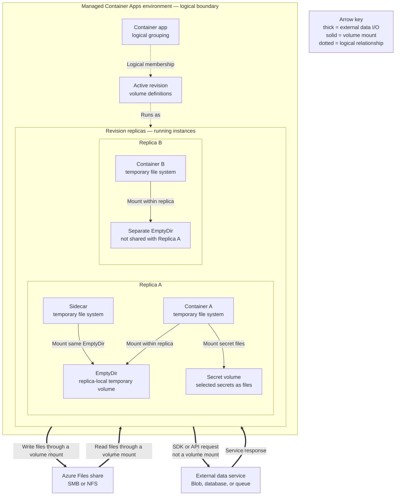
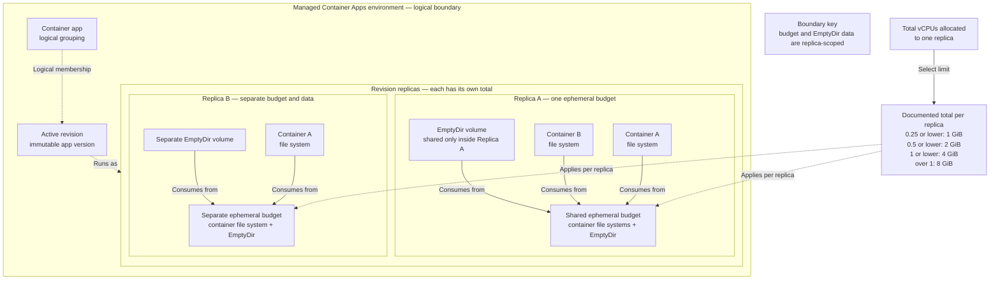
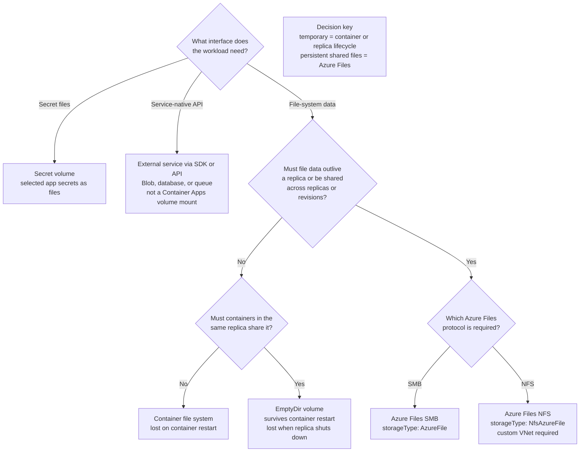

# Storage in Azure Container Apps

Azure Container Apps provides temporary container and replica storage plus persistent Azure Files mounts. A revision can also project app secrets into a volume as files. Choose by lifecycle and sharing boundary, and use an external service through application code when a file-system mount is not the right interface.

## Main Content

### Storage Types at a Glance

| Storage surface | Visibility | Lifecycle | Typical use |
|---|---|---|---|
| **Container file system** | Processes in one container | Data disappears when that container shuts down or restarts | Local cache, temporary files |
| **EmptyDir volume** | Init and app containers that mount it in one replica | Data remains across a container restart but disappears when the replica shuts down | Sidecar exchange, replica-local scratch space |
| **Azure Files volume** | Every container that mounts the same share, including containers in other replicas, revisions, or apps | Files persist in the Azure file share independently of a container or replica lifecycle | Shared files and durable file-based state |
| **Secret volume** | Containers in a revision that mount the volume | Projects selected app secrets as files; it is a configuration delivery mechanism, not general data storage | Certificates and secret files |
| **External data service via an SDK or API** | Determined by the service and application authorization | Determined by the external service | Blob/object data, databases, queues, and other service-native data |

!!! warning "Do not use ephemeral storage for persistent data"
    Container file-system data is lost when its container restarts. EmptyDir survives a container restart only while the same replica remains; it is lost when that replica shuts down. Data that must outlive a replica or be shared across replicas belongs in Azure Files or another external data service.

<!-- diagram-id: storage-types-overview -->


*Figure: Storage boundaries consume the shared `ENV` → `APP` → `REV_ACTIVE` → `REPLICAS` logical vocabulary without claiming hidden platform internals. Azure Files is the documented persistent mount; Azure Blob Storage is not a supported Container Apps volume mount and is instead accessed through application code.*

### Ephemeral Storage

Each replica receives a total ephemeral-storage budget based on the total vCPUs allocated to that replica. Container file-system storage and replica-scoped EmptyDir volumes draw from that total.

| vCPUs allocated | Total ephemeral storage |
|---|---|
| 0.25 or lower | 1 GiB |
| 0.5 or lower | 2 GiB |
| 1 or lower | 4 GiB |
| Over 1 | 8 GiB |

<!-- diagram-id: ephemeral-storage-scope -->


You can inspect the ephemeral storage limit for a running container app:

```bash
az containerapp show \
  --name $APP_NAME \
  --resource-group $RG \
  --query "properties.template.containers[0].resources" \
  --output yaml
```

| Command/Code | Purpose |
|---|---|
| `az containerapp show` | Shows the current container app resource. |
| `--name $APP_NAME` | Selects the container app. |
| `--resource-group $RG` | Selects the resource group that contains the app. |
| `--query "properties.template.containers[0].resources"` | Extracts the CPU, memory, and ephemeralStorage fields from the first container definition |
| `--output yaml` | Formats the selected resource values as YAML. |

<!-- Verified: real az CLI output from koreacentral, 2026-05-01 -->
```yaml
cpu: 0.25
ephemeralStorage: 1Gi
memory: 0.5Gi
```

#### Container-Scoped Storage

Every container has access to its own writable filesystem. This storage:

- Is temporary and disappears when the container shuts down or restarts.
- Is visible only to the current container — not to sidecars or other replicas.
- Requires no configuration — it is always available.

Use container-scoped storage for ephemeral operations: unpacking archives, writing intermediate computation output, or storing short-lived session data.

#### Replica-Scoped Storage (EmptyDir)

An EmptyDir volume is the equivalent of a Kubernetes `EmptyDir` mount — a temporary directory shared across all containers in the same replica. It persists for the lifetime of the replica, surviving individual container restarts.

**When to use EmptyDir:**

- Main app container writes log files, sidecar container ships them.
- Multiple init containers pass data to the main container.
- Scratch space for data processing that must survive container crashes but not replica replacement.

##### Configure EmptyDir via YAML

Export your app spec, add a volume and mount, then redeploy:

```bash
az containerapp show \
  --name $APP_NAME \
  --resource-group $RG \
  --output yaml > app.yaml
```

| Command/Code | Purpose |
|---|---|
| `az containerapp show` | Shows the current container app resource. |
| `--name $APP_NAME` | Selects the container app. |
| `--resource-group $RG` | Selects the resource group that contains the app. |
| `--output yaml` | Exports the full app spec as YAML for editing |

Edit `app.yaml` to add the volume and mount:

```yaml
properties:
  template:
    containers:
    - name: my-app
      image: <IMAGE>
      resources:
        cpu: 0.25
        memory: 0.5Gi
      volumeMounts:
      - mountPath: /tmp/cache
        volumeName: cache-vol
    volumes:
    - name: cache-vol
      storageType: EmptyDir
```

| Field | Purpose |
|---|---|
| `storageType: EmptyDir` | Declares a replica-scoped ephemeral volume |
| `volumeName` | Links the volume definition to the container mount |
| `mountPath` | Absolute path inside the container where the volume appears |

Apply the update:

```bash
az containerapp update \
  --name $APP_NAME \
  --resource-group $RG \
  --yaml app.yaml \
  --output yaml
```

| Command/Code | Purpose |
|---|---|
| `az containerapp update` | Updates the container app from the supplied YAML specification. |
| `--name $APP_NAME` | Selects the container app. |
| `--resource-group $RG` | Selects the resource group that contains the app. |
| `--yaml app.yaml` | Applies the edited spec including the new volume definition |
| `--output yaml` | Returns the updated app spec for verification |

Verify the volume is applied:

```bash
az containerapp show \
  --name $APP_NAME \
  --resource-group $RG \
  --output yaml
```

| Command/Code | Purpose |
|---|---|
| `az containerapp show` | Shows the current container app resource. |
| `--name $APP_NAME` | Selects the container app. |
| `--resource-group $RG` | Selects the resource group that contains the app. |
| `--output yaml` | Returns the full app spec; inspect `volumes` and `volumeMounts` to confirm the EmptyDir is registered |

<!-- Verified: real az CLI output from koreacentral, 2026-05-01 -->
```yaml
volumeMounts:
- mountPath: /tmp/cache
  volumeName: cache-vol
volumes:
- name: cache-vol
  storageType: EmptyDir
```

##### Verify EmptyDir Write and Read at Runtime

Run a Container Apps Job to write a file and read it back from the EmptyDir mount:

```bash
az containerapp job start \
  --name $JOB_NAME \
  --resource-group $RG
```

| Command/Code | Purpose |
|---|---|
| `az containerapp job start` | Triggers a manual job execution; the job writes to and reads from the EmptyDir volume |
| `--name $JOB_NAME` | Selects the Container Apps job. |
| `--resource-group $RG` | Selects the resource group that contains the job. |

The job command writes a file to `/mnt/cache`, reads it back, lists the directory, and reports disk usage:

<!-- Verified: real az CLI output from koreacentral, 2026-05-01 -->
```text
WRITTEN
hello-emptydir
total 12
drwxr-xr-x 2 root root 4096 May  1 12:30 .
drwxr-xr-x 1 root root 4096 May  1 12:30 ..
-rw-r--r-- 1 root root   15 May  1 12:30 test.txt
Filesystem      Size  Used Avail Use% Mounted on
overlay          148G   28G  114G  20% /mnt/cache
DONE
```

| Output | Meaning |
|---|---|
| `WRITTEN` / `hello-emptydir` | Write and read succeeded — EmptyDir is writable |
| `test.txt` 15 bytes | File persisted within the replica lifetime |
| `148G … /mnt/cache` | Filesystem-reported capacity from this historical run; it does not establish or replace the documented Container Apps ephemeral-storage limit |

!!! note "EmptyDir does not share data across replicas"
    Each replica has its own EmptyDir instance. Data written by one replica is not visible to another. For cross-replica sharing, use Azure Files.

### Azure Files (Persistent Storage)

Azure Files provides persistent storage outside the container and replica lifecycle. Microsoft Learn documents that multiple containers can mount the same file share, including containers in another replica, revision, or container app. All mount clients can access files written to that share, subject to the configured access mode and file-share permissions.

**Supported protocols:**

| Protocol | storageType value | Use case |
|---|---|---|
| SMB | `AzureFile` | General-purpose file sharing, Windows-compatible |
| NFS | `NfsAzureFile` | NFS-compatible Linux file sharing |

!!! warning "Azure Files network prerequisites"
    NFS Azure Files requires a Container Apps environment with a custom VNet, and the storage account must allow access from that VNet. For a custom-VNet environment, Microsoft Learn instructs you to allow ports 445 and 2049 in the NSG associated with the subnet. NFS mounts also fail when the storage account requires encrypted NFS connections because Container Apps does not support encryption in transit for NFS Azure file shares.

!!! note "Unsupported storage backends"
    Azure Container Apps does not support mounting Azure NetApp Files or Azure Blob Storage as volumes.

For new SMB mounts, Microsoft Learn recommends managed identity authentication (preview). The identity belongs to the Container Apps **environment**, not the individual app. Storage account key authentication remains supported. NFS uses network-based access controls rather than SMB authentication settings.

#### Register Azure Files with the Environment

Before mounting, register the file share at the environment level:

```bash
az containerapp env storage set \
  --name $ACA_ENV_NAME \
  --resource-group $RG \
  --storage-name my-files \
  --storage-type AzureFile \
  --azure-file-account-name $STORAGE_ACCOUNT \
  --azure-file-account-key $STORAGE_KEY \
  --azure-file-share-name $SHARE_NAME \
  --access-mode ReadWrite
```

| Command/Code | Purpose |
|---|---|
| `az containerapp env storage set` | Creates or updates a storage definition on the Container Apps environment. |
| `--name $ACA_ENV_NAME` | Selects the Container Apps environment. |
| `--resource-group $RG` | Selects the resource group that contains the environment. |
| `--storage-name` | Logical name for the storage definition in the environment |
| `--storage-type AzureFile` | Specifies SMB Azure Files |
| `--azure-file-account-name $STORAGE_ACCOUNT` | Selects the storage account that contains the file share. |
| `--azure-file-account-key $STORAGE_KEY` | Authenticates the storage definition with the storage account key. |
| `--azure-file-share-name $SHARE_NAME` | Selects the Azure file share. |
| `--access-mode ReadWrite` | Mounts with read and write permissions |

Verify the registration:

```bash
az containerapp env storage list \
  --name $ACA_ENV_NAME \
  --resource-group $RG \
  --output table
```

| Command/Code | Purpose |
|---|---|
| `az containerapp env storage list` | Lists all storage definitions registered in the environment |
| `--name $ACA_ENV_NAME` | Selects the Container Apps environment. |
| `--resource-group $RG` | Selects the resource group that contains the environment. |
| `--output table` | Formats the storage definitions as a table. |

<!-- Verified: real az CLI output from koreacentral, 2026-05-01 -->
```text
Name            ResourceGroup
--------------  ----------------
my-files        rg-myapp
```

#### Mount Azure Files in a Container

Add the volume and mount to your app YAML:

```yaml
properties:
  template:
    containers:
    - name: my-app
      image: <IMAGE>
      volumeMounts:
      - mountPath: /mnt/data
        volumeName: files-vol
        subPath: uploads
    volumes:
    - name: files-vol
      storageType: AzureFile
      storageName: my-files
```

| Field | Purpose |
|---|---|
| `storageName` | References the storage definition registered in the environment |
| `subPath` | Optional subdirectory within the share to mount (do not prefix with `/`) |

### Storage Decision Guide

<!-- diagram-id: storage-decision-guide -->


### Common Mistakes

| Mistake | Impact | Fix |
|---|---|---|
| Writing upload files to container-scoped storage | Files lost on container restart | Mount Azure Files at the upload path |
| Using EmptyDir for cross-replica cache | Each replica has isolated storage; cache misses on every new replica | Use Redis Cache or Azure Files |
| Mounting NFS without a custom VNet and storage-account network access | The mount fails | Use a custom VNet and allow the storage account to be reached from it |
| Sub path starting with `/` | Container app fails to start | Use relative sub paths: `uploads`, not `/uploads` |
| Treating filesystem-reported capacity as the Container Apps limit | Writes can exceed the documented per-replica budget even when `df` reports a larger backing filesystem | Design against the documented vCPU-based limit; reduce temporary writes, rotate logs, or allocate more vCPU when appropriate |

### Verify storage surfaces in Azure Portal


**[Observed]** `ca-sample-d38538 | Revisions and replicas` `Container App` `Create new revision` `Save` `Refresh` `Deployment mode` `Active revisions` `Inactive revisions` `Replicas` `Name` `Date created` `Running status` `View Logs` `Label` `Traffic` `Replicas` `ca-sample-d38538--0uzoi59` `6/3/2026, 10:34:26 PM` `Running` `View details` `Show Logs` `100 %` `1 (Show replicas)`.

**[Inferred]** The `Replicas` `1 (Show replicas)` value is consistent with the per-replica ephemeral storage budget described in [Ephemeral Storage](#ephemeral-storage).

**[Not Proven]** Additional compute allocation detail, volume detail, volume-definition detail, and storage-usage detail are not visible on this view.

## See Also

- [EmptyDir Disk Full — Lab Guide](../../troubleshooting/lab-guides/emptydir-disk-full.md)
- [EmptyDir Disk Full — Playbook](../../troubleshooting/playbooks/storage-and-volumes/emptydir-disk-full.md)
- [Azure Files Mount Failure — Playbook](../../troubleshooting/playbooks/storage-and-volumes/azure-files-mount-failure.md)
- [Volume Permission Denied — Playbook](../../troubleshooting/playbooks/storage-and-volumes/volume-permission-denied.md)

## Sources

- [Use storage mounts in Azure Container Apps — Microsoft Learn](https://learn.microsoft.com/en-us/azure/container-apps/storage-mounts)
- [Create an Azure Files storage mount — Microsoft Learn](https://learn.microsoft.com/en-us/azure/container-apps/storage-mounts-azure-files)
- [Manage secrets in Azure Container Apps — Microsoft Learn](https://learn.microsoft.com/en-us/azure/container-apps/manage-secrets#mounting-secrets-in-a-volume)
- [Troubleshoot storage mount failures — Microsoft Learn](https://learn.microsoft.com/en-us/azure/container-apps/troubleshoot-storage-mount-failures)
