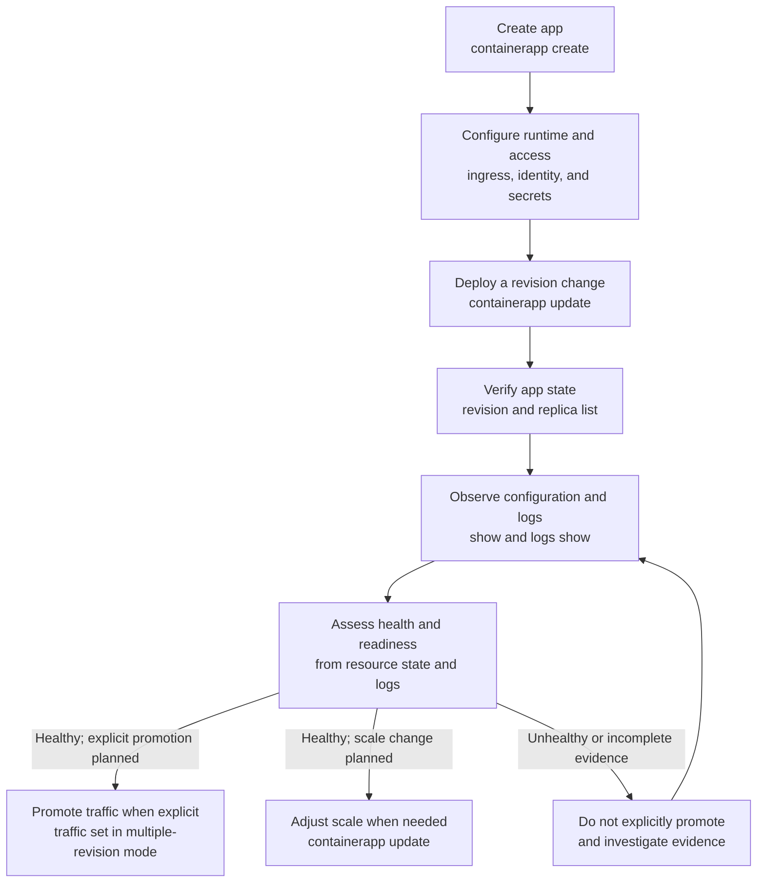

# Azure Container Apps CLI Reference

This reference summarizes commonly used Azure Container Apps CLI command groups with production-friendly examples that use long flags.

## Prerequisites

- Azure CLI 2.57+
- Container Apps extension installed and updated

```bash
az extension add --name containerapp --upgrade
```

| Command | Why it is used |
|---|---|
| `az extension add` | Installs or updates the Container Apps Azure CLI extension. |
| `--name` | Selects the `containerapp` extension required by the commands on this page. |
| `--upgrade` | Updates an existing installation so current Container Apps commands and flags are available. |

!!! warning "Destructive commands require explicit target verification"
    Commands such as `az containerapp delete` and revision deactivation can immediately impact availability. Validate `$RG`, `$APP_NAME`, and `$REVISION_NAME` before execution, and confirm intended scope with `az containerapp show` first.

!!! tip "Use a predictable lifecycle workflow"
    For day-to-day operations, use a consistent order: create or update, configure ingress/identity/secrets, then validate revisions and logs. This reduces missed steps during incident response.

## CLI workflow map

<!-- diagram-id: cli-workflow-map -->


This map is scoped to container apps. Jobs use `az containerapp job update` and `az containerapp job execution list`; they do not use app revisions or ingress traffic splitting. For apps in multiple-revision mode, the assessment gate controls an explicit traffic promotion. In the default single-revision mode, Container Apps automatically shifts traffic to the new revision after it becomes ready, so verification confirms the cutover rather than holding it for manual promotion.

## `az containerapp` commands

### Create

```bash
az containerapp create \
  --name "$APP_NAME" \
  --resource-group "$RG" \
  --environment "$ACA_ENV_NAME" \
  --image "$ACR_NAME.azurecr.io/$APP_NAME:v1.0.0" \
  --target-port 8000 \
  --ingress external \
  --registry-server "$ACR_NAME.azurecr.io" \
  --registry-identity system \
  --min-replicas 1 \
  --max-replicas 5
```

| Command | Why it is used |
|---|---|
| `az containerapp create` | Creates the Container App with the documented image, ingress, scale, and environment settings. |
| `--name` | Sets the name of the Container App being created. |
| `--resource-group` | Places the app in the selected resource group. |
| `--environment` | Attaches the app to the selected Container Apps environment. |
| `--image` | Deploys the specified versioned image from the registry. |
| `--target-port` | Routes ingress to port `8000` on the app container. |
| `--ingress` | Exposes the app through external ingress. |
| `--registry-server` | Identifies the Azure Container Registry that hosts the image. |
| `--registry-identity` | Uses the app's system-assigned identity to authenticate the image pull. |
| `--min-replicas` | Keeps at least one replica running for this example. |
| `--max-replicas` | Caps this example at five replicas. |

Example output (PII scrubbed):

```json
{
  "name": "ca-myapp",
  "location": "Korea Central",
  "provisioningState": "Succeeded",
  "runningStatus": "Running",
  "latestRevisionName": "ca-myapp--0000001"
}
```

### Update

```bash
az containerapp update \
  --name "$APP_NAME" \
  --resource-group "$RG" \
  --image "$ACR_NAME.azurecr.io/$APP_NAME:$IMAGE_TAG" \
  --cpu 0.5 \
  --memory 1.0Gi \
  --set-env-vars "ENV=prod" "LOG_LEVEL=info"
```

| Command | Why it is used |
|---|---|
| `az containerapp update` | Updates the existing Container App configuration without recreating the app. |
| `--name` | Selects the app to update. |
| `--resource-group` | Targets the resource group where the updated app revision is deployed. |
| `--image` | Deploys the image identified by `$IMAGE_TAG` in a new revision. |
| `--cpu` | Allocates `0.5` vCPU to the updated container template. |
| `--memory` | Allocates `1.0Gi` of memory to the updated container template. |
| `--set-env-vars` | Sets the production environment and log-level variables on the new revision. |

Example output (PII scrubbed):

```json
{
  "name": "ca-myapp",
  "provisioningState": "Succeeded",
  "template": {
    "containers": [
      {
        "name": "ca-myapp",
        "image": "<acr-name>.azurecr.io/myapp:v1.0.0",
        "resources": {
          "cpu": 0.5,
          "memory": "1Gi"
        }
      }
    ],
    "scale": {
      "minReplicas": 1,
      "maxReplicas": 3
    }
  }
}
```

### Show

```bash
az containerapp show \
  --name "$APP_NAME" \
  --resource-group "$RG" \
  --output json
```

| Command | Why it is used |
|---|---|
| `az containerapp show` | Reads the Container App configuration so the documented setting can be verified. |
| `--name` | Selects the app whose configuration is returned. |
| `--resource-group` | Scopes the configuration lookup to the app's resource group. |
| `--output` | Returns the complete app resource as JSON for inspection or automation. |

Example output (PII scrubbed):

```json
{
  "name": "ca-myapp",
  "location": "Korea Central",
  "provisioningState": "Succeeded",
  "runningStatus": "Running",
  "latestRevisionName": "ca-myapp--0000001",
  "ingress": {
    "fqdn": "ca-myapp.<hash>.<region>.azurecontainerapps.io",
    "external": true,
    "targetPort": 8000,
    "transport": "Auto"
  },
  "identity": {
    "type": "SystemAssigned"
  }
}
```

### List

```bash
az containerapp list \
  --resource-group "$RG" \
  --output table
```

| Command | Why it is used |
|---|---|
| `az containerapp list` | Lists Container Apps in the selected resource group for inventory or verification. |
| `--resource-group` | Limits the inventory to the selected resource group. |
| `--output` | Formats the app inventory as a readable table. |

Example output (PII scrubbed):

```text
Name      ResourceGroup  Location      Environment  LatestRevision      ProvisioningState  RunningStatus
--------  -------------  ------------  -----------  ------------------  -----------------  -------------
ca-myapp  rg-myapp       koreacentral  cae-myapp    ca-myapp--0000001  Succeeded          Running
```

### Delete

```bash
az containerapp delete \
  --name "$APP_NAME" \
  --resource-group "$RG" \
  --yes
```

| Command | Why it is used |
|---|---|
| `az containerapp delete` | Deletes the verified Container App resource. |
| `--name` | Selects the app to delete. |
| `--resource-group` | Resolves the app to delete within its resource group. |
| `--yes` | Confirms deletion non-interactively after the target variables have been verified. |

Example output:

```text
Command group 'containerapp' is in preview and under development.
```

## `az containerapp revision` commands

```bash
az containerapp revision list \
  --name "$APP_NAME" \
  --resource-group "$RG" \
  --output table

az containerapp revision show \
  --name "$APP_NAME" \
  --resource-group "$RG" \
  --revision "$REVISION_NAME" \
  --output json

az containerapp revision deactivate \
  --name "$APP_NAME" \
  --resource-group "$RG" \
  --revision "$REVISION_NAME"

az containerapp revision restart \
  --name "$APP_NAME" \
  --resource-group "$RG" \
  --revision "$REVISION_NAME"
```

| Command | Why it is used |
|---|---|
| `az containerapp revision list` | Lists revisions so rollout state, traffic, and health can be verified. |
| `az containerapp revision show` | Returns one revision for detailed health and running-state verification. |
| `az containerapp revision deactivate` | Deactivates the selected revision after its traffic and rollback role are verified. |
| `az containerapp revision restart` | Restarts replicas for the selected revision without inventing a new app-level restart command. |
| `--name` | Selects the Container App whose revisions are managed. |
| `--resource-group` | Scopes revision inspection and lifecycle operations to the app's resource group. |
| `--revision` | Selects the exact revision to inspect, deactivate, or restart. |
| `--output` | Formats revision inventory as a table or revision details as JSON. |

Example output for `az containerapp revision list` (PII scrubbed):

```json
[
  {
    "name": "ca-myapp--0000001",
    "active": true,
    "trafficWeight": 100,
    "replicas": 1,
    "healthState": "Healthy",
    "runningState": "Running"
  }
]
```

Example output for `az containerapp revision show`:

```json
{
  "name": "ca-myapp--0000001",
  "active": true,
  "healthState": "Healthy",
  "runningState": "Running"
}
```

Example output for `deactivate` / `restart`:

```text
{
  "name": "ca-myapp--0000001",
  "provisioningState": "Succeeded"
}
```

## `az containerapp replica` commands

```bash
az containerapp replica list \
  --name "$APP_NAME" \
  --resource-group "$RG" \
  --revision "$REVISION_NAME" \
  --output table

az containerapp replica show \
  --name "$APP_NAME" \
  --resource-group "$RG" \
  --replica "$REPLICA_NAME" \
  --revision "$REVISION_NAME" \
  --output json
```

| Command | Why it is used |
|---|---|
| `az containerapp replica list` | Lists replicas in the selected revision to inspect runtime state. |
| `az containerapp replica show` | Returns one replica for detailed container and running-state inspection. |
| `--name` | Selects the Container App whose replicas are inspected. |
| `--resource-group` | Scopes replica inspection to revisions of the app in this resource group. |
| `--revision` | Limits inspection to the selected revision. |
| `--replica` | Selects the exact replica returned by the show command. |
| `--output` | Formats replica inventory as a table or replica details as JSON. |

Example output for `az containerapp replica list` (PII scrubbed):

```json
[
  {
    "name": "ca-myapp--0000001-646779b4c5-bhc2v",
    "properties": {
      "containers": [
        {
          "name": "ca-myapp",
          "ready": true,
          "restartCount": 0,
          "runningState": "Running"
        }
      ],
      "runningState": "Running"
    }
  }
]
```

Example output for `az containerapp replica show`:

```json
{
  "name": "ca-myapp--0000001-646779b4c5-bhc2v",
  "properties": {
    "runningState": "Running"
  }
}
```

## `az containerapp logs` commands

```bash
az containerapp logs show \
  --name "$APP_NAME" \
  --resource-group "$RG" \
  --follow false

az containerapp logs show \
  --name "$APP_NAME" \
  --resource-group "$RG" \
  --revision "$REVISION_NAME" \
  --tail 200
```

| Command | Why it is used |
|---|---|
| `az containerapp logs show` | Reads console logs for the app or a selected revision. |
| `--name` | Selects the Container App whose logs are read. |
| `--resource-group` | Locates the app whose console logs are retrieved from this resource group. |
| `--follow` | Disables streaming for the first bounded log retrieval. |
| `--revision` | Limits the second retrieval to the selected revision. |
| `--tail` | Returns the latest 200 log lines for focused diagnosis. |

Example output:

```text
{"status":"healthy","timestamp":"2026-04-04T11:32:37.322216+00:00"}
```

## `az containerapp env` commands

```bash
az containerapp env create \
  --name "$ACA_ENV_NAME" \
  --resource-group "$RG" \
  --location "$LOCATION"

az containerapp env show \
  --name "$ACA_ENV_NAME" \
  --resource-group "$RG" \
  --output json

az containerapp env list \
  --resource-group "$RG" \
  --output table
```

| Command | Why it is used |
|---|---|
| `az containerapp env create` | Creates the managed Container Apps environment that hosts the app replicas. |
| `az containerapp env show` | Returns one environment for configuration and provisioning verification. |
| `az containerapp env list` | Lists environments in the resource group for inventory. |
| `--name` | Sets or selects the Container Apps environment name. |
| `--resource-group` | Sets or filters by the resource group containing the environment. |
| `--location` | Creates the environment in the selected Azure region. |
| `--output` | Formats environment details as JSON or inventory as a table. |

Example output for `az containerapp env show` (PII scrubbed):

```json
{
  "name": "cae-myapp",
  "location": "Korea Central",
  "provisioningState": "Succeeded",
  "defaultDomain": "<hash>.<region>.azurecontainerapps.io",
  "staticIp": "<static-ip>",
  "zoneRedundant": false
}
```

Example output for `az containerapp env list`:

```text
Name       ResourceGroup  Location      ProvisioningState
---------  -------------  ------------  -----------------
cae-myapp  rg-myapp       koreacentral  Succeeded
```

## `az containerapp job` commands

```bash
az containerapp job create \
  --name "$JOB_NAME" \
  --resource-group "$RG" \
  --environment "$ACA_ENV_NAME" \
  --trigger-type Schedule \
  --cron-expression "*/15 * * * *" \
  --image "$ACR_NAME.azurecr.io/$JOB_NAME:v1.0.0" \
  --registry-server "$ACR_NAME.azurecr.io" \
  --registry-identity system

az containerapp job start \
  --name "$JOB_NAME" \
  --resource-group "$RG"

az containerapp job show \
  --name "$JOB_NAME" \
  --resource-group "$RG" \
  --output json

az containerapp job execution list \
  --name "$JOB_NAME" \
  --resource-group "$RG" \
  --output table
```

| Command | Why it is used |
|---|---|
| `az containerapp job create` | Creates the scheduled Container Apps job with its image and registry identity. |
| `az containerapp job start` | Starts an on-demand execution of the selected job. |
| `az containerapp job show` | Returns the job configuration for verification. |
| `az containerapp job execution list` | Lists executions so their status and timing can be inspected. |
| `--name` | Sets or selects the Container Apps job name. |
| `--resource-group` | Selects the resource group containing the job. |
| `--environment` | Attaches the job to the selected Container Apps environment. |
| `--trigger-type` | Configures the job to use a schedule trigger. |
| `--cron-expression` | Runs the scheduled job every 15 minutes. |
| `--image` | Deploys the specified versioned job image. |
| `--registry-server` | Identifies the registry that hosts the job image. |
| `--registry-identity` | Uses the job's system-assigned identity for the private registry pull. |
| `--output` | Formats job details as JSON or execution inventory as a table. |

Example output for `az containerapp job show` (PII scrubbed):

```json
{
  "name": "job-myapp",
  "provisioningState": "Succeeded",
  "triggerType": "Schedule",
  "replicaTimeout": 1800,
  "replicaRetryLimit": 2,
  "identity": {
    "type": "UserAssigned"
  }
}
```

Example output for `az containerapp job execution list`:

```json
[
  {
    "name": "job-myapp-w6gm0ew",
    "status": "Succeeded",
    "startTime": "2026-04-04T12:53:54+00:00",
    "endTime": "2026-04-04T12:54:29+00:00"
  }
]
```

## `az containerapp ingress` commands

```bash
az containerapp ingress enable \
  --name "$APP_NAME" \
  --resource-group "$RG" \
  --type external \
  --target-port 8000

az containerapp ingress traffic set \
  --name "$APP_NAME" \
  --resource-group "$RG" \
  --revision-weight "$REVISION_STABLE=90" "$REVISION_CANARY=10"

az containerapp ingress show \
  --name "$APP_NAME" \
  --resource-group "$RG" \
  --output json
```

| Command | Why it is used |
|---|---|
| `az containerapp ingress enable` | Enables ingress for workloads that must receive inbound traffic. |
| `az containerapp ingress traffic set` | Assigns 90 percent of traffic to the stable revision and 10 percent to the canary. |
| `az containerapp ingress show` | Returns effective ingress configuration and traffic weights for verification. |
| `--name` | Selects the Container App whose ingress is managed. |
| `--resource-group` | Targets ingress and traffic settings for the app in this resource group. |
| `--type` | Makes ingress external for the example workload. |
| `--target-port` | Routes ingress to port `8000` on the app container. |
| `--revision-weight` | Sets the explicit stable and canary revision traffic percentages. |
| `--output` | Returns the ingress configuration as JSON. |

Example output for `az containerapp ingress show` (PII scrubbed):

```json
{
  "allowInsecure": false,
  "external": true,
  "fqdn": "ca-myapp.<hash>.<region>.azurecontainerapps.io",
  "targetPort": 8000,
  "transport": "Auto",
  "traffic": [
    {
      "latestRevision": true,
      "weight": 100
    }
  ]
}
```

## `az containerapp secret` commands

```bash
az containerapp secret set \
  --name "$APP_NAME" \
  --resource-group "$RG" \
  --secrets "redis-password=<redacted>" "api-key=<redacted>"

az containerapp secret list \
  --name "$APP_NAME" \
  --resource-group "$RG" \
  --output table

az containerapp secret remove \
  --name "$APP_NAME" \
  --resource-group "$RG" \
  --secret-names "api-key"
```

| Command | Why it is used |
|---|---|
| `az containerapp secret set` | Creates or updates the two named Container Apps secrets. |
| `az containerapp secret list` | Lists secret names without returning their values. |
| `az containerapp secret remove` | Removes the selected secret after references to it have been removed. |
| `--name` | Selects the Container App whose secrets are managed. |
| `--resource-group` | Scopes secret creation, inventory, and removal to the app's resource group. |
| `--secrets` | Supplies the secret names and values to create or update. |
| `--output` | Formats the secret-name inventory as a table. |
| `--secret-names` | Selects `api-key` as the secret to remove. |

Example output for `az containerapp secret list`:

```text
Name            Value
--------------  -----
redis-password  null
api-key         null
```

## `az containerapp identity` commands

```bash
az containerapp identity assign \
  --name "$APP_NAME" \
  --resource-group "$RG" \
  --system-assigned

az containerapp identity assign \
  --name "$APP_NAME" \
  --resource-group "$RG" \
  --user-assigned "$UAMI_ID"

az containerapp identity show \
  --name "$APP_NAME" \
  --resource-group "$RG" \
  --output json
```

| Command | Purpose |
|---|---|
| `az containerapp identity assign` | Enables either the system-assigned identity or the selected user-assigned identity on the app. |
| `az containerapp identity show` | Returns the app's identity configuration object so you can inspect the assigned identity type and IDs after enabling or attaching identities. |
| `--name` | Selects the Container App whose identity configuration is changed or inspected. |
| `--resource-group` | Targets identity assignment and inspection for the app in this resource group. |
| `--system-assigned` | Enables the identity whose lifecycle is tied to the app. |
| `--user-assigned` | Attaches the existing identity identified by `$UAMI_ID`. |
| `--output` | Returns the resulting identity configuration as JSON. |

Example output (PII scrubbed):

```json
{
  "type": "SystemAssigned",
  "principalId": "xxxxxxxx-xxxx-xxxx-xxxx-xxxxxxxxxxxx",
  "tenantId": "<tenant-id>"
}
```

## Common flag combinations

| Scenario | Useful flags |
|---|---|
| Script-friendly output | `--output json`, `--query <JMESPath>` |
| Non-interactive execution | `--yes`, `--only-show-errors` |
| Targeting revisions | `--revision <name>`, `--revision-weight` |
| Environment/app targeting | `--resource-group`, `--name`, `--environment` |

!!! note "Prefer deterministic automation output"
    In CI/CD and runbooks, combine `--output json` with `--query` so scripts parse stable machine-readable results instead of table/text formatting.

## Advanced Topics

- Pin CLI and extension versions in CI to avoid drift.
- Use `--query` and structured outputs for deterministic automation.
- Wrap high-risk operations (`delete`, `deactivate`) with change controls.

## See Also

- [Environment Variables Reference](environment-variables.md)
- [Platform Limits](platform-limits.md)

## Sources

- [Microsoft Learn: Azure Container Apps CLI](https://learn.microsoft.com/en-us/cli/azure/containerapp)
