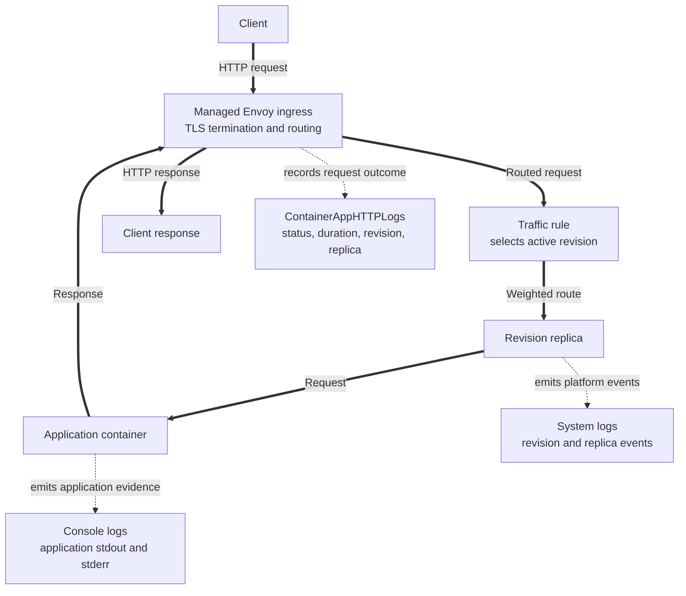
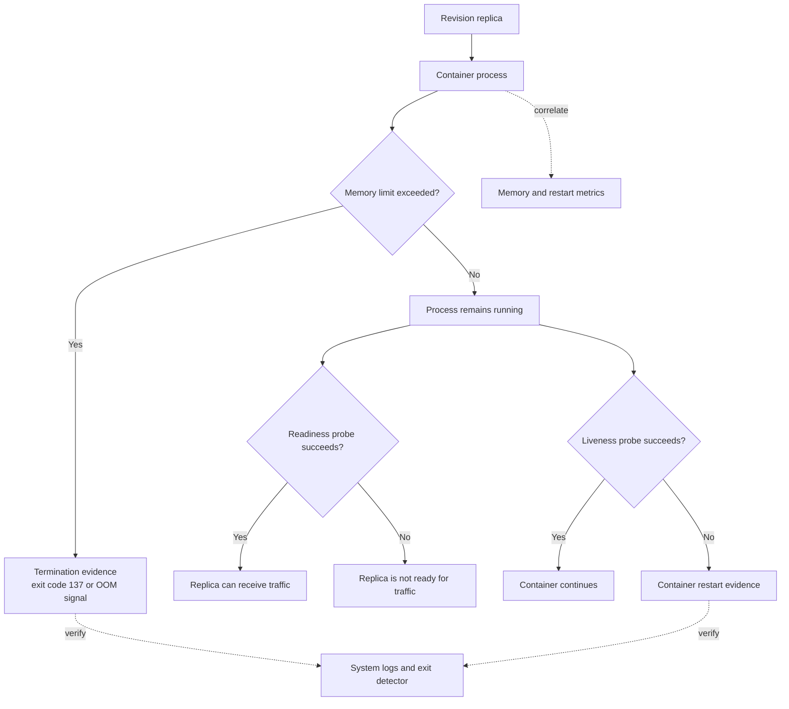
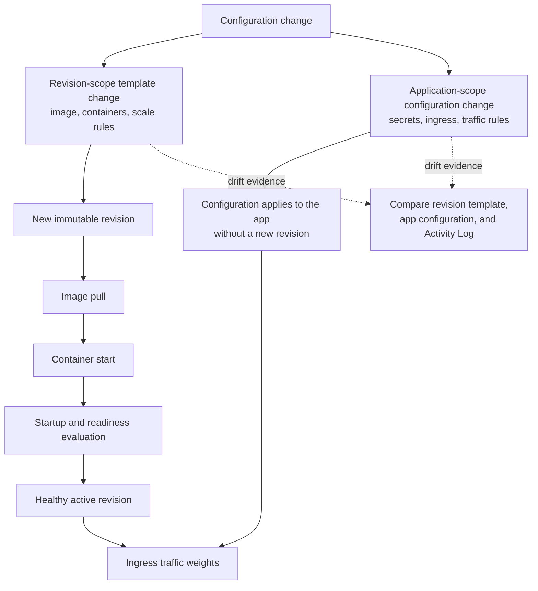
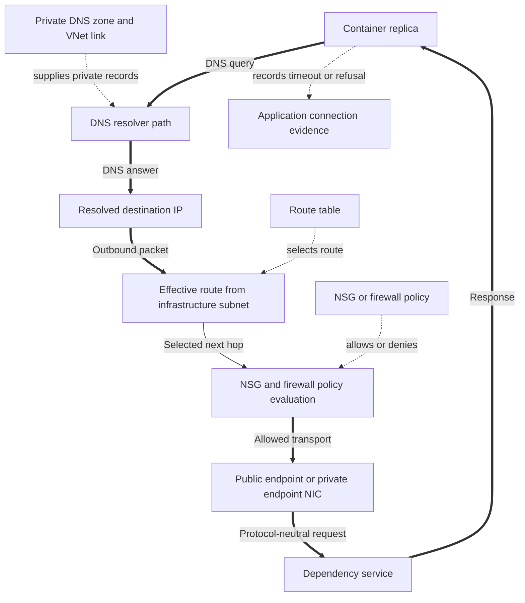
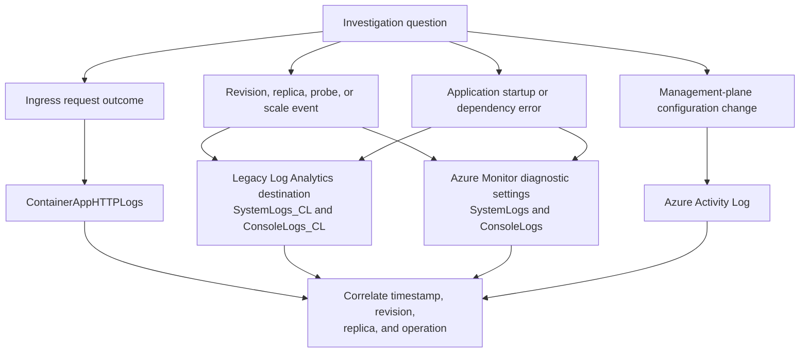

# Troubleshooting Architecture Overview

This page answers one practical question first: **where can this fail?**

Before deep debugging, map the symptom to a platform segment (Ingress, Environment, Revision, Container, or outbound path). That classification tells you which logs to query first and which playbook to open.

## Why this page exists

Playbooks are symptom-driven and detailed. During active incidents, engineers usually need one faster artifact:

1. A request-path view with failure points
2. A runtime model that explains timeout, OOM, and replica behavior
3. A deployment path showing where revision and probe failures happen
4. A network path showing DNS/SNAT/private routing issues

Use this architecture map to route quickly to the right playbook.

## 1) Request Path Architecture (where 5xx can originate)

<!-- diagram-id: 1-request-path-architecture-where-5xx-can-originate -->


The request path separates transport from evidence: HTTP logs identify the routed revision and replica, system logs describe platform events, and console logs carry application output.

### Typical interpretation

- **HTTP 5xx is not one thing**.
- A 5xx response alone does not identify whether ingress, replica availability, or application handling failed.
- If the environment is internal and fronted by Application Gateway, APIM, or Azure Front Door, treat the front-door layer as its own hypothesis first — a gateway can report backend "Unhealthy" or return 502 without any log entry on the Container Apps side when subnet NSGs block the workload profile subnet on the correct ports.
- Treat each layer as a competing hypothesis until logs disprove it.

### Request-path failure points and playbooks

| Failure Point | Typical Symptom | First Evidence | Playbook |
|---|---|---|---|
| FP-REQ-00 Front door (AppGW / APIM / Front Door) | Gateway backend "Unhealthy" or 502 at the gateway with no matching Container Apps ingress or system log entry | AppGW backend health blade, workload profile subnet NSG rules, NSG flow logs | [AppGW to Internal Azure Container Apps NSG Destination](playbooks/ingress-and-networking/appgw-to-internal-aca-nsg-destination.md) |
| FP-REQ-01 Ingress | 502/503 bursts, routing issues | `ContainerAppHTTPLogs` response details + system logs | [Ingress Not Reachable](playbooks/ingress-and-networking/ingress-not-reachable.md) |
| FP-REQ-02 No healthy replicas | Intermittent 5xx during scaling | Replica count, KEDA events | [HTTP Scaling Not Triggering](playbooks/scaling-and-runtime/http-scaling-not-triggering.md) |
| FP-REQ-03 Probe failure | App marked unhealthy, startup failures | Console startup logs + probe messages | [Probe Failure and Slow Start](playbooks/startup-and-provisioning/probe-failure-and-slow-start.md) |
| FP-REQ-04 Application code | 500 with stack traces or long latency | App/console logs + endpoint-level HTTP logs | [CrashLoop OOM and Resource Pressure](playbooks/scaling-and-runtime/crashloop-oom-and-resource-pressure.md) |

## 2) Runtime / Replica Model (memory pressure, OOM, timeout)

<!-- diagram-id: 2-runtime-replica-model-memory-pressure-oom-timeout -->


The two decisions answer different questions: readiness controls whether a replica receives traffic, while liveness can trigger a container restart; memory evidence must be correlated with termination and restart signals.

### Runtime failure mapping

| Failure Point | Why it happens | What to check first | Playbook |
|---|---|---|---|
| FP-RUN-01 Memory pressure | Memory leak, large object churn, high concurrency | Memory trend + console logs for kill/restart | [CrashLoop OOM and Resource Pressure](playbooks/scaling-and-runtime/crashloop-oom-and-resource-pressure.md) |
| FP-RUN-02 OOM Kill | Container exceeded memory limit | Platform kill messages, restart cadence | [CrashLoop OOM and Resource Pressure](playbooks/scaling-and-runtime/crashloop-oom-and-resource-pressure.md) |
| FP-RUN-03 Probe timeout | Slow startup or unresponsive health endpoint | Probe configuration, startup timing | [Probe Failure and Slow Start](playbooks/startup-and-provisioning/probe-failure-and-slow-start.md) |
| FP-RUN-04 Scale mismatch | KEDA rules don't match traffic patterns | KEDA events, replica count over time | [Event Scaler Mismatch](playbooks/scaling-and-runtime/event-scaler-mismatch.md) |

## 3) Deployment Path (revision failures and config drift)

<!-- diagram-id: 3-deployment-path-revision-failures-and-config-drift -->


This path distinguishes revision drift from application-scope drift before investigating image pull, startup, probe, or traffic configuration.

### Deployment path failure mapping

| Failure Point | Typical signal | Primary playbook |
|---|---|---|
| FP-DEP-01 Image pull failure | ACR auth error, image not found | [Image Pull Failure](playbooks/startup-and-provisioning/image-pull-failure.md) |
| FP-DEP-02 Startup mismatch | Container runs but exits or wrong port | [Container Start Failure](playbooks/startup-and-provisioning/container-start-failure.md) |
| FP-DEP-03 Probe failure | Revision never becomes healthy | [Probe Failure and Slow Start](playbooks/startup-and-provisioning/probe-failure-and-slow-start.md) |
| FP-DEP-04 Traffic split issue | Wrong revision receiving traffic | [Bad Revision Rollout and Rollback](playbooks/platform-features/bad-revision-rollout-and-rollback.md) |

## 4) Outbound / Network Path (DNS, Private Endpoints)

<!-- diagram-id: 4-outbound-network-path-dns-private-endpoints -->


DNS, route selection, policy evaluation, transport, and dependency response are separate checkpoints; a correct DNS answer does not prove that transport or authorization succeeds.

### Outbound path failure mapping

| Failure Point | Symptom pattern | Primary playbook |
|---|---|---|
| FP-NET-01 DNS failure | Intermittent/constant name lookup failures | [Internal DNS and Private Endpoint Failure](playbooks/ingress-and-networking/internal-dns-and-private-endpoint-failure.md) |
| FP-NET-02 VNet routing | Outbound blocked by NSG or route table | [Service-to-Service Connectivity Failure](playbooks/ingress-and-networking/service-to-service-connectivity-failure.md) |
| FP-NET-03 Private endpoint | Endpoint unreachable despite configuration | [Internal DNS and Private Endpoint Failure](playbooks/ingress-and-networking/internal-dns-and-private-endpoint-failure.md) |
| FP-NET-04 Dependency failures | Outbound errors isolated to one backend service | [Service-to-Service Connectivity Failure](playbooks/ingress-and-networking/service-to-service-connectivity-failure.md) |

## 5) Observability Coverage Map

<!-- diagram-id: 5-observability-coverage-map -->


Choose table names from the environment's logging destination: direct Log Analytics uses the legacy `_CL` tables, while Azure Monitor diagnostic settings use resource-specific tables without `_CL`; HTTP ingress records use `ContainerAppHTTPLogs`.

### Quick evidence commands by component

```bash
az containerapp logs show --name $APP_NAME --resource-group $RG --type system
az containerapp logs show --name $APP_NAME --resource-group $RG --type console
az monitor activity-log list --resource-group $RG --offset 24h
az containerapp revision list --name $APP_NAME --resource-group $RG --output table
az containerapp show --name $APP_NAME --resource-group $RG --query "properties.configuration.ingress"
```


| Command/Parameter | Purpose |
|---|---|
| `az containerapp logs show` | Retrieves platform system events and application console output for the app. |
| `--name` | Selects the container app whose logs, revisions, and ingress configuration are being correlated. |
| `--resource-group` | Scopes every evidence command to the resource group containing the app. |
| `--type` | Chooses `system` platform events or `console` application output for separate failure layers. |
| `az monitor activity-log list` | Lists management-plane changes that can be correlated with the incident window. |
| `--offset` | Limits Activity Log evidence to the preceding 24 hours. |
| `az containerapp revision list` | Lists revision health and state for comparison with log timestamps. |
| `--output` | Formats the revision inventory as a readable table. |
| `az containerapp show` | Reads the current container app configuration for ingress-path inspection. |
| `--query` | Returns only the ingress configuration needed for this architecture check. |


```kusto
ContainerAppConsoleLogs_CL
| where TimeGenerated > ago(2h)
| where ContainerAppName_s == "<app-name>"
| summarize count() by bin(TimeGenerated, 5m)
| order by TimeGenerated asc
```

```kusto
ContainerAppSystemLogs_CL
| where TimeGenerated > ago(24h)
| where ContainerAppName_s == "<app-name>"
| where Reason_s has_any ("ProbeFailed", "ContainerStarted", "ContainerTerminated", "PulledImage")
| project TimeGenerated, Reason_s, Log_s
| order by TimeGenerated desc
```

```kusto
ContainerAppConsoleLogs_CL
| where TimeGenerated > ago(6h)
| where ContainerAppName_s == "<app-name>"
| where Log_s has_any ("Exception", "Error", "timeout", "OOM", "killed")
| project TimeGenerated, Log_s
| order by TimeGenerated desc
```

## 6) Fast routing examples

- **Example A**: 5xx appears only during scaling events.
    - Start with runtime/replica model (FP-RUN-03/04), then check KEDA configuration.
    - Open: [HTTP Scaling Not Triggering](playbooks/scaling-and-runtime/http-scaling-not-triggering.md) and [Event Scaler Mismatch](playbooks/scaling-and-runtime/event-scaler-mismatch.md).

- **Example B**: Revision created but never becomes healthy.
    - Start with deployment path (FP-DEP-01/02/03).
    - Open: [Image Pull Failure](playbooks/startup-and-provisioning/image-pull-failure.md) and [Probe Failure and Slow Start](playbooks/startup-and-provisioning/probe-failure-and-slow-start.md).

- **Example C**: Outbound calls fail to private endpoint targets.
    - Start with outbound path (FP-NET-01/03).
    - Open: [Internal DNS and Private Endpoint Failure](playbooks/ingress-and-networking/internal-dns-and-private-endpoint-failure.md).

!!! note "How to use this architecture page during incidents"
    Do not treat any single metric as proof.
    Use this page to identify the most likely failure layer, then validate with time-correlated evidence.
    Move to the linked playbook only after you identify which layer best matches the symptom timing.

## See Also

- [Troubleshooting Method](methodology/index.md)
- [Detector Map](methodology/detector-map.md)
- [First 10 Minutes Index](first-10-minutes/index.md)
- [Playbooks Index](playbooks/index.md)
- [KQL Query Library](kql/index.md)
- [Evidence Map](evidence-map.md)
- [Decision Tree](decision-tree.md)

## Sources

- [Azure Container Apps overview](https://learn.microsoft.com/en-us/azure/container-apps/overview)
- [Ingress in Azure Container Apps](https://learn.microsoft.com/en-us/azure/container-apps/ingress-overview)
- [Monitor Azure Container Apps](https://learn.microsoft.com/en-us/azure/container-apps/observability)
- [Health probes in Azure Container Apps](https://learn.microsoft.com/en-us/azure/container-apps/health-probes)
- [Troubleshoot Azure Container Apps](https://learn.microsoft.com/en-us/azure/container-apps/troubleshooting)
- [Connect applications in Azure Container Apps](https://learn.microsoft.com/en-us/azure/container-apps/connect-apps)
- [Traffic splitting](https://learn.microsoft.com/en-us/azure/container-apps/traffic-splitting)
- [Azure Container Apps revisions](https://learn.microsoft.com/en-us/azure/container-apps/revisions)
- [Troubleshoot container start failures](https://learn.microsoft.com/en-us/azure/container-apps/troubleshoot-container-start-failures)
- [Troubleshoot image pull failures](https://learn.microsoft.com/en-us/azure/container-apps/troubleshoot-image-pull-failures)
- [Azure Container Apps networking](https://learn.microsoft.com/en-us/azure/container-apps/networking)
- [User-defined routes](https://learn.microsoft.com/en-us/azure/container-apps/user-defined-routes)
- [Private endpoints with DNS](https://learn.microsoft.com/en-us/azure/container-apps/private-endpoints-with-dns)
- [Monitor logs with Log Analytics](https://learn.microsoft.com/en-us/azure/container-apps/log-monitoring)
- [Migrate logging to Azure Monitor](https://learn.microsoft.com/en-us/azure/container-apps/migrate-logs-azure-monitor)
- [ContainerAppHTTPLogs table](https://learn.microsoft.com/en-us/azure/azure-monitor/reference/tables/containerapphttplogs)
