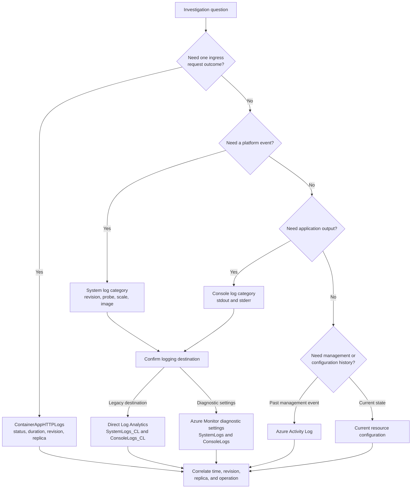

# Evidence Map for Container Apps Troubleshooting

This page maps common investigation questions to the best evidence source, the CLI command to run, and the KQL table/query to use.

Use it when you know **what you need to answer** but not **where to collect proof**.

<!-- diagram-id: use-it-when-you-know-what -->


Select the evidence category first, then use the environment's logging destination to choose the correct system or console table name.

## Why an evidence map

During incidents, teams lose time by checking the wrong signal first.

- HTTP errors are checked in CPU charts
- Startup issues are checked only in app code
- DNS issues are diagnosed without network evidence

An evidence map reduces this by pairing each question with a reproducible command and query.

!!! note "Use CLI and query artifacts for reproducible investigations"
    Since log result capture from the browser is awkward and difficult to maintain, use CLI queries and example outputs.
    This makes investigation reproducible, easier to copy, and easier to interpret.

## Quick Map (Question → Source → Command → Table)

| Question | Best Source | CLI Command | KQL Table |
|---|---|---|---|
| Was the revision restarting? | System logs + Activity Log | `az containerapp revision list --name $APP_NAME --resource-group $RG` | `ContainerAppSystemLogs_CL` |
| Was the app failing health probes? | System logs | `az containerapp logs show --name $APP_NAME --resource-group $RG --type system` | `ContainerAppSystemLogs_CL` |
| Was startup failing? | Console logs | `az containerapp logs show --name $APP_NAME --resource-group $RG --type console` | `ContainerAppConsoleLogs_CL` |
| Was an image pull failing? | System logs | `az containerapp logs show --name $APP_NAME --resource-group $RG --type system` | `ContainerAppSystemLogs_CL` |
| Was scaling not working? | System logs + Metrics | `az containerapp revision list --name $APP_NAME --resource-group $RG` | `ContainerAppSystemLogs_CL` |
| Was there a deployment? | Activity Log | `az monitor activity-log list --resource-group $RG --offset 24h` | Azure Activity Log |
| Was the container killed? | System logs | `az containerapp logs show --name $APP_NAME --resource-group $RG --type system` | `ContainerAppSystemLogs_CL` |
| Were there network errors? | Console logs | `az containerapp logs show --name $APP_NAME --resource-group $RG --type console` | `ContainerAppConsoleLogs_CL` |
| Was ingress configured correctly? | Container App config | `az containerapp show --name $APP_NAME --resource-group $RG --query "properties.configuration.ingress"` | N/A |
| Was managed identity failing? | Console + System logs | `az containerapp logs show --name $APP_NAME --resource-group $RG --type console` | `ContainerAppConsoleLogs_CL` |
| Was a secret missing? | System logs | `az containerapp logs show --name $APP_NAME --resource-group $RG --type system` | `ContainerAppSystemLogs_CL` |
| Was Dapr failing? | System logs | `az containerapp logs show --name $APP_NAME --resource-group $RG --type system` | `ContainerAppSystemLogs_CL` |

## Detailed Evidence Recipes

## 1) Was the revision restarting?

### CLI

```bash
az containerapp revision list --name $APP_NAME --resource-group $RG --output table
az monitor activity-log list --resource-group $RG --offset 24h
```


| Command/Parameter | Purpose |
|---|---|
| `az containerapp revision list` | Lists revision state to identify restarts and correlate affected revisions. |
| `--name` | Selects the container app whose revisions may be restarting. |
| `--output` | Formats the revision inventory as a readable table. |
| `--resource-group` | Selects the resource group containing the app. |
| `az monitor activity-log list` | Lists management-plane changes that may coincide with revision restarts. |
| `--offset` | Restricts Activity Log evidence to the preceding 24 hours. |


### KQL

```kusto
ContainerAppSystemLogs_CL
| where TimeGenerated > ago(24h)
| where ContainerAppName_s == "<app-name>"
| where Reason_s has_any ("ContainerStarted", "ContainerTerminated", "ReplicaRestart")
| project TimeGenerated, RevisionName_s, Reason_s, Log_s
| order by TimeGenerated desc
```

## 2) Was the app failing health probes?

### CLI

```bash
az containerapp logs show --name $APP_NAME --resource-group $RG --type system --tail 100
```


| Command/Parameter | Purpose |
|---|---|
| `az containerapp logs show` | Retrieves platform events that report health-probe failures. |
| `--name` | Selects the container app whose probe behavior is being checked. |
| `--resource-group` | Selects the resource group containing the app. |
| `--tail` | Limits the probe evidence to the 100 most recent system-log lines. |
| `--type` | Selects system logs, where the platform records probe failures. |


### KQL

```kusto
ContainerAppSystemLogs_CL
| where TimeGenerated > ago(6h)
| where ContainerAppName_s == "<app-name>"
| where Reason_s == "ProbeFailed"
| project TimeGenerated, RevisionName_s, Log_s
| order by TimeGenerated desc
```

## 3) Was startup failing?

### CLI

```bash
az containerapp logs show --name $APP_NAME --resource-group $RG --type console --tail 100
```


| Command/Parameter | Purpose |
|---|---|
| `az containerapp logs show` | Retrieves application output that exposes startup exceptions and port-binding errors. |
| `--name` | Selects the container app with the suspected startup failure. |
| `--resource-group` | Selects the resource group containing the app. |
| `--tail` | Limits startup evidence to the 100 most recent console-log lines. |
| `--type` | Selects console logs emitted by the starting application process. |


### KQL

```kusto
ContainerAppConsoleLogs_CL
| where TimeGenerated > ago(6h)
| where ContainerAppName_s == "<app-name>"
| where Log_s has_any ("failed to start", "could not bind", "listen", "startup", "Exception", "Error")
| project TimeGenerated, RevisionName_s, Log_s
| order by TimeGenerated desc
```

## 4) Was an image pull failing?

### CLI

```bash
az containerapp logs show --name $APP_NAME --resource-group $RG --type system --tail 100
```


| Command/Parameter | Purpose |
|---|---|
| `az containerapp logs show` | Retrieves platform events that expose registry authentication, manifest, and pull failures. |
| `--name` | Selects the container app whose image could not be pulled. |
| `--resource-group` | Selects the resource group containing the app. |
| `--tail` | Limits image-pull evidence to the 100 most recent system-log lines. |
| `--type` | Selects system logs, where image-pull lifecycle events are recorded. |


### KQL

```kusto
ContainerAppSystemLogs_CL
| where TimeGenerated > ago(6h)
| where ContainerAppName_s == "<app-name>"
| where Reason_s has_any ("ImagePullBackOff", "ErrImagePull", "PullingImage", "PulledImage")
| project TimeGenerated, RevisionName_s, Reason_s, Log_s
| order by TimeGenerated desc
```

## 5) Was scaling not working?

### CLI

```bash
az containerapp revision list --name $APP_NAME --resource-group $RG --output table
az containerapp show --name $APP_NAME --resource-group $RG --query "properties.template.scale"
```


| Command/Parameter | Purpose |
|---|---|
| `az containerapp revision list` | Lists revision state to compare scaling symptoms across active revisions. |
| `--name` | Selects the container app whose scaling behavior is being investigated. |
| `--output` | Formats the revision inventory as a readable table. |
| `--resource-group` | Selects the resource group containing the app. |
| `az containerapp show` | Reads the deployed scale configuration for the app. |
| `--query` | Returns only `properties.template.scale` for rule and replica-limit inspection. |


### KQL

```kusto
ContainerAppSystemLogs_CL
| where TimeGenerated > ago(24h)
| where ContainerAppName_s == "<app-name>"
| where Reason_s has_any ("KEDAScaleTargetActivated", "KEDAScaleTargetDeactivated", "ScaledReplica")
| project TimeGenerated, RevisionName_s, Reason_s, Log_s
| order by TimeGenerated asc
```

## 6) Was there a deployment?

### CLI

```bash
az monitor activity-log list --resource-group $RG --offset 24h --status Succeeded
az containerapp revision list --name $APP_NAME --resource-group $RG --output table
```


| Command/Parameter | Purpose |
|---|---|
| `az monitor activity-log list` | Lists successful management operations that can prove a deployment occurred. |
| `--offset` | Restricts deployment evidence to the preceding 24 hours. |
| `--resource-group` | Scopes activity and revision evidence to the app's resource group. |
| `--status` | Keeps only successful management operations in the deployment timeline. |
| `az containerapp revision list` | Lists revisions created by recent deployments for timestamp correlation. |
| `--name` | Selects the deployed container app. |
| `--output` | Formats the revision timeline as a readable table. |


### KQL

```kusto
ContainerAppSystemLogs_CL
| where TimeGenerated > ago(24h)
| where ContainerAppName_s == "<app-name>"
| where Reason_s has_any ("RevisionCreated", "ContainerCreated", "PulledImage")
| project TimeGenerated, RevisionName_s, Reason_s, Log_s
| order by TimeGenerated desc
```

## 7) Was the container killed?

### CLI

```bash
az containerapp logs show --name $APP_NAME --resource-group $RG --type system --tail 100
```


| Command/Parameter | Purpose |
|---|---|
| `az containerapp logs show` | Retrieves termination events that expose exit codes and OOM-kill evidence. |
| `--name` | Selects the container app with the suspected killed container. |
| `--resource-group` | Selects the resource group containing the app. |
| `--tail` | Limits termination evidence to the 100 most recent system-log lines. |
| `--type` | Selects system logs, where container termination events are recorded. |


### KQL

```kusto
ContainerAppSystemLogs_CL
| where TimeGenerated > ago(24h)
| where ContainerAppName_s == "<app-name>"
| where Reason_s == "ContainerTerminated"
| where Log_s has_any ("OOMKilled", "exit code", "killed", "terminated")
| project TimeGenerated, RevisionName_s, Log_s
| order by TimeGenerated desc
```

## 8) Were there network errors?

### CLI

```bash
az containerapp logs show --name $APP_NAME --resource-group $RG --type console --tail 100
```


| Command/Parameter | Purpose |
|---|---|
| `az containerapp logs show` | Retrieves application output containing DNS, timeout, and connection errors. |
| `--name` | Selects the container app reporting network failures. |
| `--resource-group` | Selects the resource group containing the app. |
| `--tail` | Limits network evidence to the 100 most recent console-log lines. |
| `--type` | Selects console logs emitted by the application's outbound calls. |


### KQL

```kusto
ContainerAppConsoleLogs_CL
| where TimeGenerated > ago(6h)
| where ContainerAppName_s == "<app-name>"
| where Log_s has_any ("connection refused", "connection reset", "timeout", "DNS", "ECONNRESET", "ETIMEDOUT")
| project TimeGenerated, Log_s
| order by TimeGenerated desc
```

## 9) Was ingress configured correctly?

### CLI

```bash
az containerapp show --name $APP_NAME --resource-group $RG --query "properties.configuration.ingress" --output json
az containerapp show --name $APP_NAME --resource-group $RG --query "properties.configuration.ingress.fqdn" --output tsv
```


| Command/Parameter | Purpose |
|---|---|
| `az containerapp show` | Reads the app's ingress configuration and resolved ingress FQDN. |
| `--name` | Selects the container app whose ingress path is being verified. |
| `--output` | Emits full ingress settings as JSON and the FQDN alone as TSV. |
| `--query` | Selects either the ingress object or its `fqdn` property for the two checks. |
| `--resource-group` | Selects the resource group containing the app. |


### KQL

```kusto
ContainerAppSystemLogs_CL
| where TimeGenerated > ago(6h)
| where ContainerAppName_s == "<app-name>"
| where Log_s has_any ("ingress", "routing", "target port", "external")
| project TimeGenerated, Reason_s, Log_s
| order by TimeGenerated desc
```

## 10) Was managed identity failing?

### CLI

```bash
az containerapp logs show --name $APP_NAME --resource-group $RG --type console --tail 100
az containerapp identity show --name $APP_NAME --resource-group $RG
```


| Command/Parameter | Purpose |
|---|---|
| `az containerapp logs show` | Retrieves application authentication errors for correlation with identity assignment. |
| `--name` | Selects the container app whose managed identity is being tested. |
| `--resource-group` | Selects the resource group containing the app. |
| `--tail` | Limits authentication evidence to the 100 most recent console-log lines. |
| `--type` | Selects console logs emitted by the application's credential flow. |
| `az containerapp identity show` | Displays the identities assigned to the app so missing or incorrect assignments can be detected. |


### KQL

```kusto
ContainerAppConsoleLogs_CL
| where TimeGenerated > ago(6h)
| where ContainerAppName_s == "<app-name>"
| where Log_s has_any ("managed identity", "DefaultAzureCredential", "ManagedIdentityCredential", "token", "unauthorized", "403")
| project TimeGenerated, Log_s
| order by TimeGenerated desc
```

## 11) Was a secret missing?

### CLI

```bash
az containerapp logs show --name $APP_NAME --resource-group $RG --type system --tail 100
az containerapp secret list --name $APP_NAME --resource-group $RG --output table
```


| Command/Parameter | Purpose |
|---|---|
| `az containerapp logs show` | Retrieves platform events that report missing or unresolved secret references. |
| `--name` | Selects the container app whose secret inventory is being checked. |
| `--resource-group` | Selects the resource group containing the app. |
| `--tail` | Limits secret-reference evidence to the 100 most recent system-log lines. |
| `--type` | Selects system logs, where secret resolution failures appear. |
| `az containerapp secret list` | Lists configured secret names without exposing secret values. |
| `--output` | Formats the secret-name inventory as a readable table. |


### KQL

```kusto
ContainerAppSystemLogs_CL
| where TimeGenerated > ago(6h)
| where ContainerAppName_s == "<app-name>"
| where Log_s has_any ("secret", "key vault", "SecretNotFound", "reference")
| project TimeGenerated, Reason_s, Log_s
| order by TimeGenerated desc
```

## 12) Was Dapr failing?

### CLI

```bash
az containerapp logs show --name $APP_NAME --resource-group $RG --type system --tail 100
az containerapp show --name $APP_NAME --resource-group $RG --query "properties.configuration.dapr" --output json
```


| Command/Parameter | Purpose |
|---|---|
| `az containerapp logs show` | Retrieves platform events for Dapr sidecar and component failures. |
| `--name` | Selects the container app whose Dapr integration is being inspected. |
| `--resource-group` | Selects the resource group containing the app. |
| `--tail` | Limits Dapr evidence to the 100 most recent system-log lines. |
| `--type` | Selects system logs, where Dapr sidecar lifecycle events appear. |
| `az containerapp show` | Reads the deployed Dapr configuration for comparison with the log evidence. |
| `--output` | Emits the selected Dapr configuration as JSON. |
| `--query` | Returns only `properties.configuration.dapr` for this check. |


### KQL

```kusto
ContainerAppSystemLogs_CL
| where TimeGenerated > ago(6h)
| where ContainerAppName_s == "<app-name>"
| where Log_s has_any ("dapr", "sidecar", "component", "state store", "pubsub")
| project TimeGenerated, Reason_s, Log_s
| order by TimeGenerated desc
```

## Evidence Quality Checklist

- Keep all evidence in one incident time window.
- Correlate system, console, and activity log signals before selecting a root cause.
- Preserve query text used during the incident for post-incident review.
- Capture command outputs in ticket notes with sensitive identifiers removed.

## See Also

- [Troubleshooting Method](methodology/index.md)
- [Detector Map](methodology/detector-map.md)
- [Architecture Overview](architecture-overview.md)
- [Decision Tree](decision-tree.md)
- [KQL Query Library](kql/index.md)
- [Revision Failures and Startup](kql/system-and-revisions/revision-failures-and-startup.md)
- [Image Pull and Auth Errors](kql/system-and-revisions/image-pull-and-auth-errors.md)
- [Replica Crash Signals](kql/system-and-revisions/replica-crash-signals.md)

## Sources

- [Monitor Azure Container Apps](https://learn.microsoft.com/en-us/azure/container-apps/observability)
- [Azure Container Apps logging](https://learn.microsoft.com/en-us/azure/container-apps/log-options)
- [Azure Monitor metrics overview](https://learn.microsoft.com/en-us/azure/azure-monitor/essentials/data-platform-metrics)
- [Azure Activity Log overview](https://learn.microsoft.com/en-us/azure/azure-monitor/essentials/activity-log)
- [Troubleshoot Azure Container Apps](https://learn.microsoft.com/en-us/azure/container-apps/troubleshooting)
- [Migrate logging to Azure Monitor](https://learn.microsoft.com/en-us/azure/container-apps/migrate-logs-azure-monitor)
- [ContainerAppHTTPLogs table](https://learn.microsoft.com/en-us/azure/azure-monitor/reference/tables/containerapphttplogs)
