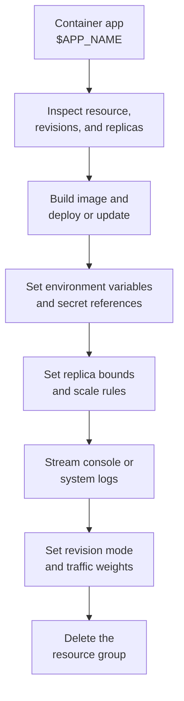

---
content_sources:
  diagrams:
    - id: use-app-name-ca-myapp-for-troubleshooting-examples-in
      type: flowchart
      source: mslearn-adapted
      based_on:
        - https://learn.microsoft.com/en-us/cli/azure/containerapp
        - https://learn.microsoft.com/en-us/azure/container-apps/overview
content_validation:
  status: verified
  last_reviewed: 2026-09-11
  reviewer: ai-agent
  core_claims:
    - claim: Azure Container Apps supports revisions for deploying and managing application versions.
      source: https://learn.microsoft.com/en-us/azure/container-apps/revisions
      verified: true
    - claim: Azure Container Apps supports ingress configuration with a target port.
      source: https://learn.microsoft.com/en-us/azure/container-apps/networking
      verified: true
    - claim: Azure Container Apps supports minimum and maximum replica settings for scaling.
      source: https://learn.microsoft.com/en-us/azure/container-apps/scale-app
      verified: true
    - claim: Azure Container Apps provides console logs and system logs for running apps.
      source: https://learn.microsoft.com/en-us/azure/container-apps/observability
      verified: true
    - claim: Azure Container Apps supports splitting traffic between active revisions.
      source: https://learn.microsoft.com/en-us/azure/container-apps/revisions
      verified: true
---
# CLI Cheatsheet

Use shell variables in examples:

```bash
RG="rg-myapp"
APP_NAME="ca-myapp"
ACA_ENV_NAME="cae-myapp"
ACR_NAME="acrmyapp"
IMAGE_TAG="v1"
```

Use `APP_NAME="ca-myapp"` for troubleshooting examples in this guide.

<!-- diagram-id: use-app-name-ca-myapp-for-troubleshooting-examples-in -->


The sequence groups commands by operator intent; it is a troubleshooting workflow, not a platform dependency graph.

## Inspect

| Task | Command |
| --- | --- |
| Show app config | `az containerapp show --name "$APP_NAME" --resource-group "$RG"` |
| Show provisioning state | `az containerapp show --name "$APP_NAME" --resource-group "$RG" --query provisioningState --output tsv` |
| Get FQDN | `az containerapp show --name "$APP_NAME" --resource-group "$RG" --query properties.configuration.ingress.fqdn --output tsv` |
| List revisions | `az containerapp revision list --name "$APP_NAME" --resource-group "$RG"` |
| Show latest revision state | `az containerapp revision list --name "$APP_NAME" --resource-group "$RG" --query "[0].{name:name,active:properties.active,health:properties.healthState}"` |
| List replicas | `az containerapp replica list --name "$APP_NAME" --resource-group "$RG"` |

Observed output patterns:

```text
$ az containerapp show --name "$APP_NAME" --resource-group "$RG" --query provisioningState --output tsv
Succeeded

$ az containerapp revision list --name "$APP_NAME" --resource-group "$RG" --output table
Name               Active    TrafficWeight    Replicas    HealthState    RunningState
-----------------  --------  ---------------  ----------  -------------  ------------
ca-myapp--0000001  True      100              1           Healthy        Running
```

| Command | Why it is used |
|---|---|
| `az containerapp show --name ...` | Reads the Container App configuration so the documented setting can be verified. |

## Deploy / Update

```bash
# Build image in ACR
az acr build \
  --registry "$ACR_NAME" \
  --image "aca-python-app:${IMAGE_TAG}" \
  .

# Create app
az containerapp create \
  --name "$APP_NAME" \
  --resource-group "$RG" \
  --environment "$ACA_ENV_NAME" \
  --image "${ACR_NAME}.azurecr.io/aca-python-app:${IMAGE_TAG}" \
  --target-port 8000 \
  --ingress external \
  --registry-server "${ACR_NAME}.azurecr.io"

# Update image
az containerapp update \
  --name "$APP_NAME" \
  --resource-group "$RG" \
  --image "${ACR_NAME}.azurecr.io/aca-python-app:v2"
```

| Command | Why it is used |
|---|---|
| `az acr build` | Builds the sample image in Azure Container Registry before the app deployment. |
| `az containerapp create` | Creates the Container App with the built image and external ingress. |
| `az containerapp update` | Creates a new revision from the updated image reference. |
| `--registry` | Selects the ACR instance where `az acr build` runs the remote image build. |
| `--image` | Sets the repository and tag for the built or deployed image. |
| `--name` | Selects the Container App for `az containerapp create` and `az containerapp update`. |
| `--resource-group` | Selects the resource group for `az containerapp create` and `az containerapp update`. |
| `--environment` | Places the app created by `az containerapp create` in the selected Container Apps environment. |
| `--target-port` | Routes `az containerapp create` ingress to port `8000`, where the sample process listens. |
| `--ingress` | Enables external ingress in `az containerapp create`. |
| `--registry-server` | Configures the ACR login server used by `az containerapp create` to pull the image. |

## Configuration / Secrets

```bash
# Set app settings
az containerapp update \
  --name "$APP_NAME" \
  --resource-group "$RG" \
  --set-env-vars "LOG_LEVEL=INFO" "TELEMETRY_MODE=advanced"

# Set secret
az containerapp secret set \
  --name "$APP_NAME" \
  --resource-group "$RG" \
  --secrets "db-connection=<redacted>"

# Bind secret to env var
az containerapp update \
  --name "$APP_NAME" \
  --resource-group "$RG" \
  --set-env-vars "DB_CONNECTION_STRING=secretref:db-connection"
```

| Command | Why it is used |
|---|---|
| `az containerapp update` | Updates environment-variable mappings in the revision template. |
| `az containerapp secret set` | Creates or updates the named app-level secret. |
| `--name` | Selects the Container App whose configuration or secrets change. |
| `--resource-group` | Targets the app whose revision template and secret store are being updated. |
| `--set-env-vars` | Tells `az containerapp update` to write plain values or `secretref:` mappings into the container environment. |
| `--secrets` | Supplies the secret name and redacted example value to `az containerapp secret set`. |

## Scale

```bash
# HTTP scale rule
az containerapp update \
  --name "$APP_NAME" \
  --resource-group "$RG" \
  --min-replicas 1 \
  --max-replicas 10 \
  --scale-rule-name "http-rule" \
  --scale-rule-type http \
  --scale-rule-http-concurrency 50

# Scale to zero
az containerapp update \
  --name "$APP_NAME" \
  --resource-group "$RG" \
  --min-replicas 0
```

| Command | Why it is used |
|---|---|
| `az containerapp update` | Updates replica bounds and the HTTP scaling rule on the app template. |
| `--name` | Selects the Container App whose scale configuration changes. |
| `--resource-group` | Scopes the replica-bound and HTTP-scaler update to the app's resource group. |
| `--min-replicas` | Sets the lower replica bound, including the scale-to-zero example. |
| `--max-replicas` | Caps scale-out at ten replicas in the example. |
| `--scale-rule-name` | Names the HTTP rule so operators can identify it later. |
| `--scale-rule-type` | Selects the HTTP scaler for request-concurrency scaling. |
| `--scale-rule-http-concurrency` | Sets the concurrent-request target used by the HTTP scaler. |

## Logs / Debugging

```bash
# Application logs (stream)
az containerapp logs show \
  --name "$APP_NAME" \
  --resource-group "$RG" \
  --type console \
  --follow

# System logs (startup, pull, probes)
az containerapp logs show \
  --name "$APP_NAME" \
  --resource-group "$RG" \
  --type system

# Exec into running replica
az containerapp exec \
  --name "$APP_NAME" \
  --resource-group "$RG" \
  --command "/bin/bash"
```

| Command | Why it is used |
|---|---|
| `az containerapp logs show` | Streams console output or reads platform system logs for the selected app. |
| `az containerapp exec` | Opens a command inside a running replica for in-container checks. |
| `--name` | Selects the Container App to inspect. |
| `--resource-group` | Locates the app that supplies runtime logs or the replica shell session. |
| `--type` | Chooses the console or system channel for `az containerapp logs show`. |
| `--follow` | Keeps the `az containerapp logs show` console stream open for new messages. |
| `--command` | Tells `az containerapp exec` to start `/bin/bash` inside the selected running container. |

Observed runtime/system snippets:

```text
Starting application...
PORT=8000
Workers=auto
[2026-04-04 11:30:53 +0000] [7] [INFO] Starting gunicorn 25.3.0
[2026-04-04 11:30:53 +0000] [7] [INFO] Listening at: http://0.0.0.0:8000 (7)

Reason_s      Log_s
------------  -----------------------------------------------------------------
PullingImage  Pulling image '<acr-name>.azurecr.io/myapp:v1.0.0'
PulledImage   Successfully pulled image in 2.42s. Image size: 58720256 bytes.
ProbeFailed   Probe of StartUp failed with status code: 1
RevisionReady Revision ready
```

## Revisions / Traffic

```bash
# Enable multiple revision mode
az containerapp revision set-mode \
  --name "$APP_NAME" \
  --resource-group "$RG" \
  --mode multiple

# Split traffic
az containerapp ingress traffic set \
  --name "$APP_NAME" \
  --resource-group "$RG" \
  --revision-weight "${APP_NAME}--rev1=80" "${APP_NAME}--rev2=20"

# Roll back
az containerapp ingress traffic set \
  --name "$APP_NAME" \
  --resource-group "$RG" \
  --revision-weight "${APP_NAME}--rev1=100"
```

| Command | Why it is used |
|---|---|
| `az containerapp revision set-mode` | Enables multiple active revisions before assigning traffic weights. |
| `az containerapp ingress traffic set` | Applies canary or rollback traffic weights to named revisions. |
| `--name` | Selects the Container App whose revision mode or traffic changes. |
| `--resource-group` | Locates the app whose revision mode and traffic allocation are being changed. |
| `--mode` | Sets `az containerapp revision set-mode` to `multiple` for weighted routing. |
| `--revision-weight` | Tells `az containerapp ingress traffic set` to map each named revision to its requested traffic percentage. |

## Cleanup

```bash
az group delete --name "$RG" --yes --no-wait
```

| Command | Why it is used |
|---|---|
| `az group delete` | Removes the example resource group and all resources it contains. |
| `--name` | Selects the example resource group for deletion. |
| `--yes` | Confirms deletion without an interactive prompt. |
| `--no-wait` | Returns immediately while Azure deletes the resource group asynchronously. |

## See Also

- [Repository map](../../start-here/repository-map.md)
## Sources
- [Azure CLI containerapp reference (Microsoft Learn)](https://learn.microsoft.com/en-us/cli/azure/containerapp)
- [Azure Container Apps overview (Microsoft Learn)](https://learn.microsoft.com/en-us/azure/container-apps/overview)
