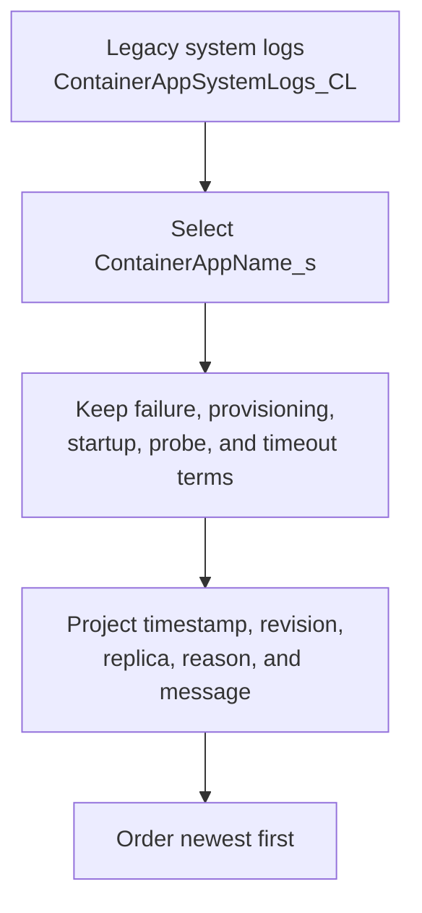

---
content_sources:
  diagrams:
    - id: query-pipeline
      type: flowchart
      source: mslearn-adapted
      based_on:
        - https://learn.microsoft.com/en-us/azure/container-apps/troubleshooting
        - https://learn.microsoft.com/en-us/azure/container-apps/health-probes
        - https://learn.microsoft.com/en-us/azure/container-apps/revisions
content_validation:
  status: verified
  last_reviewed: 2026-09-11
  reviewer: ai-agent
  core_claims:
    - claim: Azure Container Apps can send system logs that record platform events to a Log Analytics workspace.
      source: https://learn.microsoft.com/en-us/azure/container-apps/logging
      verified: true
    - claim: Log Analytics uses Kusto Query Language to filter, summarize, and visualize collected log data.
      source: https://learn.microsoft.com/en-us/azure/azure-monitor/logs/log-analytics-tutorial
      verified: true
---
# Revision Failures and Startup

Use this query when a revision fails to become healthy or startup behavior is unstable.

## Data Source

| Table | Schema Note |
|---|---|
| `ContainerAppSystemLogs_CL` | This query uses the legacy Log Analytics schema (`_CL` table and `_s` columns). Translate both the table and column names before using a resource-specific schema. |

## Query Pipeline

<!-- diagram-id: query-pipeline -->


*Figure: The broad filter finds candidate startup evidence. Diagnose the earliest relevant row for a revision and corroborate it with image, probe, configuration, and application evidence.*

## Query

```kusto
let AppName = "my-container-app";
ContainerAppSystemLogs_CL
| where ContainerAppName_s == AppName
| where Log_s has_any ("Failed", "provision", "startup", "probe", "timeout")
| project TimeGenerated, RevisionName_s, ReplicaName_s, Reason_s, Log_s
| order by TimeGenerated desc
```

## Example Output

| TimeGenerated | RevisionName_s | ReplicaName_s | Reason_s | Log_s |
|---|---|---|---|---|
| 2026-04-12T05:58:04.234Z | ca-cakqltest-54kxmtjeuidri--nu8o2ji | ca-cakqltest-54kxmtjeuidri--nu8o2ji-5cbf89478b-hfgkq | ProbeFailed | Probe of StartUp failed with status code: 1 |
| 2026-04-12T05:57:38.558Z | ca-cakqltest-54kxmtjeuidri--nu8o2ji |  | PullingImage |  |
| 2026-04-12T05:57:38.558Z | ca-cakqltest-54kxmtjeuidri--nu8o2ji |  | PulledImage |  |

## Interpretation Notes

- Focus on earliest failure event for each revision.
- `Reason_s` helps separate config validation failures from runtime startup issues.
- Normal pattern: short startup logs followed by healthy state, not repeated failures.

## Limitations

- System logs can be delayed by ingestion latency.
- Some workspaces use non-`_CL` table names.

## See Also

- [Image Pull and Auth Errors](image-pull-and-auth-errors.md)
- [Revision Provisioning Failure Playbook](../../playbooks/startup-and-provisioning/revision-provisioning-failure.md)

## Sources

- [Microsoft Learn source 1](https://learn.microsoft.com/en-us/azure/container-apps/troubleshooting)
- [Microsoft Learn source 2](https://learn.microsoft.com/en-us/azure/container-apps/health-probes)
- [Microsoft Learn source 3](https://learn.microsoft.com/en-us/azure/container-apps/revisions)
- [Microsoft Learn source 4](https://learn.microsoft.com/en-us/azure/container-apps/logging)
- [Microsoft Learn source 5](https://learn.microsoft.com/en-us/azure/azure-monitor/logs/log-analytics-tutorial)
