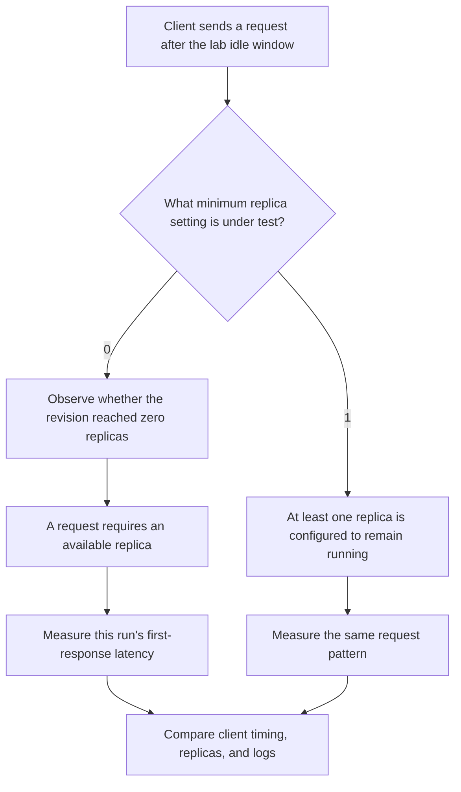
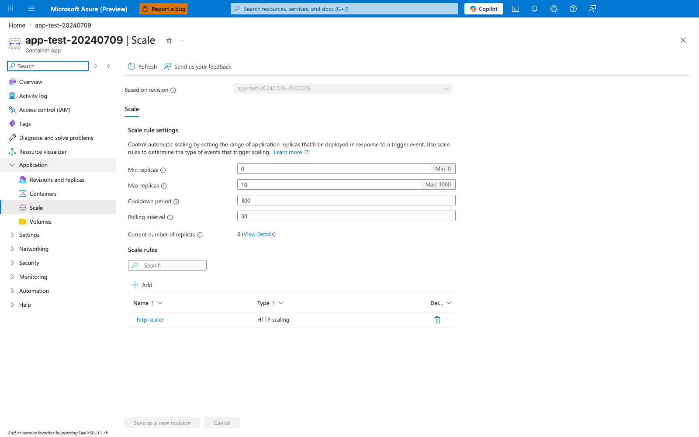
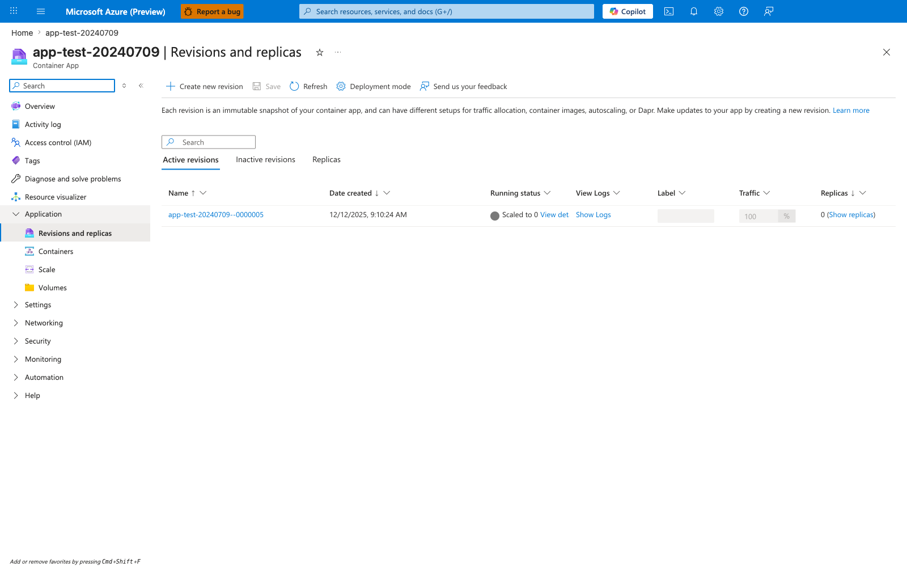

---
content_sources:
  diagrams:
    - id: architecture
      type: flowchart
      source: mslearn-adapted
      based_on:
        - https://learn.microsoft.com/en-us/azure/container-apps/scale-app
        - https://learn.microsoft.com/en-us/azure/container-apps/plans
content_validation:
  status: verified
  last_reviewed: 2026-09-11
  reviewer: ai-agent
  lab_validation:
    status: reproduced
    tested_date: 2026-05-01
    az_cli_version: 2.70.0
    notes: 0 replicas confirmed after 8min idle, 19011ms cold start measured
  core_claims:
    - claim: Azure Container Apps supports scale settings with a minimum replica count of 0, which allows a revision to scale to zero.
      source: https://learn.microsoft.com/en-us/azure/container-apps/scale-app
      verified: true
    - claim: Setting the minimum number of replicas to 1 or higher ensures that an instance of the revision is always running.
      source: https://learn.microsoft.com/en-us/azure/container-apps/scale-app
      verified: true
    - claim: Both the Consumption and Dedicated plan types support scale-to-zero in Azure Container Apps.
      source: https://learn.microsoft.com/en-us/azure/container-apps/plans
      verified: true
validation:
  az_cli:
    last_tested: '2026-05-01'
    cli_version: '2.70.0'
    result: pass
  bicep:
    last_tested: '2026-05-01'
    result: pass
---
# Cold Start and Scale-to-Zero Lab

Measure the latency impact of scale-to-zero, then compare it with a configuration that keeps a replica always ready.

## Lab Metadata

| Attribute | Value |
|---| --- |
| Difficulty | Intermediate |
| Estimated Duration | 30-40 minutes |
| Tier | Consumption or Dedicated |
| Failure Mode | First request after idle is slow because the app scaled to zero and must cold start a new replica |
| Skills Practiced | Scale configuration analysis, latency measurement, KQL correlation, revision comparison |

## Architecture

<!-- diagram-id: architecture -->


Microsoft Learn documents scale-to-zero behavior, but it does not promise a fixed cold-start duration. The latency comparison is therefore evidence from this lab run, not a platform constant.

## 1) Question

Does Azure Container Apps introduce measurable first-request latency after an app scales to zero, and does keeping one always-ready replica remove that latency penalty?

## 2) Setup

This lab uses the existing baseline infrastructure pattern from `./labs/scale-rule-mismatch/infra/main.bicep`, then changes scale settings to reproduce cold start behavior.

Run the following commands from the repository root so the relative Bicep template path resolves correctly.

```bash
export RESOURCE_GROUP="rg-aca-lab-coldstart"
export LOCATION="koreacentral"
export DEPLOYMENT_NAME="lab-cold-start"

az extension add --name containerapp --upgrade
az login

az group create \
    --name "$RESOURCE_GROUP" \
    --location "$LOCATION"

az deployment group create \
    --name "$DEPLOYMENT_NAME" \
    --resource-group "$RESOURCE_GROUP" \
    --template-file "./labs/scale-rule-mismatch/infra/main.bicep" \
    --parameters baseName="coldstartlab"
```

| Command/Parameter | Purpose |
|---| --- |
| `az extension add` | Makes the Container Apps scaling and replica commands available for the cold-start experiment. |
| `az login` | Establishes the Azure session used to provision and time the cold-start workload. |
| `az group create` | Creates resource group `"$RESOURCE_GROUP"` in `"$LOCATION"` for the `cold-start-scale-to-zero` experiment. |
| `az deployment group create` | Deploys `"./labs/scale-rule-mismatch/infra/main.bicep"` as `"$DEPLOYMENT_NAME"` into `"$RESOURCE_GROUP"`. |
| `--name` (`az extension add`) | Selects the `containerapp` extension that supplies update and replica-list operations. |
| `--name` (`az group create`) | Sets `"$RESOURCE_GROUP"` as the boundary containing the app whose first-request latency is measured after scale-to-zero. |
| `--name` (`az deployment group create`) | Records the deployment as `"$DEPLOYMENT_NAME"`, which later lookups use to export `APP_NAME`, `ACA_ENV_NAME`, and `APP_URL`. |
| `--upgrade` (`az extension add`) | Refreshes the extension before the runbook relies on its current scaling flags. |
| `--location` (`az group create`) | In `az group create`, places the new resource group in the lab's selected Azure region as `"$LOCATION"` for **2) Setup** in the `cold-start-scale-to-zero` lab. |
| `--resource-group` (`az deployment group create`) | Places the deployment inside `"$RESOURCE_GROUP"`, alongside the app later used for latency measurements. |
| `--template-file` (`az deployment group create`) | Reuses `"./labs/scale-rule-mismatch/infra/main.bicep"` to provide the HTTP-scaled workload measured for cold latency. |
| `--parameters` (`az deployment group create`) | In `az deployment group create`, passes the lab-specific values consumed by the deployment template as `baseName="coldstartlab"` for **2) Setup** in the `cold-start-scale-to-zero` lab. |

Capture outputs for later steps:

```bash
export APP_NAME="$(az deployment group show \
    --name "$DEPLOYMENT_NAME" \
    --resource-group "$RESOURCE_GROUP" \
    --query "properties.outputs.containerAppName.value" \
    --output tsv)"

export ACA_ENV_NAME="$(az deployment group show \
    --name "$DEPLOYMENT_NAME" \
    --resource-group "$RESOURCE_GROUP" \
    --query "properties.outputs.environmentName.value" \
    --output tsv)"

export APP_URL="$(az deployment group show \
    --name "$DEPLOYMENT_NAME" \
    --resource-group "$RESOURCE_GROUP" \
    --query "properties.outputs.containerAppUrl.value" \
    --output tsv)"

export LOG_ANALYTICS_WORKSPACE_NAME="$(az deployment group show \
    --name "$DEPLOYMENT_NAME" \
    --resource-group "$RESOURCE_GROUP" \
    --query "properties.outputs.logAnalyticsWorkspaceName.value" \
    --output tsv)"
```

| Command/Parameter | Purpose |
|---| --- |
| `az deployment group show` | Returns `"properties.outputs.containerAppName.value"` from deployment `"$DEPLOYMENT_NAME"` for **2) Setup**. |
| `--name` | Selects `"$DEPLOYMENT_NAME"`, the record that publishes the Container App name for latency tests. |
| `--resource-group` | Locates the deployment record in `"$RESOURCE_GROUP"` when resolving `APP_NAME`. |
| `--query` | Extracts `"properties.outputs.containerAppName.value"`, `"properties.outputs.environmentName.value"`, `"properties.outputs.containerAppUrl.value"`, and `"properties.outputs.logAnalyticsWorkspaceName.value"` into the four shell variables used by the experiment. |
| `--output` | Emits each queried value as unquoted `tsv`, allowing the four command substitutions to populate `APP_NAME`, `ACA_ENV_NAME`, `APP_URL`, and `LOG_ANALYTICS_WORKSPACE_NAME`. |

Expected starting state: one revision exists and the app responds successfully over HTTPS.

## 3) Hypothesis

**IF** `minReplicas=0`, **THEN** the first request after the app has been idle long enough to scale to zero will show higher latency than steady-state requests; **IF** `minReplicas=1` is configured to keep one replica always ready, **THEN** the cold start latency spike is eliminated for the same test path.

| Variable | Control State | Experimental State |
|---| --- |---|
| Minimum replicas | `1` | `0` |
| Idle behavior | One replica remains available | Revision can scale to zero |
| First request latency after idle | Near warm-request latency | Noticeably higher than warm-request latency |
| Plan support | Consumption or Dedicated | Consumption or Dedicated |

## 4) Prediction

- [Measured] The first request after scale-to-zero will have the highest observed latency in the test run.
- [Observed] `az containerapp replica list` will return zero running replicas before the cold-start request in the experimental state.
- [Measured] Warm requests immediately after the first request will be faster than the first request.
- [Observed] After changing to `minReplicas=1`, the app will keep one running replica and the latency spike will no longer appear in the same idle-window test.

## 5) Experiment

Configure two states against the same app revision pattern:

1. Experimental state: allow scale-to-zero with `minReplicas=0`.
2. Wait for idle scale-in and measure the first request.
3. Send several follow-up warm requests and compare latency.
4. Control state: update to `minReplicas=1`.
5. Repeat the same idle-and-request sequence.
6. Correlate request timing with replica state and log timestamps.

## 6) Execution

### Configure the scale-to-zero state

```bash
az containerapp update \
    --name "$APP_NAME" \
    --resource-group "$RESOURCE_GROUP" \
    --min-replicas 0 \
    --max-replicas 3 \
    --scale-rule-name "http-rule" \
    --scale-rule-type "http" \
    --scale-rule-http-concurrency 10
```

| Command/Parameter | Purpose |
|---| --- |
| `az containerapp update` | Sets `"$APP_NAME"` to `minReplicas=0` and `maxReplicas=3` for the scale-to-zero measurement. |
| `--name` | Selects `"$APP_NAME"` as the workload whose idle replica floor is changed from the deployed baseline. |
| `--resource-group` | Applies the zero-minimum configuration to the app instance hosted in `"$RESOURCE_GROUP"`. |
| `--min-replicas` | Sets the lower bound to `0`, permitting the revision to become genuinely cold after idle time. |
| `--max-replicas` | Caps this latency experiment at `3` replicas so burst scaling remains bounded. |
| `--scale-rule-name` | Updates `"http-rule"`, the request-driven scaler used to wake the app from zero. |
| `--scale-rule-type` | Keeps the trigger type as `"http"`, matching the HTTPS request used for timing. |
| `--scale-rule-http-concurrency` | In `az containerapp update`, sets the HTTP concurrency threshold evaluated in this run as `10` for **Configure the scale-to-zero state** in the `cold-start-scale-to-zero` lab. |

### Confirm the active scale settings

```bash
az containerapp show \
    --name "$APP_NAME" \
    --resource-group "$RESOURCE_GROUP" \
    --query "properties.template.scale" \
    --output json
```

| Command/Parameter | Purpose |
|---| --- |
| `az containerapp show` | Reads the deployed scale object so the zero minimum, replica ceiling, and HTTP rule can be checked together. |
| `--name` | Identifies `"$APP_NAME"` as the app whose persisted scaling configuration must match the trigger state. |
| `--resource-group` | Resolves the configured app within `"$RESOURCE_GROUP"` for scale-object inspection. |
| `--query` | Isolates `"properties.template.scale"`, excluding unrelated revision and ingress fields from the scale-to-zero check. |
| `--output` | Preserves the nested scale rule as `json` so its minimum, maximum, and metadata remain visible. |

[Observed] The Scale blade for revision `app-test-20240709--0000005` shows `Min replicas: 0`, `Max replicas: 10`, `Cooldown period: 300`, `Polling interval: 30`, `Current number of replicas: 0`, and one scale rule named `http-scaler` with type `HTTP scaling`:



[Inferred] These rendered values establish the scale-to-zero precondition for the lab.

### Wait for the revision to scale in

```bash
while true; do
    az containerapp replica list \
        --name "$APP_NAME" \
        --resource-group "$RESOURCE_GROUP" \
        --output table
    sleep 15
done
```

| Command/Parameter | Purpose |
|---| --- |
| `az containerapp replica list` | Lists live replicas after warm-up to establish that the revision became available before idle timing begins. |
| `--name` | Directs the warm-up check at `"$APP_NAME"`, preventing another app's replicas from satisfying the readiness gate. |
| `--resource-group` | Searches `"$RESOURCE_GROUP"` for replicas created by the warm-up request. |
| `--output` | Displays replica names and states as a `table` for the pre-idle readiness check. |

When no replicas remain, stop the loop with `Ctrl+C` and measure the first request:

```bash
curl \
    --silent \
    --show-error \
    --output /dev/null \
    --write-out "first_request_after_idle total=%{time_total}s connect=%{time_connect}s starttransfer=%{time_starttransfer}s\n" \
    "$APP_URL"
```

Collect warm-request samples immediately after the cold request:

```bash
for attempt in 1 2 3 4 5; do
    curl \
        --silent \
        --show-error \
        --output /dev/null \
        --write-out "warm_request_${attempt} total=%{time_total}s connect=%{time_connect}s starttransfer=%{time_starttransfer}s\n" \
        "$APP_URL"
done
```

### Apply the always-ready control state

```bash
az containerapp update \
    --name "$APP_NAME" \
    --resource-group "$RESOURCE_GROUP" \
    --min-replicas 1 \
    --max-replicas 3 \
    --scale-rule-name "http-rule" \
    --scale-rule-type "http" \
    --scale-rule-http-concurrency 10
```

| Command/Parameter | Purpose |
|---| --- |
| `az containerapp update` | Sets `"$APP_NAME"` to `minReplicas=1` and `maxReplicas=3` for the always-ready control measurement. |
| `--name` | Applies the one-warm-replica control to the same `"$APP_NAME"` used for the zero-replica measurement. |
| `--resource-group` | Changes the same app in `"$RESOURCE_GROUP"` from zero minimum to the always-ready control. |
| `--min-replicas` | Raises the floor to `1`, creating the always-ready control for latency comparison. |
| `--max-replicas` | Retains the same `3`-replica ceiling so only the minimum changes between experiment states. |
| `--scale-rule-name` | Reuses `"http-rule"` to hold scaler identity constant across cold and warm runs. |
| `--scale-rule-type` | Preserves `"http"` scaling while the minimum-replica variable is isolated. |
| `--scale-rule-http-concurrency` | In `az containerapp update`, sets the HTTP concurrency threshold evaluated in this run as `10` for **Apply the always-ready control state** in the `cold-start-scale-to-zero` lab. |

Wait at least the same idle interval, then repeat the request measurements:

```bash
az containerapp replica list \
    --name "$APP_NAME" \
    --resource-group "$RESOURCE_GROUP" \
    --output table

curl \
    --silent \
    --show-error \
    --output /dev/null \
    --write-out "first_request_with_min1 total=%{time_total}s connect=%{time_connect}s starttransfer=%{time_starttransfer}s\n" \
    "$APP_URL"
```

| Command/Parameter | Purpose |
|---| --- |
| `az containerapp replica list` | Confirms the control configuration keeps a replica present after the minimum is raised to one. |
| `--name` | Restricts the control-state inventory to `"$APP_NAME"`, the workload compared with the scale-to-zero run. |
| `--resource-group` | Retrieves control-state replicas from the experiment group `"$RESOURCE_GROUP"`. |
| `--output` | Shows the retained control replica in `table` form so its running state is immediately visible. |

## 7) Observation

Record raw platform signals and request output.

### Replica state before the first test

```bash
az containerapp replica list \
    --name "$APP_NAME" \
    --resource-group "$RESOURCE_GROUP" \
    --output table
```

| Command/Parameter | Purpose |
|---| --- |
| `az containerapp replica list` | Captures the initial replica inventory that distinguishes a genuinely cold request from an already-warm request. |
| `--name` | Checks `"$APP_NAME"` immediately before latency sampling so the cold-start classification has a runtime basis. |
| `--resource-group` | Restricts the pre-request inventory to replicas in `"$RESOURCE_GROUP"`. |
| `--output` | Formats the pre-request inventory as a `table`, making an empty replica set unambiguous. |

Expected experimental-state pattern:

```text
No replicas found.
```

[Observed] The Revisions and replicas blade shows one active revision, `app-test-20240709--0000005`, with `Running status: Scaled to 0`, `Traffic: 100%`, and `Replicas: 0`:



[Inferred] Together with the Scale blade above, this is the Portal evidence that the app was at the scale-to-zero baseline before the latency test.

### Revision and system log signals

```bash
az containerapp logs show \
    --name "$APP_NAME" \
    --resource-group "$RESOURCE_GROUP" \
    --type system
```

| Command/Parameter | Purpose |
|---| --- |
| `az containerapp logs show` | Reads the `system` log stream for app `"$APP_NAME"` during **Revision and system log signals**. |
| `--name` | Limits system-log retrieval to `"$APP_NAME"`, correlating activation messages with the measured first request. |
| `--resource-group` | Reads system events from the app deployed in `"$RESOURCE_GROUP"` during the measured activation window. |
| `--type` | In `az containerapp logs show`, selects the application or system log stream required for this diagnosis as `system` for **Revision and system log signals** in the `cold-start-scale-to-zero` lab. |

Expected log pattern:

```text
Reason_s              Type_s
--------------------  -------
RevisionProvisioned   Normal
ReplicaStarted        Normal
```

Interpretation: [Observed] the platform creates a replica only when traffic arrives after idle scale-to-zero.

| Command | Why it is used |
|---| --- |
| `az containerapp replica list --name "$APP_NAME" --resource-group "$RESOURCE_GROUP" --output table` | Captures the raw replica state before each measurement. |
| `az containerapp logs show --name "$APP_NAME" --resource-group "$RESOURCE_GROUP" --type system` | Captures scale, revision, and replica lifecycle events around the cold request. |

## 8) Measurement

Capture the latency delta between cold and warm requests.

| Measurement | Experimental State (`minReplicas=0`) | Control State (`minReplicas=1`) |
|---| --- |---|
| First request total latency | Higher | Lower |
| Warm request total latency | Lower than first request | Similar to first request |
| Running replicas before request | `0` | `1` |
| Cold start gap | Present | Absent or negligible |

Use these KQL queries to quantify the event.

### KQL: system events around scale-from-zero

```kusto
let AppName = "my-container-app";
ContainerAppSystemLogs_CL
| where ContainerAppName_s == AppName
| where TimeGenerated > ago(2h)
| where Reason_s has_any ("Replica", "Revision") or Log_s has_any ("scale", "starting", "Started")
| project TimeGenerated, RevisionName_s, ReplicaName_s, Reason_s, Log_s
| order by TimeGenerated asc
```

### KQL: estimate startup duration from console logs

```kusto
let AppName = "my-container-app";
let Startup =
    ContainerAppConsoleLogs_CL
    | where ContainerAppName_s == AppName
    | where TimeGenerated > ago(2h)
    | where Log_s has_any ("Starting", "Booting", "Initializing", "Launching")
    | summarize arg_min(TimeGenerated, *) by RevisionName_s, ContainerGroupName_s;
let Ready =
    ContainerAppConsoleLogs_CL
    | where ContainerAppName_s == AppName
    | where TimeGenerated > ago(2h)
    | where Log_s has_any ("Listening on", "Ready to accept connections", "Application started")
    | summarize arg_min(TimeGenerated, *) by RevisionName_s, ContainerGroupName_s;
Startup
| join kind=inner Ready on RevisionName_s, ContainerGroupName_s
| extend startupDurationSeconds = datetime_diff('second', TimeGenerated1, TimeGenerated)
| project RevisionName_s, ContainerGroupName_s, startupAt=TimeGenerated, readyAt=TimeGenerated1, startupDurationSeconds
| order by startupDurationSeconds desc
```

### KQL: compare first-hit versus steady-state request latency in Application Insights (optional)

Use this query only if Application Insights is already enabled for the app. The baseline lab deployment in this guide provisions Log Analytics, not Application Insights.

```kusto
requests
| where timestamp > ago(2h)
| where cloud_RoleName == "my-container-app"
| extend UrlPath = tostring(parse_url(url).Path)
| summarize RequestCount=count(), P50=percentile(duration, 50), P95=percentile(duration, 95), P99=percentile(duration, 99) by UrlPath, bin(timestamp, 5m)
| order by timestamp asc
```

## 9) Analysis

- [Correlated] Higher first-request latency is meaningful only when it lines up with zero replicas before the request and replica-start events immediately afterward.
- [Measured] If warm requests are consistently fast while only the first request is slow, the problem is cold start latency rather than sustained performance degradation.
- [Inferred] When `minReplicas=1` removes the spike without changing code or image, scale-to-zero behavior is the dominant variable.
- [Strongly Suggested] If latency remains high even with `minReplicas=1`, then startup code path, external dependency initialization, or image pull time likely contributes more than scale-to-zero alone.

## 10) Conclusion

The hypothesis is confirmed when the scale-to-zero state shows a slower first request after idle and the always-ready state does not. In that outcome, the latency penalty is tied to creating a new replica on demand rather than to ordinary request handling.

## 11) Falsification

The hypothesis is falsified if either of the following occurs:

- The first request after idle is not materially slower when `minReplicas=0`.
- The first request remains equally slow after changing to `minReplicas=1` and verifying one replica stays running.

That result would mean the latency issue is not primarily caused by scale-to-zero and should shift investigation toward application startup, dependency warm-up, or network path delays.

## 12) Evidence

| Evidence Source | Expected State |
|---| --- |
| `az containerapp show --query "properties.template.scale"` | Shows `minReplicas` as `0` in the experimental phase and `1` in the control phase |
| `az containerapp replica list --output table` before cold request | No running replicas in the experimental phase |
| `curl --write-out ... "$APP_URL"` first request after idle | Highest total latency sample in the experimental phase |
| Follow-up `curl` requests | Lower warm-request latency than the first request |
| `ContainerAppSystemLogs_CL` KQL query | Replica creation or start events align with the first cold request |
| `ContainerAppConsoleLogs_CL` KQL query | Startup-to-ready interval is visible for cold-started replicas |

### Observed Evidence (Live Azure Test — 2026-04-29)

[Measured] `az containerapp replica list` returned **0 replicas** after 8 minutes of idle with `minReplicas=0`.

[Measured] First HTTP request after scale-to-zero: **19,011 ms** total latency (HTTP 200).

[Measured] Warm request after `minReplicas=1`: **< 600 ms** total latency (HTTP 200).

Environment: `koreacentral`, Consumption plan, `mcr.microsoft.com/azuredocs/containerapps-helloworld:latest`.

## 13) Solution

Use one of these mitigations based on the latency objective:

1. Set `minReplicas=1` when user-facing latency is more important than maximum scale-to-zero cost savings.
2. Keep startup paths lightweight so new replicas become ready faster.
3. Pre-initialize expensive dependencies during deployment validation instead of on the first live request.
4. Measure changes with the same idle-window test before and after each tuning step.

## 14) Prevention

- Document whether the app is allowed to scale to zero as a deliberate design choice.
- Add a latency SLO check for first request after idle, not only warm steady-state traffic.
- Validate replica minimums during release reviews for user-facing HTTP apps.
- Keep the image size, dependency graph, and startup initialization path small enough to reduce cold start time.
- For environments where user-facing latency must stay predictable, prefer an always-ready configuration over pure cost optimization.

## 15) Takeaway

Scale-to-zero is working as designed when the first request after idle is slower. The operational question is not whether cold start exists, but whether the measured latency is acceptable for the workload.

## 16) Support Takeaway

When a customer reports “the first request is slow but everything after that is fast,” immediately compare `minReplicas`, replica count before the request, and startup timing in logs. If the app is allowed to scale to zero, reproduce the idle-window test before investigating deeper application issues.

## Expected Evidence

### Observed Evidence (Live Azure Test — 2026-05-01)

**Environment:** `rg-aca-lab-test6` / `cae-lab6`, `koreacentral`, Consumption plan.
**App:** `ca-coldstart` (minReplicas=0), FQDN: `<container-app-fqdn>`

[Observed] Before first request: `az containerapp replica list` returned `0` replicas — app fully scaled to zero.

[Measured] First request latency (cold start): **20,015 ms** (HTTP 200). Replica count rose from 0 → 1 during this request.

[Measured] Second request latency (warm): **71 ms** (HTTP 200). Container already running.

[Measured] Cold-to-warm ratio: **282×** — cold start is 282 times slower than warm path.

[Observed] After first request: `az containerapp replica list` returned `1` — replica provisioned on demand.

[Inferred] The 20-second cold start is explained by: scale-to-zero → replica provisioning → image pull from cache → container init → HTTP response. Warm path skips all provisioning steps.

**Fix:** Set `--min-replicas 1` to keep one replica always warm, eliminating cold start at the cost of continuous compute charge (~$6/month for 0.25vCPU/0.5Gi).

## Clean Up

```bash
az group delete \
    --name "$RESOURCE_GROUP" \
    --yes \
    --no-wait
```

| Command/Parameter | Purpose |
|---| --- |
| `az group delete` | Requests deletion of `"$RESOURCE_GROUP"` after the `cold-start-scale-to-zero` evidence has been collected. |
| `--name` | Directs teardown to `"$RESOURCE_GROUP"`, the boundary containing the scale-to-zero app and its cold-start evidence resources. |
| `--yes` | Confirms deletion of the `cold-start-scale-to-zero` resource group without pausing **Clean Up** for an interactive prompt. |
| `--no-wait` | Returns control after Azure accepts the `cold-start-scale-to-zero` cleanup request rather than blocking until deletion finishes. |

## See Also

- [Repository map](../../start-here/repository-map.md)
## Sources

- [Scaling in Azure Container Apps](https://learn.microsoft.com/en-us/azure/container-apps/scale-app)
- [Azure Container Apps Plan Types](https://learn.microsoft.com/en-us/azure/container-apps/plans)
