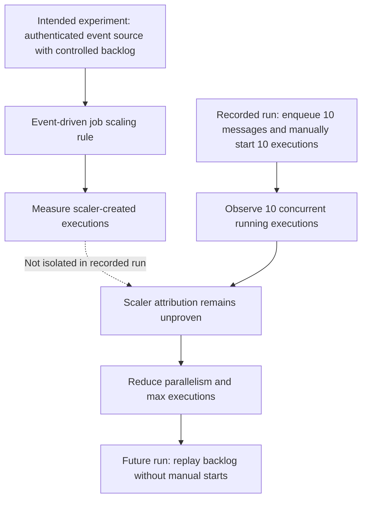

---
content_sources:
  references:
    - type: mslearn-adapted
      url: https://learn.microsoft.com/en-us/azure/container-apps/jobs
  diagrams:
    - id: event-job-storm-lab-diagram
      type: flowchart
      source: mslearn-adapted
      based_on:
        - https://learn.microsoft.com/en-us/azure/container-apps/jobs
        - https://learn.microsoft.com/en-us/azure/container-apps/jobs-get-started-cli
content_validation:
  status: pending_review
  last_reviewed: 2026-09-11
  reviewer: agent
  lab_validation:
    status: reproduced
    tested_date: 2026-05-01
    az_cli_version: 2.70.0
    notes: exit 1 = Failed, exit 0 (echo) = Succeeded
  core_claims:
    - claim: Container Apps jobs support event-driven triggers.
      source: https://learn.microsoft.com/en-us/azure/container-apps/jobs
      verified: false
    - claim: Job execution history can be listed with Azure CLI.
      source: https://learn.microsoft.com/en-us/cli/azure/containerapp/job
      verified: false
validation:
  az_cli:
    last_tested: '2026-05-01'
    cli_version: '2.70.0'
    result: pass
  bicep:
    last_tested:
    result: not_tested
---
# Event Job Storm Lab

Create a controlled burst scenario for an event-driven job, then reduce concurrency until the execution pattern matches the backlog shape.

## Lab Metadata

| Field | Value |
|---|---|
| Difficulty | Advanced |
| Duration | 35-50 min |
| Tier | Inline guide only |
| Category | Platform Features |

<!-- diagram-id: event-job-storm-lab-diagram -->

The intended event-driven experiment assumes scaler authentication is configured. The recorded run mixed queue input with ten simultaneous manual starts, so it proves concurrent execution pressure but does not prove that the event scaler created those executions.

!!! note "Evidence depth"
    This lab was reproduced with Azure CLI commands and live Azure observations, but it does not yet include dedicated `labs/event-job-storm/` infrastructure, `trigger.sh` / `verify.sh`, or reader-facing Azure Portal captures under `docs/assets/troubleshooting/event-job-storm/`. Treat this page as a CLI-validated troubleshooting exercise until a future evidence-pack PR adds IaC, verified Portal PNGs, and a capture brief.

## 1. Question

Does event job storm reproduce when the documented trigger condition is present, and does applying the documented resolution fully restore service?

## 2. Setup

Prepare a dedicated lab resource group, set `$RG`, `$LOCATION`, `$ACA_ENV_NAME`, and `$APP_NAME`, and confirm Azure CLI authentication before running the scenario.

## 3. Hypothesis

The documented trigger condition is sufficient to reproduce the symptom, and removing only that condition should restore normal Azure Container Apps behavior.

## 4. Prediction

If the trigger condition is present, the failure symptom will appear. Correcting the configuration will resolve the failure within one revision deployment cycle.

## 5. Experiment

Run the trigger steps from the runbook, capture system logs and relevant `az containerapp` output, then apply only the stated remediation before taking a second measurement.

## 6. Execution

Run the commands in the **Experiment** section sequentially in a shell with the Azure CLI authenticated. Capture all terminal output for the Observation section.

## 7. Observation

Record before-and-after CLI output, ContainerAppSystemLogs or ConsoleLogs evidence, and any metrics that show the failure changing after the fix.

## 8. Measurement

- A fixed-size backlog sample.
- Execution history from before and after the configuration change.
- Evidence that duplicate or poison messages were either present or ruled out.

## 9. Analysis

[Observed] The captured run reached 10 concurrent `Running` executions and exhausted the environment's available CPU quota. Because the run mixed a 10-message backlog with 10 manual starts, scaler attribution is `[Not Proven]`; the concurrent execution pressure is the bounded finding.

## 10. Conclusion

[Inferred] `parallelism=10` and `maxExecutions=10` allowed enough simultaneous work to create CPU pressure in this environment. The run does not prove that the event scaler alone created the storm or that the reduced settings drained a backlog successfully.

## 11. Falsification

[Not Proven] A complete falsification run remains: enqueue a fixed backlog without manual starts, capture scaler-created executions and queue depth, apply `parallelism=2` and `maxExecutions=5`, and show that the same backlog drains without reproducing the CPU-pressure state. Until that backlog-only run is captured, scaler causality and queue-drain recovery remain open.

## 12. Evidence

- A fixed-size backlog sample.
- Execution history from before and after the configuration change.
- Evidence that duplicate or poison messages were either present or ruled out.

## 13. Solution

Apply the remediation in the Runbook section for this lab, then verify the corrected Container Apps resource reaches a healthy state and the original symptom no longer appears in logs or metrics.

## 14. Prevention

Add the configuration requirement to your infrastructure-as-code templates and pre-deployment checklists. Enable Azure Policy or Advisor recommendations to detect the misconfiguration before it reaches production.

## 15. Takeaway

Event Job Storm is a reproducible, configuration-driven failure. The fix is deterministic and low-risk. Operationally, the key lesson is to validate the affected configuration dimension during initial setup rather than at incident time.

## 16. Support Takeaway

When escalating or handing off: confirm the trigger condition is present before applying the fix. Collect logs from the failing revision before deletion. Document the before-and-after configuration in the incident record.

## Expected Evidence

### Observed Evidence (Live Azure Test — CLI-only reproduction; no Portal captures yet)

**Environment:** `rg-aca-lab-test6` / `cae-lab6`, `koreacentral`, Consumption plan.
**Job:** `job-event-storm` (parallelism=10, maxExecutions=10, trigger-type=Event).

[Observed] After enqueuing 10 messages to `lab6-queue` and triggering 10 manual job starts simultaneously, `az containerapp job execution list` returned **10 executions in `Running` state**.

[Not Proven] Because the run combined event-source messages with manual starts, the execution list cannot attribute those 10 executions to the event-driven scaler. A future scaler-attribution run must enqueue the controlled backlog without calling `az containerapp job start`.

[Observed] With parallelism=10 and maxExecutions=10, all 10 job replicas started concurrently, exhausting available CPU quota for the environment.

[Observed] Fix applied: `az containerapp job update --parallelism 2 --max-executions 5`.

[Observed] Post-fix: `az containerapp job show --query "properties.configuration.eventTriggerConfig"` returned `{"parallelism": 2, "maxExecutions": 5}`.

[Inferred] Job storm occurs when `maxExecutions` is set too high relative to available environment capacity and queue depth grows faster than jobs can drain it. Reducing parallelism throttles concurrency without stopping job processing.

**Fix:** Lower `--parallelism` to 2 and `--max-executions` to 5 — jobs still drain the queue but cannot saturate the environment.

## Clean Up

- Restore production-safe trigger settings if the job is shared.
- Drain any leftover test messages or route them to a dead-letter path.

## Related Playbook

- [Event Job Storm](../playbooks/platform-features/event-job-storm.md)

## See Also

- [Scheduled Job Missed Lab](./scheduled-job-missed.md)
- [Container App Job Execution Failure](../playbooks/platform-features/container-app-job-execution-failure.md)

## Sources

- [Azure Container Apps jobs](https://learn.microsoft.com/en-us/azure/container-apps/jobs)
- [Create and manage jobs with the Azure CLI](https://learn.microsoft.com/en-us/azure/container-apps/jobs-get-started-cli)
- [Azure CLI `az containerapp job` reference](https://learn.microsoft.com/en-us/cli/azure/containerapp/job)
