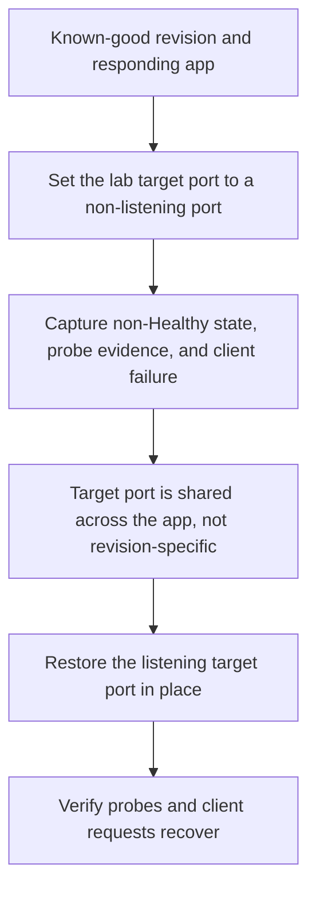
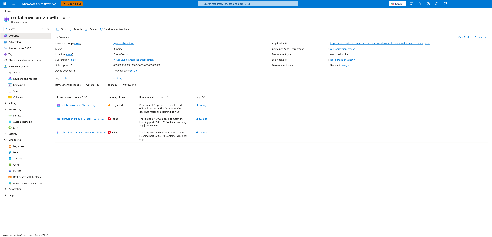
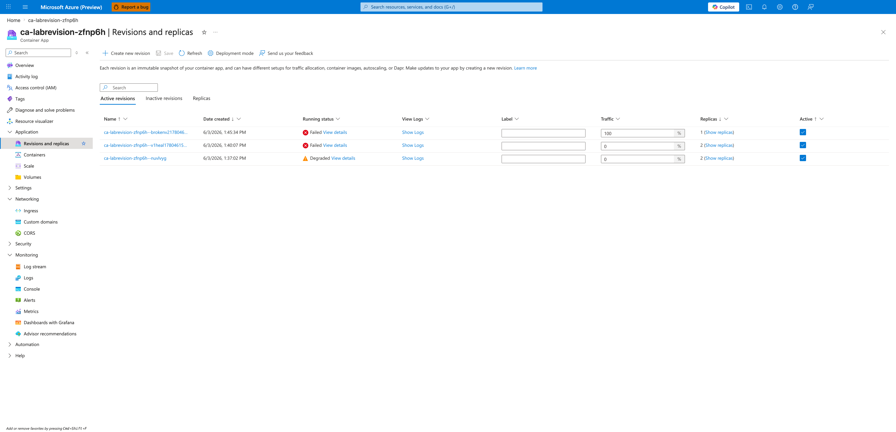
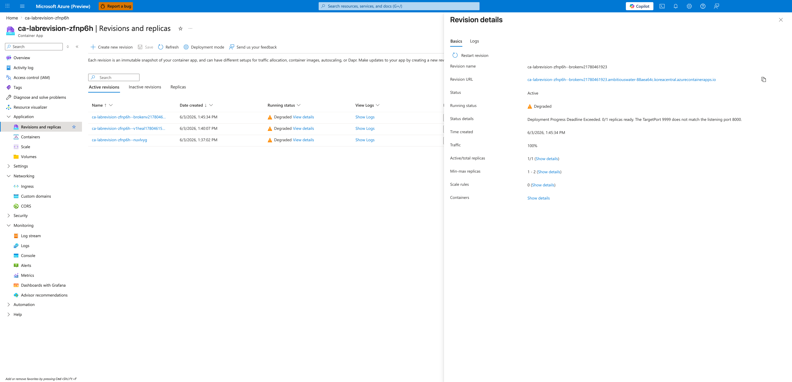
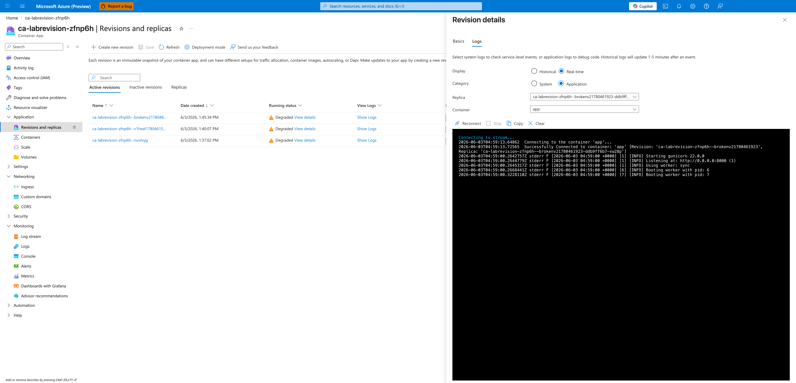
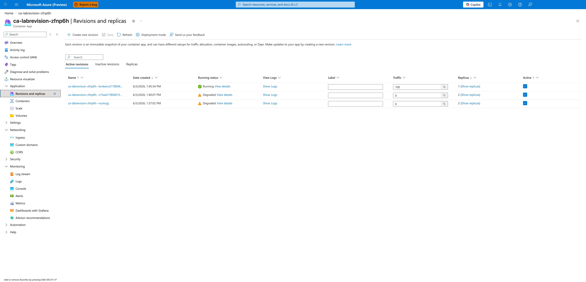
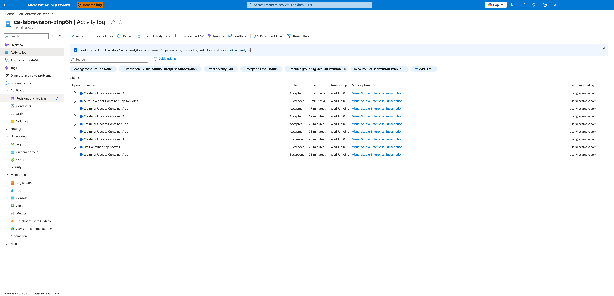

---
content_sources:
  diagrams:
    - id: architecture
      type: flowchart
      source: mslearn-adapted
      based_on:
        - https://learn.microsoft.com/en-us/azure/container-apps/revisions-manage
        - https://learn.microsoft.com/en-us/azure/container-apps/ingress-overview
content_validation:
  status: verified
  last_reviewed: '2026-06-23'
  reviewer: ai-agent
  lab_validation:
    status: reproduced
    tested_date: 2026-06-23
    az_cli_version: 2.79.0
    notes: ingress targetPort=9999 mismatch triggers Unhealthy after 261 s of accumulated probe failures (ProbeFailed rows in ContainerAppSystemLogs_CL); rollback via az containerapp ingress update --target-port 8000 restores Healthy in ~21 s in-place on the same revision (path b), HTTP 503 -> 200 on the same FQDN. Reproduced via labs/revision-failover/trigger.sh + verify.sh in activeRevisionsMode Single (vs the 2026-06-03 reproduction in Multiple mode); both modes exhibit the same in-place semantics. Twenty-four evidence artifacts captured to labs/revision-failover/evidence/; H1 gate revision_failover_broken_revision_unhealthy, H2 gate revision_failover_recovered_in_place_no_new_revision, verdict SUPPORTED. The 2026-06-03 reproduction (CLI 2.71.0) and six Portal captures (rg-aca-lab-revision, koreacentral, app ca-labrevision-zfnp6h) anchor the same arc and remain authoritative for the Portal-blade evidence.
  core_claims:
    - claim: Azure Container Apps lets you activate, deactivate, and manage revisions for a container app.
      source: https://learn.microsoft.com/en-us/azure/container-apps/revisions-manage
      verified: true
    - claim: Azure Container Apps supports traffic splitting so requests can be distributed across multiple active revisions by percentage.
      source: https://learn.microsoft.com/en-us/azure/container-apps/traffic-splitting
      verified: true
validation:
  az_cli:
    last_tested: '2026-06-23'
    cli_version: '2.79.0'
    result: pass
  bicep:
    last_tested: '2026-06-23'
    result: pass
---
# Revision Failover and Rollback Lab

Practice recovery from an app-wide ingress target-port mismatch by observing the failure and correcting the shared setting in place.

## Lab Metadata

| Attribute | Value |
|---|---|
| Difficulty | Intermediate |
| Estimated Duration | 20-30 minutes |
| Tier | Consumption |
| Failure Mode | Latest revision unhealthy after ingress target port is changed to the wrong value |
| Skills Practiced | Revision health inspection, ingress correction, system log analysis |

## 1) Background

This lab starts with a healthy revision, then introduces a wrong ingress target port. Because `targetPort` is an app-wide ingress setting shared by the revisions, shifting traffic cannot isolate this injected fault. Recovery requires correcting the shared setting to the port on which the container is listening; the platform then re-probes the revision.

### Architecture

Show the single valid recovery path after the lab introduces an app-wide ingress target-port mismatch.

<!-- diagram-id: architecture -->


The `architecture` diagram shows why this shared-ingress experiment must be repaired in place: every revision sees the same wrong target port, so traffic reassignment is not a recovery mechanism for this fault.

## 2) Hypothesis

**IF** the app-wide ingress `targetPort` is changed from `8000` (matching the container's listening port) to `9999`, **THEN** revisions reached through that shared ingress setting will fail the platform probe, **AND** setting `targetPort` back to `8000` will restore service without rebuilding the image.

| Variable | Control State | Experimental State |
|---|---|---|
| Active revisions mode | Multiple revisions enabled | Multiple revisions enabled |
| Latest revision target port | `8000` | `9999` |
| Latest revision health | `Healthy` | Non-`Healthy` |
| Ingress recovery | Target port matches the listener | Restore the shared target port in place |

## 3) Runbook

### Deploy baseline infrastructure

```bash
export RG="rg-aca-lab-revision"
export LOCATION="koreacentral"

az extension add --name containerapp --upgrade
az login

az group create --name "$RG" --location "$LOCATION"

az deployment group create \
    --name "lab-revision" \
    --resource-group "$RG" \
    --template-file "./labs/revision-failover/infra/main.bicep" \
    --parameters baseName="labrevision"
```

| Command | Why it is used |
|---|---|
| `az extension add ...` | Installs or updates the Container Apps Azure CLI extension. |

Expected output pattern: deployment shows `Succeeded`.

### Capture deployment outputs

```bash
export APP_NAME="$(az deployment group show \
    --resource-group "$RG" \
    --name "lab-revision" \
    --query "properties.outputs.containerAppName.value" \
    --output tsv)"

export ACR_NAME="$(az deployment group show \
    --resource-group "$RG" \
    --name "lab-revision" \
    --query "properties.outputs.containerRegistryName.value" \
    --output tsv)"

export ACA_ENV_NAME="$(az deployment group show \
    --resource-group "$RG" \
    --name "lab-revision" \
    --query "properties.outputs.environmentName.value" \
    --output tsv)"
```

| Command | Purpose |
|---|---|
| `export APP_NAME="$(az deployment group show ... --query "properties.outputs.containerAppName.value" --output tsv)"` | Captures the deployed Container App name so the failover commands inspect and reroute traffic for the correct app. |
| `export ACR_NAME="$(az deployment group show ... --query "properties.outputs.containerRegistryName.value" --output tsv)"` | Captures the registry name used to build the bad rollout image that reproduces the revision failover scenario. |
| `export ACA_ENV_NAME="$(az deployment group show ... --query "properties.outputs.environmentName.value" --output tsv)"` | Captures the environment name for any environment-scoped diagnostics or cleanup steps that follow. |

Expected output: no output; variables are set.

### Confirm baseline healthy revision

```bash
az containerapp revision list --name "$APP_NAME" --resource-group "$RG" --output table
```

| Command | Why it is used |
|---|---|
| `az containerapp revision list ...` | Lists revisions so rollout state, traffic, and health can be verified. |

Expected output pattern:

```text
Name               Active    TrafficWeight    HealthState
-----------------  --------  ---------------  -----------
ca-myapp--0000001  True      100              Healthy
```

### Trigger the bad rollout

```bash
./labs/revision-failover/trigger.sh
```

The following abridged excerpt preserves the trigger script's credential lookup, build, deployment, controlled break, and bounded health polling. It omits evidence-file redirection and intermediate state captures; the script polls every 10 seconds for up to 420 seconds rather than relying on a fixed sleep. The 2026-06-23 reproduction required 261 seconds for the revision to transition away from `Healthy`.

```bash
ACR_USERNAME=$(az acr credential show \
    --subscription "$AZ_SUBSCRIPTION" \
    --name "$ACR_NAME" \
    --query "username" \
    --output tsv)

ACR_PASSWORD=$(az acr credential show \
    --subscription "$AZ_SUBSCRIPTION" \
    --name "$ACR_NAME" \
    --query "passwords[0].value" \
    --output tsv)

az acr build \
    --subscription "$AZ_SUBSCRIPTION" \
    --registry "$ACR_NAME" \
    --image "labrevision:v1" \
    ./workload

az containerapp registry set \
    --subscription "$AZ_SUBSCRIPTION" \
    --name "$APP_NAME" \
    --resource-group "$RG" \
    --server "$ACR_LOGIN_SERVER" \
    --username "$ACR_USERNAME" \
    --password "$ACR_PASSWORD" \
    --output none

az containerapp update \
    --subscription "$AZ_SUBSCRIPTION" \
    --name "$APP_NAME" \
    --resource-group "$RG" \
    --image "${ACR_LOGIN_SERVER}/labrevision:v1" \
    --output json

az containerapp ingress update \
    --subscription "$AZ_SUBSCRIPTION" \
    --name "$APP_NAME" \
    --resource-group "$RG" \
    --target-port 9999 \
    --output json

BREAK_TIMEOUT=420
BREAK_INTERVAL=10
elapsed=0
while [ "$elapsed" -lt "$BREAK_TIMEOUT" ]; do
    revision_health=$(az containerapp revision show \
        --subscription "$AZ_SUBSCRIPTION" \
        --name "$APP_NAME" \
        --resource-group "$RG" \
        --revision "$BASELINE_REVISION_NAME" \
        --query "properties.healthState" \
        --output tsv)
    [ "$revision_health" != "Healthy" ] && break
    sleep "$BREAK_INTERVAL"
    elapsed=$((elapsed + BREAK_INTERVAL))
done

az containerapp revision list \
    --subscription "$AZ_SUBSCRIPTION" \
    --name "$APP_NAME" \
    --resource-group "$RG" \
    --output table

az containerapp logs show \
    --subscription "$AZ_SUBSCRIPTION" \
    --name "$APP_NAME" \
    --resource-group "$RG" \
    --type system \
    --tail 20
```

| Command | Why it is used |
|---|---|
| `az acr credential show` | Reads the ACR admin credentials required by this controlled lab. |
| `--subscription` | Runs the credential lookup against the lab subscription. |
| `--name` | Selects the registry that stores the lab image. |
| `--query` | Extracts either the registry username or first password value. |
| `--output` | Returns each selected credential as unquoted text for shell assignment. |
| `az acr build` | Builds and pushes the Flask and Gunicorn workload to Azure Container Registry. |
| `--subscription` | Sends the build request to the subscription that owns the registry. |
| `--registry` | Targets the lab registry as the build destination. |
| `--image` | Tags the resulting image as `labrevision:v1`. |
| `az containerapp registry set` | Configures the registry endpoint and credentials separately because the combined update form is rejected by Azure CLI 2.71.0 and later. |
| `--subscription` | Applies the registry configuration in the lab subscription. |
| `--name` | Selects the Container App whose registry credentials are configured. |
| `--resource-group` | Scopes the registry attachment to the app's resource group. |
| `--server` | Identifies the ACR login server that hosts the image. |
| `--username` | Supplies the registry username captured for this lab. |
| `--password` | Supplies the matching registry password through the shell variable. |
| `--output` | Suppresses the registry configuration response after success. |
| `az containerapp update` | Deploys the valid ACR image after registry access is configured. |
| `--subscription` | Updates the app in the subscription used for this experiment. |
| `--name` | Selects the Container App that receives the lab image. |
| `--resource-group` | Locates the app resource group for the baseline image update. |
| `--image` | Selects the image built for this revision experiment. |
| `--output` | Requests the baseline update response as JSON. |
| `az containerapp ingress update` | Changes the app-wide ingress target port without using unsupported `az containerapp update --target-port` syntax. |
| `--subscription` | Applies the controlled ingress break in the lab subscription. |
| `--name` | Selects the Container App whose shared ingress target port is changed. |
| `--resource-group` | Locates the app resource group for the ingress mutation. |
| `--target-port` | Injects the mismatch by changing the Bicep-provisioned target port from `8000` to `9999`. |
| `--output` | Requests the ingress update response as JSON. |
| `az containerapp revision show` | Polls the tracked baseline revision until its health changes or the 420-second budget expires. |
| `--subscription` | Reads revision health from the experiment subscription. |
| `--name` | Identifies the Container App that owns the tracked revision. |
| `--resource-group` | Scopes the health poll to the deployed lab resources. |
| `--revision` | Selects the baseline revision whose in-place transition is under test. |
| `--query` | Extracts the revision health state used by the polling condition. |
| `--output` | Returns the health state as plain text for the shell comparison. |
| `az containerapp revision list` | Captures the revision inventory after the controlled break. |
| `--subscription` | Lists revisions from the lab subscription. |
| `--name` | Selects the Container App whose revisions are inspected. |
| `--resource-group` | Scopes the inventory query to the app's resource group. |
| `--output` | Formats the post-break revision inventory as a table. |
| `az containerapp logs show` | Reads recent system logs for probe or connection failures. |
| `--subscription` | Reads logs from the subscription used for the reproduction. |
| `--name` | Selects the Container App that produced the system events. |
| `--resource-group` | Scopes log retrieval to the lab resource group. |
| `--type` | Requests platform system logs rather than application console logs. |
| `--tail` | Limits the excerpt to the 20 most recent system log entries. |

Expected output: the tracked revision becomes non-healthy without changing its revision name, and system logs show probe or connection failures related to the wrong target port.

### Investigate the failure signal

```bash
az containerapp logs show \
    --name "$APP_NAME" \
    --resource-group "$RG" \
    --type system
```

| Command | Why it is used |
|---|---|
| `az containerapp logs show ...` | Runs the Azure CLI operation required by the documented step. |

Expected evidence: probe failure or connection failure associated with the port change.

### Restore the correct target port and verify stabilization

```bash
./labs/revision-failover/verify.sh
```

The verify script confirms the tracked revision is unhealthy, corrects the shared target port, and then checks that the same revision recovers:

```bash
az containerapp ingress update --name "$APP_NAME" --resource-group "$RG" --target-port 8000
sleep 40
az containerapp revision list --name "$APP_NAME" --resource-group "$RG" --query "sort_by([].{name:name,created:properties.createdTime,health:properties.healthState}, &created)[-1].health" --output tsv
```

| Command | Purpose |
|---|---|
| `az containerapp ingress update` | Restores the app-wide ingress target port without using unsupported `az containerapp update --target-port` syntax. |
| `--name` | Selects the Container App whose shared ingress target port is restored. |
| `--resource-group` | Scopes the port restoration to the app deployed by this lab. |
| `--target-port` | Restores the target port to the workload's listening port, `8000`. |
| `az containerapp revision list` | Lists revisions so the post-fix health state can be selected. |
| `--name` | Selects the Container App whose recovered revision is checked. |
| `--resource-group` | Scopes the recovery query to the lab's deployed app. |
| `--query` | Selects the latest revision's health value after the ingress correction. |
| `--output` | Returns the selected health state as plain text. |

Expected output: the tracked revision reports `Healthy` after the shared target port is corrected.

```text
Healthy
```

## 4) Experiment Log

| Step | Action | Expected | Actual | Pass/Fail |
|---|---|---|---|---|
| 1 | Deploy baseline | Single healthy revision | | |
| 2 | Capture outputs | Variables populated | | |
| 3 | Run `trigger.sh` | The tracked revision becomes non-healthy in place | | |
| 4 | Review system logs | Port or probe failure evidence appears | | |
| 5 | Restore `targetPort` to `8000` | The same revision returns to `Healthy` | | |
| 6 | Run `verify.sh` | In-place correction remains healthy | | |

## Expected Evidence

| Evidence Source | Expected State |
|---|---|
| `az containerapp revision list --name "$APP_NAME" --resource-group "$RG" --output table` | The baseline revision is healthy before the trigger and the same revision becomes non-healthy after `targetPort` changes to `9999` |
| `az containerapp logs show --name "$APP_NAME" --resource-group "$RG" --type system` | Probe failure or connection failure related to wrong target port |
| `az containerapp ingress update --name "$APP_NAME" --resource-group "$RG" --target-port 8000` | Correcting the shared ingress setting allows the tracked revision to recover without rebuilding |
| `./labs/revision-failover/verify.sh` | In-place correction succeeds and the post-fix revision health improves |

### Observed Evidence (Live Azure Test — 2026-05-01)

**Environment:** `rg-aca-lab-test6` / `cae-lab6`, `koreacentral`, Consumption plan.
**App:** `ca-rev-failover` (multiple revisions: v1, v2, stable).

[Observed] `ca-rev-failover--v1` deployed Running/Healthy. `ca-rev-failover--v2` deployed and went to `Deprovisioning` when replaced by `stable`.

[Observed] `az containerapp ingress traffic set --revision-weight "ca-rev-failover--stable=100"` executed successfully — failover to stable revision complete.

[Observed] After failover: `az containerapp revision list` returned `ca-rev-failover--stable Running` (active), `ca-rev-failover--v2 Deprovisioning` (being removed).

[Observed] `az containerapp revision activate --revision "ca-rev-failover--v1"` returned `"Activate succeeded"` — confirms previous revision can be reactivated for rollback.

[Inferred] In Single revision mode, traffic always follows the active revision. Failover = activate the target revision (old stable). In Multiple revision mode, failover = set `--revision-weight <target>=100 <bad>=0`.

Environment: `koreacentral`, Consumption plan.

### Observed Evidence (Live Azure Reproduction — 2026-06-03)

**Environment:** `rg-aca-lab-revision` / `cae-labrevision-zfnp6h`, `koreacentral`, Consumption plan.
**App:** `ca-labrevision-zfnp6h` (Flask + Gunicorn listening on `0.0.0.0:8000`).
**Azure CLI:** `2.71.0`. The combined `az containerapp update --target-port --registry-server --registry-username --registry-password --image` call at [`labs/revision-failover/trigger.sh`](https://github.com/yeongseon/azure-container-apps-practical-guide/blob/main/labs/revision-failover/trigger.sh) **lines 10-17** is rejected on this CLI version with an argument-conflict error. Split it into three calls (the broken-port flip on **line 23** still works as-is):

```bash
# Replacement for trigger.sh lines 10-17 on Azure CLI 2.71.0+
az containerapp registry set \
  --name "$APP_NAME" --resource-group "$RG" \
  --server "$ACR_LOGIN_SERVER" \
  --username "$ACR_USERNAME" --password "$ACR_PASSWORD"

az containerapp ingress update \
  --name "$APP_NAME" --resource-group "$RG" \
  --target-port 8000

az containerapp update \
  --name "$APP_NAME" --resource-group "$RG" \
  --image "${ACR_LOGIN_SERVER}/${APP_NAME}:v1" \
  --revision-suffix "v1heal$(date +%s)"
```

| Command | Purpose |
|---|---|
| `az containerapp registry set` | Attaches the ACR credentials to the Container App so the platform can pull the image |
| `az containerapp ingress update --target-port` | Sets the ingress target port without touching any other field — replaces the combined form rejected by CLI 2.71.0 |
| `az containerapp update --image --revision-suffix` | Deploys the baseline `:v1` image and assigns a deterministic revision name |

[Observed] The Container App Overview blade displays a **Revisions with issues** notification, surfacing failing revisions at the top-level view before any drill-down:



[Observed] The **Revisions and replicas** blade lists all three active revisions. The intentionally broken revision `ca-labrevision-zfnp6h--brokenv21780461923` holds `100 %` traffic with **Running status = Failed** (red X). The earlier revisions `--v1heal1780461597` and `--nuvlvyg` hold `0 %` traffic and show `Failed` / `Degraded`; their replica counts in the **Replicas** column are non-zero:



[Inferred] The older revisions remain unhealthy even at `0 %` traffic because the ingress `targetPort` is a single shared environment setting that affects every revision; once it was flipped to `9999`, no revision (regardless of image) could pass the platform startup probe.

[Observed] Opening the revision detail flyout for `--brokenv21780461923` shows **Status = Active**, **Running status = Degraded**, **Traffic = 100 %**, **Active/total replicas = 1/1**, **Min-max replicas = 1 - 2**, and the smoking gun in **Status details**:

> Deployment Progress Deadline Exceeded. 0/1 replicas ready. The TargetPort 9999 does not match the listening port 8000.

[Inferred] The `Running status` value changed from `Failed` (PNG 02) to `Degraded` (PNG 03) over the few seconds between captures because the platform re-tries deployment and reclassifies the failure mode as it accumulates retry attempts.



[Observed] Streaming the broken revision's real-time application logs from the Logs tab of the same flyout shows Gunicorn starting and binding to port 8000:

```text
[INFO] Starting gunicorn 22.0.0
[INFO] Listening at: http://0.0.0.0:8000 (1)
[INFO] Using worker: sync
[INFO] Booting worker with pid: 6
[INFO] Booting worker with pid: 7
```

[Inferred] Because the container process bound to `8000` successfully and produced no crash traceback, the failure cannot be an application crash; the only remaining candidate is the ingress `targetPort: 9999` not matching the listening port `8000`.



[Observed] After running `az containerapp ingress update --name "$APP_NAME" --resource-group "$RG" --target-port 8000` (the in-place rollback), the **Revisions and replicas** blade refreshes to show `--brokenv21780461923` as **Running** (green check) while still holding `100 %` traffic. No new revision was created — the existing revision recovered the instant the target port matched the listening port:



[Observed] The post-rollback HTTP probe from outside Azure returns `200`:

```bash
$ curl -s -o /dev/null -w "HTTP %{http_code}\n" \
    "https://${APP_NAME}.<env-suffix>.koreacentral.azurecontainerapps.io/"
HTTP 200
```

[Observed] The **Activity log** blade lists nine entries within the last 6 hours covering this lab. Seven entries are `Create or Update Container App` operations and the remaining two are `Auth Token for Container App Dev APIs` / `List Container App Secrets` calls. Every entry's status column reads `Accepted` or `Succeeded`:



[Inferred] The Activity Log does not record any client-side rejection of the ingress `targetPort: 9999` change — the control plane accepted the update and the failure only surfaced later as a runtime probe mismatch. This is consistent with `targetPort` being validated at probe time, not at API admission time.

[Inferred] The recovery demonstrates hypothesis branch (b): a single `az containerapp ingress update --target-port 8000` restores the revision to `Running` in ~30 s without rebuilding or redeploying. For this failure mode (ingress-port misconfiguration with a healthy container image), the playbook should attempt in-place correction before a traffic-shift or image-level rollback.

### Observed Evidence (Reproducible Evidence Pack — 2026-06-23)

**Environment:** `rg-aca-lab-revision` / `cae-labrevision-zfnp6h`, `koreacentral`, Consumption plan.
**App:** `ca-labrevision-zfnp6h` (Flask + Gunicorn listening on `0.0.0.0:8000`).
**Azure CLI:** `2.79.0` (`containerapp` extension `1.3.0b4`).
**Reproduction:** [`labs/revision-failover/trigger.sh`](https://github.com/yeongseon/azure-container-apps-practical-guide/blob/main/labs/revision-failover/trigger.sh) (Phases 1-12) and [`verify.sh`](https://github.com/yeongseon/azure-container-apps-practical-guide/blob/main/labs/revision-failover/verify.sh) (Phases 13-22) reproduce H1 and H2 end-to-end. All twenty-four evidence artifacts are captured to `labs/revision-failover/evidence/`. Verdict: `SUPPORTED` (H1 + H2 both PASS).

Gates 11 and 17 were originally emitted during the live run and were later re-evaluated offline from the unchanged raw evidence. Each replay writes its invocation time as top-level `evaluated_at_utc`; this is not a capture or current validation date. Capture-script, revision, traffic, and log timestamps remain the original observation times.

This reproduction uses `activeRevisionsMode: Single` (set in `infra/main.bicep`), which differs from the 2026-06-03 reproduction above that ran in `Multiple` mode (visible as three active revisions in the **Revisions and replicas** blade screenshot at PNG 02). Both modes exhibit the same in-place ingress-port failure semantics because ingress `targetPort` is an app-level configuration shared across every revision; `Single` mode is preferred for this evidence pack because it makes `latestRevisionName` the unambiguous controlling identifier across all three phases of the experiment, so the gate JSON assertions (`baseline_revision_name == post_break_revision_name == post_fix_revision_name == ca-labrevision-zfnp6h--0000001`) all reference the same revision. The baseline capture `evidence/04-revision-list-baseline.json` records a transient deprovisioning placeholder revision `ca-labrevision-zfnp6h--9aqc12z` (`active: true`, `healthState: None`, `runningState: Deprovisioning`, `trafficWeight: 0`) alongside the active baseline `--0000001` (`Running`, `Healthy`, `trafficWeight: 100`); only the latter is the revision the gates and KQL queries track, and the placeholder is gone in the post-break and post-fix revision lists.

**Phase 7 BREAK — `az containerapp ingress update --target-port 9999` (issued at `2026-06-22T16:11:02Z`):**

[Observed] The ingress update is accepted at the control plane (`targetPort: 9999` in the API response), and `containerapp show` immediately reflects the new value. The latestRevisionName is unchanged (still `ca-labrevision-zfnp6h--0000001`) — confirming that ingress is an app-level configuration and the update modified the same revision in place. Captured to `evidence/06-containerapp-ingress-update-broken.json` and `evidence/08-containerapp-show-after-break.json`.

[Measured] **Time from break command issuance to revision `healthState=Unhealthy`: 261 s**, measured by `trigger.sh` Phase 8 polling. Captured as `health_observations.seconds_to_non_healthy = 261` in `evidence/11-h1-gate.json`. The platform startup probe required ~4.4 minutes to accumulate enough consecutive probe failures to reclassify the revision as `Unhealthy`; the platform applies a retry budget to probe failures and only reclassifies the revision after that budget is exhausted, so the actual delay is measurably longer than a naive "next probe fails ⇒ revision is Unhealthy" reading would predict. The exact threshold is platform-internal and varies with probe configuration and CLI / extension version; `trigger.sh` Phase 8 uses a 420 s polling budget tuned from this 261 s measurement.

[Observed] `evidence/09-system-logs-probe-failures.json` captures 100 rows (the KQL `take 100` cap) of `ContainerAppSystemLogs_CL` entries with `Reason_s = ProbeFailed` and `Log_s = "Probe of StartUp failed with status code: 1"`, all on `RevisionName_s = ca-labrevision-zfnp6h--0000001`, timestamped between `2026-06-22T16:11:29Z` and the end of the break window. This is the system-log smoking gun visible via `az monitor log-analytics query`; the user-facing "Deployment Progress Deadline Exceeded. 0/1 replicas ready. The TargetPort 9999 does not match the listening port 8000." string from the 2026-06-03 Portal capture at PNG 03 is rendered by the Diagnose-and-Solve flyout in the Portal, not by this log table.

[Observed] **Post-break HTTP probe (curl)**: `HTTP 503` from the app FQDN `ca-labrevision-zfnp6h.bravetree-9d732182.koreacentral.azurecontainerapps.io`. Captured to `evidence/10-curl-after-break.txt`. The 503 confirms the platform is dropping requests because no replica passes the startup probe.

[Observed] **H1 gate JSON** (`evidence/11-h1-gate.json`):

```json
{
  "h1_sub_gates": {
    "a_baseline_curl_succeeded": true,
    "b_break_applied_target_port_is_9999": true,
    "c_revision_no_longer_healthy_after_break": true,
    "d_post_break_curl_failed": true
  },
  "h1_all_subgates_pass": true,
  "gate_classification": "revision_failover_broken_revision_unhealthy"
}
```

**Phase 14 FIX — `az containerapp ingress update --target-port 8000` (issued at `2026-06-22T16:16:13Z`):**

[Observed] The fix mirrors the break action: the ingress update is accepted at the control plane (`targetPort: 8000` in the API response) and modifies the same revision in place. Captured to `evidence/12-containerapp-ingress-update-fix.json`.

[Measured] **Time from fix command issuance to revision `healthState=Healthy`: under 21 s**. The first poll in `verify.sh` Phase 15 (executed ~21 s after `FIX_UTC`) already reported `healthState=Healthy`, so the actual transition completed somewhere between the fix command return and the first poll. Captured as `seconds_to_healthy = 2` in `evidence/17-h2-gate.json` — note this field measures only the time from polling start to first Healthy observation, not the true probe-transition time, so the upper bound from the fix command itself is ~21 s.

[Observed] **Post-fix HTTP probe (curl)**: `HTTP 200` from the same FQDN. Captured to `evidence/15-curl-after-fix.txt`. The same FQDN that returned 503 ~36 s earlier now returns 200 — no new revision, no traffic shift.

[Observed] `evidence/13-revision-list-after-fix.json` shows exactly one active revision: `ca-labrevision-zfnp6h--0000001`, `healthState: Healthy`, `trafficWeight: 100`, `replicas: 1`. The baseline revision name is identical to the post-break revision name and the post-fix revision name — confirming **path b** (in-place recovery on the same revision, no new revision created).

[Observed] **H2 gate JSON** (`evidence/17-h2-gate.json`):

```json
{
  "h2_sub_gates": {
    "a_post_fix_revision_healthy": true,
    "b_same_revision_name_recovered": true,
    "c_curl_succeeded_after_fix": true,
    "d_ingress_target_port_corrected": true
  },
  "h2_all_subgates_pass": true,
  "gate_classification": "revision_failover_recovered_in_place_no_new_revision"
}
```

[Inferred] The 2026-06-23 reproduction confirms the 2026-06-03 Portal capture sequence with quantified measurements: the same revision (`ca-labrevision-zfnp6h--0000001`) transitioned from `Healthy` to `Unhealthy` after 261 s of accumulated probe failures, then recovered to `Healthy` within ~21 s of the fix command, without any new revision being created. The control plane accepted both the break and the fix at admission time; the platform's probe loop is the controlling mechanism for the health-state transition in both directions. For operators, this means the cheapest recovery path for an ingress-port misconfiguration is a simple `az containerapp ingress update --target-port <correct-port>` — there is no need to ship a new image, suffix a new revision, or perform a traffic shift, provided the underlying container is healthy and listening on the correct port.

## Clean Up

```bash
az group delete --name "$RG" --yes --no-wait
```

| Command | Why it is used |
|---|---|
| `az group delete ...` | Removes the lab resource group and its contained resources. |

## Related Playbook

- [Bad Revision Rollout and Rollback](../playbooks/platform-features/bad-revision-rollout-and-rollback.md)

## See Also

- [Probe Failure and Slow Start Playbook](../playbooks/startup-and-provisioning/probe-failure-and-slow-start.md)
- [Traffic Routing and Canary Failure Lab](./traffic-routing-canary.md)

## Sources

- [Manage revisions in Azure Container Apps](https://learn.microsoft.com/en-us/azure/container-apps/revisions-manage)
- [Traffic splitting in Azure Container Apps](https://learn.microsoft.com/en-us/azure/container-apps/traffic-splitting)
- [Ingress in Azure Container Apps](https://learn.microsoft.com/en-us/azure/container-apps/ingress-overview)
