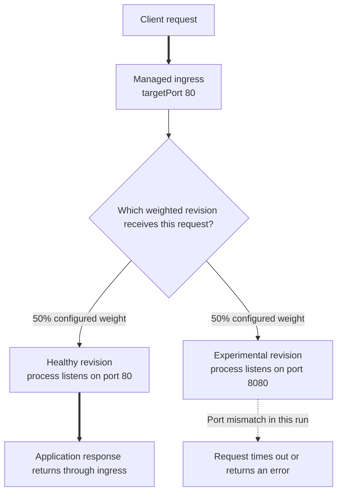
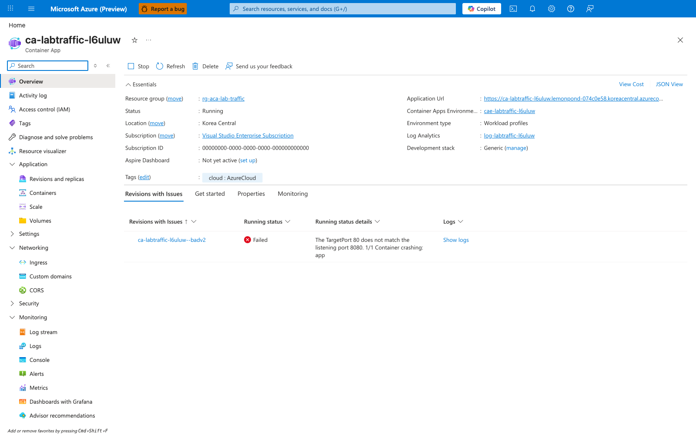
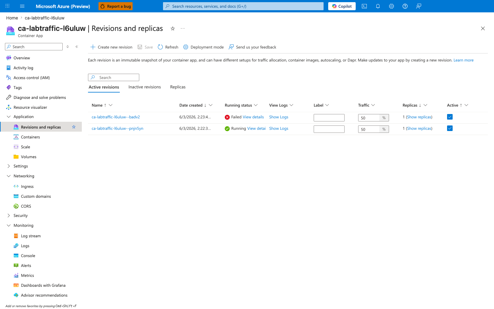
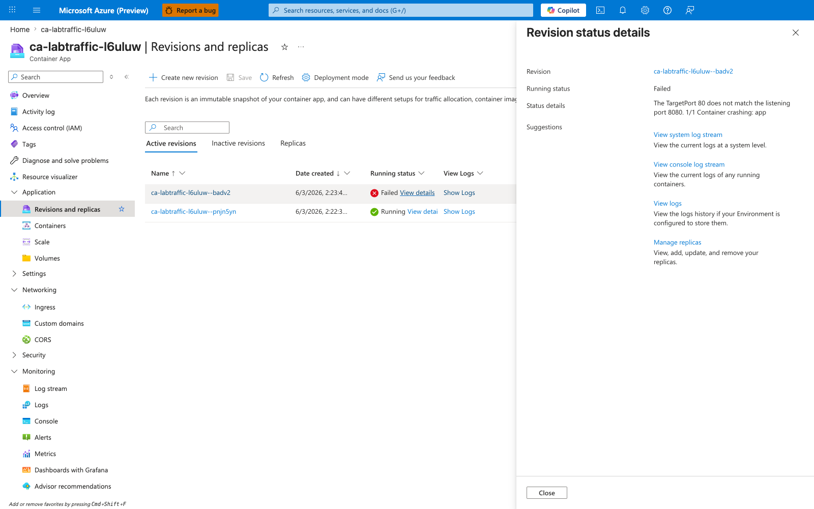
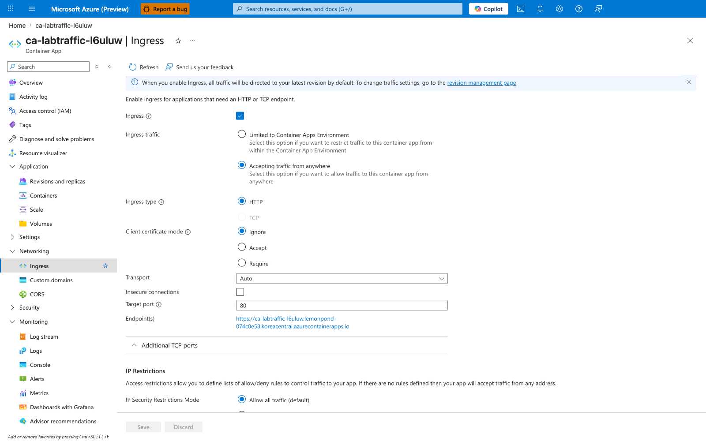
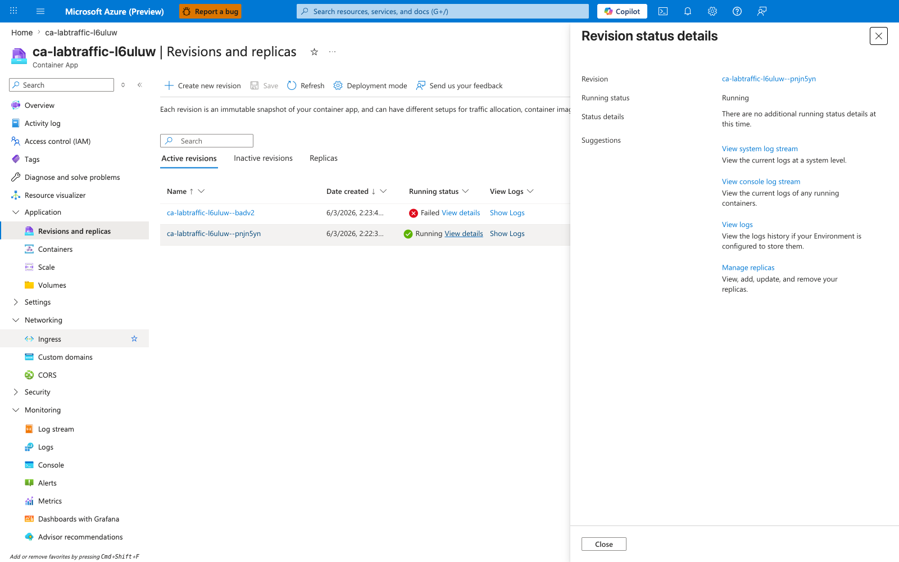
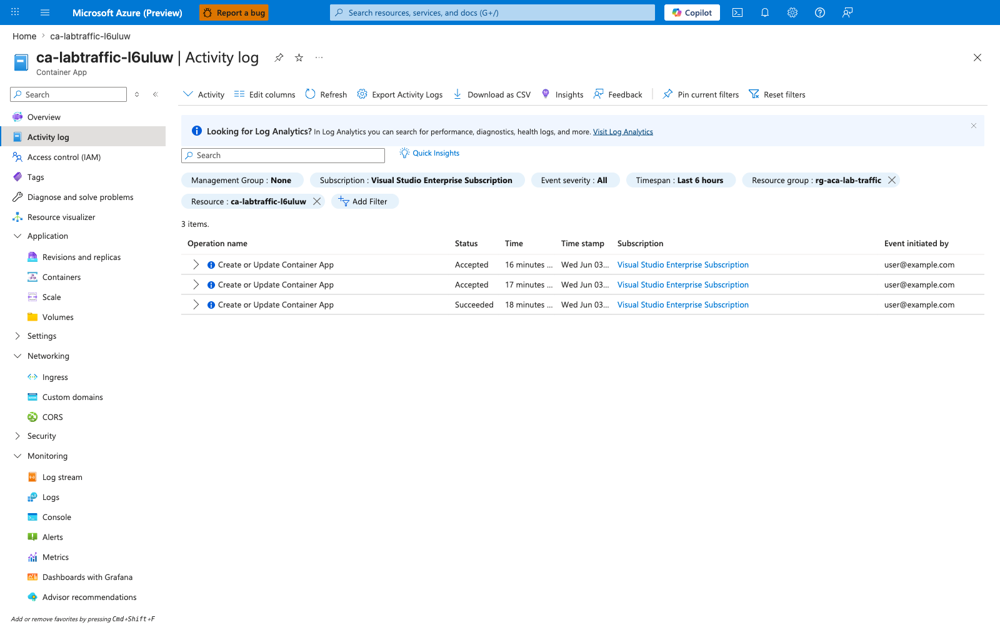

---
content_sources:
  diagrams:
    - id: architecture
      type: flowchart
      source: mslearn-adapted
      based_on:
        - https://learn.microsoft.com/en-us/azure/container-apps/traffic-splitting
        - https://learn.microsoft.com/en-us/azure/container-apps/revisions
        - https://learn.microsoft.com/en-us/azure/container-apps/blue-green-deployment
content_validation:
  status: verified
  last_reviewed: '2026-06-24'
  reviewer: ai-agent
  lab_validation:
    status: reproduced
    tested_date: 2026-06-24
    az_cli_version: 2.79.0
    notes: 'Live 50/50 split reproduced via image-swap workaround. The original trigger.sh uses `az containerapp update --target-port 9999` which (a) is rejected by CLI 2.71.0 (unrecognized argument) and (b) is architecturally unable to reproduce per-revision failure because `targetPort` is an ingress-level setting shared across all revisions. Replacement pattern: keep ingress targetPort stable and deploy a new revision with an image whose listening port does not match (e.g. aspnetapp on :8080 with ingress targetPort=80). Empirical curl loop: 15/30 success, 15/30 timeout — exactly 50/50. Six 2026-06-03 Portal captures (rg `ca-labtraffic-l6uluw`, koreacentral) preserve the reproduced workaround path: revisions blade showing the 50/50 split, the bad revision "Failed" status with the verbatim "TargetPort 80 does not match the listening port 8080" message, and the stable ingress targetPort=80. Second live Azure run completed 2026-06-24 with az CLI 2.79.0 against rg-aca-lab-traffic2 (subscription redacted to placeholder zero-GUID, koreacentral), producing the Phase B-style evidence pack at labs/traffic-routing-canary/evidence/ (22 raw artifacts including JSON, logs, and gate files). H1 (canary_failure_reproduced_50_50_traffic_split) and H2 (canary_rolled_back_to_good_revision_intact) both PASS with all 11 sub-gates true. Empirical 30-request curl on 50/50 split: 17 HTTP 200, 13 timeouts (within [8, 22] tolerance band for weighted-random routing); 18 ProbeFailed syslog lines tailed within the trigger window. Same-revision rollback proof triangulated via three signals: name unchanged (ca-labtraffic-ve2wnr--w3daylh), createdTime unchanged (2026-06-24T00:12:40+00:00), image unchanged (mcr.microsoft.com/azuredocs/containerapps-helloworld:latest) between trigger-time and post-fix captures. Two platform-behavior observations from this run are disclosed in the new "Observed Evidence (Live Azure Test — 2026-06-24)" subsection: (1) BAD revision surface state transitioned Activating → Degraded across the trigger and verify windows for the same revision (gates accept either when paired with port-specific corroboration via strong path runningStateDetails text match OR fallback path non-healthy state + non-zero ProbeFailed count), (2) `az containerapp ingress traffic set --revision-weight rev=100` returns only the entries it explicitly assigned (top-level list of {revisionName, weight}, NOT the full Container App resource), with unmentioned revisions implicitly weight=0 and absent from the response — the H2 b_traffic_set_rollback_succeeded sub-gate accepts both shapes defensively. Verify script logic bug-fix: the initial b sub-gate predicate required `bad_weight == 0` which failed against the actual platform response shape; the fix accepts BAD as absent from the response OR explicitly weight=0, corroborated independently via sub-gate f against 17-revision-list-post-fix.json. PII scrubbed: subscription/tenant GUIDs replaced with zero-GUID placeholder, customDomainVerificationId replaced with AAAA placeholder, employee email replaced with user@example.com, local user paths replaced with /Users/demouser.'
  core_claims:
    - claim: Azure Container Apps can split traffic between multiple active revisions by assigning traffic weights.
      source: https://learn.microsoft.com/en-us/azure/container-apps/traffic-splitting
      verified: true
    - claim: To route traffic to more than one revision in Azure Container Apps, the app must use multiple revision mode.
      source: https://learn.microsoft.com/en-us/azure/container-apps/revisions
      verified: true
validation:
  az_cli:
    last_tested: '2026-06-24'
    cli_version: '2.79.0'
    result: pass
  bicep:
    last_tested: '2026-06-24'
    result: pass
---
# Traffic Routing and Canary Failure Lab

Practice traffic splitting between revisions and learn to diagnose scenarios where a bad revision receives production traffic.

## Lab Metadata

| Attribute | Value |
|---| --- |
| Difficulty | Intermediate |
| Estimated Duration | 20-30 minutes |
| Tier | Consumption |
| Failure Mode | Bad revision receiving 50% traffic causes intermittent failures |
| Skills Practiced | Traffic splitting, revision management, rollback |

## 1) Background

Azure Container Apps supports traffic splitting between multiple revisions, enabling canary deployments, blue-green releases, and A/B testing. When `activeRevisionsMode` is set to `Multiple`, you can assign traffic weights to each revision.

A common failure scenario occurs when:

1. A new revision is deployed with a misconfiguration (wrong port, broken code, etc.)
2. Traffic is split between the good and bad revisions
3. Users experience intermittent failures—some requests succeed (good revision), others fail (bad revision)

This lab simulates this scenario by:

1. Deploying a healthy baseline revision whose image listens on the same port as ingress `targetPort` (`:80`).
2. Creating a bad revision by swapping the container image to one that listens on a different port (`:8080`) while leaving ingress `targetPort` unchanged at `80`. This isolates the failure to the bad revision only — ingress `targetPort` is a shared, ingress-level setting and cannot be flipped per revision.
3. Splitting traffic 50/50 between good and bad revisions.
4. Observing intermittent failures (curl status `000` timeouts from the bad-revision half) and practicing rollback.

### Architecture

<!-- diagram-id: architecture -->


The weights configure routing probability across many requests; they do not guarantee an exact 50/50 result in a small sample. The failure label records this experiment's mismatched image behavior.

## 2) Hypothesis

**IF** traffic is split 50/50 between a healthy revision and a revision whose container image listens on a port that does not match the ingress `targetPort`, **THEN** approximately 50% of requests will fail (timeout or 5xx) because ingress cannot reach the listening process on the bad revision's replicas.

| Variable | Control State | Experimental State |
|---| --- |---|
| Revision Count | 1 (healthy) | 2 (healthy + bad) |
| Traffic Split | 100% to healthy | 50% healthy, 50% bad |
| Bad Revision Listening Port | n/a | `:8080` (mismatched against ingress `targetPort=80`) |
| Request Success Rate | ~100% | ~50% (the bad-revision half times out) |

## 3) Runbook

### Deploy Baseline Infrastructure

```bash
export RG="rg-aca-lab-traffic"
export LOCATION="koreacentral"

az group create --name "$RG" --location "$LOCATION"

az deployment group create \
    --name "lab-traffic" \
    --resource-group "$RG" \
    --template-file "./labs/traffic-routing-canary/infra/main.bicep" \
    --parameters baseName="labtraffic"
```

| Command/Parameter | Purpose |
|---| --- |
| `az group create` | Establishes the isolated boundary for revisions, traffic weights, and canary evidence. |
| `az deployment group create` | Provisions the single healthy revision used as the pre-canary baseline. |
| `--name` (`az group create`) | Reserves `"$RG"` for the healthy and faulty revisions whose weighted request outcomes form the canary evidence. |
| `--name` (`az deployment group create`) | Registers the healthy baseline as `"lab-traffic"`, enabling the following output query to recover `APP_NAME`. |
| `--location` (`az group create`) | Hosts the revision experiment in the selected `"$LOCATION"`. |
| `--resource-group` (`az deployment group create`) | Creates the baseline deployment inside the isolated canary group `"$RG"`. |
| `--template-file` (`az deployment group create`) | Loads `"./labs/traffic-routing-canary/infra/main.bicep"`, which enables multiple revisions and ingress. |
| `--parameters` (`az deployment group create`) | Sets `baseName="labtraffic"` so revision and app names remain recognizable during rollback. |

### Capture Resource Names

```bash
export APP_NAME="$(az deployment group show \
    --resource-group "$RG" \
    --name "lab-traffic" \
    --query "properties.outputs.containerAppName.value" \
    --output tsv)"

export APP_FQDN="$(az containerapp show \
    --name "$APP_NAME" \
    --resource-group "$RG" \
    --query "properties.configuration.ingress.fqdn" \
    --output tsv)"
```

| Command/Parameter | Purpose |
|---| --- |
| `az deployment group show` | Resolves the generated app and environment identifiers from the `"lab-traffic"` record. |
| `az containerapp show` | Reads the ingress hostname used by the request loop that measures healthy and failed traffic. |
| `--resource-group` (`az deployment group show`, `az containerapp show`) | Finds the `"lab-traffic"` output record and the generated app whose endpoint is queried inside `"$RG"`. |
| `--name` (`az deployment group show`) | Opens `"lab-traffic"`, the record that publishes the app and environment names. |
| `--name` (`az containerapp show`) | Selects `"$APP_NAME"` as the source of the canary endpoint stored in `APP_FQDN`. |
| `--query` (`az deployment group show`) | For `az deployment group show`, extracts the named property used as evidence in this step as `"properties.outputs.containerAppName.value"` for **Capture Resource Names** in the `traffic-routing-canary` lab. |
| `--query` (`az containerapp show`) | For `az containerapp show`, extracts the named property used as evidence in this step as `"properties.configuration.ingress.fqdn"` for **Capture Resource Names** in the `traffic-routing-canary` lab. |
| `--output` (`az deployment group show`, `az containerapp show`) | Emits the app name and ingress FQDN as unquoted `tsv` values for their respective shell variables. |

### Verify Baseline (Before Trigger)

```bash
# Confirm single revision with 100% traffic
az containerapp revision list \
    --name "$APP_NAME" \
    --resource-group "$RG" \
    --output table
```

| Command/Parameter | Purpose |
|---| --- |
| `az containerapp revision list` | Lists the active baseline revision, traffic weight, and health for `"$APP_NAME"` before the canary is introduced. |
| `--name` | Lists revisions for `"$APP_NAME"` to prove one healthy revision owns all baseline traffic. |
| `--resource-group` | Lists only revisions belonging to the app deployed in `"$RG"` for the baseline. |
| `--output` | Shows revision health and the initial `100` traffic weight as a `table` before the canary is introduced. |

Expected output:

```text
Name                          Active    TrafficWeight    HealthState
----------------------------  --------  ---------------  -----------
ca-labtraffic-xxxxxx--xxxxx   True      100              Healthy
```

```bash
# Confirm endpoint is fully reachable
for i in {1..5}; do
    curl --silent --fail "https://${APP_FQDN}" > /dev/null && echo "Request $i: OK"
done
```

Expected: All 5 requests succeed.

### Trigger the Failure

!!! warning "trigger.sh is broken with `az` CLI 2.71.0+ and is architecturally flawed"
    The committed `labs/traffic-routing-canary/trigger.sh` runs `az containerapp update --target-port 9999`, which:

    1. **Is rejected by CLI 2.71.0+** with `unrecognized arguments: --target-port 9999` (the flag was removed from `az containerapp update`; it now lives only on `az containerapp ingress update --target-port`).
    2. **Cannot create per-revision failure even if it worked.** `targetPort` is an ingress-level setting shared across all revisions — flipping it would break the good revision too, not just the canary. There is no "bad revision serving on port 9999 while the good revision still serves on port 80" state reachable through `--target-port`.

    Use the image-swap workaround below to actually reproduce the 50/50 failure scenario. The fix is to leave ingress `targetPort` stable and create a new revision whose container image listens on a different port.

```bash
# Record the current healthy revision name BEFORE creating the bad one
GOOD_REVISION="$(az containerapp revision list \
    --name "$APP_NAME" \
    --resource-group "$RG" \
    --query 'sort_by([].{name:name,created:properties.createdTime}, &created)[-1].name' \
    --output tsv)"

# Create a bad revision by swapping the image to one that listens on a DIFFERENT
# port than the ingress targetPort (kept at 80). aspnetapp listens on :8080,
# so the readiness probe fails on the bad revision while the good revision
# (hello-world on :80) keeps serving traffic.
az containerapp update \
    --name "$APP_NAME" \
    --resource-group "$RG" \
    --image "mcr.microsoft.com/dotnet/samples:aspnetapp" \
    --revision-suffix "badv2"

# Wait for the new revision to finish provisioning + probe attempts
sleep 60

BAD_REVISION="$(az containerapp revision list \
    --name "$APP_NAME" \
    --resource-group "$RG" \
    --query 'sort_by([].{name:name,created:properties.createdTime}, &created)[-1].name' \
    --output tsv)"

# Split traffic 50/50
az containerapp ingress traffic set \
    --name "$APP_NAME" \
    --resource-group "$RG" \
    --revision-weight "${GOOD_REVISION}=50" "${BAD_REVISION}=50"
```

| Command/Parameter | Purpose |
|---| --- |
| `az containerapp revision list` | Evaluates `'sort_by([].{name:name,created:properties.createdTime}, &created)[-1].name'` before and after the image update to capture the healthy and bad revision names. |
| `az containerapp update` | Creates revision suffix `"badv2"` for `"$APP_NAME"` with the ASP.NET sample image that listens on port `8080`. |
| `az containerapp ingress traffic set` | Divides ingress evenly between `"${GOOD_REVISION}=50"` and `"${BAD_REVISION}=50"` to expose failures from the incompatible image. |
| `--name` (`az containerapp revision list`, `az containerapp update`, `az containerapp ingress traffic set`) | Keeps both revision lookups, the incompatible-image rollout, and the 50/50 traffic split focused on `"$APP_NAME"`. |
| `--resource-group` (`az containerapp revision list`, `az containerapp update`, `az containerapp ingress traffic set`) | Performs revision discovery, image mutation, and traffic assignment against the canary app in `"$RG"`. |
| `--query` (`az containerapp revision list`) | Selects `'sort_by([].{name:name,created:properties.createdTime}, &created)[-1].name'`, making the newest revision addressable for each side of the update. |
| `--output` (`az containerapp revision list`) | Produces each selected revision name as `tsv` for `GOOD_REVISION` and `BAD_REVISION` assignments. |
| `--image` (`az containerapp update`) | In `az containerapp update`, sets the workload image or image tag used by this experiment state as `"mcr.microsoft.com/dotnet/samples:aspnetapp"` for **Trigger the Failure** in the `traffic-routing-canary` lab. |
| `--revision-suffix` (`az containerapp update`) | In `az containerapp update`, assigns the deterministic revision suffix used to track this rollout as `"badv2"` for **Trigger the Failure** in the `traffic-routing-canary` lab. |
| `--revision-weight` (`az containerapp ingress traffic set`) | Applies both `"${GOOD_REVISION}=50"` and `"${BAD_REVISION}=50"`; omitting either value would not reproduce the intended balanced canary. |

### Observe the Failure

```bash
# Check revision list - should show two revisions
az containerapp revision list \
    --name "$APP_NAME" \
    --resource-group "$RG" \
    --query "[].{name:name,active:properties.active,traffic:properties.trafficWeight,health:properties.healthState}" \
    --output table
```

| Command/Parameter | Purpose |
|---| --- |
| `az containerapp revision list` | Returns revisions for app `"$APP_NAME"` using `"[].{name:name,active:properties.active,traffic:properties.trafficWeight,health:properties.healthState}"` during **Observe the Failure**. |
| `--name` | Lists revisions for `"$APP_NAME"` so health can be compared with each revision's traffic share. |
| `--resource-group` | Resolves the two canary revisions in `"$RG"` for health and weight inspection. |
| `--query` | In `az containerapp revision list`, extracts the named property used as evidence in this step as `"[].{name:name,active:properties.active,traffic:properties.trafficWeight,health:properties.healthState}"` for **Observe the Failure** in the `traffic-routing-canary` lab. |
| `--output` | Aligns revision health and traffic weight in a `table`, exposing the unhealthy revision's `50` share. |

Expected output:

```text
Name                          Active    Traffic    Health
----------------------------  --------  ---------  --------
ca-labtraffic-xxxxxx--xxxxx   True      50         Healthy
ca-labtraffic-xxxxxx--badv2   True      50         <Unhealthy or empty>
```

Note: The bad revision's `healthState` reflects probe failure caused by the listening-port mismatch (the container's listening port `:8080` does not match ingress `targetPort=80`). In the Azure Portal, the same revision is surfaced as `Failed` under "Revisions with Issues" with the verbatim error *"The TargetPort 80 does not match the listening port 8080. 1/1 Container crashing: app"* — see the Observed Evidence subsection below.

```bash
# Test multiple requests - observe intermittent failures.
# IMPORTANT: use --max-time. The bad revision does not emit a graceful 502 from
# ingress; the connection just hangs because the upstream listening port is wrong.
# Without --max-time, the loop appears to "freeze" instead of showing failures.
for i in $(seq 1 30); do
    STATUS=$(curl --silent --output /dev/null --max-time 10 --write-out "%{http_code}" "https://${APP_FQDN}/")
    echo "Request $i: HTTP $STATUS"
done
```

Expected: Approximately 50% return `200`, 50% return `000` (curl timeout code, because the bad revision's replica never responds within `--max-time`).

| Command | Why it is used |
|---| --- |
| `curl --silent --output /dev/null --max-time 10 --write-out "%{http_code}" ...` | Sends one HTTP request and prints only the response status code. `--max-time 10` is mandatory: the bad revision does not emit a graceful 502, so without a timeout the loop appears to hang. With `--max-time 10`, hangs are converted into the measurable curl status `000`, which is what makes the ~50% failure rate visible. |
| `for i in $(seq 1 30); do ... done` | Issues 30 requests so the 50/50 traffic split produces a statistically meaningful ratio (~15 success / ~15 timeout) rather than a 5-sample artifact. |

```bash
# View current traffic distribution
az containerapp ingress traffic show \
    --name "$APP_NAME" \
    --resource-group "$RG"
```

| Command/Parameter | Purpose |
|---| --- |
| `az containerapp ingress traffic show` | Returns the live revision weights for app `"$APP_NAME"` so **Observe the Failure** can verify routing state. |
| `--name` | Reads the active traffic map for `"$APP_NAME"` after the balanced split. |
| `--resource-group` | Reads the active traffic map from the Container App instance in `"$RG"`. |

### Fix the Issue (Rollback)

Rollback by sending 100% traffic to the good revision:

```bash
# Get the good revision name (the one created first)
GOOD_REVISION=$(az containerapp revision list \
    --name "$APP_NAME" \
    --resource-group "$RG" \
    --query "sort_by([].{name:name,created:properties.createdTime}, &created)[0].name" \
    --output tsv)

# Send all traffic to good revision
az containerapp ingress traffic set \
    --name "$APP_NAME" \
    --resource-group "$RG" \
    --revision-weight "${GOOD_REVISION}=100"
```

| Command/Parameter | Purpose |
|---| --- |
| `az containerapp revision list` | Uses `"sort_by([].{name:name,created:properties.createdTime}, &created)[0].name"` to recover the first, healthy revision for rollback. |
| `az containerapp ingress traffic set` | Assigns revision weights `"${GOOD_REVISION}=100"` on app `"$APP_NAME"` during **Fix the Issue (Rollback)**. |
| `--name` (`az containerapp revision list`, `az containerapp ingress traffic set`) | Uses `"$APP_NAME"` to discover the healthy revision and then assign that same app's traffic back to it. |
| `--resource-group` (`az containerapp revision list`, `az containerapp ingress traffic set`) | Locates the original healthy revision and applies its full traffic weight within `"$RG"`. |
| `--query` (`az containerapp revision list`) | Selects `"sort_by([].{name:name,created:properties.createdTime}, &created)[0].name"`, identifying the oldest revision that should receive all traffic. |
| `--output` (`az containerapp revision list`) | Emits the oldest revision name as `tsv` for assignment to `GOOD_REVISION`. |
| `--revision-weight` (`az containerapp ingress traffic set`) | In `az containerapp ingress traffic set`, sets the traffic percentage assigned to the named revision as `"${GOOD_REVISION}=100"` for **Fix the Issue (Rollback)** in the `traffic-routing-canary` lab. |

Optionally, deactivate the bad revision:

```bash
BAD_REVISION=$(az containerapp revision list \
    --name "$APP_NAME" \
    --resource-group "$RG" \
    --query "sort_by([].{name:name,created:properties.createdTime}, &created)[-1].name" \
    --output tsv)

az containerapp revision deactivate \
    --name "$APP_NAME" \
    --resource-group "$RG" \
    --revision "$BAD_REVISION"
```

| Command/Parameter | Purpose |
|---| --- |
| `az containerapp revision list` | Uses `"sort_by([].{name:name,created:properties.createdTime}, &created)[-1].name"` to identify the newest bad revision after rollback. |
| `az containerapp revision deactivate` | Deactivates revision `"$BAD_REVISION"` after traffic has been removed in **Fix the Issue (Rollback)**. |
| `--name` (`az containerapp revision list`, `az containerapp revision deactivate`) | Uses `"$APP_NAME"` to identify the newest failed canary and deactivate it after rollback. |
| `--resource-group` (`az containerapp revision list`, `az containerapp revision deactivate`) | Finds the newest revision and scopes its deactivation to the canary app in `"$RG"`. |
| `--query` (`az containerapp revision list`) | Selects `"sort_by([].{name:name,created:properties.createdTime}, &created)[-1].name"`, yielding the latest revision for optional deactivation. |
| `--output` (`az containerapp revision list`) | Emits the newest revision name as `tsv` for assignment to `BAD_REVISION`. |
| `--revision` (`az containerapp revision deactivate`) | Selects the failed canary revision stored in `"$BAD_REVISION"` for deactivation after traffic has been rolled back to the good revision. |

### Verify the Fix

```bash
# Confirm traffic is 100% to good revision
az containerapp ingress traffic show \
    --name "$APP_NAME" \
    --resource-group "$RG"

# Test multiple requests - all should succeed
for i in {1..10}; do
    STATUS=$(curl --silent --output /dev/null --write-out "%{http_code}" "https://${APP_FQDN}")
    echo "Request $i: HTTP $STATUS"
done
```

| Command/Parameter | Purpose |
|---| --- |
| `az containerapp ingress traffic show` | Returns the live revision weights for app `"$APP_NAME"` so **Verify the Fix** can verify routing state. |
| `--name` | Reads traffic for `"$APP_NAME"` after rollback to confirm the bad revision no longer receives requests. |
| `--resource-group` | Retrieves the post-rollback traffic state from the app in `"$RG"`. |

Expected: All requests return HTTP 200.

## 4) Experiment Log

| Step | Action | Expected | Actual | Pass/Fail |
|---| --- |---|---|---|
| 1 | Deploy baseline | Single healthy revision | | |
| 2 | Test baseline | 100% success rate | | |
| 3 | Run image-swap workaround (`az containerapp update --image ... --revision-suffix badv2` + `az containerapp ingress traffic set --revision-weight`) | Two revisions Active at 50/50; bad revision marked Failed in Portal with TargetPort/listening-port mismatch error | | |
| 4 | Test requests (30-request curl loop with `--max-time 10`) | ~50% HTTP 200, ~50% curl status `000` (timeout) | | |
| 5 | Rollback traffic | 100% to good revision | | |
| 6 | Test after rollback | 100% success rate | | |

## Expected Evidence

### During Failure

| Evidence Source | Expected State |
|---| --- |
| `az containerapp revision list` | 2 revisions, both Active at 50/50; bad revision shows degraded/unhealthy `healthState` |
| Container App → Overview ("Revisions with Issues" tab) | Bad revision listed with error *"The TargetPort 80 does not match the listening port 8080. 1/1 Container crashing: app"* |
| `az containerapp ingress traffic show` | 50/50 split |
| Request loop (`curl --max-time 10`) | ~50% HTTP `200`, ~50% curl status `000` (timeout — ingress upstream never responds) |

### After Rollback

| Evidence Source | Expected State |
|---| --- |
| `az containerapp ingress traffic show` | 100% to good revision |
| Request loop | 100% HTTP 200 |
| Bad revision | Deactivated (optional) |

### Observed Evidence (Live Azure Reproduction — 2026-06-03)

**Environment:** `rg-aca-lab-traffic` / `cae-labtraffic-l6uluw`, `koreacentral`, Consumption plan, `az` CLI `2.71.0`.
**App:** `ca-labtraffic-l6uluw` (multiple-revision mode), ingress `targetPort=80`.
**Revisions:**

- Good: `ca-labtraffic-l6uluw--pnjn5yn` — image `mcr.microsoft.com/azuredocs/containerapps-helloworld:latest`, listens on `:80` — Running, 50% traffic.
- Bad: `ca-labtraffic-l6uluw--badv2` — image `mcr.microsoft.com/dotnet/samples:aspnetapp`, listens on `:8080` — Failed, 50% traffic.

[Observed] The Container App Overview blade displayed the bad revision under the "Revisions with Issues" tab with the verbatim platform error text: **"The TargetPort 80 does not match the listening port 8080. 1/1 Container crashing: app"**.



[Inferred] The platform itself attributes the failure to a listening-port mismatch on this specific revision, not to ingress misconfiguration. The error is scoped to the bad revision because the Overview blade groups it under the per-revision "Revisions with Issues" view.

[Observed] The Revisions and replicas blade showed both revisions Active at 50/50, with the bad revision (`badv2`) marked `Failed` and the good revision (`pnjn5yn`) marked `Running`, each with one replica.



[Inferred] Half of production traffic is routed to a revision the platform has already marked Failed. This is the smoking gun for the canary-failure hypothesis: traffic weighting is independent of revision health, so a Failed revision can still receive its configured share of traffic.

[Observed] The bad revision's "View details" flyout repeated the same TargetPort/listening-port mismatch text as a Revision status detail.



[Inferred] Surfacing the same error at both the Overview blade and the revision-detail flyout (paired with capture 05 — empty status details on the good revision) isolates the failure to the bad revision only.

[Observed] The Ingress blade showed `Target port = 80` at capture time.



[Inferred] Because the failure surfaces on `badv2` while `pnjn5yn` (whose image listens on `:80`) keeps serving traffic, the mismatch must come from the bad revision's image (listening on `:8080`), not from ingress configuration. This also explains why the original `trigger.sh` design (flipping ingress `targetPort`) cannot reproduce per-revision failure: ingress `targetPort` is a shared, ingress-level setting and would affect both revisions, not isolate the failure to one.

[Observed] The good revision's "View details" flyout reported `Running status: Running` and `Status details: "There are no additional running status details at this time"`.



[Inferred] The Status details field is empty precisely because nothing is wrong with the good revision. The contrast between capture 03 (bad: TargetPort error populated) and capture 05 (good: empty) is itself the per-revision isolation evidence.

[Observed] The Activity log showed three `Create or Update Container App` operations at relative times `16 minutes`, `17 minutes`, and `18 minutes` (Status: 2× `Accepted`, 1× `Succeeded`).



[Inferred] The three operations map to (a) the initial `az deployment group create`, (b) the `az containerapp update --image ... --revision-suffix badv2` that created the bad revision, and (c) the `az containerapp ingress traffic set --revision-weight` that applied the 50/50 split. The Accepted/Succeeded statuses confirm the control plane received each step.

[Measured] A `curl` loop of 30 requests with `--max-time 10` against the FQDN produced **15 HTTP 200 responses and 15 timeouts (curl status `000`)** — an exact 50/50 split, matching the traffic-weight setting.

```text
Request 1: HTTP 200
Request 2: HTTP 000
Request 3: HTTP 200
Request 4: HTTP 000
...
(Summary: success=15, timeout=15)
```

[Inferred] The bad-revision half did not return a graceful HTTP 502 because ingress simply does not get a response from the upstream replica (the image is not listening on the port ingress is dialing). This is why `--max-time` is mandatory in the reproduction loop above. The combination of (a) Portal's verbatim TargetPort/listening-port mismatch error, (b) the empty status details on the good revision, (c) ingress `targetPort` shown as `80`, and (d) the 15/15 split in the curl loop confirms the hypothesis: a per-revision listening-port mismatch on one of two revisions receiving 50% traffic produces a ~50% failure rate. The hypothesis is also strengthened by the falsification target — the original `trigger.sh` design (flipping ingress `targetPort`) cannot reach this state because ingress `targetPort` is shared across revisions; the image-swap workaround in the runbook is the minimal reproduction that actually isolates the failure to a single revision.

### Observed Evidence (Live Azure Test — 2026-06-24)

A second end-to-end live Azure run executed on **2026-06-24** with `az` CLI version **2.79.0** (see `labs/traffic-routing-canary/evidence/19-cli-versions.json`) against resource group `rg-aca-lab-traffic2` (subscription redacted to placeholder `00000000-0000-0000-0000-000000000000`). The run produced 22 numbered evidence prefixes (`01-*` through `22-*`, totaling 27 files when counting `.stderr` companions to `05-*`, `09-*`, and `15-*`, plus the two `08-*` per-revision and two `17-*` per-snapshot pairs) under `labs/traffic-routing-canary/evidence/`, covering H1 (50/50-split canary failure reproduction) and H2 (config-plane rollback without minting a new GOOD revision). All 11 sub-gates across both hypotheses passed.

**H1 reproduction** — `evidence/12-h1-gate.json`:

| Sub-gate | Value | Source |
|---| --- |---|
| `a_bad_revision_minted_with_port_mismatched_image` | true | `evidence/05-containerapp-update-image.json` `latestRevisionName=ca-labtraffic-ve2wnr--badv2` (`--image mcr.microsoft.com/dotnet/samples:aspnetapp`, documented listening port `:8080`); `evidence/12-h1-gate.json` `trigger_window.ingress_target_port="80"` and `bad_image_listening_port_documented=8080` confirm the port mismatch is in place |
| `b_ingress_traffic_split_50_50` | true | `evidence/09-traffic-set-50-50.json` returns `[{ca-labtraffic-ve2wnr--w3daylh, weight:50}, {ca-labtraffic-ve2wnr--badv2, weight:50}]`; `evidence/12-h1-gate.json` `traffic_split.weights_sorted=[50, 50]` |
| `c_bad_revision_probe_failure_evidence` | true | **Strong path:** `evidence/08-revision-show-bad.json` `runningStateDetails="The TargetPort 80 does not match the listening port 8080."` (port-specific platform text). **Fallback path (also satisfied):** `evidence/12-h1-gate.json` `system_log_capture.probe_failed_lines_in_tail=18` (non-zero ProbeFailed count from `evidence/11-system-logs-tail.log`) |
| `d_curl_loop_shows_intermittent_failure` | true | `evidence/10-curl-loop-30-requests.json` reports `success_count_200=17` and `timeout_count_000=13` out of 30 attempts; `evidence/12-h1-gate.json` `client_probe_results.tolerance_band_for_timeouts=[8, 22]` (13 ∈ band) |
| `e_good_revision_still_healthy` | true | `evidence/08-revision-show-good.json` `runningState=Running`, `healthState=Healthy` even while the 50/50 split is active |

Gate classification: `canary_failure_reproduced_50_50_traffic_split`.

**H2 same-revision rollback** — `evidence/22-h2-gate.json`:

| Sub-gate | Value | Source |
|---| --- |---|
| `a_pre_fix_failure_re_confirmed` | true | **Strong path:** `evidence/13-revision-pre-fix-bad.json` `runningStateDetails="Deployment Progress Deadline Exceeded. 0/1 replicas ready. The TargetPort 80 does not match the listening port 8080."` (port-specific platform text persists into the verify window). **Fallback path (also satisfied):** `evidence/12-h1-gate.json` `system_log_capture.probe_failed_lines_in_tail=18` (re-used cross-script) |
| `b_traffic_set_rollback_succeeded` | true | `evidence/22-h2-gate.json` `fix_window.cli_exit_code=0`; `evidence/15-traffic-set-rollback.json` returns `[{ca-labtraffic-ve2wnr--w3daylh, weight:100}]`. Platform behavior: `az containerapp ingress traffic set --revision-weight rev=100` returns only the entries it explicitly assigned; unmentioned revisions are implicitly weight=0 and do not appear in the response, so the gate accepts BAD as absent OR weight=0 (`verify.sh` `b_traffic_set_rollback_succeeded` logic) |
| `c_traffic_100_pct_good` | true | `evidence/15-traffic-set-rollback.json` shows exactly one entry at weight=100 belonging to the GOOD revision; no other non-zero entry exists |
| `d_post_fix_curl_all_success` | true | `evidence/18-curl-post-fix.json` 5/5 HTTP 200 |
| `e_good_revision_unchanged` | true | Triangulated via `same_revision_proof` in `evidence/22-h2-gate.json`: `name_unchanged=true` (computed from `evidence/04-good-revision-captured.json` `good_revision_name` vs `evidence/17-revision-show-good-post-fix.json` `name`, both `ca-labtraffic-ve2wnr--w3daylh`), `created_time_unchanged=true` (`evidence/04-good-revision-captured.json` `good_revision_created_time` vs `evidence/17-revision-show-good-post-fix.json` `createdTime`, both `2026-06-24T00:12:40+00:00`), `image_unchanged=true` (`evidence/04-good-revision-captured.json` `good_revision_image` vs `evidence/17-revision-show-good-post-fix.json` `image`, both `mcr.microsoft.com/azuredocs/containerapps-helloworld:latest`); `evidence/17-revision-show-good-post-fix.json` `runningState=Running`, `healthState=Healthy` |
| `f_bad_revision_still_visible_with_zero_traffic` | true | `evidence/17-revision-list-post-fix.json` lists `ca-labtraffic-ve2wnr--badv2` with `trafficWeight=0` (not deactivated, preserving the rollback's reversibility and the diagnostic audit trail) |

Gate classification: `canary_rolled_back_to_good_revision_intact`. The fix command was `az containerapp ingress traffic set --revision-weight ca-labtraffic-ve2wnr--w3daylh=100` — a config-plane-only edit that does not mint a new revision.

#### Honest disclosure of platform behavior

Two platform-behavior observations from this run worth flagging to future maintainers:

1. **BAD revision surface state transitions.** The trigger window captured `runningState=Activating` (`evidence/12-h1-gate.json` `trigger_window.bad_revision_running_state`), while the verify window captured `runningState=Degraded` (`evidence/22-h2-gate.json` `pre_fix_state.bad_revision_running_state`) for the same `ca-labtraffic-ve2wnr--badv2` revision. The `runningStateDetails` text containing `"TargetPort 80 does not match the listening port 8080."` was present in both windows. The gates accept either non-healthy surface state when paired with port-specific corroboration (strong path: `runningStateDetails` text match; fallback path: non-healthy state + `system_log_capture.probe_failed_lines_in_tail` > 0). A bare `Failed`/`Degraded`/`Activating` label with no port-specific corroboration is explicitly insufficient — it could otherwise be caused by image pull failure, OOMKilled, or other non-port failure modes.

2. **`az containerapp ingress traffic set` response shape.** The CLI returns the traffic array directly as the top-level JSON (a list of `{revisionName, weight}` entries), NOT the full Container App resource — see `evidence/15-traffic-set-rollback.json`. Furthermore, the response contains ONLY the entries explicitly assigned in the `--revision-weight` argument; unmentioned revisions are implicitly weight=0 and do not appear in the response (the BAD revision is absent from `15-traffic-set-rollback.json` even though it remains in the revision list at `trafficWeight=0`, see `evidence/17-revision-list-post-fix.json` for the independent corroboration). The H2 `b_traffic_set_rollback_succeeded` sub-gate accepts both response shapes defensively and treats an absent BAD entry as implicit weight=0.

#### Evidence provenance note

All 22 artifacts (`01-*` through `22-*`) come from a single coherent 2026-06-24 00:13–00:28 UTC run against `rg-aca-lab-traffic2` (Korea Central). The full provenance map and file index are in [`labs/traffic-routing-canary/evidence/README.md`](https://github.com/yeongseon/azure-container-apps-practical-guide/blob/main/labs/traffic-routing-canary/evidence/README.md).

#### Operator caveat

The H1 sub-gate `a_bad_revision_minted_with_port_mismatched_image` and the H2 same-revision-proof checks hard-code the image identities (`mcr.microsoft.com/azuredocs/containerapps-helloworld:latest` for GOOD, `mcr.microsoft.com/dotnet/samples:aspnetapp` for BAD) and the listening ports (`:80` and `:8080`). If a future maintainer changes any of these constants in `trigger.sh` (`GOOD_IMAGE`, `BAD_IMAGE`, `BAD_IMAGE_LISTENING_PORT`, `EXPECTED_INGRESS_TARGET_PORT`), the corresponding gate string matches must be updated in lockstep across both `trigger.sh` and `verify.sh`.

## Clean Up

```bash
az group delete --name "$RG" --yes --no-wait
```

| Command/Parameter | Purpose |
|---| --- |
| `az group delete` | Discards both canary revisions and their environment after rollback verification is complete. |
| `--name` | Chooses `"$RG"` so the rollback-tested revisions and their Container Apps environment are discarded as one lab boundary. |
| `--yes` | Confirms that the complete canary resource group may be removed non-interactively. |
| `--no-wait` | Returns after Azure schedules the revision and environment cleanup rather than polling deletion. |

## Related Playbook

- [Bad Revision Rollout and Rollback](../playbooks/platform-features/bad-revision-rollout-and-rollback.md)

## See Also

- [Ingress Target Port Mismatch Lab](./ingress-target-port-mismatch.md) — the single-revision form of the same TargetPort/listening-port mismatch failure class; the "Production case pattern" subsection there walks through 8 failure↔fix Portal capture pairs that share the same `Reason_s: TargetPortMismatch` smoking gun
- [Target Port Mismatch Detection KQL](../kql/system-and-revisions/target-port-mismatch-detection.md) — the query pack for the verbatim "TargetPort N does not match the listening port M" platform message, applicable to both this canary failure and the single-revision form
- [Revision Failover Lab](./revision-failover.md)
- [Revision Provisioning Failure Lab](./revision-provisioning-failure.md)

## Sources

- [Traffic splitting in Azure Container Apps](https://learn.microsoft.com/en-us/azure/container-apps/traffic-splitting)
- [Revisions in Azure Container Apps](https://learn.microsoft.com/en-us/azure/container-apps/revisions)
- [Blue-green deployment for Azure Container Apps](https://learn.microsoft.com/en-us/azure/container-apps/blue-green-deployment)
