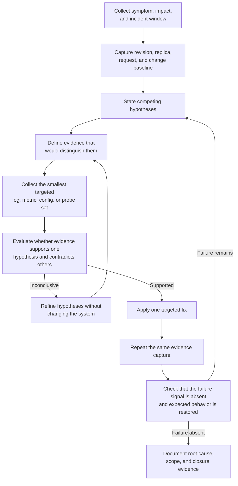
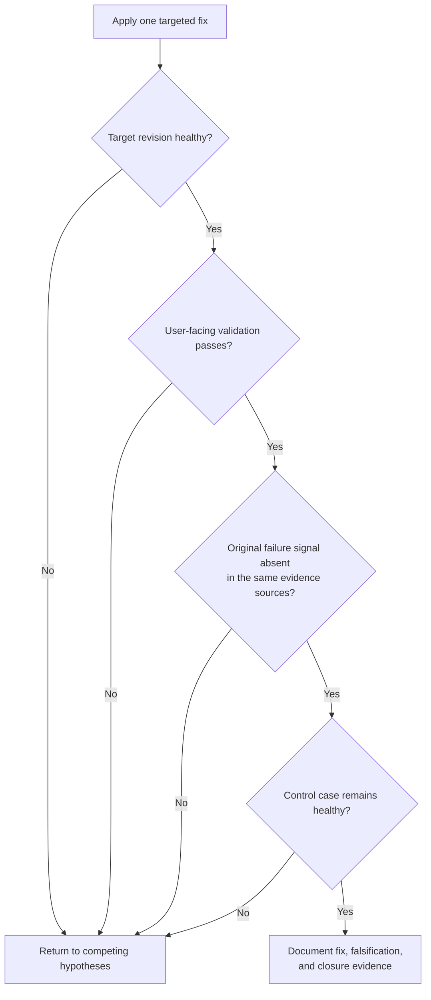

# Troubleshooting Methodology

When the quick triage checklist does not isolate the issue, use this systematic workflow to move from symptom to verified root cause.

## Diagnostic Flow

<!-- diagram-id: diagnostic-flow -->


The method separates observation from intervention and repeats the same evidence capture after one targeted fix so recovery can falsify the original failure hypothesis.

## 1) Symptom Collection

Capture exact failure mode first: no response, HTTP 5xx, slow response, intermittent timeout, startup failure.

```kql
let AppName = "ca-myapp-api";
ContainerAppConsoleLogs_CL
| where ContainerAppName_s == AppName
| where Log_s has_any ("error", "exception", "timeout", "traceback")
| project TimeGenerated, RevisionName_s, ReplicaName_s, Log_s
| order by TimeGenerated desc
```

- Record first seen timestamp, blast radius, and user-facing symptom.
- Decision: if no app logs exist, start with system logs and provisioning path.

## 2) Revision Analysis

Determine whether failure is isolated to the latest revision or shared across active revisions.

```bash
az containerapp revision list --name "$APP_NAME" --resource-group "$RG" --query "[].{name:name,active:properties.active,trafficWeight:properties.trafficWeight,health:properties.healthState}" --output table
```


| Command/Parameter | Purpose |
|---|---|
| `az containerapp revision list` | Lists revision health, activation, and traffic fields for comparison across revisions. |
| `--name` | Selects the container app whose revisions are being compared. |
| `--output` | Formats the selected revision fields as a table. |
| `--query` | Projects revision name, active state, traffic weight, and health state. |
| `--resource-group` | Selects the resource group containing the app. |


```kql
let AppName = "ca-myapp-api";
ContainerAppSystemLogs_CL
| where ContainerAppName_s == AppName
| project TimeGenerated, RevisionName_s, Reason_s, Log_s
| order by TimeGenerated desc
```

- Check active vs inactive revisions and traffic percentage.
- Decision: broken latest revision with healthy prior revision suggests rollback/failover path.

## 3) Replica Deep Dive

Focus on restart frequency, OOM kill patterns, and resource pressure.

```kql
let AppName = "ca-myapp-api";
ContainerAppSystemLogs_CL
| where ContainerAppName_s == AppName
| where Log_s has_any ("restart", "terminated", "OOM", "killed")
| summarize events=count() by RevisionName_s, ReplicaName_s
| order by events desc
```

- Frequent restarts with no code tracebacks often point to resource limits or probe failures.
- Decision: if OOM or throttling signals appear, tune CPU/memory and startup behavior before redeploy.

## 4) Image Investigation

Validate image tag immutability, base image compatibility, and dependency completeness.

```bash
az containerapp show --name "$APP_NAME" --resource-group "$RG" --query "properties.template.containers[0].image" --output tsv
az acr repository show-tags --name "$ACR_NAME" --repository "$APP_NAME" --output table
```


| Command/Parameter | Purpose |
|---|---|
| `az containerapp show` | Reads the image reference deployed in the first app container. |
| `--name` | Selects the container app for the image investigation and the registry for the tag lookup. |
| `--output` | Emits the deployed image as TSV and registry tags as a table. |
| `--query` | Returns only the first container's deployed image reference. |
| `--resource-group` | Selects the resource group containing the app. |
| `az acr repository show-tags` | Lists tags present in the application's registry repository for comparison with the deployed image. |
| `--repository` | Selects the repository named for the application. |


```kql
let AppName = "ca-myapp-api";
ContainerAppSystemLogs_CL
| where ContainerAppName_s == AppName
| where Log_s has_any ("pull", "manifest", "unauthorized", "denied")
| project TimeGenerated, RevisionName_s, Log_s
| order by TimeGenerated desc
```

- Decision: if image pulls fail, treat identity/registry/network as primary branch.

## 5) Identity Chain

Walk the chain: managed identity assignment → RBAC grant → token retrieval → target resource authorization.

```bash
az containerapp show --name "$APP_NAME" --resource-group "$RG" --query "identity" --output json
az role assignment list --assignee "$(az containerapp show --name "$APP_NAME" --resource-group "$RG" --query identity.principalId --output tsv)" --output table
```


| Command/Parameter | Purpose |
|---|---|
| `az containerapp show` | Reads the app identity and supplies its principal ID to the role-assignment lookup. |
| `--name` | Selects the container app whose identity chain is being traced. |
| `--output` | Emits identity details as JSON, the principal ID as TSV, and role assignments as a table. |
| `--query` | Selects the identity object or its `principalId` for the nested lookup. |
| `--resource-group` | Selects the resource group containing the app. |
| `az role assignment list` | Lists Azure RBAC assignments granted to the app's managed identity principal. |
| `--assignee` | Filters role assignments to the principal ID returned for this app. |


```kql
let AppName = "ca-myapp-api";
ContainerAppConsoleLogs_CL
| where ContainerAppName_s == AppName
| where Log_s has_any ("ManagedIdentityCredential", "403", "401", "token")
| project TimeGenerated, RevisionName_s, Log_s
| order by TimeGenerated desc
```

- Decision: identity exists but 403 persists usually means missing role scope or wrong audience.

## 6) Network Path

Trace path end-to-end: DNS resolution → ingress routing → healthy replica → egress connectivity.

```bash
az containerapp show --name "$APP_NAME" --resource-group "$RG" --query "properties.configuration.ingress" --output json
az containerapp env show --name "$ACA_ENV_NAME" --resource-group "$RG" --query "properties.vnetConfiguration" --output json
```


| Command/Parameter | Purpose |
|---|---|
| `az containerapp show` | Reads the app ingress configuration for the inbound segment of the network path. |
| `--name` | Selects the app for ingress inspection or the Container Apps environment for VNet inspection. |
| `--output` | Emits both selected network configuration objects as JSON. |
| `--query` | Selects the app ingress object or the environment VNet configuration. |
| `--resource-group` | Selects the resource group containing the app and environment. |
| `az containerapp env show` | Reads the environment VNet configuration for the private-network segment of the path. |


```kql
let AppName = "ca-myapp-api";
ContainerAppSystemLogs_CL
| where ContainerAppName_s == AppName
| where Log_s has_any ("DNS", "ingress", "connection refused", "timeout")
| project TimeGenerated, RevisionName_s, Log_s
| order by TimeGenerated desc
```

- Decision: ingress healthy but dependency timeout indicates egress or dependency firewall branch.

## 7) Dependency Mapping

Create an explicit map of downstream dependencies and test each path.

```kql
let AppName = "ca-myapp-api";
ContainerAppConsoleLogs_CL
| where ContainerAppName_s == AppName
| where Log_s has_any ("sql", "redis", "cosmos", "storage", "api")
| project TimeGenerated, RevisionName_s, Log_s
| order by TimeGenerated desc
```

- Verify endpoint hostnames, identity scopes, firewall allow rules, and secret versions.
- Decision: a single failing dependency can produce cascading startup or probe failures.

## Decision Tree (Symptom → Likely Cause → Next Investigation)

| Symptom | Likely cause | Investigate next |
| --- | --- | --- |
| `ImagePullBackOff` | Registry auth or image tag issue | Image Investigation, Identity Chain |
| Revision `Failed` before traffic | Invalid config or missing secret | Revision Analysis, Secret references |
| 502/504 from ingress | No healthy replica or wrong target port | Replica Deep Dive, Network Path |
| Intermittent timeout under load | Scale rule mismatch or throttling | Replica Deep Dive, scaling logs |
| Works locally, fails in Azure Container Apps | Identity/network/environment mismatch | Identity Chain, Network Path |

## Anti-Patterns (Don't Do This)

!!! warning "Do not redeploy blindly"
    Repeated redeploys without collecting logs destroys evidence and slows root-cause analysis.

!!! warning "Do not change multiple variables at once"
    Change one dimension per iteration (image, config, probes, scale) so the result is attributable.

!!! warning "Do not ignore system logs"
    Console logs show app behavior; system logs usually reveal platform-level failures first.

## Verification Loop (Fix Confidence)

After applying a candidate fix, run this loop before declaring incident closure.

<!-- diagram-id: after-applying-a-candidate-fix-run -->


Closure requires revision health, user-facing behavior, disappearance of the original signal, and a healthy control case—not only a successful deployment operation.

!!! info "Closure requires evidence, not assumption"
    A successful deployment operation alone is not proof of recovery. Confirm user-facing behavior and error-rate normalization.

## Command Pack by Investigation Stage

| Stage | Fast Command | Expected Signal |
|---|---|---|
| Revision status | `az containerapp revision list --name "$APP_NAME" --resource-group "$RG" --output table` | Identify healthy vs failed revisions |
| Replica health | `az containerapp replica list --name "$APP_NAME" --resource-group "$RG" --output table` | Detect restart or zero-replica patterns |
| Ingress config | `az containerapp show --name "$APP_NAME" --resource-group "$RG" --query "properties.configuration.ingress" --output json` | Validate external/internal access and target port |
| Identity baseline | `az containerapp show --name "$APP_NAME" --resource-group "$RG" --query "identity" --output json` | Confirm principal assignment |
| Live logs | `az containerapp logs show --name "$APP_NAME" --resource-group "$RG" --type system` | Capture platform-level failure reasons |

## See Also

- [First 10 Minutes: Quick Triage Checklist](../first-10-minutes/index.md)
- [Playbooks](../playbooks/index.md)
- [KQL Queries](../kql/index.md)
- [Detector Map: Symptom to Playbook](detector-map.md)

## Sources

- [Microsoft Learn: Troubleshoot Azure Container Apps](https://learn.microsoft.com/en-us/azure/container-apps/troubleshooting)
- [Microsoft Learn: Monitor Azure Container Apps](https://learn.microsoft.com/en-us/azure/container-apps/log-monitoring)
- [Microsoft Learn: Azure Container Apps revisions](https://learn.microsoft.com/en-us/azure/container-apps/revisions)
- [Microsoft Learn: Health probes](https://learn.microsoft.com/en-us/azure/container-apps/health-probes)
