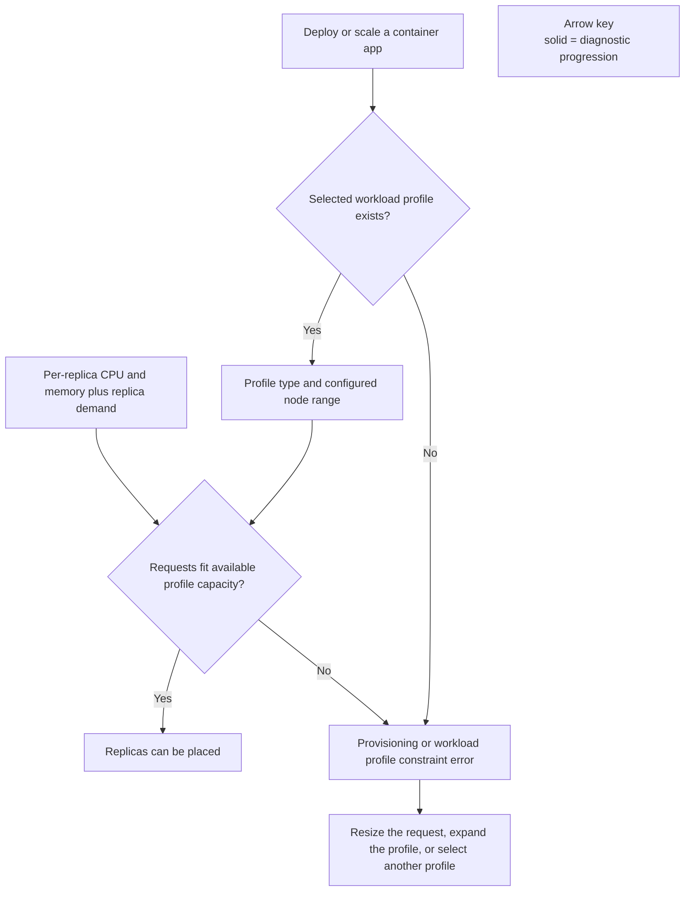

---
content_sources:
  references:
    - type: mslearn-adapted
      url: https://learn.microsoft.com/en-us/azure/container-apps/workload-profiles-overview
  diagrams:
    - id: workload-profile-mismatch-flow
      type: flowchart
      source: mslearn-adapted
      based_on:
        - https://learn.microsoft.com/en-us/azure/container-apps/workload-profiles-overview
        - https://learn.microsoft.com/en-us/azure/container-apps/workload-profiles-manage-cli
        - https://learn.microsoft.com/en-us/azure/container-apps/billing
content_validation:
  status: verified
  last_reviewed: 2026-09-11
  reviewer: agent
  core_claims:
    - claim: Azure Container Apps supports workload profiles inside an environment.
      source: https://learn.microsoft.com/en-us/azure/container-apps/workload-profiles-overview
      verified: true
    - claim: Workload profile node counts can be managed through Azure CLI.
      source: https://learn.microsoft.com/en-us/azure/container-apps/workload-profiles-manage-cli
      verified: true
    - claim: Dedicated workload profile cost is tied to reserved profile capacity rather than only request-driven execution.
      source: https://learn.microsoft.com/en-us/azure/container-apps/billing
      verified: true
---
# Workload Profile Mismatch

## Symptom

An app assigned to a dedicated workload profile fails to start, remains stuck in provisioning, or returns errors such as `WorkloadProfileMaximumCoresConstraint`. The requested replicas or resources do not land successfully even though the app definition itself looks valid.

<!-- diagram-id: workload-profile-mismatch-flow -->


*Figure: Compare the app's selected workload profile and resource demand with the profile capacity before changing application code.*

## Possible Causes

- The app is pinned to a workload profile whose node type is too small for the requested CPU or memory.
- `maximumCount` is too low to host the requested replica count.
- `minimumCount` and `maximumCount` were misconfigured during environment updates.
- A cost-optimization change shrank dedicated capacity without checking the app's actual runtime footprint.

## Diagnosis Steps

1. Identify the workload profile the app is using and the per-replica resource request:

```bash
az containerapp show \
    --name "$APP_NAME" \
    --resource-group "$RG" \
    --query "{workloadProfile:properties.workloadProfileName,cpu:properties.template.containers[0].resources.cpu,memory:properties.template.containers[0].resources.memory,minReplicas:properties.template.scale.minReplicas,maxReplicas:properties.template.scale.maxReplicas}" \
    --output json
```

| Command/Parameter | Purpose |
|---|---|
| `az containerapp show` | Reads the selected Container App so the operator can evaluate the workload profile cpu template containers evidence. |
| `--name` (`az containerapp show`) | Selects `$APP_NAME`, whose assigned workload profile and resource request are being compared. |
| `--resource-group` (`az containerapp show`) | Locates the app in `$RG` before reading its profile and sizing settings. |
| `--query` (`az containerapp show`) | Builds a compact view of the selected workload profile and requested CPU so the placement mismatch is visible in one record. |
| `--output` (`az containerapp show`) | Emits the response as `json` so the decisive fields remain usable in this diagnostic step. |


2. List workload profiles on the environment:

```bash
az containerapp env workload-profile list \
    --name "$ACA_ENV_NAME" \
    --resource-group "$RG"
```

| Command/Parameter | Purpose |
|---|---|
| `az containerapp env workload-profile list` | Lists the profiles available to the environment, including each profile's node bounds and current capacity configuration. |
| `--name` (`az containerapp env workload-profile list`) | Enumerates profiles attached to `$ACA_ENV_NAME`, where the app's requested profile must exist. |
| `--resource-group` (`az containerapp env workload-profile list`) | Locates the environment in `$RG` before comparing its profile inventory with the app assignment. |


3. Inspect the specific profile that should host the app:

```bash
az containerapp env workload-profile show \
    --name "$ACA_ENV_NAME" \
    --resource-group "$RG" \
    --workload-profile-name "general-purpose"
```

| Command/Parameter | Purpose |
|---|---|
| `az containerapp env workload-profile show` | Reads one profile's node limits so replica CPU demand can be compared with the capacity available for placement. |
| `--name` (`az containerapp env workload-profile show`) | Opens the profile configuration on `$ACA_ENV_NAME`, the environment hosting the failing app. |
| `--resource-group` (`az containerapp env workload-profile show`) | Searches `$RG` for that environment rather than a similarly named environment in another deployment. |
| `--workload-profile-name` (`az containerapp env workload-profile show`) | Inspects `general-purpose`, the profile selected by the app configuration. |


4. Compare **replica demand** (`cpu × expected replicas`) with the profile's available nodes.
5. If the app requests more than the profile can place, treat the issue as sizing mismatch rather than application failure.

## Resolution

1. **Increase profile capacity** if the current profile is correct but too small:

```bash
az containerapp env workload-profile update \
    --name "$ACA_ENV_NAME" \
    --resource-group "$RG" \
    --workload-profile-name "general-purpose" \
    --min-nodes 1 \
    --max-nodes 5
```

| Command/Parameter | Purpose |
|---|---|
| `az containerapp env workload-profile update` | Expands the profile's permitted node range so the scheduler can place the app's requested replicas. |
| `--name` (`az containerapp env workload-profile update`) | Changes the profile attached to `$ACA_ENV_NAME`, not the app template itself. |
| `--resource-group` (`az containerapp env workload-profile update`) | Applies the capacity change to the environment held in `$RG`. |
| `--workload-profile-name` (`az containerapp env workload-profile update`) | Modifies `general-purpose`, matching the profile inspected in the preceding diagnostic step. |
| `--min-nodes` (`az containerapp env workload-profile update`) | Keeps at least `1` node available for workloads assigned to this profile. |
| `--max-nodes` (`az containerapp env workload-profile update`) | Allows the profile to grow to `5` nodes when replica demand exceeds current capacity. |


2. **Reduce app demand** if the profile should stay small:

```bash
az containerapp update \
    --name "$APP_NAME" \
    --resource-group "$RG" \
    --cpu 0.5 \
    --memory "1Gi" \
    --min-replicas 1 \
    --max-replicas 2
```

| Command/Parameter | Purpose |
|---|---|
| `az containerapp update` | Resizes the app's replica demand to match capacity available in the selected workload profile. |
| `--name` (`az containerapp update`) | Changes `$APP_NAME`, whose CPU, memory, or replica request did not fit the profile. |
| `--resource-group` (`az containerapp update`) | Resolves the mismatched app from `$RG` before applying the smaller resource request. |
| `--cpu` (`az containerapp update`) | Lowers each replica request to `0.5` vCPU so it fits the profile node size. |
| `--memory` (`az containerapp update`) | Lowers per-replica memory to `1Gi` for the same placement correction. |
| `--min-replicas` (`az containerapp update`) | Keeps one baseline replica instead of reserving capacity for a larger minimum. |
| `--max-replicas` (`az containerapp update`) | Limits concurrent demand to two replicas within the profile's available nodes. |


3. **Move the workload** to a more appropriate profile or to Consumption when burst economics matter more than always-reserved capacity.

| Command | Why it is used |
|---|---|
| `az containerapp env workload-profile update --min-nodes 1 --max-nodes 5` | Expands dedicated capacity so the environment can place the app's replicas. |
| `az containerapp update --cpu 0.5 --memory "1Gi" --min-replicas 1 --max-replicas 2` | Shrinks the app request so it fits the existing profile. |

## Prevention

- Validate workload profile sizing before reducing `max-nodes` for cost reasons.
- Keep a sizing table for each production app that maps per-replica resources to profile capacity.
- Review dedicated profile changes together with app scale settings, not as separate cost-only changes.
- Use Consumption for bursty or uncertain workloads until steady-state demand is proven.

## See Also

- [Workload Profile Mismatch Lab](../../lab-guides/workload-profile-mismatch.md)
- [Plans and Workload Profiles](../../../platform/environments/plans-and-workload-profiles.md)
- [Workload Profiles](../../../platform/environments/workload-profiles.md)
- [Cost-Aware Best Practices](../../../best-practices/cost.md)

## Sources

- [Microsoft Learn: Workload profiles in Azure Container Apps](https://learn.microsoft.com/en-us/azure/container-apps/workload-profiles-overview)
- [Microsoft Learn: Manage workload profiles with Azure CLI](https://learn.microsoft.com/en-us/azure/container-apps/workload-profiles-manage-cli)
- [Microsoft Learn: Azure Container Apps billing](https://learn.microsoft.com/en-us/azure/container-apps/billing)
