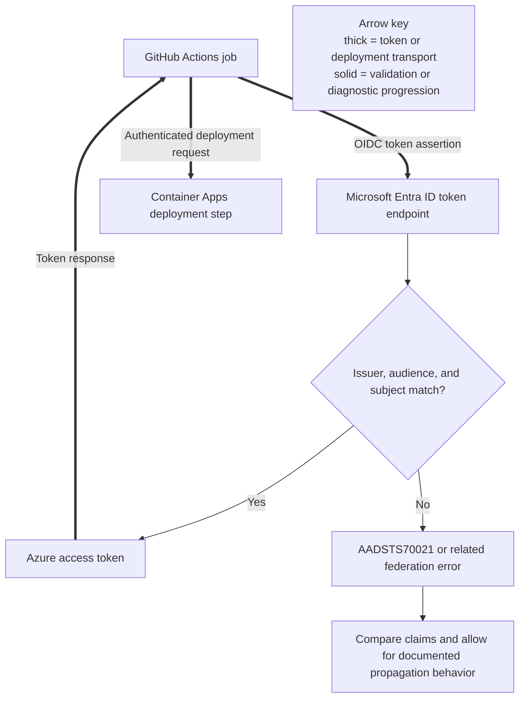

---
content_sources:
  references:
    - type: mslearn-adapted
      url: https://learn.microsoft.com/en-us/azure/developer/github/connect-from-azure-openid-connect
  diagrams:
    - id: github-actions-oidc-failure-flow
      type: flowchart
      source: mslearn-adapted
      based_on:
        - https://learn.microsoft.com/en-us/azure/developer/github/connect-from-azure-openid-connect
        - https://learn.microsoft.com/en-us/entra/workload-id/workload-identity-federation
        - https://learn.microsoft.com/en-us/entra/workload-id/workload-identity-federation-considerations
content_validation:
  status: verified
  last_reviewed: '2026-07-18'
  reviewer: ai-agent
  core_claims:
    - claim: GitHub Actions workflows can authenticate to Azure services by using the Azure Login action with OpenID Connect (OIDC).
      source: https://learn.microsoft.com/en-us/azure/developer/github/connect-from-azure-openid-connect
      verified: true
    - claim: A federated identity credential must match the incoming issuer, audience, and subject claims for workload identity federation to succeed.
      source: https://learn.microsoft.com/en-us/entra/workload-id/workload-identity-federation
      verified: true
    - claim: Federated identity credential changes can be affected by propagation timing and configuration constraints.
      source: https://learn.microsoft.com/en-us/entra/workload-id/workload-identity-federation-considerations
      verified: true
---
# GitHub Actions OIDC Failure

## Symptom

GitHub Actions deployment jobs fail during Azure sign-in or before the Container Apps deployment step runs. The workflow often reports `AADSTS70021: No matching federated identity record found for presented assertion.` and the job never obtains an Azure access token.

<!-- diagram-id: github-actions-oidc-failure-flow -->


*Figure: Federation succeeds only when the token claims match the configured credential; token request and response are shown separately.*

## Possible Causes

- The federated credential subject does not exactly match the repository and branch pattern used by the workflow.
- The issuer is not `https://token.actions.githubusercontent.com`.
- The audience is not `api://AzureADTokenExchange` for the public Azure cloud scenario documented by Microsoft Learn.
- The workflow references the wrong Microsoft Entra application or service principal.
- The federated credential was just created and directory replication has not completed yet.

## Diagnosis Steps

1. Confirm the workflow is using OpenID Connect instead of a client secret.
2. Inspect the Entra application and list its federated identity credentials.
3. Compare the configured `issuer`, `audiences`, and `subject` with the workflow branch and repository.
4. Retry once after a short wait if the credential was recently created.

```bash
az ad app show \
    --id "<app-id>"

az ad app federated-credential list \
    --id "<app-id>"

az rest \
    --method GET \
    --uri "https://graph.microsoft.com/v1.0/applications(appId='<app-id>')/federatedIdentityCredentials"
```

| Command/Parameter | Purpose |
|---|---|
| `az ad app show` | Reads the selected app registration so the operator can evaluate resource configuration record. |
| `--id` (`az ad app show`) | Selects directory or Azure object `<app-id>` for this exact lookup or mutation. |
| `az ad app federated-credential list` | Runs `az ad app federated-credential list` to collect or change the Azure state evaluated by diagnosis steps. |
| `--id` (`az ad app federated-credential list`) | Selects directory or Azure object `<app-id>` for this exact lookup or mutation. |
| `az rest` | Calls the exact ARM or Microsoft Graph resource URL to evaluate the Azure state that distinguishes this hypothesis. |
| `--method` (`az rest`) | Uses HTTP `GET`, matching the read or delete operation performed on the exact resource URL. |
| `--uri` (`az rest`) | Addresses `https://graph.microsoft.com/v1.0/applications(appId='<app-id>')/federat…`, the Microsoft Graph object needed for the identity check. |


Use this matching rule for a branch-based workflow:

```text
issuer:   https://token.actions.githubusercontent.com
audience: api://AzureADTokenExchange
subject:  repo:<ORG>/<REPO>:ref:refs/heads/<BRANCH>
```

## Resolution

1. Update the federated identity credential so the subject exactly matches the GitHub repository and ref used by the deployment workflow.
2. Confirm the issuer and audience follow the Microsoft Learn guidance for GitHub Actions OIDC.
3. If the credential was created moments ago, wait briefly and rerun the workflow.
4. Keep branch-specific and environment-specific credentials explicit instead of relying on guessed patterns.

Example credential payload:

```json
{
  "name": "github-main",
  "issuer": "https://token.actions.githubusercontent.com",
  "subject": "repo:contoso/aca-guide:ref:refs/heads/main",
  "audiences": [
    "api://AzureADTokenExchange"
  ]
}
```

```bash
az ad app federated-credential create \
    --id "<app-id>" \
    --parameters "credential.json"
```

| Command/Parameter | Purpose |
|---|---|
| `az ad app federated-credential create` | Creates the app registration that implements the documented correction and returns its provisioning result. |
| `--id` (`az ad app federated-credential create`) | Selects directory or Azure object `<app-id>` for this exact lookup or mutation. |
| `--parameters` (`az ad app federated-credential create`) | Sets the parameters input to `credential.json`, the value used by `az ad app federated-credential create` to evaluate or correct the Azure state that distinguishes this hypothesis. |


## Prevention

- Treat the federated credential subject as an exact string contract, not a fuzzy pattern.
- Keep GitHub branch names, protected environments, and Entra credential definitions aligned in IaC or scripted provisioning.
- Add a pre-deploy validation step that lists the app's federated credentials before changing the pipeline.
- After creating or updating the credential, allow for propagation before declaring the pipeline broken.

## See Also

- [GitHub Actions OIDC Failure Lab](../../lab-guides/github-actions-oidc-failure.md)
- [Managed Identity Authentication Failure](../identity-and-configuration/managed-identity-auth-failure.md)
- [Revision Provisioning Failure](../startup-and-provisioning/revision-provisioning-failure.md)

## Sources

- [Use GitHub Actions to connect to Azure](https://learn.microsoft.com/en-us/azure/developer/github/connect-from-azure-openid-connect)
- [Workload identity federation](https://learn.microsoft.com/en-us/entra/workload-id/workload-identity-federation)
- [Considerations and unsupported scenarios for workload identity federation](https://learn.microsoft.com/en-us/entra/workload-id/workload-identity-federation-considerations)
