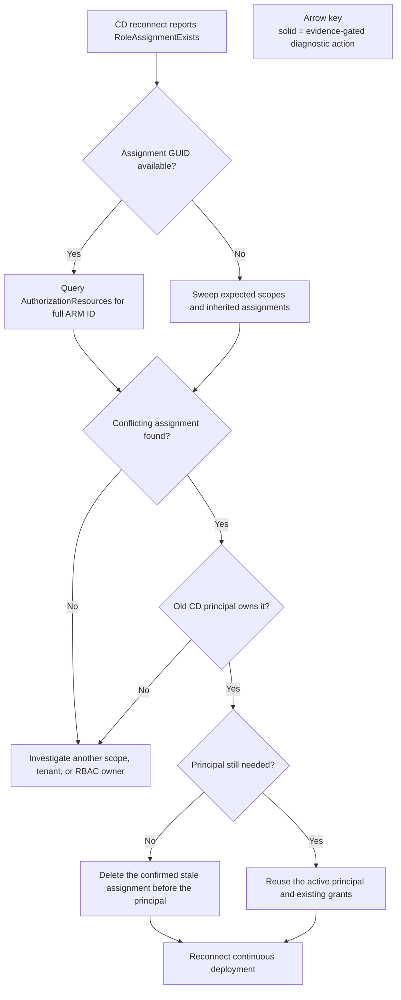

---
content_sources:
  diagrams:
    - id: troubleshooting-decision-flow
      type: flowchart
      source: mslearn-adapted
      based_on:
        - https://learn.microsoft.com/en-us/azure/container-apps/github-actions
        - https://learn.microsoft.com/en-us/azure/container-registry/container-registry-rbac-built-in-roles-overview
        - https://learn.microsoft.com/en-us/azure/container-registry/container-registry-rbac-abac-repository-permissions
        - https://learn.microsoft.com/en-us/azure/role-based-access-control/role-assignments
        - https://learn.microsoft.com/en-us/azure/role-based-access-control/role-assignments-cli
        - https://learn.microsoft.com/en-us/azure/role-based-access-control/troubleshooting
        - https://learn.microsoft.com/en-us/azure/azure-resource-manager/bicep/scenarios-rbac
        - https://learn.microsoft.com/en-us/azure/governance/resource-graph/concepts/query-language
        - https://learn.microsoft.com/en-us/azure/governance/resource-graph/samples/samples-by-category
content_validation:
  status: verified
  last_reviewed: '2026-04-23'
  reviewer: ai-agent
  validation_environment:
    subscription: <subscription-id>
    resource_group: rg-aca-cd-rbac-validate
    container_app: ca-cdrbac-dtyz5d
    acr: acrcdrbacdtyz5d
    github_repo: https://github.com/<owner>/lab-aca-cd-rbac-temp
    cli_version: 2.70.0
    containerapp_extension: 1.2.0b4
    tested_date: '2026-04-22'
    outcomes:
      - step: First connect
        result: 'Observed 2026-04-22: workflow + 3 secrets created; the tested RBAC-only registry used a manual SP with Contributor (RG) + AcrPush (ACR)'
      - step: Disconnect
        result: Workflow file deleted; secrets, SP, and role assignments left behind
      - step: Reproduce conflict
        result: PUT new role assignment with same (scope, principal, role) returned RoleAssignmentExists
      - step: 4-step cleanup + reconnect
        result: All artifacts cleaned and CD reconnected with fresh SP
  additional_validation_environment:
    subscription: <subscription-id>
    resource_group: rg-aca-orphan-ra-732926 / rg-rbac-cmd-verify-e727e8
    region: koreacentral
    cli_version: 2.70.0
    resource_graph_extension: 2.1.1
    tested_date: '2026-04-23'
    scenario: Orphaned role-assignment lookup + diagnostic command-pattern verification
    outcomes:
      - step: Resource Graph AuthorizationResources query (single-GUID lookup)
        result: Returns row with full ARM `id`, `properties.scope/principalId/principalType/roleDefinitionId/createdOn` populated; works for orphan principals
      - step: Resource Graph per-principal sweep (properties.principalId == ...)
        result: Returns all assignments held by the orphan SP; works after the principal is deleted
      - step: az role assignment list --include-inherited at RG scope
        result: 'Without flag: 0 rows; with flag: 18 inherited rows (flag is essential)'
      - step: az rest --method DELETE on full ARM `id` (api-version=2022-04-01)
        result: 200 with deleted resource body; follow-up GET returns 404 RoleAssignmentNotFound
      - step: az rest --method GET on full ARM `id` (api-version=2022-04-01)
        result: 200 for assignment at the queried scope; 404 RoleAssignmentNotFound for a sub-scope URL when the assignment lives at RG scope (URL is scope-aware)
      - step: az role assignment show subcommand
        result: Does not exist on CLI 2.70 (`'show' is misspelled or not recognized`); subcommands are create/delete/list/list-changelogs/update only
      - step: az role assignment list --assignee <orphan-principalId>
        result: Fails with `Cannot find user or service principal in graph database for '<id>'` because --assignee performs a Microsoft Entra ID lookup; use Resource Graph instead
      - step: Per-scope az role assignment list visibility for orphan RA
        result: Row remains visible with `principalName` empty (not hidden); orphan signal is the empty principalName, not a NotFound
      - step: az ad sp create-for-rbac --years 1
        result: Rejected by tenant credential lifetime policy (policy ID redacted); default (no --years) succeeded in 1st validation environment
  core_claims:
    - claim: Azure role assignments are identified by GUID resource names that must be unique within the Microsoft Entra tenant; deterministic deployments can derive that GUID from scope, principal ID, and role definition ID.
      source: https://learn.microsoft.com/en-us/azure/role-based-access-control/troubleshooting
      verified: true
    - claim: The Azure Container Apps GitHub action authenticates to the Azure Container Registry named by acrName with the credentials supplied to the Azure login action so it can push the image.
      source: https://learn.microsoft.com/en-us/azure/container-apps/github-actions
      verified: true
    - claim: Deleting a Microsoft Entra principal does not automatically remove its Azure role assignments; those assignments appear as Identity not found in the Azure portal.
      source: https://learn.microsoft.com/en-us/azure/role-based-access-control/role-assignments
      verified: true
---
# Continuous Deployment RBAC Role Assignment Conflict

## 1. Summary

### Symptom

When you reconnect GitHub Actions continuous deployment (CD) to a Container App after a previous disconnect, the deployment fails with one of the following messages:

```text
RoleAssignmentExists: The role assignment already exists.
The ID of the existing role assignment is <role-assignment-id-hex>.
```

```text
AppRbacDeployment: The role assignment already exists.
The ID of the existing role assignment is <32-char-hex>.
```

The error appears during the deployment step that creates RBAC role assignments for the GitHub Actions identity (service principal or user-assigned managed identity) on the Azure Container Registry (ACR) and/or the Container App.

The CD wizard or CLI fails atomically: no new workflow is committed to the repository, and no new secrets are written. The Container App itself continues to run normally on the previous revision.

!!! note "Verified against the live API"
    The error sample above is a representative example of the error format returned when a duplicate role assignment is detected by the Azure RBAC API.

### Why this scenario is confusing

The error message suggests something about the *new* assignment is wrong, but the actual cause is leftover state from the *previous* CD setup. The Portal "Disconnect" action and `az containerapp github-action delete` remove the GitHub workflow file, but they do **not** delete:

- the GitHub Actions secrets (`<APP_UPPER_NO_HYPHEN>_AZURE_CREDENTIALS`, `<APP_UPPER_NO_HYPHEN>_REGISTRY_USERNAME`, `<APP_UPPER_NO_HYPHEN>_REGISTRY_PASSWORD`),
- the service principal that was used as the GitHub Actions identity,
- the role assignments granted to that service principal on the resource group, ACR, or Container App.

When you reconnect using the same Container App and registry, the deployment can collide with an existing assignment. Azure role assignments are identified by GUID resource names that must be unique within the Microsoft Entra tenant. Repeatable Bicep deployments should derive that GUID deterministically from the scope, principal ID, and fully qualified role definition ID; the tuple is an input to deterministic naming, not the documented uniqueness boundary itself.

It is also confusing because the error refers to a role assignment ID, not to the principal or the role name, so you cannot tell from the message alone which permission is conflicting.

!!! info "Why ad-hoc CLI testing does not reproduce this"
    `az role assignment create --assignee-object-id <id> --role <role> --scope <scope>` is idempotent in modern Azure CLI: when the same `(scope, principal, role)` triple already exists, it returns the existing assignment instead of failing. The `RoleAssignmentExists` error surfaces only through ARM deployments — including `az containerapp github-action add`, the Portal CD wizard, and any Bicep or ARM template — because they create a `Microsoft.Authorization/roleAssignments` resource with a freshly generated assignment GUID on every run. The new GUID conflicts with the existing assignment's unique key, and ARM does not silently swallow the duplicate the way the CLI does. This was confirmed during validation: an `az role assignment create` for the same triple returned the existing record with exit code 0, while a raw REST `PUT …/roleAssignments/<new-guid>?api-version=2022-04-01` returned `Conflict / RoleAssignmentExists`.

### Troubleshooting decision flow

<!-- diagram-id: troubleshooting-decision-flow -->


*Figure: Discover the assignment's actual scope and owner before deleting it; a missing result from one guessed scope is not proof that the assignment is gone.*

## 2. Common Misreadings

- "Disconnect cleans up everything." Disconnect removes GitHub workflow and secrets only; Azure-side service principal and role assignments usually remain.
- "Deleting the ACR repository fixed the secrets, so RBAC must be clean too." Deleting a repository removes images, not role assignments. Role assignments are scoped to the registry, not to repositories inside it.
- "The error mentions a new role assignment, so the new one is malformed." The error is a uniqueness conflict — the old assignment exists and blocks the new identical one.
- "Just retry the wizard." Retrying produces the same conflict because the offending assignment is still there.
- "I should grant a different role." The CD setup requires a specific set of roles; granting a different role does not satisfy the deployment template.

## 3. Competing Hypotheses

| Hypothesis | Typical Evidence For | Typical Evidence Against |
|---|---|---|
| H1: Orphaned role assignment from previous CD setup | Error includes role assignment ID; per-scope `az role assignment list --scope <SCOPE> --query "[?name=='<GUID>']"` returns a row whose `principalName` matches a `<app>-github-actions-*` pattern (or whose `principalId`, after resolving via `az ad sp show --id <principalId>`, points at such an SP — `az rest --method GET` returns IDs only and does not include the resolved name) | The principal in the conflicting assignment is unrelated to GitHub Actions |
| H2: Service principal still exists and still holds CD-related roles | `az ad sp list --display-name "$APP_NAME"` returns a CD service principal; multiple role assignments for that principal exist on ACR and Container App | No matching service principal exists in the tenant |
| H3: Stale role assignment created manually for testing | Assignment principal is a user account or a non-CD service principal | Principal display name matches the `<app>-github-actions-*` naming pattern Azure uses for CD identities |
| H4: Reusing a name with a freshly recreated service principal | The principal in the conflicting assignment was deleted but assignment lingers as orphaned | Principal is still active in Microsoft Entra ID |
| H5: Different deployment template version expects a different role set | Conflict appears even on a fresh Container App with no prior CD history | Conflict reproduces only on Container Apps that were previously connected to CD |

The next four hypotheses are *lookup-failure modes* rather than independent root causes — they explain why the conflicting GUID cannot be located through the standard `az role assignment list` and Portal IAM blade path described in §4. Each one points to a different remediation path within §4 → "When the assignment ID returns nothing".

| Hypothesis | Typical Evidence For | Typical Evidence Against |
|---|---|---|
| H6: Orphaned assignment whose principal was already deleted | Per-scope `az role assignment list --scope <SCOPE> --query "[?name=='<GUID>']"` returns a row with **empty** `principalName` (the assignment row is still there, only the principal's display name is gone); Resource Graph `AuthorizationResources` returns the row including `properties.principalId`; `az ad sp show --id <principalId>` returns `Resource not found`; `az role assignment list --assignee <principalId>` fails with `Cannot find user or service principal in graph database` | `principalName` is populated normally and `az ad sp show --id <principalId>` resolves the principal |
| H7: Assignment exists at a different scope than the one you are searching | Per-scope `az role assignment list --scope …` returns nothing for the GUID, but Resource Graph returns it with a `scope` value pointing to a different subscription, resource group, or resource | Resource Graph also returns no row for the GUID |
| H8: You lack `Microsoft.Authorization/roleAssignments/read` at the scope where the assignment lives | Resource Graph returns the row but `az rest --method GET` against the full assignment ID fails with `AuthorizationFailed`; another account with `User Access Administrator` can see it | All accounts see the same empty result |
| H9: Assignment lives at Management Group scope or in another tenant | Resource Graph row's `scope` starts with `/providers/Microsoft.Management/managementGroups/…` or principal is from a different `homeTenantId` | Scope is under the current subscription |

## 4. What to Check First

### Error message details

The error returned by the deployment includes the conflicting role assignment ID without hyphens. The example below was captured during live validation against `acrcdrbacdtyz5d` in `koreacentral`:

```text
The ID of the existing role assignment is <role-assignment-id-hex>
```

Convert this 32-character hex string into a standard GUID by inserting hyphens at positions 8, 12, 16, and 20:

```text
<role-assignment-id>
```

### Platform Signals

!!! warning "Read this before running the snippet below — both lookups are scope-aware"
    The error message gives you the assignment GUID but **not** its scope. Both commands below assume the assignment lives at the subscription you pass in, which is only true for some Container Apps CD setups. If the assignment was actually created at a resource group, ACR, or Container App scope:

    - `az role assignment list --subscription <id> --query "[?name=='<GUID>']"` returns the row only when `--include-inherited` would have caught it from the subscription scope. For child-scope assignments you must sweep each scope explicitly (see §4 → "When the assignment ID returns nothing" → Step B).
    - `az rest --method GET …/subscriptions/<sub>/providers/Microsoft.Authorization/roleAssignments/<guid>?api-version=2022-04-01` returns `404 RoleAssignmentNotFound` even though the assignment exists. The URL must be built from the assignment's **own** scope. [Observed 2026-04-23 in `koreacentral`]: an RG-scoped Reader assignment returned `200` from `…/resourceGroups/<rg>/providers/Microsoft.Authorization/roleAssignments/<guid>` but `404` from `…/subscriptions/<sub>/providers/Microsoft.Authorization/roleAssignments/<guid>`.

    If either snippet returns nothing or `404`, **do not assume the assignment is gone** — jump to §4 → "When the assignment ID returns nothing" → Step A (Resource Graph), which returns the assignment's full ARM `id` regardless of scope.

```bash
SUBSCRIPTION_ID="<subscription-id>"
ROLE_ASSIGNMENT_ID="<role-assignment-id>"

az role assignment list \
    --subscription "$SUBSCRIPTION_ID" \
    --query "[?name=='$ROLE_ASSIGNMENT_ID']" \
    --output json

az rest --method GET \
    --url "https://management.azure.com/subscriptions/$SUBSCRIPTION_ID/providers/Microsoft.Authorization/roleAssignments/$ROLE_ASSIGNMENT_ID?api-version=2022-04-01" \
    --output json
```

| Command/Parameter | Purpose |
|---|---|
| `az role assignment list` | Enumerates role assignments at the requested principal or scope to evaluate the Azure state that distinguishes this hypothesis. |
| `--subscription` (`az role assignment list`) | Runs the authorization lookup in `$SUBSCRIPTION_ID`, where the conflicting assignment was reported. |
| `--query` (`az role assignment list`) | Filters the subscription-wide results to the conflicting assignment GUID so its surviving scope and principal can be inspected. |
| `--output` (`az role assignment list`) | Returns the matching assignment as JSON so principal, role, and scope remain available. |
| `az rest` | Calls the exact ARM or Microsoft Graph resource URL to evaluate the Azure state that distinguishes this hypothesis. |
| `--method` (`az rest`) | Uses HTTP `GET`, matching the read or delete operation performed on the exact resource URL. |
| `--url` (`az rest`) | Addresses `https://management.azure.com/subscriptions/$SUBSCRIPTION_ID/providers/M…`, the ARM resource whose existence or removal is being verified. |
| `--output` (`az rest`) | Preserves the raw ARM assignment record as JSON for cross-checking IDs. |


The output reveals the principal ID (`properties.principalId`), role definition ID (`properties.roleDefinitionId`), and scope (`properties.scope`) of the conflicting assignment, which is enough to confirm hypothesis H1 once you cross-reference the role definition ID against `az role definition list --query "[?id=='<roleDefinitionId>'].roleName" --output tsv` to recover the human-readable role name.

### When the assignment ID returns nothing

In a non-trivial number of real cases the GUID from the error message cannot be looked up through `az role assignment list`, `az rest --method GET` against a guessed scope, or the Azure Portal **Access control (IAM)** blade. Reported symptoms include:

- `az rest --method GET …/roleAssignments/<guid>?api-version=2022-04-01` returns `(NotFound)` against the scope you guessed.
- `az role assignment list --scope <RG|ACR|App>` does not include the GUID on any of the scopes you expect (or returns it with empty `principalName` — that is the orphan-principal signal, not a "not found" failure).
- `az role assignment list --assignee <orphan-principalId>` fails with `Cannot find user or service principal in graph database for '<id>'`. [Observed 2026-04-23]: this Microsoft Entra ID lookup is required by `--assignee` and breaks for any principal whose object has been deleted; use Resource Graph instead.
- The Portal IAM blade for those scopes does not render the row. [Observed]: in the cases reported on this playbook this matched assignments whose principal had been deleted; the Portal behavior is not documented as a platform guarantee.

The assignment still exists in ARM — otherwise the deployment would not fail — but standard tooling cannot see it from the scopes you are querying. The four causes worth eliminating are H6 (deleted principal), H7 (assignment is at a different scope than the ones you queried), H8 (you do not have `Microsoft.Authorization/roleAssignments/read` at that scope), and H9 (assignment is at a Management Group scope or owned by another tenant).

#### Step A — Query Azure Resource Graph (`AuthorizationResources`)

The `AuthorizationResources` table in Azure Resource Graph indexes role assignments alongside other authorization resources, and a single Resource Graph query can return rows from any subscription, resource group, or scope your account has read access to — without you having to run a separate `az role assignment list` per scope. In practice this often surfaces an assignment that the per-scope commands missed, because Resource Graph is querying its own index instead of fanning out reads across every scope you may have forgotten to check.

```bash
az extension add --name resource-graph --upgrade
RA_GUID="<role-assignment-id>"

az graph query --first 100 --graph-query "
AuthorizationResources
| where type =~ 'microsoft.authorization/roleassignments'
| where name == '${RA_GUID}'
| project id,
          scope            = tostring(properties.scope),
          principalId      = tostring(properties.principalId),
          principalType    = tostring(properties.principalType),
          roleDefinitionId = tostring(properties.roleDefinitionId),
          createdOn        = tostring(properties.createdOn)
"
```

| Command/Parameter | Purpose |
|---|---|
| `az extension add` | Installs the Azure Resource Graph CLI extension required for the tenant-wide assignment query. |
| `--name` (`az extension add`) | Selects the `resource-graph` extension named in the command. |
| `--upgrade` (`az extension add`) | Updates an existing installation so `AuthorizationResources` queries use the current command implementation. |
| `az graph query` | Locates the role assignment named by `$RA_GUID` across every readable Azure scope. |
| `--first` (`az graph query`) | Limits this single-GUID lookup to 100 rows. |
| `--graph-query` (`az graph query`) | Filters `AuthorizationResources` to role-assignment type and name `$RA_GUID`, then returns the full ARM ID, scope, principal ID and type, role definition ID, and creation time. |


If the query returns a row, capture the **`id`** field verbatim — that is the full ARM resource ID (`…/providers/Microsoft.Authorization/roleAssignments/<guid>`) you must pass to the deletion step. The `scope` field tells you *where* the assignment lives, but it is not by itself a valid target for `az role assignment delete` or `az rest --method DELETE`. If `principalType` is empty or `principalId` does not resolve via `az ad sp show --id <principalId>`, the row matches H6 (orphaned principal).

If the query returns no row, broaden it to inspect all assignments held by the suspected principal across the tenant. This catches H7 cases where the assignment lives at a scope you did not query, and H9 cases at Management Group scope:

```bash
SP_OBJECT_ID="<principalId-from-old-CD-setup>"

az graph query --first 100 --graph-query "
AuthorizationResources
| where type =~ 'microsoft.authorization/roleassignments'
| where properties.principalId == '${SP_OBJECT_ID}'
| project name, scope = tostring(properties.scope), role = tostring(properties.roleDefinitionId)
"
```

| Command/Parameter | Purpose |
|---|---|
| `az graph query` | Sweeps readable scopes for every role assignment held by `$SP_OBJECT_ID`. |
| `--first` (`az graph query`) | Returns at most 100 assignments for the suspected principal. |
| `--graph-query` (`az graph query`) | Filters `AuthorizationResources` to role assignments whose `properties.principalId` equals `$SP_OBJECT_ID`, then returns each assignment name, scope, and role definition ID. |


If even this returns nothing and you have read permission across the tenant, the assignment is owned by a different tenant (H9) — escalate to whoever administers that tenant.

#### Step B — Sweep every scope you can reach directly

Resource Graph is a strong default but it does not return data for tenants where indexing is disabled or for very recent assignments that have not propagated yet. Fall back to direct ARM listing on every scope CD touches, then grep for the GUID:

```bash
SUBSCRIPTION_ID="<subscription-id>"
RG="<your-resource-group>"
ACR_NAME="<your-acr-name>"
APP_NAME="<your-container-app-name>"

ACR_ID=$(az acr show --name "$ACR_NAME" --resource-group "$RG" --query id --output tsv)
APP_ID=$(az containerapp show --name "$APP_NAME" --resource-group "$RG" --query id --output tsv)
RG_ID="/subscriptions/$SUBSCRIPTION_ID/resourceGroups/$RG"
SUB_ID="/subscriptions/$SUBSCRIPTION_ID"

for SCOPE in "$SUB_ID" "$RG_ID" "$ACR_ID" "$APP_ID"; do
    echo "--- Scope: $SCOPE ---"
    az role assignment list --scope "$SCOPE" --include-inherited \
        --query "[?name=='$RA_GUID']" --output json
done
```

| Command/Parameter | Purpose |
|---|---|
| `az acr show` | Resolves the registry ARM ID used in the direct scope sweep. |
| `--name` (`az acr show`) | Selects `$ACR_NAME`, whose ARM ID becomes one scope in the conflicting-assignment sweep. |
| `--resource-group` (`az acr show`) | Finds that registry in `$RG` before capturing its resource ID. |
| `--query` (`az acr show`) | Retrieves the registry ARM ID as one candidate scope for the conflicting role assignment. |
| `--output` (`az acr show`) | Captures the registry scope without JSON quoting for the scope sweep. |
| `az containerapp show` | Resolves the Container App resource ID used as one candidate scope in the direct RBAC sweep. |
| `--name` (`az containerapp show`) | Reads the ID of `$APP_NAME`, the app scope that may own the conflicting assignment. |
| `--resource-group` (`az containerapp show`) | Resolves `$APP_NAME` from `$RG` before adding the app ID to the scope loop. |
| `--query` (`az containerapp show`) | Obtains the Container App ARM ID to include the app resource in the direct-scope search. |
| `--output` (`az containerapp show`) | Assigns the app scope as raw text for repeated role-assignment lookups. |
| `az role assignment list` | Searches each CD-relevant scope for the conflicting assignment GUID. |
| `--scope` (`az role assignment list`) | Iterates through `$SUB_ID`, `$RG_ID`, `$ACR_ID`, and `$APP_ID`. |
| `--include-inherited` (`az role assignment list`) | Keeps parent-scope grants visible while evaluating the effective access path. |
| `--query` (`az role assignment list`) | Keeps only the target assignment GUID at each enumerated scope, eliminating unrelated RBAC entries. |
| `--output` (`az role assignment list`) | Returns matching assignment records as JSON without dropping unresolved principal fields. |


`--include-inherited` is essential: without it, an assignment inherited from the subscription onto the resource group is invisible from the resource group scope.

If H7 is still in play after sweeping the four CD-relevant scopes above, list every role assignment held by the suspected principal across the entire tenant — this enumerates all scopes regardless of resource type, so it catches assignments at scopes the CD setup is not expected to touch.

!!! warning "`--assignee` fails for orphan principals — use Resource Graph instead"
    `az role assignment list --assignee <object-id>` performs a Microsoft Entra ID lookup on the principal before issuing the ARM query. If the principal has been deleted (the most common cause of the conflict you are diagnosing), the command fails with `Cannot find user or service principal in graph database for '<id>'` and returns no rows — even though the role assignments still exist in ARM. [Observed 2026-04-23 in `koreacentral`]: a deleted service principal whose orphan RA was visible in `AuthorizationResources` and in per-scope `az role assignment list` returned exactly that error from `--assignee`. **Use the Resource Graph form below first**; only fall back to `--assignee` if you have already confirmed via `az ad sp show --id "$SP_OBJECT_ID"` that the principal still exists.

    ```bash
    # Resource Graph form — works for orphan principals.
    az graph query --first 100 --graph-query "
    AuthorizationResources
    | where type =~ 'microsoft.authorization/roleassignments'
    | where properties.principalId == '${SP_OBJECT_ID}'
    | project name, scope = tostring(properties.scope), role = tostring(properties.roleDefinitionId)
    "
    ```

    | Command/Parameter | Purpose |
    |---|---|
    | `az graph query` | Searches Azure Resource Graph for the authorization evidence described below for this diagnostic step. |
    | `--first` | Caps this orphan-principal sweep at 100 role-assignment rows. |
    | `--graph-query` | Filters `AuthorizationResources` to role assignments for `$SP_OBJECT_ID`, then returns each assignment name, scope, and role definition ID. |

If — and only if — the principal still resolves in Microsoft Entra ID, the `--assignee` form is also valid:

```bash
az role assignment list --assignee "$SP_OBJECT_ID" --all --include-inherited --output table
```

| Command/Parameter | Purpose |
|---|---|
| `az role assignment list` | Enumerates role assignment records to assemble role-assignment search for comparison. |
| `--assignee` (`az role assignment list`) | Restricts role results to principal `$SP_OBJECT_ID`, linking grants to the identity under test. |
| `--all` (`az role assignment list`) | Retrieves every result page so the role or resource search cannot miss a later match. |
| `--include-inherited` (`az role assignment list`) | Keeps parent-scope grants visible while evaluating the effective access path. |
| `--output` (`az role assignment list`) | Displays every inherited and direct grant for `$SP_OBJECT_ID` in a table. |


#### Step C — Delete by full resource ID with the REST API

Once Resource Graph or the scope sweep returns the assignment's full resource ID, delete it directly through ARM. This works even when the Portal cannot render the row and when `az role assignment delete --ids` complains about validation:

```bash
FULL_ID="<id-from-AuthorizationResources-query>"

az rest --method DELETE \
    --url "https://management.azure.com${FULL_ID}?api-version=2022-04-01"

# Verify removal.
az rest --method GET \
    --url "https://management.azure.com${FULL_ID}?api-version=2022-04-01" 2>&1 | head -3
```

| Command/Parameter | Purpose |
|---|---|
| `az rest` | Calls the exact ARM or Microsoft Graph resource URL to evaluate the Azure state that distinguishes this hypothesis. |
| `--method` (`az rest`) | Uses HTTP `DELETE, GET`, matching the read or delete operation performed on the exact resource URL. |
| `--url` (`az rest`) | Addresses `https://management.azure.com${FULL_ID}?api-version=2022-04-01`, the ARM resource whose existence or removal is being verified. |


A successful DELETE returns HTTP 200 with the deleted resource body; a follow-up GET returns 404. If the DELETE returns `AuthorizationFailed`, you do not have `Microsoft.Authorization/roleAssignments/write` at that scope (H8) — request the `User Access Administrator` role on the scope's parent or hand the request to someone who already holds it.

!!! warning "Not all `(scope, principal, role)` triples are removable from your tenant"
    H9 cases — assignments at Management Group scope you do not own, or principals from another tenant — cannot be removed by you. Document the blocker and either (a) ask the owning tenant or MG admin to remove the assignment, or (b) connect CD using a brand-new principal that is guaranteed not to collide (a freshly created service principal or a new user-assigned managed identity), so the unique-key conflict cannot occur.

### Cross-check related leftovers

A previous CD setup typically leaves four classes of artifacts behind. The naming patterns below were captured during live validation on 2026-04-22:

| Artifact | Naming pattern | Verified example |
|---|---|---|
| GitHub workflow file | `.github/workflows/<APP_NAME>-AutoDeployTrigger-<guid>.yml` | `ca-cdrbac-dtyz5d-AutoDeployTrigger-0bc69788-ed5f-4e3b-a10a-6bd0feffbc9f.yml` |
| GitHub secret (Azure SP credential) | `<APP_UPPER_NO_HYPHEN>_AZURE_CREDENTIALS` | `CACDRBACDTYZ5D_AZURE_CREDENTIALS` |
| GitHub secret (registry username) | `<APP_UPPER_NO_HYPHEN>_REGISTRY_USERNAME` | `CACDRBACDTYZ5D_REGISTRY_USERNAME` |
| GitHub secret (registry password) | `<APP_UPPER_NO_HYPHEN>_REGISTRY_PASSWORD` | `CACDRBACDTYZ5D_REGISTRY_PASSWORD` |
| Service principal | Whatever name was supplied to `az ad sp create-for-rbac --name` (or to the Portal wizard) | `sp-rg-aca-cd-rbac-validate-gha-1776844468` |
| Role assignments | Resource-group deployment role plus an ACR push role compatible with the registry's `roleAssignmentMode` | See "Common roles" below |

`<APP_UPPER_NO_HYPHEN>` means the Container App name uppercased with hyphens removed (Container Apps CD secret-naming convention).

```bash
RG="<your-resource-group>"
APP_NAME="<your-container-app-name>"
ACR_NAME="<your-acr-name>"
GH_REPO="<owner>/<repo>"

ACR_ID=$(az acr show --name "$ACR_NAME" --resource-group "$RG" --query id --output tsv)
APP_ID=$(az containerapp show --name "$APP_NAME" --resource-group "$RG" --query id --output tsv)
RG_ID="/subscriptions/$(az account show --query id --output tsv)/resourceGroups/$RG"

# Azure-side leftovers
az role assignment list --scope "$ACR_ID" --output table
az role assignment list --scope "$APP_ID" --output table
az role assignment list --scope "$RG_ID" --output table
az ad sp list \
    --filter "startswith(displayName,'sp-${RG}')" \
    --query "[].{displayName:displayName, appId:appId, id:id}" \
    --output table

# GitHub-side leftovers
gh api "repos/${GH_REPO}/contents/.github/workflows" --jq '.[] | {name, path}'
gh secret list --repo "$GH_REPO"
```

| Command/Parameter | Purpose |
|---|---|
| `az acr show` | Resolves the registry ARM ID used to inventory leftover CD assignments. |
| `--name` (`az acr show`) | Selects `$ACR_NAME` so its exact resource ID can anchor the registry-scope RBAC check. |
| `--resource-group` (`az acr show`) | Locates the registry inside `$RG`, avoiding an ID from a same-named registry elsewhere. |
| `--query` (`az acr show`) | Resolves the registry to its full ARM scope before checking for deployment-era leftovers. |
| `--output` (`az acr show`) | Emits a command-ready registry resource ID for the leftover-assignment query. |
| `az containerapp show` | Resolves the Container App ARM ID used to search for deployment-era role assignments. |
| `--name` (`az containerapp show`) | Selects `$APP_NAME`, the previous CD target. |
| `--resource-group` (`az containerapp show`) | Finds that app in `$RG`. |
| `--query` (`az containerapp show`) | Resolves the deployed app resource to the exact scope where CD may have created an assignment. |
| `--output` (`az containerapp show`) | Returns the app ARM path alone so it can feed the cross-scope comparison. |
| `az account show` | Reads the active subscription ID used to construct the resource-group scope. |
| `--query` (`az account show`) | Reads the active subscription ID to construct the broadest subscription scope in the leftover sweep. |
| `--output` (`az account show`) | Supplies the subscription GUID without formatting noise for ARM scope construction. |
| `az role assignment list` | Enumerates role assignments at the requested principal or scope to evaluate the Azure state that distinguishes this hypothesis. |
| `--scope` (`az role assignment list`) | Checks `$ACR_ID`, `$APP_ID`, and `$RG_ID` for leftover grants. |
| `--output` (`az role assignment list`) | Formats each scope's surviving assignments as a table. |
| `az ad sp list` | Lists service principals whose generated names indicate they may belong to the old deployment setup. |
| `--filter` (`az ad sp list`) | Restricts results to service-principal display names beginning with `sp-${RG}`. |
| `--query` (`az ad sp list`) | Reduces matching service principals to display name, application ID, and object ID so duplicate deployment identities are obvious. |
| `--output` (`az ad sp list`) | Shows candidate deployment identities in a compact table. |


!!! warning "If `az role assignment list --scope` returns `Bad Request`"
    Some recent `containerapp` CLI extension builds intercept the `az role assignment` command and fail with `Operation returned an invalid status 'Bad Request'` when scoped to a Container App resource ID. As a workaround, query the role assignments directly through ARM:

    ```bash
    az rest --method GET \
        --url "https://management.azure.com${APP_ID}/providers/Microsoft.Authorization/roleAssignments?api-version=2022-04-01&\$filter=atScope()" \
        --query "value[?properties.scope=='${APP_ID}'].{name:name, principalId:properties.principalId, role:properties.roleDefinitionId}" \
        --output json
    ```

    | Command/Parameter | Purpose |
    |---|---|
    | `az rest` | In **Cross-check related leftovers**, reads `value[?properties.scope=='${APP_ID}'].{name:name, principalId:properties.principalId, r...` from the live resource so this hypothesis can be tested. |
    | `--method` | Uses HTTP `GET` to read role assignments at the Container App scope. |
    | `--url` | Calls the `Microsoft.Authorization/roleAssignments` collection under `${APP_ID}` with API version `2022-04-01`. |
    | `--query` | Keeps assignments whose `properties.scope` equals `${APP_ID}` and projects their name, principal ID, and role definition ID. |
    | `--output` | Emits nested assignment evidence as JSON. |

    This workaround is **specific to the Container App scope intercept by the `containerapp` extension**. It is not a generic substitute for ACR scope: [Observed 2026-04-23]: the equivalent ARM call against an ACR scope (`https://management.azure.com${ACR_ID}/providers/Microsoft.Authorization/roleAssignments?...`) returned an IIS-style `400 Bad Request - Invalid URL` from a CDN/Front Door layer rather than a JSON ARM error. For ACR-scope listing, prefer `az role assignment list --scope "$ACR_ID" --include-inherited` directly, or sweep via Resource Graph.

Look for service principals that were created for an earlier CD setup (commonly named after the resource group or Container App with a timestamp suffix) and for direct role assignments at the resource group, ACR, or Container App scopes whose `principalId` matches one of those service principals.

## 5. Evidence to Collect

### Required Evidence

| Evidence | Command/Query | Purpose |
|---|---|---|
| Conflicting assignment details | `az rest --method GET --url "https://management.azure.com/subscriptions/$SUBSCRIPTION_ID/providers/Microsoft.Authorization/roleAssignments/$ROLE_ASSIGNMENT_ID?api-version=2022-04-01"` (works only when the assignment lives at sub scope; otherwise use the per-scope `az role assignment list --query "[?name=='$ROLE_ASSIGNMENT_ID']"` sweep from §4 Step B) | Identifies principal, role, and scope of the blocking assignment |
| Tenant-wide lookup by GUID | `az graph query --graph-query "AuthorizationResources \| where type =~ 'microsoft.authorization/roleassignments' \| where name == '$ROLE_ASSIGNMENT_ID'"` | Surfaces the assignment when standard per-scope `az role assignment list` returns nothing (H6-H9) |
| Tenant-wide lookup by principal | `az graph query --graph-query "AuthorizationResources \| where properties.principalId == '$SP_OBJECT_ID'"` | Lists every assignment owned by the suspected principal across all subscriptions and scopes you can read |
| All role assignments on ACR | `az role assignment list --scope "$ACR_ID" --output table` | Reveals all CD-related and unrelated assignments on registry scope |
| All role assignments on Container App | `az role assignment list --scope "$APP_ID" --output table` | Reveals all CD-related and unrelated assignments on app scope |
| Candidate service principals | `az ad sp list --display-name "$APP_NAME" --output table` | Confirms whether the previous CD service principal is still in the tenant |
| Container App CD configuration | `az containerapp github-action show --name "$APP_NAME" --resource-group "$RG"` | Confirms whether CD is currently considered connected from the Azure side |

### Useful Context

- Record when the previous CD was disconnected and what cleanup was performed (workflow deletion, secret deletion, ACR repository deletion).
- Record whether the previous CD used a system-assigned managed identity, a user-assigned managed identity, or a service principal.
- Record whether the same Container App or a recreated one with the same name is involved.
- Record whether the GitHub repository is the same as before or a different one.

## 6. Validation and Disproof by Hypothesis

### H1: Orphaned role assignment from previous CD setup

**Signals that support:**

- Per-scope `az role assignment list --scope <SCOPE> --query "[?name=='<GUID>']"` returns a row whose `roleDefinitionName` is `AcrPush`, `Contributor`, or another role used by Container Apps CD setup, and whose `principalName` references the Container App name. (`az rest --method GET` against the assignment's full ARM `id` returns the same row's IDs — `properties.roleDefinitionId` and `properties.principalId` — which you must resolve separately via `az role definition list --query "[?id=='<roleDefinitionId>']"` and `az ad sp show --id <principalId>` to recover the human-readable names.)
- The `createdOn` timestamp predates your reconnect attempt.

**Signals that weaken:**

- The assignment was created today and references a principal you just provisioned manually.

**What to verify:**

```bash
# Resolve the full ARM id first (scope-independent), then inspect.
FULL_ID=$(az graph query --first 1 --graph-query "
AuthorizationResources
| where type =~ 'microsoft.authorization/roleassignments'
| where name == '${ROLE_ASSIGNMENT_ID}'
| project id
" --query "data[0].id" --output tsv)

# Per-scope list returns the resolved principalName / roleDefinitionName.
SCOPE=$(az graph query --first 1 --graph-query "
AuthorizationResources
| where type =~ 'microsoft.authorization/roleassignments'
| where name == '${ROLE_ASSIGNMENT_ID}'
| project s = tostring(properties.scope)
" --query "data[0].s" --output tsv)

az role assignment list --scope "$SCOPE" \
    --query "[?name=='${ROLE_ASSIGNMENT_ID}'].{principal:principalName, role:roleDefinitionName, scope:scope, created:createdOn}" \
    --output json

# REST GET against the full id returns IDs only (no resolved names).
az rest --method GET \
    --url "https://management.azure.com${FULL_ID}?api-version=2022-04-01" \
    --query "{principalId:properties.principalId, principalType:properties.principalType, roleDefinitionId:properties.roleDefinitionId, scope:properties.scope, created:properties.createdOn}" \
    --output json
```

| Command/Parameter | Purpose |
|---|---|
| `az graph query` | Searches Resource Graph across scopes for authorization records to evaluate the conflicting assignment's principal and scope. |
| `--first` (`az graph query`) | Limits the Resource Graph sample to `1` records, enough to prove whether a match exists. |
| `--graph-query` (`az graph query`) | Runs the displayed authorization filter and projection to locate the assignment across scopes. |
| `--query` (`az graph query`) | Selects the first Resource Graph match's full assignment ID and scope to locate an orphan independent of its principal. |
| `--output` (`az graph query`) | Emits the assignment ID and scope as tab-separated values for immediate shell inspection. |
| `az role assignment list` | Enumerates role assignments at the requested principal or scope to evaluate the conflicting assignment's principal and scope. |
| `--scope` (`az role assignment list`) | Reads assignments at `$SCOPE`, the actual boundary returned by Resource Graph. |
| `--query` (`az role assignment list`) | Filters to the stale GUID and summarizes principal, role, and scope to confirm the previous CD assignment still exists. |
| `--output` (`az role assignment list`) | Returns the resolved principal and role names as JSON before the raw-ID comparison. |
| `az rest` | Calls the exact ARM or Microsoft Graph resource URL to evaluate the conflicting assignment's principal and scope. |
| `--method` (`az rest`) | Uses `GET` to read the assignment at its discovered full ARM ID. |
| `--url` (`az rest`) | Addresses `https://management.azure.com${FULL_ID}?api-version=2022-04-01`, the ARM resource whose existence or removal is being verified. |
| `--query` (`az rest`) | Projects the assignment principal, type, role definition, and scope from ARM even when normal RBAC listing cannot resolve the deleted identity. |
| `--output` (`az rest`) | Returns raw principal, role-definition, and scope IDs as JSON for orphan analysis. |


If the Resource Graph query returns no row, the assignment may live at Management Group scope or in another tenant — see §4 → "When the assignment ID returns nothing" → Step B for the per-scope sweep fallback.

### H2: Service principal still exists and still holds CD-related roles

**Signals that support:**

- `az ad sp list --display-name "$APP_NAME"` returns one or more matching SPs.
- Listing role assignments by that SP's `appId` returns multiple assignments across ACR and Container App scopes.

**Signals that weaken:**

- No service principal with a related display name exists.
- The conflicting assignment's principal does not appear in the SP list.

**What to verify:**

```bash
SP_APP_ID="<appId-from-previous-step>"
az role assignment list --assignee "$SP_APP_ID" --all --output table
```

| Command/Parameter | Purpose |
|---|---|
| `az role assignment list` | Enumerates role assignment records to assemble role-assignment search for comparison. |
| `--assignee` (`az role assignment list`) | Restricts role results to principal `$SP_APP_ID`, linking grants to the identity under test. |
| `--all` (`az role assignment list`) | Retrieves every result page so the role or resource search cannot miss a later match. |
| `--output` (`az role assignment list`) | Displays every grant still held by `$SP_APP_ID` in a table. |


### H3: Stale role assignment created manually for testing

**Signals that support:**

- The conflicting assignment's principal is a user account (`principalType` is `User`) or a service principal unrelated to GitHub Actions.
- The display name has no connection to the Container App.

**Signals that weaken:**

- The assignment principal name follows Azure's CD-generated SP naming convention.

**What to verify:**

```bash
az rest --method GET \
    --url "https://management.azure.com/subscriptions/$SUBSCRIPTION_ID/providers/Microsoft.Authorization/roleAssignments/$ROLE_ASSIGNMENT_ID?api-version=2022-04-01" \
    --query "properties.principalType" \
    --output tsv
```

| Command/Parameter | Purpose |
|---|---|
| `az rest` | Calls the exact ARM or Microsoft Graph resource URL to evaluate the conflicting assignment's principal and scope. |
| `--method` (`az rest`) | Uses `GET` to inspect the assignment without changing it. |
| `--url` (`az rest`) | Addresses the assignment GUID at the supplied subscription scope and API version. |
| `--query` (`az rest`) | Reads the stored principal type to determine whether the assignment came from a user, group, service principal, or managed identity. |
| `--output` (`az rest`) | Prints the principal type as a single text value for the manual-test provenance check. |


(If the GET returns `RoleAssignmentNotFound`, resolve the assignment's full ARM `id` first — see §4 → "When the assignment ID returns nothing" → Step A — then GET that full URL.)

### H4: Reusing a name with a freshly recreated service principal

**Signals that support:**

- The `principalId` in the conflicting assignment cannot be resolved to an active object in Microsoft Entra ID.
- `az ad sp show --id <principalId>` returns "not found".

**Signals that weaken:**

- The principal resolves and has an active Microsoft Entra object.

**What to verify:**

```bash
PRINCIPAL_ID=$(az rest --method GET \
    --url "https://management.azure.com/subscriptions/$SUBSCRIPTION_ID/providers/Microsoft.Authorization/roleAssignments/$ROLE_ASSIGNMENT_ID?api-version=2022-04-01" \
    --query "properties.principalId" --output tsv)
az ad sp show --id "$PRINCIPAL_ID" --output json
```

| Command/Parameter | Purpose |
|---|---|
| `az rest` | Reads the historical principal ID stored on the conflicting assignment. |
| `--method` (`az rest`) | Sends a non-mutating `GET` request. |
| `--url` (`az rest`) | Reads `$ROLE_ASSIGNMENT_ID` from the shown ARM authorization endpoint. |
| `--query` (`az rest`) | Retrieves the object ID embedded in the old assignment so it can be compared with the newly recreated service principal. |
| `--output` (`az rest`) | Returns only the historical principal GUID, making object-ID drift visible in the shell comparison. |
| `az ad sp show` | Reads the selected service principal so the operator can evaluate resource configuration record. |
| `--id` (`az ad sp show`) | Attempts to resolve `$PRINCIPAL_ID`; not found confirms the old directory object is gone. |
| `--output` (`az ad sp show`) | Returns the surviving service-principal record as JSON; a not-found response proves the old object was deleted. |


(If the GET returns `RoleAssignmentNotFound`, resolve the assignment's full ARM `id` first — see §4 → "When the assignment ID returns nothing" → Step A — then GET that full URL to capture `properties.principalId`.)

### H5: Different deployment template version expects a different role set

**Signals that support:**

- Conflict appears even when there is no prior CD history on this Container App and no matching service principal exists.
- The conflicting assignment principal is owned by an Azure platform service.

**Signals that weaken:**

- Conflict reproduces consistently only after a previous CD disconnect on the same Container App.

**What to verify:** This is rare. Confirm by attempting CD setup on a fresh Container App in a clean resource group and observing whether the same error appears.

### H6: Orphaned assignment whose principal was already deleted

**Signals that support:**

- Per-scope `az role assignment list --scope <SCOPE> --query "[?name=='<GUID>']"` returns the row but with **empty** `principalName` while `principalId` is still populated. The assignment is intact in ARM; only the principal's display name is gone because the principal object was deleted.
- `az role assignment list --assignee <principalId>` fails with `Cannot find user or service principal in graph database` because `--assignee` requires a Microsoft Entra ID lookup.
- Resource Graph `AuthorizationResources` returns the row including `properties.principalId`; `properties.principalType` may be empty or stale.
- `az ad sp show --id <principalId>` returns `Resource not found`.
- [Observed]: in cases reported on this playbook, the Portal IAM blade did not render the row for these assignments. This Portal behavior is not formally documented as a guarantee.

**Signals that weaken:**

- The principal still resolves through `az ad sp show` or `az ad user show`.

**What to verify:**

```bash
PRINCIPAL_ID=$(az graph query --first 1 --graph-query "
AuthorizationResources
| where name == '$ROLE_ASSIGNMENT_ID'
| project pid = tostring(properties.principalId)
" --query "data[0].pid" --output tsv)

az ad sp show --id "$PRINCIPAL_ID" 2>&1 | head -3
az ad user show --id "$PRINCIPAL_ID" 2>&1 | head -3
```

| Command/Parameter | Purpose |
|---|---|
| `az graph query` | Searches Resource Graph across scopes for authorization records to evaluate the Azure state that distinguishes this hypothesis. |
| `--first` (`az graph query`) | Limits the Resource Graph sample to `1` records, enough to prove whether a match exists. |
| `--graph-query` (`az graph query`) | Runs the displayed authorization filter and projection to locate the assignment across scopes. |
| `--query` (`az graph query`) | Pulls the principal ID from the orphaned assignment record even though Microsoft Entra ID no longer resolves it. |
| `--output` (`az graph query`) | Stores the unresolved principal GUID as plain text for the deletion-state check. |
| `az ad sp show` | Reads the selected service principal so the operator can evaluate resource configuration record. |
| `--id` (`az ad sp show`) | Tests whether `$PRINCIPAL_ID` still resolves as a service principal. |
| `az ad user show` | Reads the selected ad user so the operator can evaluate resource configuration record. |
| `--id` (`az ad user show`) | Tests the same GUID as a user object before classifying it as orphaned. |


### H7: Assignment exists at a different scope than the one you are searching

**Signals that support:**

- Per-scope `az role assignment list --scope <RG|ACR|App>` returns nothing for the GUID, but Resource Graph returns it with a `scope` value pointing to a subscription, resource group, or resource you did not query.
- Adding `--include-inherited` to `az role assignment list` at the resource group scope surfaces the row.

**Signals that weaken:**

- The Resource Graph row's `scope` matches one of the scopes you already queried.

**What to verify:**

```bash
RG_SCOPE_FROM_GRAPH=$(az graph query --first 1 --graph-query "
AuthorizationResources
| where name == '$ROLE_ASSIGNMENT_ID'
| project s = tostring(properties.scope)
" --query "data[0].s" --output tsv)

echo "Assignment lives at: $RG_SCOPE_FROM_GRAPH"
```

| Command/Parameter | Purpose |
|---|---|
| `az graph query` | Searches Resource Graph across scopes for authorization records to evaluate the Azure state that distinguishes this hypothesis. |
| `--first` (`az graph query`) | Limits the Resource Graph sample to `1` records, enough to prove whether a match exists. |
| `--graph-query` (`az graph query`) | Runs the displayed authorization filter and projection to locate the assignment across scopes. |
| `--query` (`az graph query`) | Selects the assignment's actual scope from Resource Graph to expose searches performed at the wrong hierarchy level. |
| `--output` (`az graph query`) | Outputs the discovered scope as an unquoted ARM path for follow-up commands. |


### H8: You lack `Microsoft.Authorization/roleAssignments/read` at the scope where the assignment lives

**Signals that support:**

- Resource Graph returns the row but `az rest --method GET` against the assignment's full ARM `id` fails with `AuthorizationFailed` or returns `(NotFound)`.
- An account holding `User Access Administrator` or `Owner` at the scope can see and delete the row.

**Signals that weaken:**

- All accounts in the tenant see the same empty result for the GUID.

**What to verify:** Re-run the same `az rest --method GET` and `az rest --method DELETE` calls (or `az role assignment delete --ids`) as a principal that has `User Access Administrator` on the scope. If the second principal succeeds, H8 is confirmed.

### H9: Assignment lives at Management Group scope or in another tenant

**Signals that support:**

- Resource Graph row's `scope` starts with `/providers/Microsoft.Management/managementGroups/…`.
- The principal's `homeTenantId` differs from your own tenant ID.
- Even an `Owner` on your subscription cannot delete the row.

**Signals that weaken:**

- Scope is under `/subscriptions/<your-sub>/…` and principal is from your tenant.

**What to verify:**

```bash
# Capture both the scope and the principalId in one Resource Graph call.
RG_ROW=$(az graph query --first 1 --graph-query "
AuthorizationResources
| where name == '$ROLE_ASSIGNMENT_ID'
| project scope            = tostring(properties.scope),
          principalId      = tostring(properties.principalId),
          principalType    = tostring(properties.principalType)
" --output json)

echo "$RG_ROW"
PRINCIPAL_ID=$(echo "$RG_ROW" | jq -r '.data[0].principalId // empty')

# If principalId is populated, check whether it belongs to a foreign tenant.
# (For deleted principals this command will return "Resource not found"; that
# matches H6, not H9.)
if [ -n "$PRINCIPAL_ID" ]; then
    az ad sp show --id "$PRINCIPAL_ID" --query "appOwnerOrganizationId" --output tsv
fi
az account show --query "tenantId" --output tsv
```

| Command/Parameter | Purpose |
|---|---|
| `az graph query` | Searches Resource Graph across scopes for authorization records to evaluate the Azure state that distinguishes this hypothesis. |
| `--first` (`az graph query`) | Returns one assignment row because the investigation starts from a single GUID. |
| `--graph-query` (`az graph query`) | Projects scope and principal details for `$ROLE_ASSIGNMENT_ID` from `AuthorizationResources`. |
| `--output` (`az graph query`) | Presents app owner organization evidence as `tsv` so the scalar can be consumed without JSON quoting. |
| `az ad sp show` | Reads the selected service principal so the operator can evaluate the app owner organization evidence. |
| `--id` (`az ad sp show`) | Resolves the projected `$PRINCIPAL_ID` when the object still exists. |
| `--query` (`az ad sp show`) | Reads the service principal's owning tenant so cross-tenant ownership can be compared with the active Azure context. |
| `--output` (`az ad sp show`) | Captures the owner tenant GUID without JSON quotes for the tenant comparison. |
| `az account show` | Returns the signed-in tenant ID for comparison with the service principal owner. |
| `--query` (`az account show`) | Selects the tenant ID of the current CLI session to detect a mismatch with the service principal owner. |
| `--output` (`az account show`) | Emits the signed-in tenant identifier as a bare scalar for side-by-side checking. |


If the two tenant IDs differ, the assignment is cross-tenant. Coordinate with the owning tenant or, as a workaround, reconnect CD using a freshly created principal so the conflicting `(scope, principal, role)` triple cannot recur.

## 7. Likely Root Cause Patterns

| Pattern | Frequency | First Signal | Typical Resolution |
|---|---|---|---|
| Orphaned registry push-role assignment | High | Error references registry scope; the role is `AcrPush` in `rbac` mode or `Container Registry Repository Writer` in `rbac-abac` mode | Delete the orphaned assignment by ID, then reconnect |
| Orphaned `Contributor` assignment on Container App scope | High | Error references Container App scope | Delete the orphaned assignment by ID, then reconnect |
| Multiple orphaned assignments across ACR and app | Medium | First retry succeeds past one role and fails on the next | Delete all orphaned assignments before retrying |
| Stale service principal still active and re-selected by wizard | Medium | Same SP exists with `<app>-github-actions-*` name | Either reuse the SP (if you have its credentials) or delete it along with assignments |
| Tenant-wide role assignment cleanup policy lag | Low | Assignment exists but principal is missing | Delete the orphaned assignment by ID |
| Orphaned assignment whose principal was deleted (Portal hides it) | Medium | Portal IAM blade does not show the row; `az ad sp show` returns not found | Locate via Resource Graph `AuthorizationResources`, delete via `az rest DELETE` |
| Assignment created at a scope other than the four CD-relevant ones | Low | Per-scope listing on RG/ACR/App is empty; Resource Graph reveals a `scope` outside that set | Delete using the full ARM resource ID returned by Resource Graph |
| Cross-tenant or Management Group scope assignment | Rare | Resource Graph row's scope starts with `/providers/Microsoft.Management/managementGroups/…` or principal's home tenant differs | Cannot delete from your tenant; reconnect CD with a brand-new principal to avoid the collision |

## 8. Immediate Mitigations

The reconnect failure is caused by leftover state from the previous CD setup spread across **four places**: Azure role assignments, GitHub repository (workflow + secrets), the Microsoft Entra service principal / app registration, and finally the CD link itself. Clean all four in this order, then reconnect.

This four-step sequence was end-to-end validated on 2026-04-22 against `ca-cdrbac-dtyz5d` (RG `rg-aca-cd-rbac-validate`, ACR `acrcdrbacdtyz5d`, repo `lab-aca-cd-rbac-temp`): the `RoleAssignmentExists` error was reproduced via raw REST PUT, the steps below cleared every artifact, and `az containerapp github-action add` succeeded on the next attempt with a fresh service principal.

!!! tip "Order matters"
    Steps 1 and 3 both delete principal-bound state. If you delete the service principal (step 3) before deleting the role assignments (step 1), the assignments become "orphaned" — they still occupy the unique `(scope, principal, role)` slot but refer to a missing principal, and they are harder to spot in the Portal. Always delete the role assignment **first**.

### Step 1 — Identify and delete the conflicting role assignment

Convert the role assignment ID from the error message into GUID format, **discover the assignment's actual scope** (do not assume subscription scope), inspect the assignment so you understand what you are deleting, then delete it by its full ARM resource ID.

#### Step 1a — Discover the assignment's full ARM `id` (scope-independent)

Container Apps CD assignments commonly land at the resource group, ACR, or Container App scope, so a subscription-scope lookup will frequently miss the assignment. Use Resource Graph to recover the full ARM `id` regardless of scope:

```bash
SUBSCRIPTION_ID="<subscription-id>"
ROLE_ASSIGNMENT_ID="<role-assignment-id>"

az extension add --name resource-graph --upgrade

FULL_ID=$(az graph query --first 1 --graph-query "
AuthorizationResources
| where type =~ 'microsoft.authorization/roleassignments'
| where name == '${ROLE_ASSIGNMENT_ID}'
| project id
" --query "data[0].id" --output tsv)

echo "Conflicting assignment full ID: $FULL_ID"
```

| Command/Parameter | Purpose |
|---|---|
| `az graph query` | Finds the conflicting assignment across readable scopes without guessing its parent resource. |
| `--first` (`az graph query`) | Stops after the first GUID match because role-assignment names are unique at a scope. |
| `--graph-query` (`az graph query`) | Filters `AuthorizationResources` to `$ROLE_ASSIGNMENT_ID` and projects its full ARM ID. |
| `--query` (`az graph query`) | Extracts the first matching assignment's complete ARM ID so remediation no longer depends on guessing its scope. |
| `--output` (`az graph query`) | Assigns the full role-assignment path directly to the shell variable used by REST inspection and deletion. |
| `az extension add` | Installs or refreshes the extension that provides `az graph query`. |
| `--name` (`az extension add`) | Targets the `resource-graph` extension. |
| `--upgrade` (`az extension add`) | Upgrades an existing extension before the scope-independent lookup. |


If `FULL_ID` is empty, fall back to §4 → "When the assignment ID returns nothing" → Step B (per-scope sweep with `--include-inherited`) before continuing.

#### Step 1b — Inspect the assignment by its full ARM `id`

```bash
az rest --method GET \
    --url "https://management.azure.com${FULL_ID}?api-version=2022-04-01" \
    --query "{principalId:properties.principalId, principalType:properties.principalType, role:properties.roleDefinitionId, scope:properties.scope, created:properties.createdOn}" \
    --output json
```

| Command/Parameter | Purpose |
|---|---|
| `az rest` | Reads the discovered role assignment directly from ARM before deletion. |
| `--method` (`az rest`) | Sends an HTTP `GET` request. |
| `--url` (`az rest`) | Addresses `$FULL_ID` with the `2022-04-01` role-assignment API version. |
| `--query` (`az rest`) | Summarizes principal identity, principal type, role definition, and scope before the assignment is removed. |
| `--output` (`az rest`) | Preserves the projected principal, role, scope, and creation time as JSON for the deletion decision. |


The output gives you `properties.principalId` (cross-reference with `az ad sp show --id <principalId>` — `Resource not found` confirms H6, an orphaned principal) and `properties.scope` (the actual scope to use in Step 1c). To recover the human-readable role name, look up `properties.roleDefinitionId` with `az role definition list --query "[?id=='<roleDefinitionId>']" --output table`.

#### Step 1c — Delete the assignment by its full ARM `id`

`az role assignment delete --ids` requires the **full** resource ID — not just the GUID — to target the correct scope. Reuse `$FULL_ID` from Step 1a:

```bash
az role assignment delete --ids "$FULL_ID"

# If the CLI command fails with `Bad Request` (some `containerapp` extension
# builds intercept `az role assignment` calls — see §4 → "If `az role
# assignment list --scope` returns `Bad Request`"), fall back to ARM directly:
# az rest --method DELETE \
#     --url "https://management.azure.com${FULL_ID}?api-version=2022-04-01"
```

| Command/Parameter | Purpose |
|---|---|
| `az role assignment delete` | Deletes the evidence-confirmed stale assignment to evaluate the Azure state that distinguishes this hypothesis. |
| `--ids` (`az role assignment delete`) | Targets the full resource ID `$FULL_ID`, avoiding ambiguous name-and-scope reconstruction. |


!!! warning "If Step 1a returns nothing for the GUID"
    Resource Graph cannot see the assignment when it is indexed in a tenant where Resource Graph is disabled, when it has not yet propagated, or when you lack `Microsoft.Authorization/roleAssignments/read` at every scope it could be inherited from. The Portal IAM blade and per-scope `az role assignment list` are subject to the same read-permission constraint and additionally hide rows whose principal has been deleted in some configurations. Fall back to §4 → "When the assignment ID returns nothing" → Step B and sweep every scope (`subscription`, `resourceGroup`, ACR, Container App, child resources) with `az role assignment list --scope <SCOPE> --include-inherited --query "[?name=='$ROLE_ASSIGNMENT_ID']"`. Once you recover the full ARM `id` from any of those scopes, delete it via the REST API: `az rest --method DELETE --url "https://management.azure.com${FULL_ID}?api-version=2022-04-01"`.

    If even the REST DELETE fails with `AuthorizationFailed`, you have hit H8 (read/write permission gap) or H9 (cross-tenant / Management Group scope) — see §6 for the validation procedure and the workaround of reconnecting with a brand-new principal.

    !!! note "Hard case: Resource Graph disabled + orphan principal + assignment outside expected CD scopes"
        If Resource Graph is disabled in your tenant, the principal has been deleted (so `--assignee` cannot be used), and the assignment lives outside the four CD-relevant scopes (subscription, resource group, ACR, Container App), the per-scope sweep in §4 Step B is your only option — and you may need to enumerate every additional scope where CD-related work might have created assignments (other resource groups, child resources, sibling registries, Management Group). Engage someone with broader scope read permission (typically `User Access Administrator` at the subscription or Management Group scope) to perform the enumeration.

Then sweep for sibling assignments that the same identity holds across the resource group, ACR, and Container App. The registry assignment can be `AcrPush` in `rbac` mode or `Container Registry Repository Writer` in `rbac-abac` mode, so a single conflicting GUID can hide additional sibling assignments that surface on the next reconnect.

```bash
RG="<your-resource-group>"
ACR_NAME="<your-acr-name>"
APP_NAME="<your-container-app-name>"

ACR_ID=$(az acr show --name "$ACR_NAME" --resource-group "$RG" --query id --output tsv)
APP_ID=$(az containerapp show --name "$APP_NAME" --resource-group "$RG" --query id --output tsv)
RG_ID="/subscriptions/$SUBSCRIPTION_ID/resourceGroups/$RG"

az role assignment list --scope "$RG_ID"  --query "[?scope=='$RG_ID']"  --output table
az role assignment list --scope "$ACR_ID" --query "[?scope=='$ACR_ID']" --output table
az role assignment list --scope "$APP_ID" --query "[?scope=='$APP_ID']" --output table
```

| Command/Parameter | Purpose |
|---|---|
| `az acr show` | Reconstructs the registry ARM scope used to verify that the deleted assignment no longer exists there. |
| `--name` (`az acr show`) | Reads `$ACR_NAME` to rebuild the registry scope used for post-delete verification. |
| `--resource-group` (`az acr show`) | Finds `$ACR_NAME` in `$RG` for post-delete verification. |
| `--query` (`az acr show`) | Resolves the registry scope used to verify that deletion removed the assignment from ACR. |
| `--output` (`az acr show`) | Saves the registry ARM path in a shell-safe form for the post-delete sweep. |
| `az containerapp show` | Reconstructs the app scope before verifying that no conflicting role assignment remains there. |
| `--name` (`az containerapp show`) | Selects `$APP_NAME`, whose continuous-deployment principal previously held the stale grant. |
| `--resource-group` (`az containerapp show`) | Finds `$APP_NAME` in `$RG` before rebuilding its ARM scope. |
| `--query` (`az containerapp show`) | Resolves the app scope included in the verification sweep after deleting the full assignment ID. |
| `--output` (`az containerapp show`) | Provides the app resource ID as plain text for the three-scope absence check. |
| `az role assignment list` | Rechecks the resource-group, registry, and app scopes after the stale assignment is deleted. |
| `--scope` (`az role assignment list`) | Queries `$RG_ID`, `$ACR_ID`, and `$APP_ID` in turn. |
| `--query` (`az role assignment list`) | Filters each listing to the resource-group, registry, or app scope to prove the deleted GUID is absent from every expected location. |
| `--output` (`az role assignment list`) | Displays any surviving assignments in tables, where an empty result confirms cleanup. |


Delete each sibling assignment that belongs to the previous CD identity using `az role assignment delete --ids <full-resource-id>`.

### Step 2 — Clean up GitHub workflow files and secrets

Disconnecting from the Azure side does **not** remove the GitHub Actions secrets, and it removes the workflow file only when the disconnect operation is allowed to commit back to the repository. Treat the GitHub repository as a separate cleanup target.

```bash
GH_REPO="<owner>/<repo>"
APP_NAME="<your-container-app-name>"

# 1) Remove the workflow file. Use either the Azure disconnect command (which deletes
#    the workflow on your behalf if CD is still linked) or a direct git delete.
az containerapp github-action delete \
    --name "$APP_NAME" \
    --resource-group "$RG" \
    --token "$(gh auth token)"

# Or, if CD is already broken or the file lingered:
gh api "repos/${GH_REPO}/contents/.github/workflows" \
    --jq '.[] | select(.name | test("AutoDeployTrigger")) | .path'
# Then `git rm` each path locally and push, or use the GitHub web UI to delete.

# 2) Delete the three secrets the previous CD setup wrote.
APP_UPPER=$(echo "$APP_NAME" | tr -d '-' | tr '[:lower:]' '[:upper:]')
for SECRET in "${APP_UPPER}_AZURE_CREDENTIALS" "${APP_UPPER}_REGISTRY_USERNAME" "${APP_UPPER}_REGISTRY_PASSWORD"; do
    gh secret delete "$SECRET" --repo "$GH_REPO"
done

# 3) Verify both are gone.
gh api "repos/${GH_REPO}/contents/.github/workflows" 2>/dev/null | head -3
gh secret list --repo "$GH_REPO"
```

| Command/Parameter | Purpose |
|---|---|
| `az containerapp github-action delete` | Disconnects the Container App source-control resource and asks GitHub to remove its generated workflow. |
| `--name` (`az containerapp github-action delete`) | Disconnects continuous deployment from `$APP_NAME`. |
| `--resource-group` (`az containerapp github-action delete`) | Locates the app in `$RG` for source-control deletion. |
| `--token` (`az containerapp github-action delete`) | Supplies the current GitHub CLI token so Azure can update the repository workflow. |


If you skip this step, the next reconnect will overwrite the workflow file but the stale `*_AZURE_CREDENTIALS` secret will still authenticate as the **old** service principal, which is exactly what step 3 below is going to delete — leading to authentication failures in the very first deployment.

### Step 3 — Remove leftover service principal and app registration

If the GitHub Actions identity was a service principal (the default for `az containerapp github-action add` and the Portal CD wizard when no managed identity is selected), the principal and its underlying Microsoft Entra application registration both linger after disconnect.

!!! note "Managed identity instead of a service principal"
    If the previous CD setup used a managed identity (`--login-with-github` plus `--service-principal-tenant-id` omitted, or an explicit `--user-assigned-identity-id`), the lingering object is **not** a service principal you can `az ad sp delete`:

    - **System-assigned MI**: tied to the Container App's lifecycle. Disable it with `az containerapp identity remove --system-assigned --name "$APP_NAME" --resource-group "$RG"` *only if* you are sure no other workloads depend on it. Role assignments held by the deleted system MI become orphaned and need the §4 → "When the assignment ID returns nothing" path to clean up.
    - **User-assigned MI**: a standalone resource. Inventory the user-assigned identities in the resource group with `az identity list --resource-group "$RG" --output table`, then for each candidate identity grep the Container App configuration for references (`az containerapp show --name <app> --resource-group "$RG" --query "identity.userAssignedIdentities"`) and any other consumers (Key Vault access policies, Function/Web Apps, AKS pod identities, RBAC assignments) before running `az identity delete --name <mi-name> --resource-group <mi-rg>`. Deleting a user-assigned MI that is still referenced will silently break those workloads.

    In both MI cases, skip `az ad sp delete` and `az ad app delete`; jump directly to step 4 with the new identity model you intend to use.

```bash
# The principalId from Step 1's `az rest --method GET` output identifies the SP.
PRINCIPAL_ID="<principalId-from-step-1>"

# Resolve to the application's appId (clientId).
SP_APP_ID=$(az ad sp show --id "$PRINCIPAL_ID" --query "appId" --output tsv)

# List remaining assignments held by this SP across the entire tenant - belt and braces.
az role assignment list --assignee "$SP_APP_ID" --all --output table

# Delete the service principal and the app registration.
az ad sp delete  --id "$SP_APP_ID"
az ad app delete --id "$SP_APP_ID"

# Verify both are gone.
az ad sp show  --id "$SP_APP_ID" 2>&1 | head -3
az ad app show --id "$SP_APP_ID" 2>&1 | head -3
```

| Command/Parameter | Purpose |
|---|---|
| `az ad sp show` | Reads the selected service principal so the operator can evaluate resource configuration record. |
| `--id` (`az ad sp show`) | Resolves `$PRINCIPAL_ID` first and then `$SP_APP_ID` to identify the service principal and its application registration. |
| `--query` (`az ad sp show`) | Retrieves the application ID behind the leftover service principal so the paired app registration can also be removed. |
| `--output` (`az ad sp show`) | Stores the client application ID without quoting for the application-delete command. |
| `az role assignment list` | Enumerates role assignment records to assemble role-assignment search for comparison. |
| `--assignee` (`az role assignment list`) | Restricts role results to principal `$SP_APP_ID`, linking grants to the identity under test. |
| `--all` (`az role assignment list`) | Retrieves every result page so the role or resource search cannot miss a later match. |
| `--output` (`az role assignment list`) | Shows every remaining grant held by `$SP_APP_ID` before directory cleanup. |
| `az ad sp delete` | Deletes the leftover service-principal object used by the former CD connection. |
| `--id` (`az ad sp delete`) | Selects the stale service principal represented by `$SP_APP_ID` for deletion. |
| `az ad app delete` | Deletes the paired Microsoft Entra application registration. |
| `--id` (`az ad app delete`) | Addresses the exact directory object required for `$SP_APP_ID`, anchoring resource deletion result to the exact value used by this operation. |
| `az ad app show` | Reads the selected app registration so the operator can evaluate resource configuration record. |
| `--id` (`az ad app show`) | Rechecks the deleted application ID; a not-found result confirms cleanup. |


Skip this step **only** if you intend to reuse the same service principal for the new CD link (in which case keep its credentials and supply them to step 4).

### Step 4 — Reconnect continuous deployment

With the role assignment, GitHub artifacts, and service principal removed, create a fresh service principal (or reuse one you preserved in step 3), grant it the standard CD roles, and run the connect command.

First inspect the registry permission mode. Use `AcrPush` only when `roleAssignmentMode` is `rbac`. When the mode is `rbac-abac`, use `Container Registry Repository Writer`; that role can be registry-wide or restricted to the deployment repository with an ABAC condition. Legacy `AcrPush` is not honored in ABAC-enabled registries.

```bash
RG="<your-resource-group>"
APP_NAME="<your-container-app-name>"
ACR_NAME="<your-acr-name>"
GH_REPO_URL="https://github.com/<owner>/<repo>"
TENANT_ID="<tenant-id>"
SUBSCRIPTION_ID="<subscription-id>"

# Create a fresh SP for CD. --years honors your tenant's credential lifetime policy.
# [Observed 2026-04-23]: --years 1 was rejected in one tested tenant with
# "The tenant has a credential lifetime policy that limits the maximum lifetime
#  of password credentials" referencing a tenant-specific policy ID.
# If your tenant rejects --years 1, drop the flag (uses the policy maximum, which
# may be 30 days or another tenant-specific cap) and rotate the secret accordingly.
SP_NAME="sp-${RG}-gha-$(date +%s)"
az ad sp create-for-rbac \
    --name "$SP_NAME" \
    --role Contributor \
    --scopes "/subscriptions/${SUBSCRIPTION_ID}/resourceGroups/${RG}" \
    --years 1 \
    --json-auth > sp-creds.json

SP_CLIENT_ID=$(jq -r '.clientId' sp-creds.json)
SP_SECRET=$(jq -r '.clientSecret' sp-creds.json)
SP_OBJECT_ID=$(az ad sp show --id "$SP_CLIENT_ID" --query "id" --output tsv)

# Inspect the registry permission mode before choosing the repository role.
ACR_DETAILS=$(az acr show --name "$ACR_NAME" --resource-group "$RG" \
    --query "{id:id, mode:roleAssignmentMode}" --output json)
ACR_ID=$(jq -r '.id' <<< "$ACR_DETAILS")
ACR_ROLE_MODE=$(jq -r '.mode' <<< "$ACR_DETAILS")

if [ "$ACR_ROLE_MODE" = "rbac-abac" ]; then
    ACR_PUSH_ROLE="Container Registry Repository Writer"
else
    ACR_PUSH_ROLE="AcrPush"
fi

# Grant the mode-compatible role required to push the workflow image.
az role assignment create \
    --assignee-object-id "$SP_OBJECT_ID" \
    --assignee-principal-type ServicePrincipal \
    --role "$ACR_PUSH_ROLE" \
    --scope "$ACR_ID"

# Reconnect CD.
az containerapp github-action add \
    --name "$APP_NAME" \
    --resource-group "$RG" \
    --repo-url "$GH_REPO_URL" \
    --branch main \
    --registry-url "${ACR_NAME}.azurecr.io" \
    --service-principal-client-id "$SP_CLIENT_ID" \
    --service-principal-client-secret "$SP_SECRET" \
    --service-principal-tenant-id "$TENANT_ID" \
    --token "$(gh auth token)" \
    --context-path "./" \
    --image "${ACR_NAME}.azurecr.io/${APP_NAME}:{{ .Run.Number }}"

# Verify the new CD configuration is registered.
az containerapp github-action show \
    --name "$APP_NAME" \
    --resource-group "$RG" \
    --output json
```

| Command/Parameter | Purpose |
|---|---|
| `az ad sp show` | Resolves the newly created service principal object ID required for the replacement role assignment. |
| `--id` (`az ad sp show`) | Resolves `$SP_CLIENT_ID`, the newly created CD application's client ID. |
| `--query` (`az ad sp show`) | Resolves the replacement service principal's object ID before granting the new deployment role. |
| `--output` (`az ad sp show`) | Produces the assignee object ID as raw text accepted by role-assignment creation. |
| `az acr show` | Reads registry scope and permission mode so the reconnect uses an RBAC- or ABAC-compatible push role. |
| `--name` (`az acr show`) | Selects `$ACR_NAME`, matching the registry named in this fence. |
| `--resource-group` (`az acr show`) | Finds `$ACR_NAME` in `$RG`. |
| `--query` (`az acr show`) | Returns the registry scope with `roleAssignmentMode` so reconnecting CD chooses the correct RBAC or ABAC repository role. |
| `--output` (`az acr show`) | Returns registry ID and `roleAssignmentMode` as JSON for role selection. |
| `az ad sp create-for-rbac` | Creates fresh credentials for the replacement GitHub Actions identity. |
| `--name` (`az ad sp create-for-rbac`) | Names the new service principal `$SP_NAME`. |
| `--role` (`az ad sp create-for-rbac`) | Grants `Contributor` for Container App deployment at the supplied scope. |
| `--scopes` (`az ad sp create-for-rbac`) | Limits Contributor access to the `$RG` resource-group ARM path. |
| `--years` (`az ad sp create-for-rbac`) | Requests a one-year credential lifetime when tenant policy permits it. |
| `--json-auth` (`az ad sp create-for-rbac`) | Writes the credential payload in the JSON shape consumed by GitHub authentication. |
| `az role assignment create` | Creates the replacement role grant to evaluate the provisioning operation or revision blocking completion. |
| `--assignee-object-id` (`az role assignment create`) | Grants registry access to `$SP_OBJECT_ID`. |
| `--assignee-principal-type` (`az role assignment create`) | Declares the assignee as a `ServicePrincipal`, avoiding principal-type ambiguity. |
| `--role` (`az role assignment create`) | Applies `$ACR_PUSH_ROLE`, selected from the registry permission mode. |
| `--scope` (`az role assignment create`) | Creates the push grant directly on `$ACR_ID`. |
| `az containerapp github-action add` | Reconnects the app to the GitHub repository and generates a new deployment workflow. |
| `--name` (`az containerapp github-action add`) | Configures continuous deployment for `$APP_NAME`. |
| `--resource-group` (`az containerapp github-action add`) | Locates the app in `$RG`. |
| `--repo-url` (`az containerapp github-action add`) | Connects the source-control resource to `$GH_REPO_URL`. |
| `--branch` (`az containerapp github-action add`) | Triggers deployments from `main`. |
| `--registry-url` (`az containerapp github-action add`) | Pushes workflow images to `${ACR_NAME}.azurecr.io`. |
| `--service-principal-client-id` (`az containerapp github-action add`) | Registers `$SP_CLIENT_ID` as the deployment identity. |
| `--service-principal-client-secret` (`az containerapp github-action add`) | Supplies `$SP_SECRET` for the generated workflow credential. |
| `--service-principal-tenant-id` (`az containerapp github-action add`) | Associates the credential with `$TENANT_ID`. |
| `--token` (`az containerapp github-action add`) | Authorizes repository workflow and secret creation with the current GitHub token. |
| `--context-path` (`az containerapp github-action add`) | Builds from the repository root `./`. |
| `--image` (`az containerapp github-action add`) | Tags each build as `${ACR_NAME}.azurecr.io/${APP_NAME}:{{ .Run.Number }}`. |
| `az containerapp github-action show` | Reads the selected continuous-deployment configuration so the operator can evaluate resource configuration record. |
| `--name` (`az containerapp github-action show`) | Verifies the new source-control resource on `$APP_NAME`. |
| `--resource-group` (`az containerapp github-action show`) | Reads the app's CD registration from `$RG`. |
| `--output` (`az containerapp github-action show`) | Returns branch and workflow metadata as JSON for reconnect verification. |


Confirm success on three dimensions: (1) `az containerapp github-action show` returns a `sourcecontrols/current` resource with the new branch and a fresh `workflowName`; (2) the GitHub repository contains a new `<APP_NAME>-AutoDeployTrigger-<guid>.yml` and three `<APP_UPPER_NO_HYPHEN>_*` secrets; (3) the first GitHub Actions run completes a build-push-deploy cycle without authentication errors.

Delete `sp-creds.json` immediately after the reconnect succeeds — it contains a usable client secret.

## 9. Prevention

- Treat CD disconnect as the **four-step cleanup** documented in §8: (1) role assignments, (2) GitHub workflow + secrets, (3) service principal and app registration, (4) reconnect. Skipping any of the first three guarantees a `RoleAssignmentExists` (or downstream auth failure) on the next reconnect.
- Script the disconnect path in a runbook so the four steps run deterministically and so leftover RBAC, secrets, and Microsoft Entra app registrations are removed in a single command.
- Manage CD identities and their role assignments in IaC (Bicep or Terraform) so disconnects show up as code changes and orphaned assignments are obvious in drift detection.
- Use distinct Container App names per environment to avoid recycling the exact `(scope, principal, role)` triple, and to keep the auto-generated GitHub secret names (`<APP_UPPER_NO_HYPHEN>_*`) from colliding across environments.
- Document which identity model your team uses for CD (system-assigned MI, user-assigned MI, or service principal) so reconnects always pick the same option.
- Add a pre-flight check before reconnect that lists role assignments on the resource group, ACR, and Container App scopes and warns about CD-related leftovers, and that lists `<APP_UPPER_NO_HYPHEN>_*` secrets in the GitHub repository.
- Keep the role assignment ID returned by failures in your incident notes; it is the fastest path to root cause for future occurrences.

## See Also

- [CD Reconnect RBAC Conflict Lab](../../lab-guides/cd-reconnect-rbac-conflict.md)
- [Managed Identity Auth Failure](managed-identity-auth-failure.md)
- [Secret and Key Vault Reference Failure](secret-and-key-vault-reference-failure.md)

## Sources

- https://learn.microsoft.com/en-us/azure/container-apps/github-actions
- https://learn.microsoft.com/en-us/azure/container-registry/container-registry-rbac-built-in-roles-overview
- https://learn.microsoft.com/en-us/azure/container-registry/container-registry-rbac-abac-repository-permissions
- https://learn.microsoft.com/en-us/azure/role-based-access-control/role-assignments
- https://learn.microsoft.com/en-us/azure/azure-resource-manager/bicep/scenarios-rbac
- https://learn.microsoft.com/en-us/azure/role-based-access-control/role-assignments-cli
- https://learn.microsoft.com/en-us/azure/role-based-access-control/troubleshooting
- https://learn.microsoft.com/en-us/azure/role-based-access-control/role-assignments-list-cli
- https://learn.microsoft.com/en-us/azure/governance/resource-graph/concepts/query-language
- https://learn.microsoft.com/en-us/azure/governance/resource-graph/samples/samples-by-category
- https://learn.microsoft.com/en-us/azure/role-based-access-control/role-assignments-list-portal
