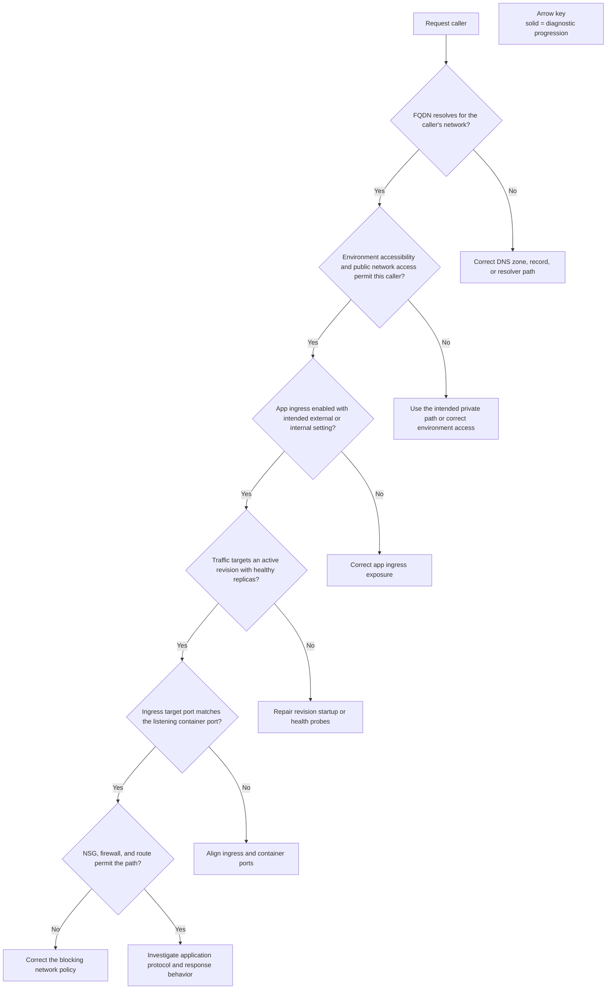

---
content_sources:
  diagrams:
    - id: troubleshooting-decision-flow
      type: flowchart
      source: mslearn-adapted
      based_on:
        - https://learn.microsoft.com/en-us/azure/container-apps/ingress-overview
        - https://learn.microsoft.com/en-us/azure/container-apps/troubleshooting
        - https://learn.microsoft.com/en-us/azure/container-apps/health-probes
content_validation:
  status: verified
  last_reviewed: 2026-09-11
  reviewer: ai-agent
  core_claims:
    - claim: Ingress must be enabled on a container app before it can accept HTTP or TCP traffic.
      source: https://learn.microsoft.com/en-us/azure/container-apps/ingress-overview
      verified: true
    - claim: Azure Container Apps supports both external and internal ingress modes.
      source: https://learn.microsoft.com/en-us/azure/container-apps/ingress-overview
      verified: true
---
# Ingress Not Reachable

## 1. Summary

### Symptom

HTTP requests to your Container App's FQDN fail with timeout, 502 Bad Gateway, or 504 Gateway Timeout errors. DNS may resolve correctly, but the application is not serving traffic. Errors can be intermittent or sustained.

### Why this scenario is confusing

Ingress failures have many possible causes spanning DNS, networking, revision health, and probe configuration. A working revision doesn't guarantee reachability—ingress mode, target port, and backend health all contribute to the final outcome.

### Troubleshooting decision flow

<!-- diagram-id: troubleshooting-decision-flow -->


*Figure: External app ingress does not by itself prove public reachability; environment accessibility and network policy remain separate gates.*

## 2. Common Misreadings

- "DNS is broken" — Many reachability issues are actually unhealthy replicas or wrong target port, not DNS.
- "Ingress external means always public" — NSGs, firewalls, and private environment routing still apply.
- "The revision is running, so ingress should work" — Revision running ≠ healthy replicas passing probes.
- "502 means platform issue" — Often indicates backend unhealthy or probe failures, not platform bugs.
- "It works from my machine" — Different network paths (VNet, internet, private endpoint) have different reachability.

## 3. Competing Hypotheses

| Hypothesis | Typical Evidence For | Typical Evidence Against |
|---|---|---|
| **H1: DNS/Environment misconfiguration** | NXDOMAIN, wrong IP resolved, environment domain mismatch | DNS resolves to correct environment IP |
| **H2: Ingress mode mismatch** | `external=false` but tested from internet, or vice versa | Internal caller succeeds from same VNet |
| **H3: No healthy backend replicas** | `HealthState=Unhealthy`, 0 running replicas, probe failures | Multiple healthy replicas serving requests |
| **H4: Target port mismatch** | 502 with app logs showing no incoming requests, app listening on different port | App and target port aligned, health probes pass |
| **H5: Firewall/NSG blocking** | Timeout from specific networks, works from others | Same behavior from all network locations |

## 4. What to Check First

### Metrics

- Request count with 5xx spikes and low success ratio
- Replica count over time (should be > 0)
- Ingress latency percentiles (P50, P95, P99)

### Logs

```kusto
let AppName = "ca-myapp";
ContainerAppSystemLogs_CL
| where ContainerAppName_s == AppName
| where TimeGenerated > ago(1h)
| where Log_s has_any ("ingress", "502", "503", "504", "connection refused", "timeout", "upstream", "gateway")
| project TimeGenerated, RevisionName_s, Reason_s, Log_s
| order by TimeGenerated desc
```

### Platform Signals

```bash
# Check ingress configuration
az containerapp show --name "$APP_NAME" --resource-group "$RG" \
  --query "properties.configuration.ingress" --output json

# Check revision health and traffic weights
az containerapp revision list --name "$APP_NAME" --resource-group "$RG" \
  --query "[].{name:name,active:properties.active,replicas:properties.replicas,health:properties.healthState,traffic:properties.trafficWeight}" \
  --output table

# Check replica status
az containerapp replica list --name "$APP_NAME" --resource-group "$RG" --output table
```

| Command/Parameter | Purpose |
|---|---|
| `az containerapp show` | Returns the app ingress configuration so exposure mode, target port, and FQDN can be checked before testing backends. |
| `--name` (`az containerapp show`) | Inspects `$APP_NAME`, the endpoint that callers cannot reach. |
| `--resource-group` (`az containerapp show`) | Finds the affected app in `$RG` before reading its ingress contract. |
| `--query` (`az containerapp show`) | Projects the configuration ingress fields so the response exposes the configuration ingress evidence without unrelated resource properties. |
| `--output` (`az containerapp show`) | Preserves the complete ingress object as JSON for field-by-field inspection. |
| `az containerapp revision list` | Lists traffic-bearing revisions and their health to determine whether ingress has a viable backend. |
| `--name` (`az containerapp revision list`) | Enumerates revisions owned by `$APP_NAME`. |
| `--resource-group` (`az containerapp revision list`) | Reads revision state from the app deployed in `$RG`. |
| `--query` (`az containerapp revision list`) | Summarizes each revision's activity, replica count, and health to show whether ingress has a viable backend. |
| `--output` (`az containerapp revision list`) | Displays traffic, health, and replica counts in aligned columns for rapid comparison. |
| `az containerapp replica list` | Lists current replicas and health states to determine whether ingress has any ready backend. |
| `--name` (`az containerapp replica list`) | Requests replicas created for `$APP_NAME`. |
| `--resource-group` (`az containerapp replica list`) | Limits replica discovery to the app in `$RG`. |
| `--output` (`az containerapp replica list`) | Presents replica readiness and running state as a table to expose an empty or unhealthy backend pool. |


## 5. Evidence to Collect

### Required Evidence

| Evidence | Command/Query | Purpose |
|---|---|---|
| Ingress config | `az containerapp show ... --query ingress` | Verify mode, port, transport |
| Revision list | `az containerapp revision list` | Check health state and traffic weights |
| Replica list | `az containerapp replica list` | Confirm running replicas exist |
| System logs | KQL on `ContainerAppSystemLogs_CL` | Find ingress/probe errors |
| DNS resolution | `nslookup <fqdn>` or `dig <fqdn>` | Verify DNS resolves correctly |

### Useful Context

- Environment networking mode (VNet-integrated or consumption-only)
- Custom domain configuration (if applicable)
- Recent deployment or configuration changes
- Network path of the caller (internet, VNet, private endpoint)

## 6. Validation and Disproof by Hypothesis

### H1: DNS/Environment misconfiguration

**Signals that support:**

- `nslookup` returns NXDOMAIN or unexpected IP
- Environment default domain doesn't match expected pattern
- Custom domain verification incomplete

**Signals that weaken:**

- DNS resolves to correct environment IP
- Same FQDN works from other clients

**What to verify:**

```bash
# Check DNS resolution
nslookup $(az containerapp show --name "$APP_NAME" --resource-group "$RG" \
  --query "properties.configuration.ingress.fqdn" --output tsv)

# Check environment domain
az containerapp env show --name "$ACA_ENV_NAME" --resource-group "$RG" \
  --query "properties.defaultDomain" --output tsv
```

| Command/Parameter | Purpose |
|---|---|
| `az containerapp show` | Reads the app FQDN so its DNS suffix can be compared with the managed environment's default domain. |
| `--name` (`az containerapp show`) | Reads the ingress hostname assigned to `$APP_NAME`; the environment name is not used by this command. |
| `--resource-group` (`az containerapp show`) | Scopes the hostname lookup to the resource group containing the app whose ingress DNS record is being tested. |
| `--query` (`az containerapp show`) | Reads the app-assigned ingress FQDN that the DNS test must resolve. |
| `--output` (`az containerapp show`) | Places the hostname into the shell variable without JSON quotes for direct resolver use. |
| `az containerapp env show` | Returns the environment default domain used to test DNS resolution independently of the app hostname. |
| `--name` (`az containerapp env show`) | Opens `$ACA_ENV_NAME`, whose default domain should suffix the app FQDN. |
| `--resource-group` (`az containerapp env show`) | Selects the resource group containing the environment whose default domain must match the app FQDN suffix. |
| `--query` (`az containerapp env show`) | Retrieves the environment default domain to verify that the app hostname uses the expected DNS suffix. |
| `--output` (`az containerapp env show`) | Prints the domain suffix as plain text for comparison with the app FQDN. |


### H2: Ingress mode mismatch

**Signals that support:**

- `external: false` but testing from public internet
- Works from VNet but not from internet (or vice versa)
- 404 or timeout only from specific network locations

**Signals that weaken:**

- Ingress mode matches test scenario
- Same error from both internal and external callers

**What to verify:**

```bash
# Check ingress external setting
az containerapp show --name "$APP_NAME" --resource-group "$RG" \
  --query "properties.configuration.ingress.external" --output tsv

# Expected: true for public access, false for VNet-only
```

| Command/Parameter | Purpose |
|---|---|
| `az containerapp show` | Extracts the external-ingress setting to verify whether the endpoint is intentionally limited to the environment network. |
| `--name` (`az containerapp show`) | Reads `$APP_NAME`, the app whose exposure mode is being checked. |
| `--resource-group` (`az containerapp show`) | Reads the ingress exposure flag from `$APP_NAME` in `$RG`. |
| `--query` (`az containerapp show`) | Selects the external-ingress flag that determines whether callers outside the environment can reach the app. |
| `--output` (`az containerapp show`) | Shows the exposure flag as an undecorated Boolean for the ingress-mode check. |


### H3: No healthy backend replicas

**Signals that support:**

- `HealthState: Unhealthy` or `Degraded` in revision list
- Replica count is 0 or replicas show `Terminated` status
- System logs show `ProbeFailed`, `ContainerTerminated`, `CrashLoopBackOff`
- 502/503 errors with backend probe failure messages

**Signals that weaken:**

- Multiple `Healthy` replicas in `Running` state
- Successful responses intermixed with failures

**What to verify:**

```bash
# Check revision health
az containerapp revision list --name "$APP_NAME" --resource-group "$RG" \
  --query "[?properties.active].{name:name,health:properties.healthState,replicas:properties.replicas}" \
  --output table

# Check replica status
az containerapp replica list --name "$APP_NAME" --resource-group "$RG" --output table
```

| Command/Parameter | Purpose |
|---|---|
| `az containerapp revision list` | Lists revisions and their current lifecycle state to evaluate the revision and replica state behind the symptom. |
| `--name` (`az containerapp revision list`) | Requests active revisions for `$APP_NAME`. |
| `--resource-group` (`az containerapp revision list`) | Looks up `$APP_NAME` in `$RG` before filtering to active revisions. |
| `--query` (`az containerapp revision list`) | Filters to active revisions and reports health plus replica counts to identify traffic targets with no healthy capacity. |
| `--output` (`az containerapp revision list`) | Formats active revision health and replica counts as a table for backend comparison. |
| `az containerapp replica list` | Reports replica readiness after probe checks so an empty backend pool can be confirmed. |
| `--name` (`az containerapp replica list`) | Requests backend replicas created for `$APP_NAME`. |
| `--resource-group` (`az containerapp replica list`) | Retrieves the app's replica records from `$RG`. |
| `--output` (`az containerapp replica list`) | Presents `az containerapp replica list` in the format required by the next check replica status comparison or shell assignment, retaining fields selected in this fence. |


KQL for probe failures:

```kusto
let AppName = "ca-myapp";
ContainerAppSystemLogs_CL
| where ContainerAppName_s == AppName
| where TimeGenerated > ago(1h)
| where Reason_s in ("ProbeFailed", "ContainerTerminated", "Unhealthy")
| summarize count() by Reason_s, RevisionName_s
| order by count_ desc
```

### H4: Target port mismatch

**Signals that support:**

- 502 errors but no incoming requests in app console logs
- App configured to listen on port 3000 but `targetPort: 8000`
- Probe failures with "connection refused"

**Signals that weaken:**

- App console logs show incoming requests
- Target port matches `EXPOSE` in Dockerfile and app bind

**What to verify:**

```bash
# Check target port
az containerapp show --name "$APP_NAME" --resource-group "$RG" \
  --query "properties.configuration.ingress.targetPort" --output tsv

# Check app's actual listening port (from container config or Dockerfile)
az containerapp show --name "$APP_NAME" --resource-group "$RG" \
  --query "properties.template.containers[0].env[?name=='PORT' || name=='CONTAINER_APP_PORT']" \
  --output table
```

| Command/Parameter | Purpose |
|---|---|
| `az containerapp show` | Retrieves the configured ingress target port for comparison with the port where the container actually listens. |
| `--name` (`az containerapp show`) | Checks `$APP_NAME`, whose declared listener must match ingress `targetPort`. |
| `--resource-group` (`az containerapp show`) | Reads both port-related queries from the app in `$RG`. |
| `--query` (`az containerapp show`) | Places ingress target port beside declared container ports so a listener mismatch is apparent without scanning the full template. |
| `--output` (`az containerapp show`) | Emits the scalar target port and the matching environment-variable rows in forms suited to direct comparison. |


### H5: Firewall/NSG blocking

**Signals that support:**

- Timeout from specific source networks only
- Works from Azure Cloud Shell but not corporate network
- VNet has NSG rules blocking inbound 443/80

**Signals that weaken:**

- Same behavior from all network locations
- NSG logs show traffic allowed

**What to verify:**

```bash
# For VNet-integrated environments, check NSG rules
az network nsg rule list --resource-group "$RG" --nsg-name "$NSG_NAME" --output table

# Test from different network locations
curl --verbose --connect-timeout 10 "https://${APP_FQDN}/health"
```

| Command/Parameter | Purpose |
|---|---|
| `az network nsg rule list` | Lists inbound NSG rules in priority order to find a deny affecting the app's ingress path. |
| `--resource-group` (`az network nsg rule list`) | Searches `$RG` for the NSG attached to the Container Apps network path. |
| `--nsg-name` (`az network nsg rule list`) | Targets `$NSG_NAME`, the group attached to the subnet carrying inbound traffic. |
| `--output` (`az network nsg rule list`) | Shows rule priority, direction, ports, and action in a table for the inbound-path review. |


## 7. Likely Root Cause Patterns

| Pattern | Frequency | First Signal | Typical Resolution |
|---|---|---|---|
| Probe failure cascade | Very common | System logs: `ProbeFailed` | Fix probe config or app startup |
| Target port mismatch | Common | 502 + no app traffic | Align targetPort with app |
| Ingress disabled | Common | 404 or connection refused | Enable ingress |
| Revision not activated | Occasional | 0 traffic weight | Set traffic weight > 0 |
| VNet routing issues | Occasional | Timeout from VNet only | Check UDR and private DNS |

## 8. Immediate Mitigations

1. **If no healthy replicas:** Roll back to previous healthy revision
   ```bash
   az containerapp ingress traffic set --name "$APP_NAME" --resource-group "$RG" \
     --revision-weight "<previous-healthy-revision>=100"
   ```

   | Command/Parameter | Purpose |
   |---|---|
   | `az containerapp ingress traffic set` | In **8. Immediate Mitigations**, sets the displayed configuration required by the remediation. |
   | `--name` | Selects `$APP_NAME` for the traffic rollback. |
   | `--resource-group` | Directs the rollback to the resource group containing the unreachable app whose last healthy revision will receive traffic. |
   | `--revision-weight` | Sends 100 percent of traffic to `<previous-healthy-revision>`. |

2. **If target port mismatch:** Update ingress target port
   ```bash
   az containerapp ingress update --name "$APP_NAME" --resource-group "$RG" \
     --target-port 8000
   ```

   | Command/Parameter | Purpose |
   |---|---|
   | `az containerapp ingress update` | Aligns the existing ingress configuration with the port exposed by the app process. |
   | `--name` | Changes ingress on `$APP_NAME`. |
   | `--resource-group` | Resolves the target app from `$RG`. |
   | `--target-port` | Routes ingress traffic to container port `8000`. |

3. **If probe too aggressive:** Relax probe settings temporarily
   ```bash
   az containerapp update --name "$APP_NAME" --resource-group "$RG" \
     --set-env-vars "PROBE_INITIAL_DELAY=30"
   ```

   | Command/Parameter | Purpose |
   |---|---|
   | `az containerapp update` | Creates a revision with the temporary probe-delay setting used by this example. |
   | `--name` | Applies the temporary setting to `$APP_NAME`. |
   | `--resource-group` | Directs the temporary probe-delay update to the resource group containing the app with failing readiness checks. |
   | `--set-env-vars` | Sets `PROBE_INITIAL_DELAY=30` for the application's probe configuration logic. |

4. **If ingress disabled:** Enable ingress
   ```bash
   az containerapp ingress enable --name "$APP_NAME" --resource-group "$RG" \
     --type external --target-port 8000 --transport http
   ```

   | Command/Parameter | Purpose |
   |---|---|
   | `az containerapp ingress enable` | In **8. Immediate Mitigations**, enables the displayed feature required by the remediation. |
   | `--name` | Enables ingress for `$APP_NAME`. |
   | `--resource-group` | Selects the app from `$RG`. |
   | `--type` | Exposes the endpoint externally. |
   | `--target-port` | Forwards requests to port `8000`. |
   | `--transport` | Uses HTTP transport detection for the ingress route. |

## 9. Prevention

- Include endpoint smoke tests in release pipeline
- Alert on sustained 5xx increase and zero healthy replicas
- Validate ingress config in IaC templates before deployment
- Use health check endpoints that verify actual app readiness
- Document expected ingress mode and FQDN in runbooks

## See Also

- [Container Start Failure](../startup-and-provisioning/container-start-failure.md)
- [Probe Failure and Slow Start](../startup-and-provisioning/probe-failure-and-slow-start.md)
- [Service-to-Service Connectivity Failure](service-to-service-connectivity-failure.md)
- [AppGW to Internal Azure Container Apps NSG Destination](appgw-to-internal-aca-nsg-destination.md) — use this playbook when Application Gateway fronts an internal environment and the container app subnet NSG has Destination = `staticIp` or is missing `31443` / `31080` / `AzureLoadBalancer`
- [Application Gateway Integration with an Internal Container Apps Environment](../../../platform/networking/application-gateway-integration.md)
- [Ingress Error Analysis KQL](../../kql/ingress-and-networking/ingress-error-analysis.md)
- [Target Port Mismatch Detection KQL](../../kql/system-and-revisions/target-port-mismatch-detection.md) — directly resolves H4 ("Target port mismatch") in the decision flow above with the verbatim `Reason_s: TargetPortMismatch` system log
- [HTTP Query Pack](../../kql/http/index.md)
- [Ingress Target Port Mismatch Lab](../../lab-guides/ingress-target-port-mismatch.md)

## Sources

- [Ingress in Azure Container Apps](https://learn.microsoft.com/en-us/azure/container-apps/ingress-overview)
- [Troubleshoot Azure Container Apps](https://learn.microsoft.com/en-us/azure/container-apps/troubleshooting)
- [Health probes in Azure Container Apps](https://learn.microsoft.com/en-us/azure/container-apps/health-probes)
