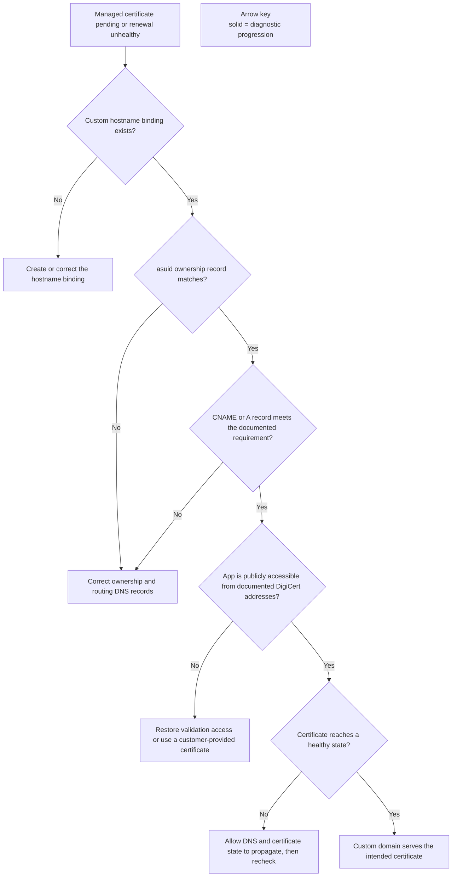

---
content_sources:
  references:
    - type: mslearn-adapted
      url: https://learn.microsoft.com/en-us/azure/container-apps/custom-domains-managed-certificates
  diagrams:
    - id: custom-domain-tls-renewal-flow
      type: flowchart
      source: self-generated
      justification: Diagnostic decision flow synthesized from the documented managed-certificate DNS, accessibility, issuance, and renewal requirements.
      based_on:
        - https://learn.microsoft.com/en-us/azure/container-apps/custom-domains-managed-certificates
content_validation:
  status: verified
  last_reviewed: '2026-07-18'
  reviewer: ai-agent
  core_claims:
    - claim: Azure Container Apps managed certificates are automatically renewed without action from you as long as the app continues to meet the documented requirements.
      source: https://learn.microsoft.com/en-us/azure/container-apps/custom-domains-managed-certificates
      verified: true
    - claim: Managed certificates require the container app to be publicly accessible from the DigiCert IP addresses.
      source: https://learn.microsoft.com/en-us/azure/container-apps/custom-domains-managed-certificates
      verified: true
---
# Custom Domain TLS Renewal

<!-- diagram-id: custom-domain-tls-renewal-flow -->


*Figure: Automatic renewal depends on the hostname continuing to meet the documented DNS and accessibility requirements.*

## Symptom

- A custom hostname stays in `Pending`, HTTPS serves the wrong certificate, or certificate issuance/renewal does not complete.
- The hostname itself may resolve, but managed certificate validation never moves to a healthy bound state.
- Incidents often begin after DNS record cleanup, registrar migration, or a stale verification record.

Typical evidence:

- [Observed] Hostname binding exists, but certificate status does not progress as expected.
- [Observed] The `asuid` TXT record or CNAME/A record is missing, stale, or mismatched.
- [Correlated] Failure begins after DNS changes rather than app image or revision changes.

## Possible Causes

| Cause | Why it breaks |
|---|---|
| Missing or stale `asuid` TXT record | Domain ownership validation fails. |
| Missing or incorrect CNAME/A record | The hostname no longer meets managed certificate requirements. |
| App is not publicly accessible from the DigiCert IP addresses | Managed certificate issuance and renewal requirements are not met. |
| CAA or registrar-side policy blocks issuance | Validation reaches DNS, but certificate issuance still cannot proceed. |

## Diagnosis Steps

1. List current hostname bindings.
2. Retrieve the app verification ID used for the `asuid` record.
3. Confirm whether the app still meets the managed-certificate accessibility requirements before pursuing renewal remediation.

```bash
az containerapp hostname list \
  --name "$APP_NAME" \
  --resource-group "$RG" \
  --output table

az containerapp show \
  --name "$APP_NAME" \
  --resource-group "$RG" \
  --query "properties.customDomainVerificationId" \
  --output tsv

az containerapp env show \
  --name "$ACA_ENV_NAME" \
  --resource-group "$RG" \
  --query "properties.vnetConfiguration.internal" \
  --output tsv
```

| Command/Parameter | Purpose |
|---|---|
| `az containerapp hostname list` | Lists bound hostnames and certificate states to identify the domain whose renewal is stale or failing. |
| `--name` (`az containerapp hostname list`) | Lists bindings on `$APP_NAME`, where the managed certificate failed to renew. |
| `--resource-group` (`az containerapp hostname list`) | Retrieves the app's hostname records from `$RG`. |
| `--output` (`az containerapp hostname list`) | Presents hostname and certificate-binding state in a table for renewal review. |
| `az containerapp show` | Retrieves the domain-verification value that DNS must publish before certificate renewal can succeed. |
| `--name` (`az containerapp show`) | Selects `$APP_NAME`, whose bound hostname and certificate state are under review. |
| `--resource-group` (`az containerapp show`) | Finds the custom-domain app in `$RG` before reading its ingress bindings. |
| `--query` (`az containerapp show`) | Selects the domain-verification identifier required to validate the current custom-domain ownership record. |
| `--output` (`az containerapp show`) | Outputs the verification token as raw text so it can be compared with the DNS TXT value. |
| `az containerapp env show` | Reports whether the environment is internal, which determines the DNS path used for domain validation. |
| `--name` (`az containerapp env show`) | Reads `$ACA_ENV_NAME` to determine whether the hostname is on an internal environment. |
| `--resource-group` (`az containerapp env show`) | Selects the resource group containing the environment whose internal mode determines the certificate validation path. |
| `--query` (`az containerapp env show`) | Selects the internal-environment flag because certificate reachability differs for internal and external environments. |
| `--output` (`az containerapp env show`) | Prints the Boolean environment mode plainly for use in the renewal-path decision. |


Interpretation:

- [Observed] If the app is not publicly accessible from the DigiCert IP addresses, the documented managed-certificate requirements are not met.
- [Observed] If the verification ID does not match the DNS TXT value, validation failure is expected.
- [Strongly Suggested] If DNS was recently changed and the issue is limited to one hostname, treat stale DNS as the primary suspect.

## Resolution

1. Restore the required DNS records for the hostname.
2. Re-run hostname add or bind after DNS is correct and propagated.
3. If the hostname cannot meet the managed-certificate requirements, use a customer-managed certificate instead of managed issuance.

```bash
az containerapp hostname add \
  --name "$APP_NAME" \
  --resource-group "$RG" \
  --hostname "app.example.com"

az containerapp hostname bind \
  --name "$APP_NAME" \
  --resource-group "$RG" \
  --hostname "app.example.com" \
  --environment "$ACA_ENV_NAME" \
  --validation-method CNAME
```

| Command/Parameter | Purpose |
|---|---|
| `az containerapp hostname add` | Adds the corrected custom hostname to the app after DNS ownership records are restored. |
| `--name` (`az containerapp hostname add`) | Changes `$APP_NAME`, the app receiving the renewed binding. |
| `--resource-group` (`az containerapp hostname add`) | Applies the hostname update to the app in `$RG`. |
| `--hostname` (`az containerapp hostname add`) | Registers `app.example.com` as the custom host to validate. |
| `az containerapp hostname bind` | Validates DNS ownership and binds a managed certificate to the corrected hostname. |
| `--name` (`az containerapp hostname bind`) | Binds the certificate to `$APP_NAME`. |
| `--resource-group` (`az containerapp hostname bind`) | Directs certificate binding to the resource group containing the app whose repaired hostname is being renewed. |
| `--hostname` (`az containerapp hostname bind`) | Chooses `app.example.com`, matching the hostname added immediately above. |
| `--environment` (`az containerapp hostname bind`) | Uses `$ACA_ENV_NAME`, the environment that issues and stores the managed binding. |
| `--validation-method` (`az containerapp hostname bind`) | Validates ownership through the hostname's `CNAME` record. |


## Prevention

- Keep the `asuid` TXT record and canonical DNS target under change control.
- Monitor hostname bindings after registrar or DNS-zone changes.
- Use managed certificates only for supported external scenarios.
- Document when a hostname must use customer-managed TLS instead of managed renewal.

## See Also

- [Custom Domain TLS Renewal Lab](../../lab-guides/custom-domain-tls-renewal.md)
- [Custom Domains and Certificates](../../../language-guides/python/recipes/custom-domains.md)
- [Managed Certificates](../../../operations/custom-domains/managed-certificates.md)
- [Bring Your Own Certificates](../../../operations/custom-domains/byo-certificates.md)

## Sources

- [Custom domains and managed certificates in Azure Container Apps](https://learn.microsoft.com/en-us/azure/container-apps/custom-domains-managed-certificates)
- [Bring your own certificates to Azure Container Apps](https://learn.microsoft.com/en-us/azure/container-apps/custom-domains-certificates)
